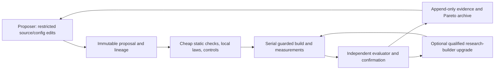

# Recursive compiler improvement: measuring the feedback

Status: research design, 2026-10-17. The [baseline report](../../implementation/phase104/README.md)
separates implemented measurements from the experiments proposed here. No new
compiler transformation or backend is required by this first investigation.

## Question and success criteria

Can improvements to a compiler increase the subsequent rate of discovering
independently validated improvements? A faster executable, a self-hosting fixed
point, and a rising sequence of selected benchmark scores do not answer this.

Measure three outcomes separately:

1. Research capacity: validated experiments per wall hour, CPU hour and agent
   token/monetary budget, counting failures and qualification.
2. Research yield: held-out log-performance improvement per budget, with fixed
   correctness, memory, code-size and complexity constraints.
3. Recursive feedback: the causal difference between otherwise comparable
   research campaigns that do and do not adopt improvements into their tools.

The outcome can be negative: discovering that native builds or agent work swamp
compiler-speed feedback is valuable information about where to invest next.
Do not equate accepted commits with quality; splitting one change into ten
commits must not increase the score. Report the five established compiler metrics
separately, alongside research cost, rather than concealing tradeoffs in one sum.

## The actual Bend system

The core language representation is `KTerm`/`KDef`, with dependent checking,
quantities, erasure, specialization and exact-name indexing. See
[`term.bend`](../../selfhost/src/core/term.bend),
[`index.bend`](../../selfhost/src/core/index.bend), and
[`kernel.bend`](../../selfhost/src/check/kernel.bend).

The JS backend has expression and worker representations (`JIR`, `JW`). Native
lowering has [`N_Program` and `N_Segment`](../../selfhost/src/back/native/ir.bend),
whose bodies already contain rendered C strings. It is not an LLVM-style,
fully structured optimization IR. Native lowering preserves worker, observer,
ownership and constructor facts, then emits scheduler/direct C code. External
Clang does machine optimization, instruction selection and register allocation.

The selected native profile adds general direct-worker composition, borrowed
and owning observers, scalar-result projection, constructor loops, unique-cell
reuse and bounded forced inlining. See the
[mechanism guide](../../docs/self_hosted/phase102-native-lowering.md).
Its effective source is the exact `phase102-lowering04` profile, not simply
whatever is currently assembled from the modular source tree. An experiment
must pin its effective source and recipe. Editing a module without rebuilding
the selected profile is not a compiler intervention.

Current native lineage:

```text
upstream TypeScript/Bun --emits C--> Clang --> native Bend B1
native Bend B1          --same source, emits C--> Clang --> native Bend B2
native Bend B2          --same source, emits identical C--> B3 build input
```

The core already has a complete-C/diagnostic fixed point. B3–B5 executables have
not been built in this investigation. The Phase103 public CLI is native and
Bend-written, but rebuilding its three OS effects requires a private build
bridge; its final provider policy does not admit those effects as user imports.
Use the preserved candidate04 core for a clean fixed-source experiment.

Correctness evidence is substantial but bounded: 45 semantic programs, 69
eligible native fixtures plus three expected rejections per stage, 31 exclusions,
and 70 backend obligations. Local laws and independent BendTT checks support
specific helpers, not the entire compiler, C runtime, parallelism or GPU.
Bootstrap consistency cannot substitute for those checks.

LLVM IR and direct assembly remain research alternatives, not selected production
backends. PGO can be tested on emitted C with the current Clang toolchain.
Changing backend now would confound the initial feedback experiment.

## Three transition systems

**Level 1: fixed-source compilation.** Let `S` be source, `A` runtime/assets,
`F` flags/toolchain and `E_n` the compiler executable:

\[
E_{n+1}=\operatorname{Build}_{F}(\operatorname{Run}(E_n,S,A)).
\]

Correct implementations of the same deterministic compiler semantics should
emit the same output. Upstream-built B1 and self-built B2 can run at different
speeds because their own generated code differs. Once self-C and deterministic
native build inputs agree, continued speed improvement is not expected.
Determinism alone does not prove convergence: arbitrary deterministic maps can
cycle. Paths, build metadata, undefined behavior, environment, profiles or
time-bounded search can also change outputs. Distinguish emitted-C identity,
normalized executable-code identity and whole-executable identity.

**Level 2: fixed-source optimization with changing state.** The state `z_n`
contains profiles, decisions, search archive, seeds and budgets:

\[
z_{n+1}=T(z_n,\operatorname{Profile}(E_n),b_n),\qquad E_n=E(S,z_n).
\]

More speed can buy more search under a fixed wall budget, but something in `z`
must change. With identical profiles and a fixed number of deterministic search
steps, a faster executable changes search time, not the result. Keep a work-budget
arm and a wall-budget arm. PGO of the compiler executable may leave every emitted
user program unchanged; a better Bend code-generation policy can improve both.

**Level 3: self-research.** State includes source, executable, optimizer policy,
evidence, agent context and proposal policy. The LLM is not executed by Bend;
compiler improvements cannot directly accelerate its inference. Search policy
changes and stronger models must be logged as different interventions.

## Mathematical model and limits

Let `v` be throughput on a fixed compiler workload, `x=log(v/v0)`, `p(x)` success
probability per attempted experiment and `delta` a successful log-speed gain.
Let the mean complete experiment cost, including failures and amortized release
work, be:

\[
\tau(x)=H(x)+W(x)/v.
\]

`H` includes costs not accelerated by this particular compiler-speed change:
agent service, Clang, other tests, scheduling and IO. It is not necessarily
constant. For serial experiments the local drift approximation is:

\[
\frac{d\mathbb E[x]}{dt}\approx\frac{p(x)\mathbb E[\delta\mid x]}{\tau(x)},
\qquad
\frac{dv}{dt}\approx
\frac{p(x)\mathbb E[e^\delta-1\mid x]v^2}{W(x)+H(x)v}.
\]

These are mean-field/local approximations, not identities obtained by replacing
the expectation of a nonlinear random process with its mean.

With zero overhead and constant gain the proposed `v²` feedback follows. The
solution `v(t)=v0/(1-k v0 t)` has a finite-time singularity; this indicates that
the idealization eventually fails, not a prediction of infinite physical speed.
With constant positive `H` and bounded fractional gains, growth is at most
asymptotically exponential in this model, even if opportunities never diminish.

A finite ceiling can be represented by expected gain
`g(v)=g0 max(0,1-v/vmax)`. Throughput then approaches `vmax`. Declining `p`, growing
search difficulty `W`, finite remaining transformations and increasing validation
cost can produce stagnation much earlier. Faster generation can also expose a
different bottleneck, changing the model coefficients.

For a preregistered quality measure `Q`, write:

\[
R=\frac{d\mathbb E[Q]}{dt}\approx\frac{p\mu}{\tau},
\quad\mu=\mathbb E[\Delta Q\mid\text{success}].
\]

For positive smooth terms, research yield accelerates when
`d log(p)/dt + d log(mu)/dt > d log(tau)/dt`. Faster experiments alone do not
establish this: declining opportunity size may dominate. Absolute throughput,
log-throughput and discoveries/hour have different notions of acceleration.

With constant `H,W`, the elasticity of experiment rate to compiler throughput is
`f=(W/v)/(H+W/v)`. A compiler speedup `s` gives the familiar bound:

\[
\text{cycle speedup}=1/((1-f)+f/s).
\]

Our single historical self-emission/build observations give `151s + 374s`, hence
`f≈0.287`: doubling Bend alone predicts only `1.168×` for this boundary; infinite
Bend speed predicts `1.403×`. These are conditional arithmetic, not measured
research throughput. Tests and agent work further dilute this component.
Smaller emitted C can improve both terms and escapes that particular bound.

For policy stability, scalar `z_{n+1}=T(z_n)` is locally attracting when
`|T'(z*)|<1`; a vector policy uses Jacobian spectral radius below one. No such
condition has been established for our compiler. Profiles and greedy selection
can cause cycles. Preserve a validated incumbent and policy archive, use paired
confirmation, and distinguish real policy cycles from measurement noise.

An upgrade costing `U` seconds only pays back after roughly
`N > U/(tau_old-tau_new)` subsequent equivalent experiments. A 525-second upgrade
saving 0.3 seconds per experiment needs more than 1,750 experiments. Conversely,
saving ten seconds needs about 53. These examples exclude future policy changes;
they explain why rebuilding B2 after every small idea is often counterproductive.

## Experiments ordered by information value and cost

Estimates below are planning ranges on the current machine, not promises of
speed gains. Historical fixtures are development data, never new holdouts.

| Order | Falsifiable experiment | Information and rejection condition | Estimated effort |
|---|---|---|---|
| E0 | Authenticate existing lineage; fresh balanced B1/B2 tiny screen; separate clocks | Finds mixed-source/stage claims; establishes initial measurements without assuming later generations | Tens of seconds execution, under an hour tooling |
| E1 | Instrument 10–20 real fast-loop attempts, including failed candidates | Estimate compiler-dependent fraction and bottleneck; reject strong compiler-only feedback if fraction is small | 1–2h setup; use next normal work cycle |
| E2 | Optional single extra B3 build with pinned toolchain and unchanged source | Tests executable reproducibility; stop after fixed point, do not fabricate B4/B5 observations | About 9–12min execution, plus safe scratch space |
| E3 | Same predeclared candidate sequence, same builder, with/without externally injected calibrated old-latency delay | Isolates latency → experiments/hour; reject cost model if observed effect disagrees beyond uncertainty | 1–2h setup, 20–60min pilot |
| E4 | Fixed-source Clang PGO and small bounded inline-policy search | Is there a useful compute/time → compiler-quality response curve that transfers outside training? | 2–4h setup; builds minutes each, capped pilot |
| E5 | Randomized fixed-builder versus updating-builder autonomous campaigns | Do upgrades buy more independently confirmed gain after charging their cost? | 2–4h minimal scheduler; multiple 1–2h campaigns, pilot then power-based replication |
| E6 | Law-constrained general rewrite search and learned effort allocation | Can learned policies improve success/gain rather than just trial throughput? | Days or longer after E4/E5 justify it |

E2 is a consistency experiment, not a prerequisite for E3. A physical B3 build
requires enough temporary disk and the existing 6 GiB RSS/available-memory guards.
At this investigation's start less than 1 GiB disk was free; do not queue several
large Clang builds just to redraw an already established emitted-C fixed point.

E4 starts with a small set of already supported, semantics-preserving choices:
forced-inline thresholds/dependency depth, Clang optimization/profile choices,
and existing worker profitability choices. Freeze source for the PGO arm;
source-rewritten knobs are explicitly Level 3 until exposed as configuration.
Use bounded enumeration or a bandit before introducing an e-graph or RL model.
Compare fixed evaluation count and fixed total wall time, including training.

E5 uses a factorial design: objective A minimizes compiler request/full build
cost; objective B minimizes generated-program runtime including the compiler.
Within each objective compare frozen and updating research builders. All arms
can retain better candidate source; only the updating arm adopts it as its
research executable. Evaluate final source through a common qualified build
pipeline; report its search-built executable separately. Charge new-generation
builds and qualification to the updating arm. Keep agent/model and token budgets
fixed. Start with two independent seeds per cell as a pilot, not proof; use
observed between-campaign variance to plan replication. Timing repetitions are
not independent research campaigns.

## Evaluation architecture



The proposer may edit candidate source and a declared configuration area. A
separate evaluator account/container owns frozen harness, compiler references,
acceptance rules and hidden corpus. Candidate execution has no write access to
those files or network access to agent/evaluation services. Read-only mounts and
process isolation enforce this; hashes in the same writable workspace alone do
not. Freeze evaluator code before each campaign and test its rejection behavior.
This protected service is proposed, not implemented by the initial auditor.

Use three data partitions: visible development; limited-query validation for
selection; hidden final evaluation. Split by program family, not scaled copies
of the same program. Our repeatedly used 45 cases and three applications belong
in development/regression. New generators, independent oracles, modules, sharing,
effects, strings, closures and parallel cases should supply new families. Keep
excluded semantics explicit rather than silently dropping failing cases.

Predeclare a small practical effect threshold using a noise pilot. Alternate or
randomize paired order, pin physical cores, control background jobs, distinguish
fresh processes from warmed code and live Base from prepared Base. Use fresh
confirmation samples after selecting a winner; report paired log ratios and
uncertainty. Account for multiple candidates and limited validation reuse.
Do not stop sampling only when significance appears.

For a compiler throughput-only change, complete C/verdict equality is a strong
regression check. For code-generation changes, C equality is not expected:
compare independently specified complete program behavior, laws and targeted
ownership/effect controls, followed by representative runtime and native-chain
gates. A passing fixed point does not show that an identically reproduced bug is
correct. Never let the candidate supply its own expected answers.

Each event records proposal ID, parent source/config/artifact hashes, producer,
runtime/toolchain, work/seed budget, monotonic start/end, CPU time, RSS, bytes,
stage, cache policy, raw samples, outputs, acceptance and failure reason. Add
agent model/effort, actual token/cost telemetry when available and null otherwise;
do not infer billed quota from wall time. Charge all worker compute, count
overlapping intervals by union for wall occupancy, and retain unknown time as
unknown. Preserve rejects as well as accepted candidates.

Plot performance against (1) bootstrap generation with exact lineage, (2)
research wall time, (3) cumulative CPU/agent compute, and (4) attempted candidate
count. Use staircase best-so-far and unselected candidate plots together. A
single rising best-so-far curve is expected under selection and is not evidence
of accelerating discovery. Compare whole-campaign curves, area under fixed
utility curves and time-to-preregistered targets between arms.

## Bend-specific high-value feedback paths

1. **Generated C size and build cost.** Faster developer builds, bounded inlining,
   reusable runtime components and incremental compilation may improve research
   throughput more than another small compiler-request speedup. Require runtime
   guardrails and report break-even points for separate developer/release modes.
2. **Ownership and continuation work.** Candidate03's nearby Map profile spends
   29.3% in `term_drop` and 20.0% in `span_fade`; it is not a fresh candidate04
   profile nor a removable-time forecast. Test retained observations, fewer
   captures and construction fusion with ownership contracts and fallback paths.
3. **Learn profitability, preserve legality.** Mine structured experiment history
   for useful inlining/worker decisions. Keep legality/correctness checks fixed;
   allow learned models to choose among already legal transformations.
4. **Anytime search with amortization.** Spend extra optimization work where future
   saved execution exceeds search/build cost. Archive proofs and successful
   rewrites across experiments so equivalent queries are not solved repeatedly.
5. **Local synthesis plus independent checking.** Bend laws can narrow candidate
   transformations and reject invalid rewrites cheaply. Closing the connection
   to actual ownership/lowering is essential; abstract proofs alone do not certify
   native memory behavior.

## Novelty and decision

Bootstrapping, self-PGO, iterative compilation, superoptimization and autonomous
code search are established. See the
[primary-source survey](../../research/compilers_architecture_and_techniques/recursive-self-improvement.md).
The promising contribution is a reproducible causal study of how adopting
compiler improvements changes subsequent validated research yield, including
the costs and cases where feedback fails. We have no evidence yet of sustained
recursive research acceleration, and make no first-of-its-kind claim.

Proceed first with attribution and controlled latency replay. Keep architecture
changes tied to measured constraints. A small, convincing demonstration of
positive feedback is a better foundation than assuming the feedback exists.
