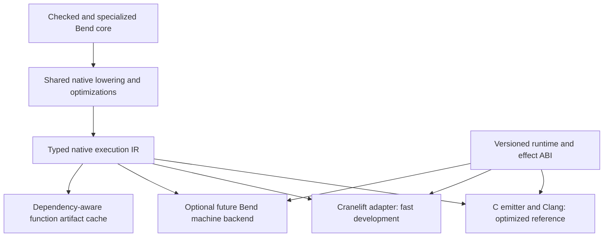

# A fast native backend and an incremental research loop

Status: comprehensive proposal, 2026-10-17. No backend replacement or new
performance experiment has been implemented for this note. The current native
release remains Phase102 candidate04, exposed by the Phase103 Bend CLI.

This extends the [recursive-improvement plan](../phase104/recursive-improvement.md).
The objective is to reduce complete, validated edit–build–test cost while
preserving generated-program performance, conformance and maintainability.
The accompanying [comparison protocol](../../docs/self_hosted/NATIVE_COMPILER_COMPARISON.md)
defines native B1/B2 versus upstream measurements.

## Recommendation

Create a structured native execution IR owned by Bend, preserve the C/Clang
backend as the optimized reference path, and prototype a Cranelift consumer for
fast development builds. Design function boundaries and dependency identities
so unchanged code can eventually be reused. Consider an all-Bend machine backend
only after the IR and ABI experiments establish their value.

Removing Clang from ordinary development builds does not require immediately
removing it from runtime construction, optimized releases or the project. A
prebuilt C runtime is compatible with a native Bend compiler. Replacing every
external tool is a different objective from making research iterations faster.

The useful experiment is not merely "does another backend emit an object faster?"
It is "does this compiler profile reduce build plus realistic validation time,
and can it preserve the quality of our optimized release path?"

## Existing evidence and limits

The [current baseline](../../implementation/phase104/README.md) authenticates the
candidate04 source, native B1/B2 and complete emitted-C fixed point. Historical
single observations give 150.846s for B2 self emission and 374.033s for Clang
construction of its identical self-C. The compiler source is about 1.79MB; its
self-generated C is 30.37MB. These clocks exclude agent work and general tests.

| Conditional scenario | Bend emission | Machine build | Total | Speedup |
|---|---:|---:|---:|---:|
| Recorded-cost envelope |150.846s|374.033s|524.879s|1.00×|
| Hypothetical 40s backend |150.846s|40s|190.846s|2.75×|
| Hypothetical zero backend cost |150.846s|0s|150.846s|3.48×|

These are arithmetic scenarios, not Cranelift estimates or new timings. They
hold Bend emission speed constant. Another backend may change the speed of the
compiler it produces, the cost of emission, memory and validation work.

Prior failures constrain the plan:

- [Phase90](../../implementation/phase90/native-build.md): an old O0 image built
  in 99.895s but timed out on self emission at 240s. Earlier O0 compilation also
  failed on preserve-none/indirect-musttail register allocation. An optimization
  guard fixed the calling-convention boundary. Initial O1 builds exceeded even
  a 10GiB guard; a dispatch-table accessor then reduced LLVM callgraph growth.
  These are historical, differently configured observations, not a controlled
  current O0/O2 ratio. Blindly lowering the optimization flag is not a solution.
- [Phase102 build screen](../../implementation/phase102/build-notes.md): compact
  identifiers reduced application C text about 19%, but the renderer Clang screen
  improved only about 3%. A prefix precompiled header was approximately neutral
  warm and slower clean. Fewer text bytes do not imply equally less machine-build
  work, and a PCH is not a precompiled runtime object.
- The runtime template is only 83,683 bytes versus 555–748KB for those application
  C products. Much of the work is generated program code. Precompiling a small
  common prefix cannot remove most optimization/code-generation cost.
- Phase102 unrestricted composed forced inlining exceeded the 420s build limit.
  Bounded dependency depth allowed construction. Our emitter affects Clang cost;
  it is not purely an external tool problem.

## What Zig demonstrated

Zig's June 2025 development report gives a compiler-build example falling from
75s to 20s with its own x86 backend. This is evidence for the value of a dedicated
fast backend on that workload, not a portable speed factor for Bend.
[Zig 2025 devlog](https://ziglang.org/devlog/2025/)

Zig 0.16 keeps its x86 backend as the Debug default, explicitly describing faster
compilation and lower machine-code quality than LLVM. Its new ELF linker example
records a 14s initial compiler build followed by 65ms and 64ms function edits.
The release also says incremental compilation remains opt-in because bugs and
miscompilations remain; the new linker lacks some features, including DWARF.
LLVM remains supported. These improvements combine incremental semantic analysis,
code generation and linking; they are not the result of removing LLVM alone.
[Zig 0.16 release notes](https://ziglang.org/download/0.16.0/release-notes.html)

The 2026 devlog explains that incremental frontend work with LLVM still leaves
LLVM's object-emission step. Directly generating LLVM IR therefore does not
automatically provide cheap incremental machine builds.
[Zig 2026 devlog](https://ziglang.org/devlog/2026/)

Our [pinned Zig source study](../../research/compilers_architecture_and_techniques/zig.md)
describes AST/ZIR, semantic analysis and typed AIR, separate liveness, target MIR
and backend dispatch. The transferable boundary is explicit typed operations and
per-function state. Copying Zig's full compiler architecture would add unnecessary
language-specific machinery. Its multiyear investment also cautions against
promising a production-quality machine backend from one short prototype.

## Why our current backend cannot simply change printers

The shared language boundary is checked, specialized, annotated `KTerm`/`KDef`.
JS and native have different execution contracts. Native
[`N_Segment.body`](../../selfhost/src/back/native/ir.bend) is C source text;
`N_Program` also carries rendered declarations and static-image expressions.
[`NF_Worker`](../../selfhost/src/back/native/flat.bend) contains emitted code.
The selected profile's `NC_Text` improves text construction but does not turn it
into an instruction IR. A new backend cannot infer all required semantics merely
by consuming the existing segment metadata.

The CPU runtime uses separate functions with preserve-none and must-tail
transfers; device execution uses switch dispatch. Do not mistake the CPU for
one monolithic switch. The argument-bank width and signature depend on the
program through [`nb_bank`](../../selfhost/src/back/native/tables.bend), alongside
generated function/constructor IDs, static images and observer declarations.
These dependencies make independent runtime reuse and function caching real
architectural work.

The implementation must use the exact selected native profile/recipe. Some
recent native mechanisms are not yet integrated into the modular assembly.
Editing a similarly named module is not evidence that a candidate executable
contains that change. Preserve a pinned effective source and replayable lineage.

## Proposed architecture

The native IR should be a small executable language, with a verifier and these
explicit contracts:

| Component | Required information |
|---|---|
| Values | Typed integer/float/boxed/address values, stable local IDs, exact widths and conversions |
| Functions/blocks | Parameters, branches, joins/block arguments, returns, local definitions and symbolic references |
| Calls | Direct/indirect callee, argument and result ABI, ordinary call versus mandatory tail transfer |
| Memory/ownership | Layout, field accesses, allocation, retain/drop/borrow obligations, aliasing and root lifetime |
| Control effects | Error/trap paths, effect calls, task creation, scheduler transfer, join and continuation-frame operations |
| Program data | Constructor descriptors, static roots/data, exported symbols and relocatable function identities |

Use the minimum representation needed for two real consumers. Block arguments
can represent SSA joins; do not introduce a large general optimizer before a
measured transformation needs it. Keep instruction order where effects and
ownership require it. Pure numeric simplification must retain Bend's overflow,
shift, conversion and floating-point behavior; backend undefined behavior or
fast-math assumptions cannot silently redefine the language.

Keep existing general optimizations shared: direct-worker composition, owning
and borrowed observers, scalar projections, constructor loops, unique-cell reuse
and legal specialization. Profitability may differ by backend. Separate legal
transformation facts from backend-specific inlining/cost decisions, so a cheaper
backend does not discard all the work that made generated programs fast.

Do not force the JS backend into this native memory/scheduler IR. Share genuinely
common checked facts and transformations; retain different runtime contracts.

### Runtime and calling conventions

Define a versioned boundary for heap allocation, ownership primitives, effects,
thread/task context, errors and static roots. Move platform/OS/allocator machinery
into reusable objects where possible. Tiny hot operations may remain IR
intrinsics lowered inline; turning every retain/read/drop into an opaque call
can erase the runtime gains we are trying to preserve.

Cranelift has a tail-call calling convention, but it is not ABI-stable and is
not automatically compatible with our current Clang preserve-none functions.
Use backend-local tail functions with explicit C-ABI adapters at external
boundaries, or an explicitly specified trampoline. Pin backend versions and
verify stack usage under deep transfers. Ordinary calls with hoped-for tail-call
optimization are insufficient.
[Cranelift calling conventions](https://docs.rs/cranelift-codegen/latest/cranelift_codegen/isa/enum.CallConv.html)

Initially target Linux x86-64 CPU execution. Preserve the existing C path for
other targets and GPU operation; unsupported fast-backend capabilities must be
explicit. Runtime atomics, aliasing, refcount publication and worker synchronization
remain obligations even if initial measurements use one worker. Provider loading
must retain the existing permission boundary, including the separate CLI bridge.

### Incremental compilation

Give each compilation unit a deterministic semantic key containing its lowered
IR, dependent signatures/layouts/optimization facts, runtime ABI, compiler/backend
versions, target features and flags. Source text alone is not a sufficient key.
Inlining introduces body dependencies; changing an observer or ownership fact
must invalidate consumers that relied on it.

Use symbolic references and relocations so changing one definition does not
renumber every function and rebuild the whole program. Link generated static
tables separately where the runtime permits. Start with cached functions or
small SCCs and ordinary object linking; an in-process incremental linker or JIT
is a later project. Caches must handle malformed/removed definitions and changed
Base/runtime assets without reusing invalid facts.

Function artifact caching only reduces code generation. Reducing the 151s
frontend/lowering component additionally requires semantic dependency reuse.
Measure those contributions separately. A process-local warm cache, persistent
artifact cache, fresh-process preparation and cold filesystem are different states.

## Alternatives and selection

| Approach | Advantages | Main costs/risks | Decision |
|---|---|---|---|
| Tuned Clang development profile | Smallest intervention; current language/runtime coverage | Earlier O0/O1 failures and slow produced compilers; forced hints may dominate | Useful control, bounded screen first |
| C split into stable units | Reuses toolchain and enables object caching | ABI change, cross-unit optimization tradeoff, global IDs and invalidation | Complementary incremental experiment |
| Cranelift | Fast compilation focus, AOT/object support, instruction selection/register allocation already implemented | Rust dependency, adapter, ABI/tail/runtime translation and code-quality tradeoff | Preferred first machine-backend prototype |
| QBE | Compact C implementation and simple textual SSA IL; C ABI | Mandatory tail transfers need a separate solution; lower optimization scope | Alternative if runtime interface fits |
| Direct LLVM IR | Avoids C parsing; explicit low-level facts and metadata | Still pays LLVM optimization/object emission; new IR/UB obligations | Not the first response to this build bottleneck |
| Bend-written assembly/object backend | Maximum control and eventual self-contained generation | Register allocation, calling conventions, relocations, encoding, debugging, portability | Later, after shared IR and measured payoff |

[Cranelift](https://cranelift.dev/) supports both JIT and AOT use and deliberately
balances compile speed against optimization complexity. Its published external
performance comparisons are not forecasts for Bend. [QBE](https://c9x.me/compile/)
offers a small SSA backend and C ABI support; its
[documented IL](https://c9x.me/compile/doc/il.html) does not supply an explicit
mandatory-tail-call operation matching our current requirement. A trampoline
is possible but must be measured for stack behavior, dispatch cost and ownership.

Cranelift remains an external machine-code component, as Clang is today. Parsing,
checking, native optimizations and the new lowering/emitter stay written in Bend;
using a Rust backend library does not mean rewriting that compiler in Rust.
A narrow transport/helper can initially invoke the backend outside the compiler
process. Retain its cost in process/end-to-end measurements.

## Sequential experiments and stop conditions

1. **Measure the actual build boundary.** Freeze one current self-C and selected
   application C products. Collect bounded Clang phase attribution separately
   from clean timing. Compare a small number of viable development settings with
   the release recipe, using build plus realistic candidate-test cost. Do not
   repeat known failed attribute combinations or enlarge resource limits blindly.
2. **Create a vertical IR slice with two consumers.** Cover ordinary workers,
   loops, boxed values, ownership, errors and a deep tail-transfer control. Emit
   both C and Cranelift from the same operations. Require complete behavioral
   equality and structural/verifier checks before expanding the surface.
3. **Measure representative compiler-shaped work.** Include text-heavy and
   ownership-heavy helpers, closures/continuations, large function counts and
   realistic symbol/data tables. Tiny arithmetic examples alone cannot predict
   compiler-image speed or build memory. Measure adapter and linking cost.
4. **Expand to one complete application, then compiler coverage.** Keep C fallback
   explicit while incomplete; a mixed build is not a Clang-free self-hosting claim.
   Once the necessary language/runtime surface is covered, construct a genuine
   fast-backend compiler image and run the existing narrow compiler screen.
5. **Add function artifact reuse.** Test leaf edits, dependency edits, layout
   changes, deletions, recursion and runtime-version changes. Compare against clean
   builds with independently determined outputs. Measure cache hit rate and
   invalidation fanout, not just the most favorable one-line edit.
6. **Qualify the fast profile.** Complete stage lineage, self-source behavior,
   eligible conformance, application results and representative generated runtime.
   Retain the optimized C profile. Adopt the fast executable as a research builder
   only if its build/run tradeoff repays the upgrade cost for expected use.

Phases 1–3 are bounded investigations; a narrow prototype is a days-scale planning
estimate, while full backend/runtime coverage and native-chain qualification can
take substantially longer. Set explicit per-stage time/compute limits after
measuring the first slice. No total-speed gain or completion date is guaranteed.

Do not allocate several heavy builds concurrently on the present machine. Keep
serial guarded execution, memory floors, disk reserves and bounded trace output.
At Phase104 start less than 1GiB disk was free. Reuse authenticated inputs and
build the large compiler only after smaller evidence earns that cost.

## Measurement and acceptance

For a builder used `N` times, compare:

\[
T_{\mathrm{total}}=T_{\mathrm{acquire/build}}+
  N\,T_{\mathrm{representative\ request}}+T_{\mathrm{validation}}.
\]

Measure startup/preparation and cumulative CPU separately, include failures and
cache construction, and report break-even reuse counts. The fastest-to-build
compiler need not be the best long-lived research builder. Performance experiments
on user programs use the optimized release profile unless explicitly testing the
fast profile; fast-profile correctness checks cannot certify release-only code.

Track the five established metrics plus research productivity: B1 and B2 compiler
latency, generated-program runtime, conformance, maintained source/IR/adapter
complexity, build time, memory, and validated gain per wall/CPU/agent budget.
Show fast and release profiles separately. Generated code may legitimately
differ across backends; compare complete observable behavior and independent
oracles rather than requiring C identity. Retain exact-output checks within
unchanged producers/configurations.

An initial success threshold should be chosen from a noise pilot and the actual
research workload. A useful target is a material reduction in total candidate
build-and-validation cost, not a claim of 10× whole-loop speed because one backend
phase became 10× faster. Stop or redirect if runtime regressions consume the build
savings, ABI adaptation dominates, or a smaller C-unit change achieves the same
benefit with substantially less maintained code.

## Relation to recursive research

The strongest feedback would combine less code-generation work, cheaper native
construction and reusable compiled functions while retaining general optimizer
gains. That improves the infrastructure on which further experiments depend.
It still does not establish accelerating discovery. Use the Phase104 controlled
frozen/updating-builder protocol to measure whether extra capacity produces more
held-out validated improvement after accounting for implementation and upgrades.
