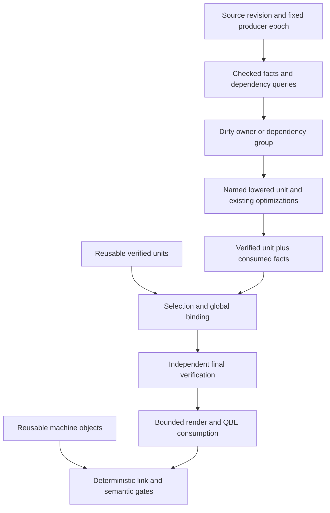

# Phase134 — Bounded IR and incremental native compilation

Status: **implementation plan, not implemented or qualified**. Written at
`dd2c910dcd0de2bbcc328922b2fbd5f27c886496`, 2026-10-24, for
`selfhost/bootstrap`. [Validation contract](validation.md) ·
[Execution and time budget](execution.md).

## Decision and goals

Refactor the existing Bend compiler into reusable verified owner units, with
bounded output rendering and explicit semantic dependencies. Keep QBE, the
current optimization decisions, the qualified Phase131 fallback and independent
correctness gates. Implement compiler semantics and reuse decisions in Bend;
host tools supervise processes, transport bytes and inspect evidence.

The priorities, in order, are:

1. Stop retaining expanded textual IR for the whole compiler. Then reduce the
   amount of structured lowering state alive simultaneously.
2. Recheck, analyze, lower, render and machine-compile only work affected by an
   edit, with correct invalidation. Measure avoided work before claiming reuse.
3. Preserve cold compilation and generated-program performance, and improve
   cold speed where compact identities and eliminated traversals pay off.
4. Make the development loop faster after accounting for acquisition, checking,
   validation, cache maintenance, failed experiments and qualification.

This is a change to compilation boundaries, not a new optimizer or backend. It
must preserve the optimizations that made Phase131 useful. A fast edit mode that
quietly omits them is a different product and does not meet this plan.

## Evidence and limits

Reuse [Phase132 measurements](../../implementation/phase132/README.md) and
[Phase133 Zig/source research](../../research/phase133/README.md). Do not rerun
the entire discovery campaign before implementation.

| Existing observation | Implication |
|---|---|
| Qualified QBE is 107,059,385 bytes; largest function 171,719 bytes | Bounded function rendering is plausible without deleting computation. |
| Largest attributed owner is 2.13 MB; data text totals 4.63 MB | Owner size and data emission need explicit bounds; one function is not the entire live set. |
| One edited full request took 368.98 s and peaked at 2.90 GB RSS | A local edit currently repeats substantial native work. This is one observation, not a new controlled baseline. |
| About 1.90 GB RSS accumulated late, before output became visible | Investigate retained output and intermediates; this is not a measured exclusive rendering time. |
| Machine reuse took 5.98 s versus 19.85 s fresh partitioned | Useful machinery exists, but the unchanged frontend and 22.84 s partition preparation erase the benefit. |
| A one-owner edit changed 476 functions; 377 had only numeric-copy changes | Global binding/static placement can destroy locality. Preserve symbolic references before binding. |
| Qualified N2 emitted all 45 measured wrapper products exactly | Existing program evidence can be reused when exact artifact identity survives. |

Distinguish total serialized text, live encoded buffers, live structured IR,
retained cache and peak RSS. A sub-1-MB output buffer does not mean a 1-MB
compiler. Linked-character storage can use many bytes per output character.
The complete instruction inventory is not expected to fit in 1 MB.

Targets, not promises:

- First: bounded output with exact bytes and no cold-time regression.
- Next: actual unchanged lowering units skipped on a real edit.
- Integrated warm edits: first 10–30 s, then 1–5 s if fixed costs permit it.
- Longer term: 50–500 ms for genuinely local edits, after checking and linking
  floors are addressed. Global optimizer/runtime changes remain broad rebuilds.
- Cold 1.5–3× speedup is an ambitious research possibility, not a prerequisite,
  forecast or justification for adding speculative machinery.

## Architecture and contracts



The first implementation keeps whole-program checks and binding. They are
measured floors, not silently removed work. Later stages make their inputs
reusable or compact only after equivalence and invalidation are established.

### Four interfaces, rather than another universal IR

1. **Sealed emission plan.** A successful existing verification result plus
   ordered selected functions, data descriptors and binding tables. Rendering
   consumes a cursor; it does not construct a `List<String>` containing all text.
2. **Owner unit.** One source definition, or an explicitly discovered recursive/
   optimization dependency group, with its continuations, private alternatives,
   selected workers, exports, source map and consumed facts. It uses the existing
   structured native IR, with names interned where measured worthwhile.
3. **Semantic query result.** An immutable fact, its content identity, exact
   dependencies and environment/schema identity. Clients depend on the fact
   they consumed, not automatically on every property of its owner.
4. **Build artifact record.** Named unit, binding dependencies, rendered unit,
   object and validation receipts. The compiler produces boundaries directly;
   a host script must not rediscover them by rescanning 107 MB after every edit.

Separate **stable identity** (which unit), **action identity** (what determines
its result), and **result identity** (what a consumer observes). In-process
integer handles also carry a pool/revision context; they are not portable cache
keys. Content hashes identify bytes, not a correctness proof.

An illustrative contract, not proposed Bend syntax:

```text
Epoch = producer + checker/kernel + runtime ABI + policy + schema + target
FactKey = owner + kind(type/body/layout/ownership/effects/admission/presence)
FactResult = payload + result_identity + consumed_fact_versions
OwnerUnit = stable_owner + local_ids + named_IR + consumed_facts + obligations
BoundUnit = OwnerUnit + exact_binding_dependencies + machine_policy
Artifact = action_identity + content_identity + complete_validation_receipt
```

The implementation should introduce only fields consumed by the current phase.
Do not prebuild a generic query database, serialization system or new pass manager.

Implement candidate modules through the current authenticated source-composition
workflow, starting from the exact Phase131 manifest named in its
[candidate receipt](../../implementation/phase131/final/candidate.json).
The assembled `compiler.bend` is a frozen input, not a file to edit in place.
Initially keep experimental modules, controls and metadata adapters under
`selfhost/tools/performance/phase134/`; give emission, unit identity and reuse
separate modules. Bind every override and generated source to its input hash.
At consolidation, integrate the accepted modules into the maintained compiler
manifest and remove replaced adapters. Never edit pinned upstream sources or
the human-written `bend2/bend.ts` as part of this refactor.

### Stable names and binding

Source-owner identity initially preserves the assembled manifest's semantic
scope, definition name and duplicate/first-match rules. Do not use declaration
ordinal alone or a regex split as a semantic module boundary. Generated local
identities are owner-relative; editing one owner may renumber that owner's
continuations without renumbering unrelated owners.

Keep FID/CID and literal references symbolic until binding. The existing runtime
uses numeric IDs and static tagged words; this plan does not change that ABI by
assertion. Initially retain deterministic global binding and invalidate all
units whose bound values change. Then test narrower contracts:

- Owner-local fresh-name allocation and deterministic external symbol maps.
- Stable within-epoch FID/CID allocation or a measured relocation strategy.
- Literal content/graph identity separate from static-pool placement.
- Explicit dependencies on static-capacity admission and worker availability.

Stable allocation may make bytes edit-history-dependent. Define reproducibility
before enabling it: same frozen revision **and binding manifest** yields exact
output; a canonical clean build is a separate semantic reference. Never claim
unconditional byte reproducibility if historical allocation affects the image.
Prefer a deterministic representation that avoids this tradeoff when practical.
Do not replace immediate IDs with runtime loads merely to improve rebuild time
without the generated-program performance gate.

### Query invalidation

Track consumed definition types, reducible bodies, specialization/inlining
inputs, constructor identity/layout, ownership/borrowing, effects, helper
readiness/refusal, symbol presence/absence, literal admission and relevant order.
Dependent checking can consume a body even when its type is unchanged.

A source edit marks potentially affected queries dirty. Recompute a query only
when its consumed inputs changed; propagate only if its relevant result changed.
Cycles are conservatively invalidated as groups initially. Unknown dependencies
force recomputation. Start with one closed query family and broaden it only with
adversarial edit coverage. A whole-book fingerprint is a safe fallback, but a
hit after unchanged whole-book reconstruction is not fine-grained compilation.

Retain whole-source acceptance, error order and fallback behavior. Do not adopt
Zig's lazy language acceptance rules or treat our source fragments as imports.

## Sequential phases and decision gates

### Phase A — Freeze the experiment and its accounting (0.5–1 hour)

Authenticate the Phase131 source/image/runtime/carrier and current reference
products. Use the qualified N3 for recovery/acquisition; historical timing is
specifically N2, so name and retime the actual baseline used in a new comparison.
Freeze small controls, three compiler requests, the historical45 runtime corpus
and an edit matrix before implementing cache decisions.

Extend existing receipts with source-check, preparation, analysis/lowering,
verification, render/write, QBE, assembly, link, cache and validation clocks.
For overlapping stages, retain spans and critical-path wall time; do not add them
as if sequential. Add low-volume work counts and retained-buffer estimates in
diagnostic mode. Reuse the general profiler; do not build another profiler.

**Exit:** independent baseline identities, scoped timing definitions and a small
replay. No fresh full self-build unless a required artifact is unavailable.

### Phase B — Stop materializing complete output (2–4 hours)

Refactor the successful boundary after `p126bp_complete`'s existing checks and
before `p113a_admitted_chunks` creates text. Introduce a sealed emission plan and
a native IO cursor that renders, writes and releases one bounded piece at a
time. Keep the ordinary pure collection API as a compatibility adapter initially;
the native path must bypass it.

Inventory every successful native route, not only `p126bp_complete`:
`p128raw_prepare` has a direct `p113a_admitted_chunks` fallback, and no-private/
static paths can retain complete chunk lists. Route all these native successes
through the same sealed-plan consumer and include a witness for each branch.

Audit private functions as well as generic segments: `p113a_registered` and
`p112c_attach` can hide a joined private-function String in an apparent chunk
list. Data tables, strings and `main` need the same bounded path. Preserve exact
byte order, escaping and native `IO.print` newline behavior. A cursor whose
closure captures an already rendered tail is not streaming.

Start with existing String pieces to isolate control/lifetime changes. Measure
their physical cost. Add a compiler-local packed ASCII output buffer only when
necessary, using existing supported storage and proving actual layout; do not
change general Bend String semantics. Reserve a bounded exception for oversized
functions or split them into deterministic instruction/data chunks.

Keep the whole verified structured program in this phase. This is **output
streaming only**, not bounded total IR. Verify before emitting to the public
result. Any subsequent IO failure leaves an unsuccessful temporary artifact;
publish executable/cache completion only after all stages succeed.

**Validation:** byte-exact output and refusal controls, boundary/newline tests,
bounded-buffer counters, small and scaling native requests. Then one full-image
emission to test the 107-MB case and measure RSS/cold time. Exact output permits
reuse of generated-program evidence under the validation contract.

**Exit:** no whole-program rendered String remains on the native path; memory
improves at scale without a confirmed cold-time regression. Initial small-case
success alone is insufficient. If only IO overhead grows, adjust batching before
continuing. Retain this independently useful checkpoint.

### Phase C — Establish owner units and compact identities (3–6 hours)

Expose an owner boundary around `p111_compile_defs` and private-candidate
construction. Preserve the current merged-helper closure and `p131p_closed`
retry semantics. Distinguish a small emission unit from the possibly larger
optimization group needed to select its implementation.

First use units as an internal adapter with unchanged choices and ordering.
Give continuations owner-local IDs and maintain an exact mapping to legacy
symbols. Intern one hot identifier domain across construction, verification and
rendering. Avoid an extra String-to-ID lookup for every emitted token.

Resolve literal identity at this stage: `p112s_prepare` already creates `NStatic`
terms containing global offsets before `p128raw_prepared`. The first reusable
unit must either preserve symbolic literals before that preparation or depend
explicitly on the complete static map and admission environment. Use the latter
as a conservative prototype if needed and report its lost locality. Phase E
cannot retroactively make already-bound cached IR independent of the pool.

Release completed unit bodies once permitted by global passes; retain compact
summaries and immutable backing artifacts when a later pass still needs them.
If actual helper dependencies form a large component, report it and retain that
component—do not force independence by disabling optimization.

Compact physical instruction storage is an optional bounded subexperiment here,
not a prerequisite for all reuse. Compare complete construction/query/destruction
cost, not lookup alone. Keep it only if it reduces live bytes or cold time without
regressing the other. An Array of boxed records is not demonstrated packing.

**Exit:** exact/reversibly renamed unit output, unchanged admission/fallbacks,
no nonlocal fresh-name churn, explicit global dependencies, and a measured
lifetime/representation benefit. Stop expanding the representation if it merely
moves allocations between stages.

### Phase D — Reuse actual lowering under a fixed producer (4–8 hours)

Put the cache decision **before** `p128raw_prepared`, `p111_compile_defs` and
private-candidate construction for the covered units. Start with immutable
checked input, the existing whole-book checker and one measured query family.
Freeze two source revisions and compare a warm build with an independent clean
build of the new revision using the same candidate implementation.

The first workload is the real Phase132 emitter edit, followed by a private
computation edit and a body/layout-sensitive edit. Include an unrelated held-out
compiler edit chosen before tuning. Cache unbound named units, dependency
results and explicit verification obligations. Re-run the final independent
verifier initially. Conservatively recompute untracked whole-program passes.

Use a minimal two-revision batch entry in Bend for the first experiment: the
fixed producer builds revision A, retains a bounded typed cache, then builds B.
Compare with a separate fresh B process and charge A's initial acquisition.
This establishes real reuse without serializing arbitrary native IR or already
implementing Phase F's long-lived service. If Phase C retains numeric literals,
keep that conservative static-environment dependency in every such unit's key.

Record queries visited/recomputed, units analyzed/lowered/reused and instructions
rendered. A reused unit must not have run its expensive preparation speculatively.
Use controlled missing-dependency mutations to demonstrate that the oracle
rejects an invalid reuse decision.

**Exit:** one meaningful compiler edit skips genuine lowering and reduces full
edit cost including lookup/validation. Transfer must hold for another edit.
If global preparation dominates, proceed directly to Phase F's narrow preparation
reuse experiment rather than polishing a low-value cache. Keep the negative result.

### Phase E — Preserve reuse through binding and machine construction (3–6 hours)

Have the compiler produce unit boundaries, symbol references, literal references
and object action keys. Reuse the existing object-build/comparison machinery;
remove its full-output partition scan from the proposed production path.

Begin with exact bound-byte keys. Measure which unchanged semantic units are
invalidated by current binding. Address the dominant source of churn under the
stable-name/literal contract above. Keep global dispatch/static data as explicit
small invalidatable units. Objects must include every indirectly referenced
symbol, fallback, runtime ABI and tool/flag dependency.

Use deterministic object ordering and preserve visibility/calling conventions.
Different partitioning can alter alignment, layout and performance even when IR
looks equivalent. Compare to both a fresh partitioned build and the qualified
monolithic reference; timing is required for changed machine products.

**Exit:** a local edit reuses unchanged named units **and** their machine products,
without full-text rescanning; complete new executable matches the clean semantic
oracle and meets generated-program/cold-time gates. If binding cannot become
local economically, retain semantic reuse and quantify the remaining floor.

### Phase F — Reuse preparation in a persistent native process (4–8 hours initially)

Retain checked syntax, canonical facts and dependency records across requests.
First cache exact source-fragment parsing with parser context, assembled order
and source maps. Then reuse a narrowly justified checked summary/query family.
Use existing checked-prefix contracts where applicable; they do not authorize
arbitrary middle-definition reuse. Full independent source checking remains a
separately measured gate until a sound reuse contract exists.

Updates are transactional: build dirty results against a new revision, publish
only a complete verified revision, and keep the previous state valid on errors,
cancellation or failed machine construction. Evict stale revisions and artifacts
under explicit byte budgets. Exercise edit/revert, failed edit/recovery and long
mixed edit histories. Do not retain every previous whole book through references.

Keep full checking visible in the user-facing validated-edit clock. First
10–30-second edits may include it. Subsecond semantics or emit time is not a
subsecond validated rebuild. Separate process-cold, cache-cold and persistent-warm
measurements; complete cross-process snapshot restoration is deferred.

**Exit:** the real edit suite removes most repeated preparation/lowering and
improves amortized development cost, with bounded memory across histories. If
full checking dominates, propose the smallest reusable checking contract next,
not silent omission of the check.

### Phase G — Qualify, consolidate and make the path usable (1–3 hours plus failures)

Close the source, ownership, invalidation and generated-program gates. Acquire a
native successor from the qualified parent, then perform self-reproduction with
the extra generation needed when code generation changes. Measure N1 and N2
separately on identical requests and source. See [validation](validation.md).

Publish a Bend-native one-shot entry, an experimental persistent-session entry,
a clear clean-rebuild/recovery option and receipts explaining hits/misses.
Document exact caches, invalidation and supported edit classes. Remove superseded
production adapters only after the replacement passes; keep the frozen reference
implementation in evidence, rather than retaining two permanent pipelines.

Update the selected development path only after qualification. Installed
production selection is a separately recorded promotion decision, not an
automatic side effect of a successful prototype or this planning document.

## Bend laws that support this refactor

Add narrow source-connected laws alongside the first use of each contract:

- A fold over emission pieces produces exactly the legacy ordered bytes.
- Intern/resolve round-trips within one pool; different live names remain distinct.
- A query depending only on a specified finite fact projection has the same
  result when that projection is unchanged, for a concrete executable query.
- Binding preserves resolved symbol/literal identity under an admissible map.

Check proofs independently with the existing BendTT workflow, bind the proved
function body to the candidate and include a wrong-map/dependency mutation.
An abstract memoization lemma does not prove that production recorded every
dependency. IO lifetime, raw storage, runtime ownership and whole-program
equivalence retain their independent controls. Do not make full compiler
verification or dependent types on every IR node a prerequisite.

## Deferred work and success criteria

Defer a custom linker, new backend, disk snapshots of arbitrary live compiler
state, universal SSA, global String replacement, worker deduplication and new
optimization policies. Parallel machine work comes after independent units and
byte budgets exist. None is needed to prove the first useful reuse boundary.

The refactor succeeds when a controlled real edit performs substantially less
compiler work, materializes less IR, preserves semantics and generated-program
speed, and reduces complete validated edit time. Report cold overhead, failed
experiments and invalidation breadth alongside the best warm result. Claims of
recursive research acceleration require a subsequent controlled experiment;
this refactor supplies enabling infrastructure only.
