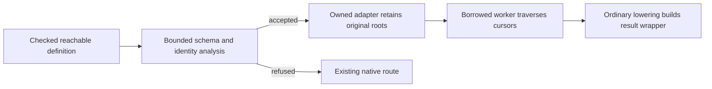

# Native root-preserving observers

The Phase70 working compiler implements a bounded optimization for functions
that traverse immutable data, return the original input roots, and compute one
scalar answer. The compiler checks a restricted return-identity property and
emits a borrowed traversal instead of repeatedly consuming and reconstructing
the same nodes. The implementation is written in Bend; it uses the existing C
runtime and worker machinery.

**This document describes working source and measured checkpoints. Phase69
remains the installed release.** The [Phase70 report](../../implementation/phase70/README.md)
tracks final qualification and promotion; the [Phase69 report](../../implementation/phase69/README.md)
identifies the installed compiler. The results below measure execution of
B1-generated C programs, not B1/B2 compilation speed.

## What changes

A source traversal may recursively rebuild a String or user-defined list merely
to return the unchanged value beside an observation. For example, a comparison
can return `((left, right), ordering)`. The optimized worker computes only the
ordering while an owning adapter retains both complete inputs. On success the
adapter creates the original result wrapper from those retained roots and the
answer.

This is structural admission, independent of function names and benchmarks.
Map/String library functions and separately written one-root and two-root Strand
functions qualify through the same rules. Returning a value of the same type is
insufficient: the analysis must establish the exact original root at each
specified result position.

## Permission and routing

`nc_compile_checked` requires a successfully checked, specialized, annotated and
layout-validated book, the trusted runtime/Base ABI, and the driver's audited
foreign-source permission. The current whole-program certificate permits the
native primitive catalog and the audited Base `IO.args`, `IO.print` and `IO.now`
handlers. Those handlers neither expose immutable-root identity nor mutate it.
Changed/custom effects, unknown foreign definitions or unsupported representation
demands decline the certificate. Any future whitelist expansion must preserve
this stronger observer contract or use a separate permission.

The explicit permission flows through native compilation. Raw `nc_compile`
passes False and skips observer planning and worker construction. A user book
marker or a C macro cannot grant permission. Direct callers of the internal
checked API must establish its preconditions; it does not authenticate arbitrary
books supplied with a forged True flag.

Planning uses the actually checked runtime-reachable names and excludes native,
foreign and reachable bang owners. Imported but unreachable definitions may not
have elaborated matcher metadata and are not candidates. Ordinary and product
worker admission finish before observer routing. A successful optional plan adds
two private workers and wraps only the matching public direct scheduler entry.
Private-name collisions, descriptor failures or failed worker admission retain
the existing route.

The hook is guarded by `!DEVICE && NATIVE_READONLY_OBSERVERS`. Its device branch
retains the previous scheduler body, and private observer functions are host-only.
This is a CPU optimization; no GPU execution improvement or hardware validation
is claimed.

The current substitution is **at scheduler entries**. Existing private ordinary
worker calls continue to use their admitted bodies and can bypass the observer.
Seeing an observer in emitted C therefore does not prove it executes on a given
control. Planning only after ordinary-worker refusal is a separate
[compilation-cost experiment](../../experiments/phase70/P70-008-observers-after-ordinary-refusal.md),
not a condition of the return-identity theorem.

## Supported shapes and bounds

| Property | Current admission |
| --- | --- |
| Live parameters | At most four; one or two roots, with scalar remaining arguments. |
| Root datatype | A closed, zero-parameter immutable ADT with exactly two constructors: one nullary and one boxed constructor with two to eight fields. |
| Recursive fields | Exactly one field has the root type; all remaining fields have supported immediate scalar types. Native String and structurally equivalent user ADTs qualify. |
| Result | One or two fixed constructor shells containing each retained root exactly once and one scalar observation. The current schema maps roots in input order. |
| Scalar kinds | Trusted native Nat/U32/F32/Char and supported nullary enums, with exact argument/result kinds. Arrays, IO values, foreign handles and allocating word views are excluded from borrowed roots. |
| Analysis | One 4,096-step candidate budget shared across branches and helper expansion; acyclic helper expansion depth at most eight. |
| Type/layout discovery | At most 32 parameter telescope binders, eight constructor fields and 32 constructors per enum; existing bounded alias/substitution helpers remain in use. |

A refusal means the optional optimization could not establish its restricted
contract. It does not reject an otherwise supported program. Parameterized lists,
general trees, changing roots, arbitrary boxed observations, mutual recursion,
dynamic calls and non-tail residual work remain on existing native routes.

The analysis reads current plain erased definitions, retaining source literal
kinds. It does not trust a previously prepared static body as source proof.
Numeric literals become typed immediate atoms; String literals expand one
structural step per budgeted visit. Native Nat is an immediate 48-bit value in
this runtime; overflow reports an error rather than allocating a big integer.

## Identity, demand and ownership

The symbolic evaluator represents constructors virtually and keeps scalar work
as ordered residual statements. A successful match records the constructor,
owner and ordered field origins in that branch alone. Reconstructing the same
constructor from those exact fields proves the original origin. Changed fields,
reordered roots, duplicated roots or facts borrowed from another branch cannot
establish that identity. Helper invocations have separate lexical environments
and globally fresh runtime origins.

A recursive transition must pass each root's own current cursor or a descendant
of it, with at least one strict descendant. Scalar slots retain their exact
kinds. The continuation must prove the fixed result wrapper and return the
recursive scalar observation without further dynamic work. Only then does
recursion become a local loop with simultaneous parameter updates.

Removing a virtual wrapper must not remove demanded computation. Scalar
primitives remain statements even when their results are unused. V1
conservatively declines evaluated zero-argument references and native
`Succ`/`U32`/`F32` constructor forms whose virtualization could hide a runtime
check. Known helper calls retain the existing checked native arity and demand
boundary. Non-tail or discarded recursive results decline.

The borrowed worker contains only scalar operations, qualified field reads,
branches and local loops. It does not allocate, retain, drop, seal or consume
nodes. Boxed reads use `term_peek`, including existing immutable static and RFC
storage; Nat predecessor and Char identity use their certified immediate
representations. Array and allocating U32/F32 word-view readers are excluded.

The separate owning adapter keeps original roots in stable locals while cursor
parameters change. Shared roots, aliases and tails retain the caller's existing
ownership references. After success, ordinary owned lowering constructs the
result wrapper, transferring each retained root once. No borrowed cursor escapes
as the returned scalar. The public one-word result ABI is unchanged.

The original scheduler error check and worker polling envelope remain. Scalar
statements, observer return and adapter boundaries retain the nonsequential
shared-error checks. Explicit match errors remain error paths. Failed workers
use the existing request teardown convention; the adapter does not invent extra
root drops during failure.

These are compiler analysis invariants, source reviews and finite controls.
They are **not a machine-checked proof of this compiler optimization**. Tests
must distinguish ordinary fallback from an actually executed observer, especially
for demanded failures and asynchronous error propagation.

## Source map

| Module | Responsibility |
| --- | --- |
| [observer-layout.bend](../../selfhost/src/back/native/observer-layout.bend) | Bounded parameter/root/result schema and representation descriptors. |
| [observer-literals.bend](../../selfhost/src/back/native/observer-literals.bend) | Exact literal kinds and conservative demand barriers. |
| [observer-analysis.bend](../../selfhost/src/back/native/observer-analysis.bend) | Scoped origins, ordered symbolic evaluation, return identity and recursive-loop proof. |
| [observer-plan.bend](../../selfhost/src/back/native/observer-plan.bend) | Permission-gated plan query and existing binding conversion. |
| [observer-emitter.bend](../../selfhost/src/back/native/observer-emitter.bend) | Small borrowed residual emitter returning ordinary `NC_Code`. |
| [observer-adapter.bend](../../selfhost/src/back/native/observer-adapter.bend) | Owned roots, normal result lowering and guarded scheduler hook. |
| [observer-integration.bend](../../selfhost/src/back/native/observer-integration.bend) | Late route selection, name checks and private-worker admission. |

The pass reuses `KTerm`, `NC_Binding`, `NC_Code`, `NF_Worker`, scalar primitive
emission and the existing worker envelope. It is not a second general-purpose
backend. See the [analysis design](../../design/phase70/observer-analysis.md),
[emission design](../../design/phase70/observer-emission.md) and
[source/query snapshots](../../selfhost/tools/performance/phase70/observers-analysis/README.md)
for the proof boundary, preserved failures and exact residual grammar.

## Measured checkpoint and validation

The `observer-emission02` comparisons use saved C/binaries, identical work within
each comparison, matching compiler settings and rotated roles. The independent
String and Tape batches have different work counts from the original six-family
suite, so their times cannot be combined into that suite's aggregate.

| B1-generated native workload | Phase69 baseline | Observer checkpoint | Pinned upstream | Checkpoint / upstream |
| --- | ---: | ---: | ---: | ---: |
| Map operations | 681 ms | 351 ms | 391 ms | 0.898× |
| Independent String ordering | 492 ms | 296 ms | 370 ms | 0.800× |
| Independent Tape traversal | 1,213 ms | 912 ms | 301 ms | 3.030× |

These are useful transfers beyond the original motivating case, with a large
remaining Tape gap. They do not establish general upstream parity. The
[emission checkpoint report](../../implementation/phase70/observer-emission.md)
links exact timing, output and emitted-C evidence. It also preserves a demanded
Nat-overflow difference: the candidate and pre-observer compiler retain the
failure, while pinned upstream returns success on five controls. Expected
outputs were not changed to turn that disagreement into a pass.

Use the [native fast-loop guide](native-parity.md) for the existing resource
policy and the [Phase70 experiment records](../../experiments/phase70/P70-001-root-preserving-observers.md)
for the new observer gates. Start with admission/refusal and emitted-route checks,
then execute the focused semantic controls and saved-binary loop. Broad native,
raw, B2/reproduction and release gates belong to final qualification. The
installed CLI does not acquire these working changes merely because this document
or the source modules exist.

## Related checked Bool array change

The Phase70 `compiler02` working candidate also admits trusted Base Bool in the
existing whole-program scalar-array certificate. This is a separate change from
borrowing roots. Under the checked Base/runtime/effect boundary, Bool producers
emit exactly 0 or 1 and existing transports preserve those bits. A packed
32-bit write/read is therefore exact and carries no element heap ownership.
A type name, a user enum or an arbitrary foreign value cannot supply that fact.

Bool admission can preserve packed-array storage and typed private scalar
parameters for pipelines with intermediate `Array<Bool>`. It does not itself
prove an array is unshared, remove per-element product allocation or establish
Array-map performance parity. Raw `native_bool` accepts a broader representation
for compatibility; that generic ABI is not the checked 0/1 invariant.

The [producer/transport audit and controls](../../selfhost/tools/performance/phase70/coverage/bool-admission-v1/README.md)
and [registered experiment](../../experiments/phase70/P70-007-checked-bool-arrays.md)
record the contract. The compiler02 checked build, all seven Bool native
controls in both compiler roles, and all nine admission checks pass. Its balanced
three-round Array-map comparison has nine correct, qualified samples:

| Phase69 baseline | Compiler02 candidate | Pinned upstream | Candidate / upstream |
| ---: | ---: | ---: | ---: |
| 1,022 ms | 738 ms | 299 ms | 2.468× |

That is 27.8% less execution time than the baseline, while a substantial gap
remains. Evidence is `selfhost/build/phase70/compiler02-array-map-comparison/report.json`.
This measures the combined compiler02 candidate, not a Bool-only ablation.
Final release qualification remains pending; the observer-only Map/String/Tape
numbers above belong to the earlier checkpoint.
