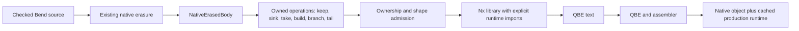

# Direct native IR with production ownership

Phase109 extends the scalar Nx experiment with a real ownership boundary. The
lowering, ownership checker, local optimization and QBE emitter are written in
Bend. The selected production compiler remains Phase102; Phase108 cproc/QBE
remains a full-language bootstrap/reference. This experiment does not replace it.

The route is:

No worker body is emitted as C or parsed by cproc on this route. The runtime is
still C: a small authenticated extraction of the actual production allocator,
tagged Terms and reference counting. Acquiring that runtime object is a separate
cost; it is reused by direct workers. The C emitter for the same Nx graph is a
comparison control, not an intermediate step in QBE compilation.

## Scope and interfaces

The initial descriptor is deliberately fixed: Nil/Con for List<String> and
SNil/SCon for String, with zero or two fields. A worker receives an opaque runtime
context and owned U64 Terms. Constructor fields transfer exactly once. `keep`
replaces its input handle with the returned handle before either copy escapes.
Nullary values are immediate; static nodes cannot be overwritten or freed.

The implemented subset handles constructor matches/builds, variables, explicit
discard/duplication, direct returns and self-tail calls. Unsupported expressions,
external/non-tail/indirect calls and malformed facts fail admission. Closures,
general calls, continuations, arrays, effects, parallel scheduling and device
execution are not implemented by this slice. The normal checked frontend still
owns language checking and erasure; the new validators do not prove arbitrary
source or whole-compiler correctness.

Three explicit policies are available:

| Policy | Behavior |
|---|---|
| `raw` | Checked runtime imports; conservative reference/default |
| `trusted` | Private imports after shape, ownership and checked-entry admission; reuses an immediately available discriminant |
| `fused` | Additionally recognizes adjacent consume/build/tail operations and reconstructs a node while retaining the remaining field |

Fusion uses no function names. It reuses only a uniquely consumed heap shell;
shared and static cases allocate. Existing reference-count and child-sealing
semantics are retained. The original semantic operation graph stays available
for inspection. Unknown policy strings fail.

## Hosts and bootstrap

The fast development host transports existing checked facts through JavaScript;
it does not implement erasure or compiler transformations. The small Bend API is
checked and acquired using the pinned upstream compiler in roughly 1.4 seconds
on the recorded machine. This development acquisition is not a new self-hosting
claim.

The [native selected-library entry](../../selfhost/tools/performance/phase109/native/README.md)
reuses the mature Bend frontend and `NR_Request` directly. It accepts only the
frozen reverse/discard/duplicate source contracts and emits a library for the
runtime harness. Its one-time image acquisition uses the existing native seed
and C/cproc/QBE; its ordinary requests emit structured IR directly. Consult the
[report](../../implementation/phase109/README.md) for actual qualification status.

## Run and interpret experiments

Use the [fast-loop instructions](../../selfhost/tools/performance/phase109/README.md).
The frozen observations include empty, singleton, deep, Unicode, shared-root,
shared-tail and static inputs, retained aliases after releasing the result, and
zero live allocation/scratch checks. Separate mutations test the admission,
ownership, import and fusion boundaries. They are finite tests, not proof of the
full language.

The repeated kernel clock excludes graph construction, observation and release.
Object acquisition, whole-process time and runtime acquisition are reported
separately. Do not interpret the kernel result as a new upstream, B1/B2 or
whole-compiler ratio. The production C reverse worker was already a direct loop;
this experiment does not remove a per-node continuation dispatch.

The next migration gate is general typed constructor descriptors and ordinary
calls with structured ownership results. Keep the cproc reference until a direct
IR successor passes full semantic, bootstrap and performance gates.
