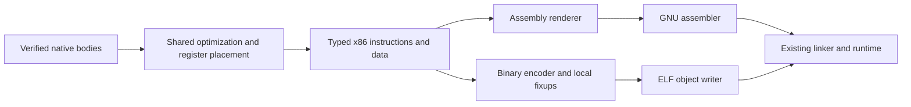

# Optional x86 object emission

The x86 backend can emit ELF64 relocatable objects using Bend code, then use the
existing authenticated linker and runtime. Assembly is still the default.
Select `--target x86 --emit object` in `selfhost/tools/build/native.py` or
`request.py`, with a compiler image that implements `x86-object`.

This is an output option on the existing x86 target. It shares instruction
selection, register allocation, ownership rules and all optimizations with the
assembly route. It is not a separate source-language backend.

## Current architecture

Instruction selection produces typed machine sequences directly. Registers carry
architectural indices and widths; operands retain full immediate bits, memory
addresses and symbolic references. Instructions, labels, sections and data widths
survive until the final consumer:



Selection lives in the existing scalar, floating, call and function modules.
`machine-model.bend` and `machine.bend` define sequence composition and assembly
rendering; `object-model.bend` defines numeric operands and object records.
`object-build.bend` consumes the same typed sequences, `object-encode.bend`
encodes instructions, and `object-elf.bend` writes the object. The old strict
`object-parse.bend` parser is a test/diagnostic API, absent from the selected
production source closure. Object output never renders or parses assembly.

Both consumers release typed sequences per function; assembly additionally writes
data in slices of at most128 directives. The object writer still retains byte
sections in memory. It resolves local relative branches and omits unescaped,
nonglobal local symbols; address references, exported symbols and unresolved
external relocations retain their explicit identities. The encoder still uses
near branches and does not perform relaxation.

`File.write_bytes` sends objects without text decoding. Host tools authenticate,
capture, inspect and link bytes; instruction selection, encoding, fixups and ELF
records are implemented in Bend. Original native verification and semantic
admission remain intact. Supported instructions are the Linux AMD64 SysV scalar
and SSE subset selected by this backend; invalid encodings fail explicitly.

## Build

Use a fresh output under the existing disk/resource guard. The producer image
and its receipt must be supplied together:

```sh
python3 -B selfhost/tools/build/native.py \
  --assets selfhost/manifests/assets-native.json \
  --image /absolute/compiler --image-receipt /absolute/report.json \
  --host native --stage N1 --target x86 --emit object --mode cache \
  --source /absolute/program.bend --out selfhost/build/example/object \
  --seconds 60
```

The recorded stage must match the image binding. Older installed compilers
reject `x86-object`; adding the flag does not update an image. The build links
`program.o` directly, executes no assembler, and records `assemblerSkipped`,
`emissionFormat`, exact bytes and tool identities. Use `--expected-object` for
complete object-byte comparison. `--ir FILE.o --target x86 --emit object` links
an already emitted object through the same authenticated machine-build path.

## Limits and qualification

Each text, read-only data and writable data section is capped at 32 MiB. Objects
are currently materialized in memory; this is not a streaming full-compiler
object writer. Text alignment is at most 16 and data alignment at most 8. These
bounds refuse before publishing a successful artifact. One complete native self-build through object output has passed; full
reproduction fixed-point qualification remains separate.

Branches currently use near encodings, without GNU-as relaxation or its
`-mbranches-within-32B-boundaries` policy. Byte identity, code size and program
runtime may differ. This option is experimental and is not the default or the
installed compiler selection. Its initial purpose is establishing a correct
Bend-written binary-output path, not claiming compilation or execution gains.

See the [Phase188 refactor report](../../implementation/phase188/README.md),
[design](../../design/phase188/README.md), and
[reproducible control plan](../../selfhost/tests/phase188/control-plan.md).
The [Phase187 report](../../implementation/phase187/README.md) preserves the
text-parsing prototype and its315.35s versus199.11s same-source build result.
Those timings describe the old implementation, not the typed path.

Phase188's controlled same-source build takes 205.02s for direct objects versus
197.40s for assembly. The older object route took 315.35s. Both new formats preserve
the baseline's machine code on the full compiler and the 45-program corpus. Assembly
remains default; direct objects avoid the assembler and are now within 4% on this
full-build measurement. See the report for stage, source and statistical scope.
