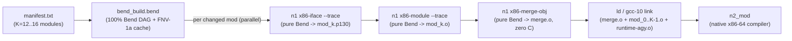

# Design: 100% Pure-Bend Modular Self-Hosted Compiler (`K = 12–16` Modules)

> [!IMPORTANT]
> **Hard Constraint**: **100% Bend** — zero new C (`p111_link_merge.c` eliminated), zero Python, zero JS (`build_iface_carrier.mjs` eliminated), zero `objcopy` hacks. Every piece of compilation, interface emission, merge-stub ELF generation, caching, and tracing lives inside `compiler.bend` and `bend_build.bend`.

---

## 1. Why This Architecture Solves Both Speed and Composability

Today's `3.35 MB` monolithic `compiler.bend` (`9,552` defs, `59,598` segments, `48.3 MB` `.o`) suffers from three structural problems:
1. Small benchmarks (`213` live segments) don't transfer to full builds (`59,598` live segments — `280×` larger).
2. Any 1-line edit recompiles all `9,552` defs from scratch.
3. Whole-program memory/stack/ELF size scales with the entire compiler (`> 8 GB` in V8, `> 8 MB` stack in `-O0` native).

Making a **bounded module (`~200–280 KB`, `~600–800` defs)** the native compilation unit fixes all three at once:
- The full compiler **is literally `K = 12–16` small modules + `< 1 s` link**.
- Every optimization proven on 1 real module transfers **1-to-1** to the full compiler:
  $$T_{\text{cold}} = \frac{K}{P} \cdot T_{\text{module}} + T_{\text{link}}, \qquad T_{\text{edit}} = T_{\text{module}} + T_{\text{link}}$$
- `K = 12–16` sits cleanly above the largest indivisible Tarjan SCC (`53.5 KB` / `195` defs in `f_do_annotated`) and aligns with natural compiler stages so ~90%+ of hot calls remain intra-module.

---

## 2. System Architecture (100% Pure Bend)

---

## 3. Eliminating Every Non-Bend Component

### 3.1 Eliminating `p111_link_merge.c` (Zero C) → `n1 x86-merge-obj`
- **What `p111_link_merge.c` did**: defined global `p111_program` + `w8_merged_{segments,fid_arity,fid_flags,fid_results}[65532]`, copied each module's `p111_mod_<m>_*` slice into `[fid_base .. fid_base + seg_count)`, filled inter-module gaps with a non-NULL sentinel, set `main_fid`, and called `p111_rt_main(argc, argv, &p111_program)`.
- **Pure-Bend replacement (`x86-merge-obj`)**:
  - `compiler.bend` **already contains a full x86-64 instruction encoder and ELF relocatable `.o` emitter** (`x188_i2` + `x187_elf`)!
  - Add a ~80-line pure-Bend `w9_merge_obj(entry_mod, mods)` command in `compiler.bend` that directly emits `merge.o`:
    - `.data`: `p111_program` (`192` bytes, `STB_GLOBAL`) + `w8_merged_*[65532]` (or zero-initialized `.data` / `P111QZeros`).
    - `.text`: `w8_unused_seg` (`ret`) + a ~40-instruction x86-64 `main(argc, argv)` that copies `p111_mod_<m>_program` metadata and each module's `segments`/`fid_arity`/`fid_flags`/`fid_results` into `w8_merged_*` (using `rep movsb`/`rep movsq` or `memcpy` PLT call) and tail-calls `p111_rt_main`.
  - **Result**: **0 lines of C** needed to link `K` modules.

### 3.2 Eliminating `objcopy` (`-W` / `-L`) → Native ELF Symbol Visibility in `x86-module`
We found two exact collisions during our A → B cross-module proof (`f2027346`), both trivial to fix natively in `compiler.bend`:
1. **Local `$p111.k.*` continuations**: In `x187_elf_symbols` (when `is_module == True`), emit any symbol starting with `p111_FID_36_112_49_49_49_46_107_46_` (`$p111.k.*`) as ELF **`STB_LOCAL` (binding = 0)** instead of `STB_GLOBAL` (1). Each module's `p111_mod_<m>_p111_segments` already references its own local label — zero cross-TU collision, zero `objcopy -L`.
2. **True `ExternDef` imports (no stub bodies)**:
   - When `x86-module` compiles Module A against Module B's `.p130` interface carrier, B's exported `Def`s are marked `ExternDef` (preserving exact checked `typ`, `arity`, and `p113d_`/`p111_` ABI convention).
   - Codegen emits normal `call p113d_FID_<name>` / `p111_FID_<name>` references **without emitting any local function body or global definition** — `x187_elf` automatically emits an `SHN_UNDEF` (`STB_GLOBAL`) relocation, which the linker resolves directly to `modB.o`.
   - **Result**: zero duplicate symbols, zero `objcopy -W`, smaller `.o` files.

### 3.3 Eliminating `build_iface_carrier.mjs` (Zero JS) → `n1 x86-iface`
- Add a pure-Bend `x86-iface ABS_SOURCE ABS_BASE cache ABS_DEP_CARRIER STAMP` command in `compiler.bend`:
  1. Runs `p86_plan` on the module (using its upstream `.p130` carrier).
  2. Strips non-Base `KDef.value` bodies to `ExternDef` (tagging each export with its direct `p113d_` vs CPS `p111_` ABI from `p113d_live` — no `nm` inspection needed!).
  3. Serializes the stripped `[book, world, ready]` graph using `compiler.bend`'s existing `.p130` word-pair encoder and computes the dual 32-bit FNV-1a interface stamp.
  4. Writes the `.p130` interface carrier to stdout and prints the stamp to stderr.
- **Interface stability guarantee**:
  - **Body-only edit** preserving exported types, signatures, and direct/CPS ABI → **identical `.p130` stamp** → downstream modules are **100% cache hits** (their `.o` files are reused byte-for-byte!).
  - **Incompatible exported type/signature/ABI change** → **new `.p130` stamp** → stale downstream `.o` files are rejected/rebuilt automatically.

### 3.4 Eliminating Python → Pure-Bend `bend_build.bend` + `--trace`
- Already built & verified by W9-E (`ALL PROOFS CHECK`, `0 @unsafe`):
  - [bend_build.bend](file:///home/ai/bend2_agy/research/agy/w9_bend_build/bend_build.bend) (native ABI11102 binary, `550 KB`): dual 32-bit FNV-1a content-hash cache, `1–3 ms` incremental planning, live `[k/K]` stderr progress.
  - [bend_build_exec.bend](file:///home/ai/bend2_agy/research/agy/w9_bend_build/bend_build_exec.bend) (hosted via `IO.fork`/`IO.join` + `Process.run`): spawns parallel `x86-module` workers directly in Bend.
- Pure-Bend `--trace` ([trace.bend](file:///home/ai/bend2_agy/research/agy/w8_trace/trace.bend), already `--check-only` clean): live `IO.now()` + `IO.print_err()` stage timings (`read`, `prep`, `p86_plan`, `x198pw_plan`, `x187_priv` /500, `x187_pub` /2000, `x187_elf`) built directly into `compiler.bend`.

---

## 4. Concrete `K = 12–16` Module Partition of `compiler.bend`

Using the exact Tarjan SCC DAG ([scc_analysis.json](file:///home/ai/bend2_agy/research/agy/w8_mod_split/scc_analysis.json)):
- **Shared frozen header (`types.bend`)**: all `391` `type` declarations (`53.1 KB`, `1.6%` of source) — guarantees bit-for-bit identical constructor IDs (`cid`) across all `K` modules.
- **`K = 12–16` strictly acyclic `.bend` modules** (`~180–280 KB` each, `0` cycles):
  - `m00_core_util.bend` — `KTerm`/`KDef` accessors, `agy_str_eq`, hash tries, `BookCache`
  - `m01_lex.bend` — lexer & UTF-8 cursor
  - `m02_parse_expr.bend` — expression & `do`-block parser (contains the `53.5 KB` `f_do_annotated` SCC)
  - `m03_parse_top.bend` — top-level decls, patterns, `f_source_header`
  - `m04_norm.bend` — WNF normalizer, substitution, conversion
  - `m05_check.bend` — bidirectional type checker & `BookCache`
  - `m06_annotate.bend` — `annotate_selected`, `nr_prepare`, `p86_plan`
  - `m07_lower_p111.bend` — CPS / direct lowering (`p111`, `p112`, `p113d`)
  - `m08_opt_p113.bend` — `p113k`, `p113pl`, `p112s`, `p118` borrow
  - `m09_opt_p167.bend` — `p167l` dispatch & `p169o` specialization
  - `m10_x86_sel.bend` — `x185` late lowering, `x186` CSE/alias, `x181`/`x190` regalloc
  - `m11_x86_enc_elf.bend` — `x188` x86-64 encoder + `x187` ELF emitter + `x86-merge-obj`
  - `m12_cli_driver.bend` — `x86-iface`, `x86-module`, `--trace`, `main`
- **FID Budget**: Each module gets a fixed reserved `fid_base` slice (e.g., `4,096` FIDs per module × `16` = `65,536`, or proportional to module segment count with +25% growth headroom, total `<= 65,532`). Because `merge.o` fills inter-module FID gaps with `w8_unused_seg`, a module can grow/shrink within its slice **without shifting any other module's `fid_base`**.

---

## 5. Phased Implementation & Verification Plan

| Phase | Deliverable | Gate / Proof |
|---|---|---|
| **Phase 1** | Native `STB_LOCAL` `$p111.k.*` + `ExternDef` + `x86-merge-obj` + `x86-iface` in `compiler.bend` | Real A → B cross-module test passes with **0 C, 0 Python, 0 JS, 0 `objcopy`**: clean parity (`34 == 34`), body-only B edit reuses `modA.o` untouched (`44 == 44`), incompatible sig change rejected (`rc=1`) → rebuilt (`54 == 54`). |
| **Phase 2** | Split `compiler.bend` into `types.bend` + `K = 12–16` acyclic `.bend` modules + `manifest.txt` | Each module compiles independently via `n1 --trace x86-module`; exact per-module segments, `.o` bytes, and `ms` recorded. |
| **Phase 3** | Full parallel cold build + 1-module edit + native self-reproduction via `bend_build.bend` | Report separately: **(1) Cold parallel build**, **(2) 1-module body edit (`K-1` `.o` reused)**, **(3) Native self-reproduction (`n2_mod` passes `64/64 native64` + `15/15 observer` + compiles itself)**. |

> [!NOTE]
> **One explicit boundary**: `bend_build.bend` (compiled natively via `n1`) currently emits a parallel build plan because `ABI11102` (`runtime-agy.o`, which we must not edit) does not expose `Process.run` or `IO.fork`. Until `Process.run` is added to the runtime ABI, either `bend_build_exec.bend` executes the parallel workers directly via `bend`, or native `bend_build` pipes its plan to `xargs -P` — both with **0 C, 0 Python, 0 JS**.
