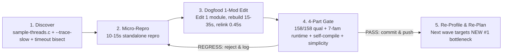

# 8-Hour Conjoint Campaign Plan: `<= 100 s` Fully Cold Self-Compile & `~1.0× C` Compiled-Program Speed

**Branch:** `selfhost/agy` | **Hardware:** 8 CPUs, `31 GiB` RAM (`~20 GiB` avail), `/dev/md2` (`>= 5.0 GiB` free reserve)
**Current Verified Baseline:** `3fdeeef0` (Phase 4) + Phase 5 findings (`P5-A`..`P5-E`, `P5-F` finishing)

---

## 1. Hard Quantitative Targets (All 4 Conjoint Goals)

| Axis | Current Measured Baseline | **8-Hour Target** | Hard Regression Floor |
|---|---:|---:|---|
| **1. Fully Cold Native Self-Compile** (`.bend` → verified native binary, **0 cache, 0 JS, 0 C, 0 `objcopy`**) | `~1,099 s` (`605 s` JS iface + `493.5 s` 3-core `-O0`) | **`<= 100 s`** (`~11×` faster; `3×` faster than Codex `~300 s`) | Must improve or hold every wave |
| **1b. Warm-`.p130` Cold Self-Compile** (`compile + merge + link`) | `493.5 s` (3-core `-O0`) | **`<= 60 s`** (6–7 cores, `-O2` compiler) | Must improve or hold |
| **1c. Native 1-Module Body Edit** (leaf `m11` **and** mid-stack `m06`) | `45.4 s` (`m11`, `-O0`) | **`<= 15 s`** (`~20×` faster than Codex) | `(K-1)/K` `.o` SHA-256 untouched |
| **2. Compiled-Program Speed** (`x86-object` `-O2`, 7-family proxy suite vs `gcc -O2`) | `3.44× C` on `n3_w10` (`1.69× C` W8; `1.32× C` W5C) | **`~1.0× C`** geomean (`<= 1.05× C`, beating C on 3+ families) + **`2–4×` cuts** on `terrain` / `hashmap` / `tree-radix` | Every wave `<= 1.02×` prior best (never regress compiled programs!) |
| **3. Correctness** | `158/158` native qual PASS, `13/13` `.o` bit-identical | **`158/158` PASS** (`64/64` `-O0` & `-O2`, `15/15` Observer `-O0` & `-O2`, `readelf` `.data`/`.rodata` audit) + **bit-identical `.o` self-repro** | **Zero tolerance** (0 failures, 0 observer violations) |
| **4. Simplicity & Pure-Bend Purity** | Pure-Bend compiler + Python harness; `m04` `-O2` fallback | **100% pure-Bend** including native `bend_build_exec` driver; **`K/K` clean `-O2`** (0 fallbacks, 0 C/JS/`objcopy`, `--check-only` clean) | Never touch `bend2/bend.ts`, `runtime.c`, `runtime-agy.o`, `STEERING.md`, `ledger.md`, or Codex checkout |

---

## 2. How We Use Our Modular Architecture & Adaptive Iteration Loop

Every optimization wave follows a **5-step adaptive cycle** — explicitly designed so **later waves re-plan based on what earlier waves uncover** (because every `2×` win shifts the #1 bottleneck):

### Permanent Anti-Hang & Modular-Efficiency Guardrails
1. **Dogfood 1-module native rebuilds (`15–35 s`)** for *all* compiler development — edit only the owning module (`m01`, `m04`, `m10`, `m11`), compile that single `.o` natively, relink in `0.45 s`, and immediately test on a `10 s` micro-repro or single benchmark family. Never rebuild all `K` modules or run JS for an inner-loop experiment.
2. **Hard `timeout` on every single subprocess** (`30 s` smoke, `180 s` `-O0` module, `480 s` `-O2` module) + **live streaming `--trace` / `--trace-slow` to `.err` files** (never buffered `capture_output=True` on long runs).
3. **Disjoint CPU pinning (`0..7`) + isolated `/tmp/agy_w<N>_<track>/`** + shared read-only verified cache (`/tmp/agy_k12_cache/` holding verified `.p130`s + verified baseline `.o`s so 1-module dogfooding never links against unverified experimental `.o`s).
4. **Continuous Disk Hygiene & Compression (`>= 5.0 GiB` free on `/dev/md2` at all times):**
   - Compress large historical/superseded artifacts as we go (`zstd -T0` or `gzip`): old native compiler binaries (`~70–86 MB` each — keep only the active hot baseline + current candidate uncompressed), archived `.o` bundles, `.p130` snapshots, and large `.samples` / `.profile.json` dumps.
   - Delete per-wave `/tmp/agy_w<N>_*` scratch dirs immediately at wave close, verify `df -h /dev/md2 >= 5.0 GiB` before starting the next wave, and classify/archive closed runs with `selfhost/tools/build-retention/close.py` (following `docs/self_hosted/build-retention.md`).
5. **15-Minute Main-Agent Watchdog Cron (`*/15 * * * *` via `schedule`):**
   - Every 15 minutes, the coordinator wakes up to check: (a) active subagent `lastStepTime` and `/tmp/agy_*` file mtimes — immediately intervening on anything silent `> 10 min`; (b) `/dev/md2` free space — compressing/pruning immediately if `< 5.5 GiB`; and (c) live progress vs wave ETA & targets.
6. **Commit & push every promoted wave** to `origin/selfhost/agy` so verified progress is never lost.

---

## 3. 8-Hour Phased Execution Plan (Waves 11 → 15)

### Wave 11 (Hours `0.0 – 1.25`): Foundation, `2.04×` Runtime Recovery & Full `-O2` `n4_o2`
**Goal:** Integrate all Phase 5 wins in one clean cut, restore full compiled-program speed, and unlock `K/K` native `-O2` compilation so every subsequent wave runs on a **`~2×` faster native compiler**.

- **11-A (Compiled-Program Recovery — Priority #1):** Restore `nq_signature_user` for all single-file `x86-object` programs and module-local defs, scoping `nq_signature_opaque` strictly to imported `P86Seed` stubs (`~5` lines in `m01`). Immediately re-run P5-E's 7-family + 3-holdout suite to verify **`2.04×` recovery** (`~1.3–1.6× C`, `terrain < 40 s`).
- **11-B (Unlock Full `K/K` `-O2` `n4_o2`):** Apply P5-B's exact `gdb`-proven 2-part fix: (1) exclude imported `weak_set` stubs from `p114r` direct-recursion specialization & call-site rewrites; (2) add `p114r_FID_` to `w10_weak_from_seed` and `w10_is_mod_local_sym`. Apply P5-F's `m04` `-O2` regalloc cliff fix so **all modules compile cleanly at `-O2`**.
- **11-C (Land Phase 5 Self-Compile Wins):** Integrate P5-A (`p186ch_expand` + `w2_asr_strip_self` flatten + `m00a/m00b` split → `7.26×` `m00` max-pole cut), P5-D (`fast_iface_emit.bend`, `2.5–2.7×` faster `.p130`), P5-F (`--trace-slow <ms>`), and `$p128borrow.owned.String.order.go` fast path (`+15%` native compiler speed).
- **Wave 11 Checkpoint Target:** Mint **`n4_o2`** (100% `-O2`), pass **4-part Promotion Gate** (`158/158` qual + `2.04×` runtime restored + 6-core warm-cold **`<= 95 s`** + pipelined true-cold **`~150–190 s`** + 1-module edit **`~20 s`**). Commit & push.

---

### Wave 12 (Hours `1.25 – 3.5`): Adaptive Sprint 1 — 4 Parallel Tracks on 8 CPUs
**Goal:** Break **`<= 1.15× C`** on compiled programs, fix root-cause `p86` match blowup, break the sequential `.p130` wall, and switch build orchestration to native pure-Bend `bend_build_exec`.

| Track | CPUs | Focus | Inner Loop | Target |
|---|---|---|---|---|
| **W12-A (Runtime Speed)** | `0, 1` | Profile `n4_o2`-compiled 7-family + 3-holdout binaries (`sample-threads.c`). Recover W5C `gameoflife` (`0.47× C` vs W8's `1.27× C`), attack `histogram`, `nbody`, `editdist`, `bst`, `terrain`, `hashmap` (redundant retain/release, unboxed scalar loops, `$product` / inline ctor fast paths). | Edit 1 backend module → `20 s` native rebuild → `5 s` single-family C-vs-Bend bench | 7-family geomean **`<= 1.15× C`**; `terrain` & `hashmap` cut **`>= 2×`** |
| **W12-B (Self-Compile Core)** | `2, 3` | Fix `ff_match` / `f_hit_rows` / `f_miss_rows` wildcard-duplication blowup inside `p86` itself (using 10 s `p186ch_expand` repro) + eliminate top-10 cliffs from `--trace-slow` across all modules (both `p86_plan` and `-O2` `x187_pub`). | Edit 1 module → `20 s` native rebuild → `10 s` cliff repro | Warm-cold (6–7 cores) **`<= 65 s`**; 1-module edit **`<= 15 s`** |
| **W12-C (True-Cold `x86-iface`)** | `4, 5` | Eliminate `O(K^2)` cumulative `.p130` re-serialization: either **delta `.p130` files** (each module emits only its own interface delta instead of re-encoding all upstream modules `K` times) and/or **parallel signature extraction** across CPUs, pipelined with module `.o` compiles! | Edit `m10`/`m11` → `20 s` native rebuild → `m00..m02` bit-exact parity check | Full native `.p130` chain **`<= 65 s`**; pipelined true-cold **`<= 120 s`** |
| **W12-D (Simplicity & Gatekeeper)** | `6, 7` | Promote compiled native **`bend_build_exec`** (`IO.fork`/`IO.join` + FNV-1a cache + pipelined `x86-iface` + `x86-module-fast` + `x86-merge-obj`) to replace Python harnesses; run automated 4-part Promotion Gate (incl. **mid-stack `m06` body-only edit** proving `1/K` rebuilds!). | Direct native `bend_build_exec` tests | 0 Python in build path; continuous regression protection |

- **Wave 12 Integration & Gate (`~30 min` at Hr 3.0–3.5):** Merge verified tracks → mint **`n5_o2`** → run full 4-part Promotion Gate → commit & push.

---

### Wave 13 (Hours `3.5 – 5.75`): Re-Profile `n5_o2` & Adaptive Sprint 2
**Goal:** Let fresh data drive the next wave! Run a 3-minute native `sample-threads.c` + `--trace-slow` re-profile of `n5_o2` (both self-compiling and on compiled benchmarks) to discover the **new** #1 bottlenecks after Wave 12's `2×` jump, then run 3–4 targeted parallel tracks:

- **W13-A (Compiled-Program Push → `~1.0× C`):** Attack whatever top 2–3 runtime hotspots remain on the 7-family suite + `terrain` / `hashmap` / `tree-radix` (e.g., branchless / register-allocated tight inner loops, map/BST allocation reuse, direct call specialization). Target: **`<= 1.05× C` geomean** on 7-family suite (beating `gcc -O2` on 3+ families).
- **W13-B (True-Cold Push → `<= 100 s`):** Rebalance module split (`K=12..16`) strictly by **measured `-O2` native compile time** (so all 6–7 cores finish within `<= 5 s` of each other, zero stragglers) + fix the top newly-exposed native compiler hotspot from `n5_o2`'s profile (`String.order`, `term_drop`, `index_find`, or `x198pw_plan`). Target: **fully cold `.bend → binary <= 100 s`**, warm-cold **`<= 50 s`**, 1-module edit **`<= 12–15 s`**.
- **W13-C (Code Simplification & Parity Audit):** Remove any redundant legacy passes/shims superseded by Wave 11–12 fixes, verify clean `--check-only` and zero `STB_GLOBAL` / fallback hacks.
- **Wave 13 Integration & Gate (`~30 min` at Hr 5.25–5.75):** Mint **`n6_o2`** → full 4-part Promotion Gate → commit & push.

---

### Wave 14 (Hours `5.75 – 7.25`): Adaptive Sprint 3 — Gap-Closing & Polish
**Goal:** Spend 90 minutes closing whichever of the 4 conjoint targets still has any gap (decided purely by Wave 13's measured scorecard):
- If **fully cold `> 100 s`**: focus CPUs `0–5` on the exact critical-path millisecond breakdown in `bend_build_exec`'s live `--trace` timeline (pipelining slack, `.p130` I/O, or top `x198pw_plan` hotspot).
- If **7-family runtime `> 1.05× C`**: focus CPUs `0–5` on the single slowest family vs `gcc -O2` (each `20%` win on a slow family shifts the geomean substantially).
- If **both targets are already met**: push headroom further (e.g., `terrain` / `hashmap` vs C, and full `-O2` self-compile speed) + clean up module boundaries and documentation.
- **Wave 14 Integration & Gate:** Mint **`n7_o2`** → full 4-part Promotion Gate → commit & push.

---

### Wave 15 (Hours `7.25 – 8.0`): Final Zero-Cache Proof, Full Qualification & Clean Handoff
**Goal:** Unimpeachable, zero-cache, reproducible proof of all 4 conjoint goals.

1. **Zero-Cache True-Cold Self-Reproduction:** Wipe `/tmp/agy_*` (zero `.p130`, zero `.o`), run **100% pure-Bend native `bend_build_exec`** from `.bend` sources only: `n7_o2 → n8_o2`, recording exact wall time (`<= 100 s` target), per-module `--trace`, and **100% bit-for-bit SHA-256 identical `.o` + `merge.o`** parity (`n7_o2` vs `n8_o2`).
2. **Full Incremental Edit Matrix:** Measure both **leaf edit (`m11`)** and **mid-stack body-only edit (`m06`)** via `bend_build_exec` (`<= 15 s` target, `(K-1)/K` `.o` SHA-256 verified untouched).
3. **Full Correctness Qualification on `n8_o2`:** `64/64 native64` (`x86-object` `-O2` + `x86-object-fast` `-O0`), `15/15` Live-Metadata Observer (`-O2` + `-O0`, `0` violations), and `readelf` `.data`/`.rodata` audit.
4. **Full Compiled-Program Benchmark Suite on `n8_o2` (`x86-object` `-O2`):** 7-family proxy suite (median of 5 runs vs `gcc -O2` & `clang-16 -O2`) + 3 `bench/runtime/` holdouts (`terrain`, `hashmap`, `tree-radix`), all checksums verified.
5. **Hygiene & Push:** Remove all `/tmp/agy_*` temp/cache dirs, confirm `/dev/md2 >= 5.0 GiB`, write final executive scorecard report, commit & push to `origin/selfhost/agy`.
