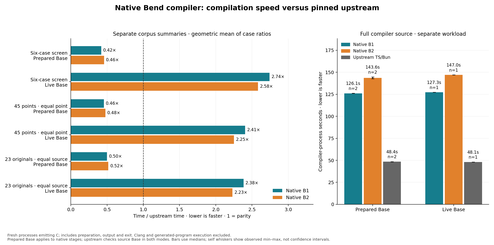

# Current native B1/B2 compilation versus pinned upstream

2026-10-17. **Complete:** 693 timed compiler requests, 45 upstream reference
acquisitions and 12 generated-product executions passed. No compiler, runtime,
native selection or installed release changed.

[Protocol](../../docs/self_hosted/NATIVE_COMPILER_COMPARISON.md) ·
[Frozen experiment](../../experiments/phase105/P105-001-current-compilation.md) ·
[Replay commands](../../selfhost/tools/performance/phase105/README.md).

Prepared ordinary-source compilation is about twice as fast as the configured
upstream workflow on this corpus. Live-Base preparation and complete compiler-source
compilation expose separate gaps: broad B2 is 2.23× upstream live, and full-source
B2 is 2.97× prepared. The distinction matters more than one overall speed number.

[Vector figure](figures/compilation-speed.svg) ·
[Six-source detail](figures/compilation-screen.png) ·
[Per-case CSV](case-summary.csv) · [Every observation](observations.csv).

## What is being compared

All three compilers receive the same Bend source and emit complete C:

- **Upstream:** pinned TypeScript `059266225b77c8ca256ac6b25ee5c21449bab151`, Bun 1.4.3.
- **Native B1:** candidate04 Bend compiler, compiled through upstream C and Clang.
- **Native B2:** identical candidate04 Bend source, compiled through B1 C and
  the same Clang executable/O2 flags. Both build recipes were checked equal.

The source is `63ef222c…`, 1,788,947 bytes. Native binaries are B1 `b2aec9e6…`
and B2 `85a70429…`. This is the admitted same-source stage pair, not the distinct
Phase103 public CLI entry. Its launcher/authentication cost is excluded.

Primary time is high-resolution **compiler child process wall time**, including
startup, imports/preparation, checking, optimization, C output and exit. The same
existing Phase46 child wrapper surrounds all roles inside the Phase86 resource
guard. Guard wall time is retained separately because its 20ms polling adds
exit-detection latency. TypeScript's small measurement-adapter manifest/result
IO is included; native diagnostic IO is included. These are measured execution
workflows, not identical internal phase boundaries.

Native internal `request_ms` excludes input-file reading, Base preparation and
runtime transport. Upstream's request includes input/Base loading and checking.
Those diagnostic clocks are retained but **not used for cross-implementation
speed ratios**. Clang and generated-program execution are separate measurements.

## Small and broad source results

Every ratio is our process time divided by upstream process time; below 1 is
faster. Aggregate each case's median ratio geometrically. Prepared and live modes
are separate experiments, each with independently measured upstream controls.

| Corpus and weighting | Native Base mode | B1 / upstream | B2 / upstream | B2 / B1 |
|---|---|---:|---:|---:|
| Six-source screen | Prepared |0.419×|0.458×|1.093×|
| Six-source screen | Live |2.743×|2.584×|0.942×|
|45 closed points, equal point | Prepared |0.456×|0.477×|1.047×|
|45 closed points, equal point | Live |2.407×|2.251×|0.935×|
|23 original programs, equal original | Prepared |0.499×|0.517×|1.036×|
|23 original programs, equal original | Live |2.384×|2.231×|0.936×|

The screen has four samples per source/role/mode: 144 timed compilations.
Broad45 has two: 540 timed compilations, after 45 separately recorded upstream
reference acquisitions. All repetitions start fresh processes. The 45 closed
points derive from 23 original programs; variants are not 45 independent families.
All 45 count for compilation speed, including the control whose executable does
zero useful work. No held-out or universal performance claim.

With prepared Base, B2 is faster in 41/45 measured points. Four observed slower
cases are `test-morning-program` 1.100×, `test-map-set-ops` 1.214×,
`coverage-map-churn-32` 1.231× and `coverage-map-churn-128` 1.120×. Native B1 has
five slower points. With live Base, both native stages are slower on all 45.
These counts use measured medians, not significance tests.

### Why the preparation distinction matters

Prepared native requests reuse an authenticated 1,100,924-byte Base carrier;
upstream checks source Base in both modes. This is a practical workflow advantage,
not evidence that native checking algorithms are universally faster.

| Native preparation clock, pooled broad median | B1 | B2 |
|---|---:|---:|
| Read/decode prepared Base |58ms|78ms|
| Parse/check live Base (file read precedes this clock) |1405ms|1314ms|
| Runtime transport |1ms|1ms|

In a typical small input, this fixed preparation dominates the live-Base
comparison. B2's prepared-Base preparation path is slower than B1's, while its
live preparation is faster. That helps explain the different stage ordering without conflating
compiler generations or attributing the gap to the Bend language itself.

Prepared asset creation was not rerun or timed; its offline acquisition is an
excluded setup cost, not zero. Both modes use normal OS file caches. Fresh
processes do not imply cold filesystem caches or persistent warmed Bun sessions.

### Variation and memory

Broad paired-sample max/min spreads have median 0.43%/0.63% for prepared B1/B2
and 0.75%/0.63% for live B1/B2. Upstream medians are 3.53% prepared and 2.54% live;
individual upstream cases reach 12.46%/15.51%. Two samples cannot support narrow
confidence intervals or tiny regression claims. The large prepared/live gap is
much larger than these observed spreads.

Maximum child RSS across broad reference acquisitions/timed runs is 88.16MiB
for B1, 86.23MiB for B2 and 133.58MiB for upstream. These are observed maxima,
not comparable per-case median memory ratios. Per-case timings, min/max, memory
and CPU observations are in [screen.json](screen.json) and [broad.json](broad.json).

## Complete compiler source

This is a separate large workload, not part of either aggregate above. All roles
compile the identical complete 1.79MB candidate04 Bend compiler source.

| Role, prepared workflow | Median process time | Observed range, n=2 | Time / upstream | Maximum child RSS |
|---|---:|---:|---:|---:|
| Upstream TS/Bun |48.442s|48.323–48.561s|1.000×|2614MiB|
| Native B1 |126.051s|125.961–126.141s|2.602×|1434MiB|
| Native B2 |143.646s|142.667–144.624s|2.965×|1317MiB|

B2 takes 1.140× B1's time on this workload. All native self-C outputs match the
expected 30,373,059 bytes exactly; upstream matches its 18,452,096-byte oracle.
Expected native diagnostics include declared unsafe/foreign definitions; their
complete bytes are checked, not reclassified as a whole-compiler proof.

| Role, live Base control | Process time, n=1 | Time / upstream |
|---|---:|---:|
| Upstream TS/Bun |48.122s|1.000×|
| Native B1 |127.254s|2.644×|
| Native B2 |147.031s|3.055×|

All three live controls also match their complete C oracles. They support the
same order-of-magnitude conclusion, but one observation cannot resolve small
cache effects. Source/Base request work and ordinary timing variation both
contribute to differences between modes. Existing images are reused, with no
native image rebuild or new bootstrap-generation claim. See
[prepared data](self-prepared.json) and [live data](self-live.json).

## What these measurements imply

1. Prepared ordinary-source compilation is already about twice as fast as the
   configured upstream workflow on the broad corpus. This includes native Base
   reuse and does not establish superiority at equal internal checking work.
2. Live Base remains a distinct fixed-cost problem. A prepared compiler service
   and a from-source compiler invocation should not share one speed claim.
3. Full self compilation remains roughly 3× upstream for B2. Most of that gap is
   present in B1 as well, despite its upstream-generated native executable.
   Merely matching B1's execution would save about 12% of B2 time and still leave
   the 2.60× gap. B1 is not an upper limit on possible backend quality; this is a
   conditional comparison, not a bound on all future improvements.
4. Next attribution should distinguish costs common to our compiler implementation
   and representation from costs specific to our generated executable. These
   timings alone do not establish a particular algorithm, allocator or language
   as the cause. Profile the actual full-source workload before extrapolating
   small-case wins to the self-hosting loop.
5. Removing Clang addresses a separate machine-build cost. It can accelerate
   candidate construction while leaving this Bend-to-C execution gap untouched,
   or change it through different generated compiler code. Measure both.

## Generated products and separate Clang observations

Six varied broad cases were compiled with the same pinned Clang/O2 recipe and
executed with one worker/GPU off. Native B1/B2 emit byte-identical C, so one
native build per case validates their shared product. Upstream has its own C
and build. All 12 executions match complete expected stdout and stderr.

| Selected product | Native C build | Upstream C build |
|---|---:|---:|
| Lexer |1.052s|0.654s|
| Active ray256 |1.367s|0.678s|
| Closures256 |0.597s|0.551s|
| Unicode64 |0.772s|0.653s|
| Map churn128 |3.942s|1.777s|
| Numeric recurrence1024 |0.562s|0.526s|

These are single fresh build observations, not repeated Clang performance
estimates. They suggest that fast prepared C emission does not automatically
mean a faster complete executable build. Product executions are correctness
checks, **not a new generated-program runtime benchmark**. No Clang build is
included in the compiler latency table.

## Correctness and preservation boundaries

Every timed native request matches the current frozen C and complete diagnostic
oracle; B1/B2 products agree. Upstream screen outputs match existing same-source
hashes. Broad upstream products were acquired once before timing and every
repetition matches; this establishes determinism, not an independent proof of
correctness. The selected twelve executions provide the fresh cross-compiler
behavior check. Existing broader qualification remains separately scoped.

The host is an Intel Xeon E3-1245 V2. All target jobs run serially on CPU3 under
the existing resource guard; normal requests have 60s/2GiB limits, full source
300s/6GiB with 16GiB available-memory floor. No concurrent benchmark jobs,
profiling, compiler mutations or cache flushing. Inputs, tools, images, recipes,
commands, random seed and order are bound in the raw receipts. Role order is
randomized/rotated, not perfectly counterbalanced over two/four rounds.

Only newly generated, fully validated duplicate C files were hard-linked. Every
sample path and raw log remains. Historical evidence was not deleted. No PR
comment was posted. The fast-backend proposal remains a proposal; these results
measure the current compiler, not Cranelift or incremental compilation.

## Cost, replay and evidence

| Campaign | Target jobs | Runner wall | Compiler/program child time |
|---|---:|---:|---:|
| Six-source comparison |144|3.01min|2.20min|
| Broad45, including 45 reference acquisitions |585|13.50min|9.60min|
| Full source, prepared |6|10.67min|10.60min|
| Full source, live |3|5.41min|5.37min|
| Selected C builds and executions |24|0.28min|0.22min|
| Total |762|32.86min|28.00min|

The difference includes launcher startup, identity checks, supervision, output
verification and report IO. These totals exclude planning, method implementation,
review, documentation and final evidence/plot processing; they are not total
conversation wall time or token/quota usage. All jobs passed without guard
timeout/OOM or disk exhaustion. [Accounting data](account.json).

For subsequent optimization, use the existing runner's one-round prepared
six-case screen first. Both Base modes, broad45 and complete source are progressively
more expensive checks; do not repeat this whole campaign for every edit.
The [replay guide](../../selfhost/tools/performance/phase105/README.md) supplies
shorter commands and explicit limits. The six-case screen cannot certify scaling
on the complete compiler source.

The [verified evidence capsule](evidence/README.md) preserves 7,218 paths in 4,215
unique objects, including complete C/binaries, source inputs, measurement methods,
every raw sample and resource receipts. Its 13.24MB archive is content-deduplicated;
source/method pins and every archived object hash were verified. Compiler/toolchain
artifacts and historical admission inputs are separately pinned prerequisites.
An offline reviewer independently recomputed the screen/broad aggregates and
checked counts, variation, RSS and product results.
