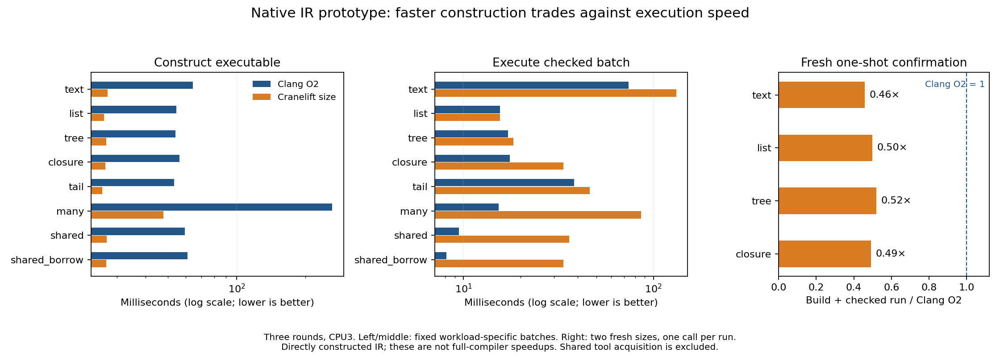

# Native IR and constrained optimization loop

2026-10-18. All five bounded experimental steps are complete.
[Design](../../design/phase106/native-ir-research-loop.md) ·
[Replay](../../selfhost/tools/performance/phase106/README.md) ·
[Evidence](evidence/README.md) · [Backend analysis](backend-analysis.md).
The installed compiler, candidate 04 selection and production source are unchanged.

## What we learned

1. **There are two distinct large costs.** A current full-self native B2 request
   took 142.16s under sampling; a separate clean Clang image build took 375.64s.
   Within the compiler process, destruction/shared-field ownership and string
   equality account for 72.94% of physical leaf samples. Avoiding Clang does not
   remove that compiler-execution work.
2. **A fast machine backend helps short checks, but runtime quality matters.**
   On this directly constructed IR slice, Cranelift object generation is 10–17×
   faster than C/Clang O2. Including IR emission and the system link narrows the
   construction advantage to 2.0–5.5×. Fresh one-shot checked build/run target-cost estimates are
   **0.476× on the training families and 0.504× on held-out families**.
3. **One policy does not win at every evaluation budget.** The small initial
   training benefit did not survive larger inputs: repeated-batch confirmation
   regressed 2.35% on training while improving 23.25% on held-outs. Ten/hundred-batch
   training scenarios select C O2. We do not promote a universal backend policy.
4. **Function boundaries explain concrete opportunities.** Clang inlines 128
   helpers in the many-functions case; Cranelift retains them. Its text scan
   retains two classifier calls per character. We can move useful inexpensive
   optimization into the Bend IR, making it available to both consumers.
5. **The contracts are connected to real code, but carefully bounded.** Twelve
   public laws and one support lemma for the actual folding helper pass independent
   checking. Four safely admitted wrong helpers fail the unchanged laws. This
   does not prove the recursive pass, ownership, emitters or whole compiler.
6. **The research harness itself now dominates tiny experiments.** The repeated
   matrix used77.84s elapsed for 11.80s of target work. Batching the independent
   differential screen kept2138 subprocess checks below 10s. Reusing supervision,
   compiled harnesses and unchanged proofs matters once backend work is milliseconds.

## Five completed steps

| Step | Implemented and observed | Boundary |
| --- | --- | --- |
| Attribute current native loop | Exact-output full-self profile and current-recipe Clang build | One sample run and one clean build, not repeated latency estimates |
| Shared native IR | Bend model, verifier, folding, C/JSON emitters; pinned Cranelift AOT consumer; real native producer | Directly constructed workload IR, no general KTerm lowering |
| Useful laws | 12 public source-connected contracts + support, independent kernel,4 admitted semantic mutants, executable bridge | Safe folding helper only; no new ownership theorem |
| End-to-end tradeoffs | 8 workloads ×5 profiles ×3 shuffled rounds; separate emit/object/link/run/RSS | Synthetic kernels plus two real lexical algorithms; not a full compiler backend |
| Bounded policy search | Training-only selection at 1/10/100 batches, held-out families, fresh two-size confirmation | No recursive acceleration or universal performance claim |

## Current compiler attribution

One full-source native B2 sample run preserved complete emitted C and normalized
compiler diagnostics. It took 142.1598s with 1,353,492 KiB maximum RSS. The run records
**8,879 physical CPU samples**; there is no dynamic call-stack attribution.

| Physical leaf | Share of samples |
| --- | ---: |
| `term_drop` | 34.00%|
| `span_fade` | 21.44%|
| `p88_string_eq` | 17.49%|
| Other | 27.06%|

`span_fade` manages child-field ownership while destructuring shared constructors;
it is not text copying. Leaf sampling does not measure allocated bytes, inclusive
caller cost or precise parse/check/lower phase time. The process includes startup,
Base preparation, request, output and teardown. `perf` was unavailable with this
kernel/tool/permission configuration; we reused the authenticated CPU sampler.
[Source attribution](attribution-notes.md) · [Receipt](fullself-profile.json).

A fresh current-source Clang O2 image build took **375.6436s**, maximum RSS
2,491,012 KiB. The binary is byte-identical to selected B2. This is one clean
observation; no image promotion or redundant new qualification was needed.
[Receipt](self-clang-clean.json).

For scale only, adding that build to the preceding Phase105 clean B2 emission
median143.646s gives a 519.29s conditional envelope, with Clang72.3%. These were
separate observations, not a measured complete research cycle. Perfectly removing
that build would leave substantial compiler work; Cranelift full-self performance
cannot be inferred from the small IR experiment.

## Architecture and implementation scope

The graph has U32/U64/pointer types; typed locals; structured if/while; direct and
signature-declared indirect calls; allocations, loads, stores and free; defined
wrapping arithmetic and masked shifts. Effects cannot be nested in pure operands.
Both consumers receive the same verified graph. Allocation is zeroed libc memory,
with a minimum allocation size of one byte and abort on failure.

The IR core/producer is 569 Bend lines; fixtures and executable law bridge add 283.
The Rust adapter is 668 lines, and the common C runner 63. The separate law/reference
Bend package adds 144 lines. Counts include comments/blank lines and exclude locked
third-party dependencies. This is additional experimental code, not a reduction
of the production compiler. Measurement, proof orchestration and documentation
are counted separately rather than hidden in the compiler size.

Two actual lexical classifiers are reconstructed from the current compiler into
IR and checked over ASCII, extended values and ABI narrowing. Text scanning/hash,
allocated lists, trees, explicit closure environments, self-tail loops and 128
functions provide executable variety. The shared/borrowed pair tests an explicit
owner-lifetime assumption; it does not implement production Bend ownership.

The producer itself was compiled by the installed native Bend compiler. The final
build took 2.945s to emit C and 10.885s in Clang. The one-time Rust adapter build
occupied 134.83s after dependency acquisition. No Rust runtime is linked into
produced programs. Cranelift replaces object compilation; the prototype still
uses the Clang driver and system linker for linking.

Missing integration work is explicit: general checked-KTerm lowering; production
value/ownership ABI; effects and foreign-policy boundaries; guaranteed mutual tail
transfers; task scheduling/parallelism; GPU lowering; full bootstrap/conformance.
The typed verifier does not prove bounds, alignment, pointer lifetimes or indirect
target validity. Fixtures establish those conditions and the independent interpreter
checks the exercised memory paths. No GPU result is claimed.

## Correctness and proof results

Final `controls04` passes:

- 1992 complete native result observations across C/Cranelift and raw/fold variants.
- 996 independent interpreter observations, including allocation reclamation checks.
- 600 native arithmetic bridge observations, including literal/dynamic forms and
  nonzero runtime seeds; all 30 literal ASTs actually become the expected constants.
- 44 deliberately wrong expected values rejected even with a colliding repeated
  checksum; every timing run separately checks each invocation.
- 8 malformed graphs refused by the Bend verifier and 5 malformed transports by
  Cranelift; leak, double-free, use-after-free and bounds mutants refused by the
  independent interpreter.

The positive source closure contains 13 nonopaque named laws and passes the
independent Lean/BendTT kernel. It takes 43.145 guarded seconds, of which41.440s is
kernel work. Four semantic mutant helpers admit safely before their unchanged laws
reject them; those eight steps take4.775s. These mutation rejections are source
checks, not a claim that unelaborated mutations were sent to the independent kernel.
[Laws and evidence](laws-notes.md).

The fold contracts cover eight U32 operations and four fallback cases over complete
result expressions. They constrain result type, operation and preserved tree.
The recursive optimizer remains `@unsafe`; this is deliberately not a theorem
that every whole graph preserves semantics. Do not rerun the 41s kernel for an
unchanged, authenticated proof package after every backend-only experiment.

## Repeated backend measurements

Three shuffled rounds on CPU3, host ISA/PIC for both consumers, identical external
runner, fresh objects/executables. Runtime includes process startup and checked
repeated calls; it is not a pure kernel timer. Figures below are screening medians.
The full evidence includes ranges, peak RSS, exact commands, input/output hashes
and every observation. No significance is claimed for small differences.

| Workload | C O2 object, ms | CL size object, ms | C O2 runtime batch, ms | CL size runtime batch, ms | Runtime CL/C |
| --- | ---: | ---: | ---: | ---: | ---: |
| Text | 40.602| 3.166| 73.746| 131.537| 1.784×|
| List | 31.116| 2.799| 15.551| 15.529| 0.999×|
| Tree | 30.431| 3.023| 17.134| 18.325| 1.070×|
| Closure | 32.605| 3.014| 17.570| 33.586| 1.912×|
| Tail loop | 29.611| 2.567| 38.211| 46.074| 1.206×|
| 128 helpers | 229.405| 13.595| 15.326| 86.054| 5.615×|
| Shared observation | 35.718| 3.075| 9.454| 35.908| 3.798×|
| Borrowed observation | 37.660| 2.956| 8.116| 33.637| 4.144×|

Linking takes approximately 21ms for either consumer. Most prototype emissions
are2–3ms; the 128-helper graph is 12–13ms. Consequently object generation alone
exaggerates the full construction benefit. Cranelift compile RSS is about 6.7 MiB
versus80–82 MiB for these Clang objects. These are process high-water observations,
not allocated bytes or estimates for building the full compiler.

The search also includes C O0, CL none and CL speed. O0 pays a substantial runtime
penalty. Cranelift optimization labels do not guarantee runtime ordering: the
unoptimized tail screen is 35.424ms versus46.140ms with speed. Disassembly exposes
loop-placement and recurrence differences, but no isolated causal ablation was
performed. Tiny differences among the three CL training scores are noise-sensitive.

## Policy selection and fresh confirmation

Select using only text/list, minimizing the sum of emission + object + link +
`k * checked runtime batch`. Tree/closure never select a policy. Tail/many and
shared/borrowed are controls. Emission is one observation per fixed artifact;
k=1/10/100 are projections from measured medians, not extra research campaigns.
A batch contains its workload-specific repeat count, not one function invocation.
These cost estimates sum component medians, reuse the original single emission
observation, and exclude per-job supervision. They are not directly measured
end-to-end wall latencies. The fresh one-shot comparisons use the same convention.

| Batches per build | Selected profile | Training selected/C O2 | Held-out selected/C O2 |
| --- | --- | ---: | ---: |
| 1|CL size| 0.965×| 0.727×|
| 10|C O2| 1.000×| 1.000×|
| 100|C O2| 1.000×| 1.000×|

The profile chosen at k=1 is frozen for a fresh confirmation: three shuffled
rounds, two new sizes in each of the four families, same artifacts and contracts.
Each binary is also run in a separate one-shot process; those costs are measured,
not obtained by dividing batch time. This additional scenario did not reselect
or tune a policy.

| Fresh cost view | Training CL/C O2 | Held-out CL/C O2 |
| --- | ---: | ---: |
| Independent build + repeated batch at each size | 1.024×| 0.767×|
| Reuse each build for both repeated sizes | 1.223×| 0.929×|
| Independent build + one checked invocation per size |**0.476×**|**0.504×**|

The 400000-character text case costs 1.364× C O2 for emission, construction and
a repeated batch; batch execution alone is 1.780×. Its
one-shot build/check is 0.468×. Evaluation intensity changes the decision. The new
training-size regression blocks any general promotion based on the original 3.5%
training gain. An explicit short-check profile is supported for this slice;
C O2 remains the incumbent for production and sustained evaluation.

Training-only target search cost is 3.662s. Against the original 7.36ms training
saving per cycle, the conditional payback is 498 cycles **before** reusable tool
acquisition, supervision, independent qualification and other overhead. The fresh
training regression invalidates that payback outside its initial inputs. Including
one-time adapter/producer construction makes first-use economics much less favorable.
We established a reproducible policy experiment, not accelerating discovery of
compiler improvements or a useful autonomous self-optimization system yet.

## What the code explains, and the strongest next experiment

The [object-code comparison](backend-analysis.md) provides stronger evidence than
speculating from ratios:

- Clang removes all 128 helper boundaries in `many`: one function, zero call sites.
  Cranelift retains 130 functions including main/wrapper, with 129 static call sites.
  The measured batch implies12.8 million helper calls versus none.
- The CL text scan calls both lexical classifiers for each character:40 million
  calls in the batch. Clang inlines them. The inspected Clang code is scalar;
  we did not find evidence that SIMD explains this gap.
- Both closure products retain an indirect call. Tiny-worker frame overhead,
  multiplication selection and invariant placement differ; calling this
  devirtualization would be incorrect.
- Borrowing removes four RC updates per observation in the CL fixture. The measured
  speed gain is about 2.47× with CL none, but only 1.07× with CL size and 1.16× with
  C O2. It interacts with call/loop optimization. This does not validate a generic
  production ownership pass or predict a proportional full-self speedup.

The best next bounded experiment is **a Bend IR inliner for small pure helpers,
with size/depth limits and a semantic contract**, then ordinary local simplification.
Use the actual lexical slice and unrelated held-out helpers. Compare full build/run
cost again; do not choose only favorable programs. This tackles observed function
boundaries and can benefit both consumers. In parallel conceptual planning, design
borrow summaries tied to owner lifetime for the real shared-constructor bottleneck;
that needs substantially stronger memory/ownership contracts than these scalar laws.

A JIT or persistent linker/runner could remove much of the 21ms fixed link cost,
while batched supervision could shrink the experiment overhead. These are next
hypotheses, not implemented benefits. Full production backend integration should
follow a useful code-quality/cost result on representative lowered compiler code.

## Time, rejected attempts and resource discipline

| Activity | Recorded time | Interpretation |
| --- | ---: | --- |
| Full-self native profile | 142.160s|Instrumented child process|
| Clean Clang self-image build | 375.644s|Child process, one observation|
| First Rust adapter construction | 134.833s|Guarded build wall, dependency fetch separate|
| Two native producer builds | 27.277s|Emission + Clang child time, includes verifier repair rebuild|
| Final independent law check | 43.145s|Guarded checks,41.440s kernel|
| Four mutation admissions/rejections | 4.775s|Eight guarded source checks|
| Final differential controls | 9.759s|One guarded batch,2138 serial subprocesses|
| Repeated backend matrix | 77.839s| 361 guarded jobs,11.796s target time|
| Fresh confirmation | 26.258s| 145 guarded jobs,3.506s target time|

The matrix spends 61.563s inside per-target supervision and 16.276s elsewhere in
its driver/reference/checkpoint work. Within supervision,49.767s exceeds measured
child execution. These are scoped recorded clocks, not token usage or a complete
human/agent effort ledger. Offline agents prepared/reviewed disjoint components;
root scheduled all substantial target work serially, with one delegated serial
source-law slot. No parallel heavy builds or OOM occurred. Guarding and a disk
floor remained active; no historical evidence was deleted.

Preserved attempts include: initial Cargo setup/DNS failures before authorized
fetch; three producer source-admission failures from unsupported match placement;
a comparison proof that needed Bool congruence rather than reflexivity; a control
expecting exit1 where the adapter correctly returned2; and an interpreter missing
u32 entry narrowing. Review repaired a leading-digit identifier acceptance gap and
added its rejection control. The final producer's44 outputs are byte-identical to
the earlier producer after that verifier-only repair. Earlier controls and receipts
remain in the evidence rather than being silently replaced.

No new B1/B2 self-hosting chain, upstream-relative compiler-speed claim, broad45
program-speed claim, complete-language conformance claim, installed release change,
GPU backend or PR comment was made. Those are distinct integration gates.
