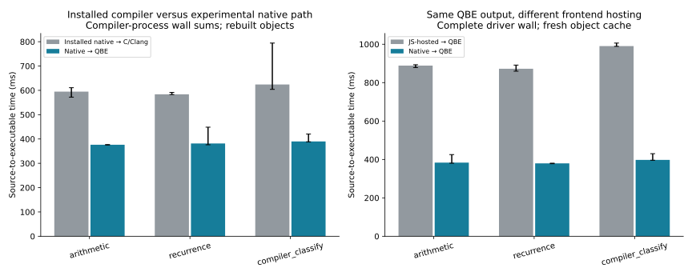
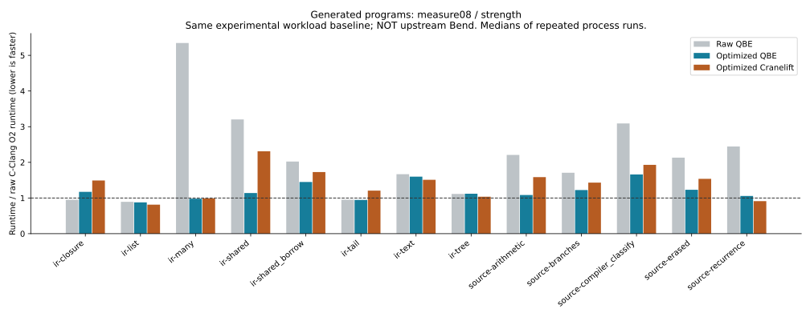

# Phase107 — a native IR path without Clang on ordinary requests

Campaign: 2026-10-18, beginning06:37UTC; planned consolidation by09:37UTC.
This report separates the usable native source compiler, IR optimization
experiments, and the work still required for self-hosting through this backend.

The new experimental path accepts checked Bend source and produces an executable
through **Bend → typed IR → QBE → GNU assembler/linker**. Parsing, checking,
lowering, optimization and QBE emission run native code written in Bend.
Ordinary requests require neither Bun nor Clang. Acquiring that native frontend
image still uses the installed Bend-to-C compiler and Clang once. The installed
general compiler and its selected release remain unchanged.

[Design](../../design/phase107/native-ir-ambition-ladder.md) ·
[Usage and supported language](../../docs/self_hosted/NATIVE_IR.md) ·
[Tables, samples and diagrams](metrics.md) ·
[Backend investigation](backend-options.md).

## Main results and their denominators

| Question | Observed result | Boundary |
| --- | --- | --- |
| Can actual checked Bend source bypass Clang? | Yes: eight admitted source families, six declared unsupported families, additional ill-typed rejections | First-order scalar subset, not the full language |
| Is complete source compilation cheaper? | Three examples take0.376/0.382/0.390s through native QBE versus0.595/0.584/0.624s through installed native C/Clang: **34.6–37.5% less wall time** | Fresh objects, prepared Base, three alternating rounds, complete source-to-executable clocks |
| Does native hosting help this prototype? | Same scalar QBE interface takes0.401–0.437× the JS-hosted route's time | Native prepared Base versus the ordinary JS frontend; not a pure hosting-only comparison |
| Can shared IR optimizations recover code quality? | The128-helper chain gains5.43× with Cranelift and4.98× with QBE, both about1.01× raw Clang time | Same IR workload, common runner, not upstream compiler comparisons |
| Can a general memory pass help? | QBE shared-object workload gains2.65× versus raw QBE and reaches1.26× raw Clang time | Closed-allocation scalar promotion after the earlier passes; synthetic memory IR |
| Can we make optimizing the optimizer cheap? | Identical pure128-helper kernel request: native0.147s versus JS2.149s | Cold complete construction/optimization/verification/emission requests; no frontend |
| Was redundant verification expensive? | Composed pipeline gives identical output and takes0.890s versus8.627s on the128-helper case | Warmed JS optimization clocks; boundary-checked versus individually checked pass composition |

The numbers above answer different questions. They must not be multiplied to
claim a full compiler speedup, upstream parity, or faster autonomous research.
The [machine-readable summary](metrics.json) retains exact receipt hashes and all
samples. Three runtime rounds are a screen, not a confidence interval or a claim
that percent-level changes are significant.

## What changed architecturally

The frontend consumes the existing compiler's checked, annotated `KTerm`/`KDef`
definitions. It uses existing primitive provenance, erasure and typing facts;
there is no second parser or generated-C string rewrite. A small Bend lowerer
translates an explicitly admitted first-order call graph into the Phase106 IR.
Unsupported reachable operations refuse with a reason. The normal selected
frontend admission runs before this stricter lowering gate.

The IR has explicit scalar widths, mutable typed-zero locals, direct/indirect
calls, structured control and explicit memory operations. Bend implements its
verifier, transforms and C/JSON/QBE emitters. Cranelift's Rust adapter consumes
the same graph. QBE adds an independently implemented machine optimizer/code
generator and uses GNU tools; it does not introduce LLVM as an indirect dependency.
The existing IR's private stack-slot representation lets QBE construct/registerize
SSA without adding a second SSA construction algorithm to Bend for this pilot.

The native host driver authenticates source/image/Base/tool identities, invokes
tools and records evidence. Python remains orchestration, cache validation and
independent evaluation code; it does not implement Bend's compiler algorithms.
The GCC-built common runner uses the documented experimental scalar ABI. This
is distinct from the production Bend ownership/scheduler/device runtime.

Implemented optimization modules are deliberately separate:

- Bounded pure inlining snapshots arguments, resets locals, avoids name collisions
  and preserves sequencing. Deep dependency summaries and entry-first expansion
  handle the128-helper chain without program-name special cases.
- Self-tail conversion preserves parameter snapshots and per-call local reset.
  It is not general mutual-tail support.
- Closed-program reachability preserves direct calls and function-address roots.
  The sole public entry assumption is explicit.
- Effectful leaf inlining admits only bounded call-free/loop-free helpers and
  preserves allocation, stores and freeing in their original order.
- Fresh-allocation memory forwarding replaces loads in place. It validates loop
  writes and aliases twice, declining when effects or provenance are unknown.
- Closed-allocation scalar promotion preflights a whole function, then replaces
  eligible U32/U64 fields with fresh locals. It retains physical allocations,
  frees and pointer stores; unknown calls, escaping/unknown pointers and overlapping
  layouts refuse. It is a restricted scalar-replacement pass, not a generic
  reference-count cancellation or borrowing theorem.
- Demand-aware traversal avoids optimizing dead helper bodies. Its initial public
  composition still paid repeated verifier costs. The optional composed pipeline
  reuses the same pass cores and checks at admission/final return. Individually
  checked passes remain available for debugging and qualification.

The final two optimizations are useful experiments in the shared IR kernel. The
qualified native source image04 retains its recorded simpler `fast` policy:
self-tail conversion, entry-first inlining, folding and reachability. Image
manifests, not an informal label, define the exact policy. No claim is made that
every more expensive policy improves every program or should become a production
default.

## Actual source coverage and semantic qualification

The source suite includes arithmetic/helpers, Boolean branches, erased arguments,
self-recurrence, two actual lexical predicates extracted from the compiler, a
Boolean default arm, an erased function argument and an erased local. The final
four were review-derived controls rather than reasons to add special cases.
The declared refusal suite covers Nat, Nat-counted shifts, a public Boolean
argument, user data, higher-order application and a source lacking required Base
admission. That last case is explicitly a loader refusal, not a lowerer test.
Additional ill-typed inputs must fail before lowering.

`native-controls03` passes32 native/JS transport comparisons,180 independent
boundary-output checks,14 rejection requests and six live-Base comparisons.
The native image's JSON string escaping was fixed after a real unit-transport
failure. Default Boolean arms were repaired after a separate source control.
Rejected attempts remain in the evidence; they are not silently replaced by the
successful run. A source-only draft03 was superseded before image acquisition.

The backend ABI gate independently checks646 expected observations and1,938
native results across QBE, GCC and Cranelift, including arithmetic width/shift,
control, memory and indirect-call boundaries. Eight malformed IR graphs refuse.
Wrong expected answers are rejected by every resulting executable.

Focused pass gates include:

| Gate | Retained finite evidence |
| --- | --- |
| Inlining |108 transformations/696 input pairs, semantic mutants detected |
| Effectful leaf |48 transformation pairs,256 input pairs,192 native observations, wrong-expect and typed semantic mutants |
| Reachability |Nine families,72 native observations, three mutants |
| Demand traversal |88 pairs,272 distinct model executions, three typed semantic mutants |
| Memory forwarding |21 families,300 native outputs,280 distinct model executions,576 independent interval checks, four mutants |
| Scalar promotion |27 families,444 native outputs,326 distinct model executions, two observable fresh-field assignment mutants |
| Boundary pipeline |69 programs:61 valid/eight invalid;427 reference intermediate checks; exact complete IR/JSON/C/QBE comparisons |
| Final performance screen |13 programs,312 independent model observations,936 native outputs,78 builds and234 runtime samples |

These counts describe separate gates with overlaps; summing them would inflate
coverage. The byte-memory interpreter checks executed bounds/lifetimes and
allocation/free counts. The IR verifier proves neither ownership nor arbitrary
program correctness. Two continuation helper laws and four allocation-interval
helper laws were separately elaborated and checked by the retained Lean kernel,
including rejection of a false proof. They are local facts, not whole-pass proofs.

Function pointers have opaque identity and indirect-call semantics; internal
oracle addresses are not a numeric layout ABI. The mixed-width memory control
requires byte-memory semantics: its GCC witness explicitly uses
`-fno-strict-aliasing`; ordinary typed C dereferences do not generally define
unaligned/overlapping accesses. These boundaries are retained in the
[IR review](memory-review.md) and [promotion report](promotion.md).

The composed pipeline's full capacity-boundary matrix and final-failure injection
are still outstanding. Exact agreement on69 controls plus reuse of the same
bounded pass cores supports an opt-in experiment, not a whole-pipeline theorem.
See the [boundary-verification report](boundary-verification.md).

## Compilation, object reuse and acquisition costs

`native-latency02` compares the complete native and JS-hosted QBE interfaces with
identical pass settings. Their IL products agree after stripping trailing LF
bytes from both transports. Executable outputs require exact decimal text plus
one LF and empty stderr. Cold means fresh machine-object caches, not cold OS
page caches. Warm requests reuse authenticated machine objects; they still check
source and run the frontend.

`legacy-latency02` compares the installed native C route with the native QBE route
on the same three source mains and independent expected results. Both use prepared
Base. All18 generated executables agree. This is the direct complete-loop result
that exceeds the design's25% reduction target; it is not the earlier sum-of-child
components estimate.

Both per-function units and whole-object modes have controls for cold/warm reuse,
a source edit, ABI salt changes, and corrupted cached artifacts. The two repeated
native cache batches each pass12 builds/120 output checks. One arithmetic helper
edit rebuilds only its function unit in raw units mode. All units affected by an
ABI change invalidate; a corrupt object is detected and rebuilt. Whole-object
mode remains the practical default because fewer processes reduce cold setup.
Caching post-optimization text naturally invalidates callers whose inlined bodies
change. This does not claim incremental checking or incremental specialization.

The frontend image04 cost110.840s to emit C and264.527s to compile/link it:
**375.367s one-time acquisition**, with approximately1.63GiB peak process-tree RSS
in the Clang job. Ordinary requests amortize that cost; it is not hidden in a
source-to-executable comparison. The smaller IR-only kernel01 costs32.515s to
acquire and is useful for experimenting on transformations without rebuilding
the whole frontend. It is still built by the existing C backend, not self-hosted
through QBE.

Python3.9 timeout polling added measurable parent delay after short child exits.
The event-driven Linux pidfd helper has fallback, timeout, kill/reap, nonzero-exit
and descriptor-leak controls. Fifty-six alternating timing samples plus13 semantic
controls pass. Both comparison arms use symmetric outer supervision; native
inner launches use the same helper. Complete before/after batches are descriptive,
while the small host probe isolates waiting behavior. See
[supervision evidence](supervision.md).

## What failed, and what that taught us

Forwarding two invariant pointer/payload loads did not materially improve the
QBE shared-memory workload. Its repeated scalar heap updates remained. Scalar
promotion removed those hot heap operations and gave a large measured gain;
Cranelift still spills a loop accumulator and remains2.55× raw Clang time.
This distinguishes missing general IR optimization from remaining backend code
selection/register allocation.

Demand-aware traversal alone did not solve optimizer cost. Although it reduced
dead work, repeated structural verification dominated the composed route.
Moving verification to explicit pipeline boundaries reduced the128-helper
optimization by9.70× with byte-identical output. Smaller examples gained3.57–7.90×.
This is an architectural overhead result, not faster emitted programs.

Native hosting also matters: identical IR construction/optimization/emission
requests are much cheaper than cold JS hosting on this prototype. The native
0.147s versus JS2.149s pure128-helper request includes startup and output.
JS phase clocks attribute much of the difference to optimization/verification;
there is no matched native internal clock, so we do not invent an optimizer-only
native speedup by subtracting startup.

Two host launches used output-directory names already occupied by earlier controls;
they failed before target work. One later matrix launch referenced a nonexistent
graph directory, then its dependent reader failed. Fresh corrected runs preserved
these receipts. Promotion audit01's second mutant accidentally selected an existing
collision-test local; audit02 explicitly restricts mutations to newly introduced
locals and detects both fresh-field errors. These harness mistakes did not change
compiler output and are documented rather than presented as compiler failures.

## Milestone assessment and next boundary

The1× core milestone is met: ordinary checked source reaches multiple native consumers,
a real compiler helper is automatically lowered, useful general passes work,
refusals are visible, and complete compilation is materially cheaper. The supported
language remains deliberately narrow; the separately frozen held-out source gate
is still pending at this report checkpoint.

Several10× seeds work: native frontend integration, independent QBE code generation,
per-function machine-object reuse, explicit alias-aware transformations and a native
IR research kernel. Complete Bend data/ownership/closure/runtime lowering does not
yet work. The100× self-hosting research system is not complete: no compiler binary
has been built through QBE, no IR B1/B2 fixed point has been measured, and there is
no evidence yet of recursively accelerating research yield.

The next architectural step is a single real allocation-heavy compiler module,
with an explicit source-to-IR runtime/ownership contract and independent checks.
Do not equate the synthetic calloc/free graphs with Bend's production runtime.
After that boundary works, expand to closures/tail ABI and a full compiler image.
The small QBE route has already removed Clang from ordinary scalar experiments;
removing it from acquiring the compiler itself requires that broader lowering.

Phase105 remains the authoritative broad native compilation comparison:
prepared45-program B1/B2 ratios0.499×/0.517× upstream, live-Base2.384×/2.231×,
full-source prepared2.602×/2.965×. This phase does not update those values or the
selected compiler's broad generated-program/conformance scoreboards. Added
experimental modules increase research code; no overall line-count reduction
or production simplification claim is made.

The native kernel02 confirms a complete-request improvement from0.42157s for the
public checked composition to0.09692s for the fast pipeline on the128-helper
program. JS-hosted counterparts take6.83271s and1.25921s. This separate cold-process
comparison is not the same clock as the warmed pipeline audit. Its27 native/JS
product pairs agree exactly. Image acquisition costs44.061s, separately recorded.
Scalar promotion adds unnecessary verification cost when the input has no allocations;
a cheap identity prefilter is the last bounded implementation followup.

Final evidence inventory, accounting and any remaining bounded experiments will
be added during the reserved consolidation interval.
