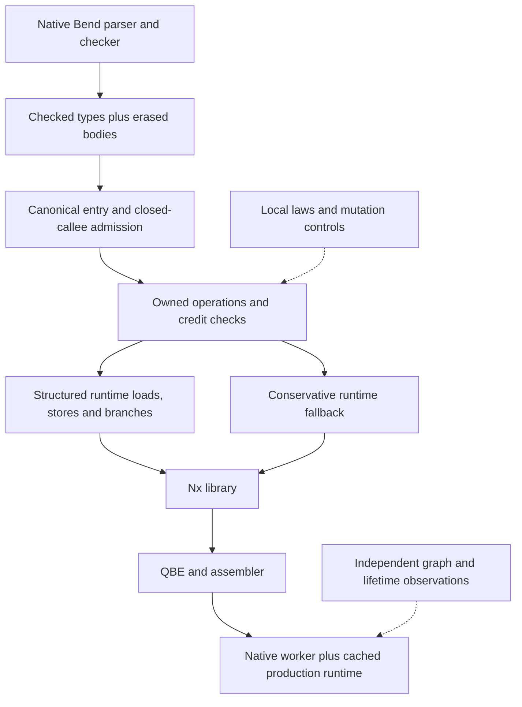
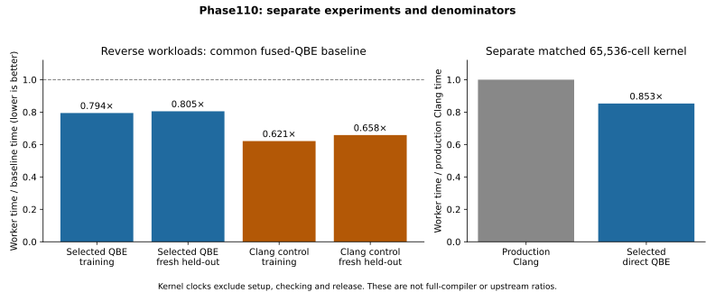
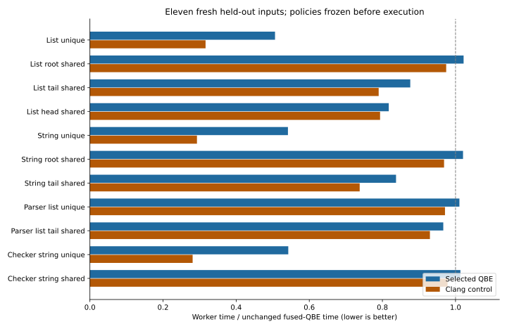
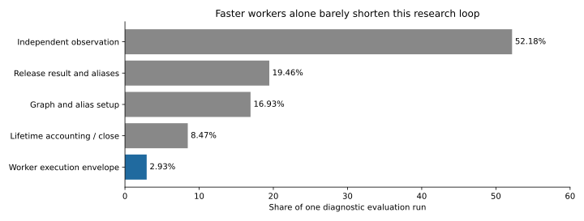

# Phase110 — ownership information that survives native lowering

[Design](../../design/phase110/ownership-laws-and-search.md) ·
[Experiment log](../../experiments/phase110/P110-001-owned-interfaces.md) ·
[Compiler guide](../../docs/self_hosted/OWNED_NATIVE_IR.md) ·
[Replay](../../selfhost/tools/performance/phase110/README.md).

Baseline `7fc45f3`, branch `selfhost/bootstrap`. The planned window is
2026-10-18 18:59:56–21:59:56 UTC. Compiler/runtime changes stopped before21:30;
the final work consolidates evidence, replay commands and this report.

The direct backend now preserves ownership into structured runtime operations,
accepts canonical checked entries and closed ordinary calls, and runs through a
qualified native Bend frontend. Its selected QBE policy uses **19.5% less worker
time on eleven fresh held-out reverse workloads** than Phase109's fused-QBE
baseline. On a separately matched compiler reverse kernel, it uses **14.7% less
time than the existing production Clang worker**. These are kernel results,
not a new whole-compiler or upstream speed ratio.

## What changed

The algorithms remain written in Bend. The pipeline preserves the original
checked `KDef` type alongside its `NativeErasedBody`, derives canonical entry and
closed-callee contracts, checks ownership operations, and lowers them into Nx.
Native requests emit QBE directly. A cached object supplies the production
allocator, tagged Terms and reference counts. The C emitter is an independent
backend control for the same graph; C strings and cproc are not intermediate
steps in ordinary direct worker compilation.

Previously, even fused reconstruction crossed opaque helper boundaries for
known constructor tags, field positions and ownership transfers. The new private
runtime IR makes these facts available to machine lowering. Single-context
loads and the reference-count-one path are explicit; shared and static objects
retain the conservative fallback. A correspondence verifier regenerates the
private template from admitted ownership operations. It is a structural gate,
not a mathematical proof of runtime or machine semantics.

Ordinary calls transfer one ownership credit per argument and return one credit.
A returned physical word may alias an argument. Scratch transfers finish before
another call, runtime imports cannot masquerade as owning source callees, and
generated-name namespaces are checked. Canonical `String` and `List<&2,String>`
arguments/results support one to eight live arguments. Generic specialization,
arbitrary datatypes, closures, indirect calls, effects, parallel scheduling and
device execution remain outside this slice.

## Measured runtime results

The final training comparison uses five alternating rounds, seven frozen input
families and eleven immutable worker binaries. Selection requires at least a 3%
gain over the relevant incumbent and improvement in every round. Extra complexity
does not win merely by producing the smallest noisy median. The final eleven
held-out inputs were frozen before selection and first executed afterward.

| Worker | Training / fused QBE | Fresh held-out / fused QBE | Decision |
|---|---:|---:|---|
| Compact general runtime IR, QBE | 0.7943× | **0.8051×** | Selected experimental QBE policy |
| Stored-field refinement, QBE | 0.7811× | Not selected for final evaluation | Incremental gain below 3% |
| Wrapper reuse, QBE | 0.8157× | Not selected for final evaluation | Slower than compact general |
| Combined refinement, QBE | 0.7920× | Not selected for final evaluation | Incremental gain below 3% |
| Delayed-load refinement, QBE | 0.7832× | Not selected for final evaluation | Magnitude/round rule fails |
| Wrapper reuse, Clang control | 0.6211× | **0.6582×** | Fastest control; not a QBE-backend replacement |

The QBE held-out geometric mean improves 19.49%; four individual cases regress
slightly, by 1.07–2.21%. Unique deep List/String cases take about 0.51–0.54× the
fused baseline time. Shared-root cases have less removable work. The Clang
control improves all eleven cases and the geometric mean by 34.18%.

The separate `production-compare01` run uses the preserved production Clang
binary and the new QBE worker, the original thirteen semantic controls, five
alternating rounds, and 20 repetitions of 65,536 List<String> cells:

| Matched worker | Median worker time | Time / production Clang |
|---|---:|---:|
| Existing production Clang | 13.966 ms | 1.0000× |
| Selected direct QBE | 11.914 ms | **0.8531×** |

All five paired ratios are below one (0.806–0.856). This comparison uses a direct
current denominator; it does not multiply historical ratios. The existing reverse
worker already had a direct loop, so there is no trampoline-removal credit.
The compiler source used as input data in some reverse cases does not make those
measurements complete parser, checker or compiler executions.

The production comparison receipt omitted an explicit GCC pin because its tool
name filter missed the versioned executable basename. A subsequent read-only
audit found the current executable's exact hash equal to the historical tool.
Worker/runtime objects and the compared production binary are pinned; this
receipt limitation remains documented rather than retroactively rewriting it.

## Why some attractive variants did not win

Making ownership operations visible was useful. Moving every operation into a
more complicated helper interface was not. Typed pair returns, stored-child
refinements and wrapper recycling have different register and stack costs.
QBE and Clang prefer different code shapes.

On one explicitly selected unique-list path, machine inspection counts 100
instructions and five stack accesses for compact-general QBE. Delaying the old
child load reduces that to 79 instructions and two stack accesses, but does not
earn the required measured gain. It also leaves only six selected instructions
between the next-node load and the backedge, versus 56 in the simpler path.
Lost memory-latency overlap is a plausible explanation, not measured cycle
attribution. Instruction count alone is an inadequate cost model.

The final choice deliberately retains the simpler QBE profile. The original
generic Take/List.last comparison also showed essentially no gain (1.0147× the
fused control in that screen). Faster reverse does not imply every source
function becomes faster. See [ABI analysis](abi-audit.md) and the archived
disassembly/path selections for the exact assumptions and excluded paths.

### Transfer beyond reverse

After freezing the selection, `native-transfer01` compares that fixed QBE policy
with fused QBE on actual compiler nt_append and actual Base String.append.
Every product comes from the native image. All original whole-value, alias and
lifetime checks run before timing and on every timed repetition. Five paired
rounds use the same cached runtime; this is a transfer diagnosis, not reselection.

| Computation/input | Median selected / fused | Paired range |
|---|---:|---:|
| nt_append, same shared root | 0.9215× | 0.846–1.019× |
| nt_append, shared tail | 0.7180× | 0.681–1.305× |
| nt_append, distinct deep inputs | 0.6246× | 0.506–0.637× |
| String.append, shared left of depth512 | **1.1584×** | 1.137–1.280× |
| String.append, unique left of depth1024 | **1.0519×** | 1.033–1.060× |

The append medians improve, with a noisy round on two shapes. The recursive
String.append regression is consistent across all rounds. The structured runtime
template obtains and validates heap/allocator pointers on every worker entry.
Reverse amortizes those two calls over a loop; non-tail recursion repeats them
per cell. [P110-002](../../experiments/phase110/P110-002-context-boundary.md)
tests this mechanism with a separate ABI experiment. Its candidates and reused
inputs are explicitly separate from the frozen native selection and fresh
performance held-outs.

### Validate the context once across a closed call chain

The final diagnostic succeeds without changing the selected native image.
Exported wrappers retain both original validation calls. Private owning workers
either receive the stable heap/allocator pointers as two borrowed arguments, or
load them from authenticated context offsets. This depends on one synchronous
context, stable arena/allocator bases, and empty scratch across calls; it does
not authorize concurrent or foreign reentry.

`context-machine02` tests the exact same ownership graphs and byte-identical
runtime object. All 18 workers pass 234 original semantic observations across
String.append, nt_append and reverse. The emitter passes 31 named Bend controls,
54 malformed-certificate refusals and exact baseline QBE/C comparisons with the
qualified native products. Five paired timing rounds give:

| String.append input | Threaded QBE / compact QBE | Context-load QBE / compact QBE | Threaded Clang / compact Clang | Context-load Clang / compact Clang |
|---|---:|---:|---:|---:|
| Shared left, depth 512 | 0.9040× | 0.8841× | 0.8821× | 0.9072× |
| Unique left, depth 1,024 | 0.8501× | 0.8571× | 0.8340× | 0.8426× |

Every paired ratio is below one. One Clang unique-input round is unusually low
(about 0.61–0.63×), so the medians and ranges remain in the raw report. This
supports removing repeated validation on this closed recursive path: QBE uses
about 10–15% less worker time. These are reused diagnostic inputs, not new
held-outs. There is no fresh fused-QBE denominator in this experiment; multiplying
the earlier transfer ratios would not establish that its regression is resolved.
Reverse and list append receive semantic regression coverage here, not new timing
claims. The complete machine campaign takes 117.926 seconds.

Machine inspection confirms that both private workers remove the two recursive
getter calls. QBE's baseline body is 548 bytes; threaded pointers grow it to 568,
while direct context loads reduce it to 522. The threaded form adds a static
stack-memory site. Context loads preserve the original three-argument recursive
ABI; pointer threading needs five. Clang's corresponding body sizes are
409/415/375 bytes. This is a concrete example of a cross-layer choice: both
representations remove the same checks but have different register costs. Neither
form wins every input/backend, so no universal policy is selected from two cases.

The experiment also exposed a development-tool limit. Exact regenerated-machine
comparison through Base String.eq overflowed the hosted stack on the reverse
certificate. A full-codepoint tail-recursive Bend comparator preserves the exact
gate and emits a constant-stack loop. Early invalid binder/match forms remain
failed receipts. The first machine run then lacked Clang's stddef.h; the successful
runner pins the GCC header and applies identical include flags to all Clang
variants. No semantic oracle, runtime behavior or selected source was changed to
make these failures pass. Full details are in the [context correctness review](context-call-correctness.md)
and [machine audit](evidence/machine08-analysis.md).

A final synthetic eight-owner call witness passes 24 independent observations
across six builds, including eight physically aliased arguments and both release
orders. Inspection verifies QBE's eleven private arguments across six registers
and five stack slots. Clang removes unused private arguments, so its successful
semantics do not qualify that exact eleven-argument machine ABI. This is a calling
convention witness, not an expansion of actual-source language coverage.

## Laws and correctness evidence

Twenty-three distinct local laws were elaborated without opaque definitions and
checked independently through the existing BendTT/Lean path:

- Five field/selector laws and five additional reconstruction laws.
- Four stored-field invariance laws.
- Nine exclusive-wrapper reuse laws.

Fourteen well-typed model mutants distinguish the laws from mere typechecking:
the changed law-free models are accepted, while the unchanged laws reject them
in the source checker. That is not fourteen negative independent-kernel runs.
Two further mutations change actual compiled consumer instructions while leaving
the ownership graph unchanged; exact runtime observations catch the wrong field
and the lost remaining child. This demonstrates complementary coverage from
model laws and physical execution, not whole-compiler correctness.

The runtime bridge still needs concrete layout, writer, separation and
single-context premises. Stored-field and wrapper laws do not prove those
premises automatically. The actual probes cover reference counts one/two,
shared/static inputs, overlapping physical children, allocator handoff,
retained aliases, both release orders, scratch state and zero live allocations.
The selected general Take probe passes 120 observations; selected reconstruction
and wrapper probes each pass 70. Additional delayed-path probes retain their
own scope and results. These totals overlap and are not a count of unique
language-conformance tests.

Ordinary-call controls include actual compiler `nt_append`/`nt_reverse`, Base
List selectors, and independently frozen call shapes. Fresh append and call-shape
held-outs pass. Typed entry/closure controls refuse unsupported private callees,
generic parameters, erased/type mismatches and runtime-name impersonation.
Details are in [IR audit](ir-audit.md), [law audit](laws-audit.md) and
[independent coverage audit](coverage-audit.md).

## Native image and a useful failed experiment

The first general image embedded the complete 75,064-character Base text for
exact authentication. Emission exceeded its 300-second guard. A minimal probe
isolated a size-sensitive cliff: 1,024 characters emitted in 0.718 seconds;
75,064 characters exceeded 45 seconds. Splitting the text into 74 String helpers
also exceeded 45 seconds.

Source inspection explains a credible mechanism. Strings expand into constructor
syntax, while static interning caps the complete image at 65,536 words. The full
text needs 150,128 constructor words. Function splitting does not remove that
global representation pressure.

The successful mitigation packs the identical ASCII bytes into 18,766 U32 words,
requiring 37,532 list words in isolation. The comparator still checks every full
input codepoint, exact length and empty suffix. It is not a hash or truncated-byte
comparison. Eleven hosted controls and fourteen actual native controls pass,
including non-ASCII characters with the same low eight bits. Minimal emission
takes 4.825 seconds and machine construction 2.492 seconds. This is evidence for
a representation fix, not a precise attribution of every compiler stage.

The integrated `native-source05` then emits in **148.836 seconds** and builds
through cproc/QBE in **87.720 seconds**, with a 3.086 GB peak process tree.
These guarded acquisition clocks total 236.56 seconds and are paid once, not on
every direct worker request. The compiler/static cap and runtime are unchanged.

The resulting native image passes:

- Eight exact QBE/C products for four canonical closed roots, plus four refusals.
- Execution of those eight actual native-emitted products: 36 full-value,
  alias-release and heap-balance observations per backend.
- Actual Base `String.append`: 20 independent observations per backend, including
  Unicode, sharing and overlapping inputs. Qualified non-tail depth is at most
  1,024 first-input cells; arbitrary stack depth is not claimed.
- Eight unchanged products for the existing reverse/tail/last/append fixed
  contracts, followed by the old thirteen-case reverse execution gate on both
  QBE and Clang products.

The general command constructs its own checked Base seed and same-source closure.
It does not accept an unchecked caller seed or a flag saying that facts are
trusted. Requested entries must be reachable from checked `main`. Ordinary
requests run native Bend directly; acquisition still uses the mature C backend,
cproc/QBE and GNU tools. See [native usage](../../selfhost/tools/performance/phase110/native/README.md).

## What the research-loop measurements mean

An instrumented pass preserves all eleven original semantic fixtures and checks.
Only 2.93% of its outer clock is worker execution; observation is 52.18%, release
19.46%, graph setup 16.93%, and lifetime accounting/close 8.47%. Even eliminating
the worker cost would improve that fixed evaluation only 1.0302×.

The initial twelve-choice training campaign took 247.683 seconds. Calibrated
repetitions and a changed candidate matrix made later screens much shorter, but
that is an experimental-method change, not recursive compiler acceleration.
The final eleven-choice/five-round screen took about 56.9 seconds. Binaries and
the runtime are cached; expensive observation still dominates many cases.

A faster worker has not yet been substituted into the builder's own critical
path. There is no frozen-builder versus updating-builder causal experiment and
no demonstrated increase in validated discoveries per hour. The
[research-loop audit](research-loop-audit.md) specifies the smallest paired
experiment that could test that claim, including upgrade cost and break-even.

## Ambition reached and remaining boundaries

| Plan level | Result |
|---|---|
| 1×: useful ownership interface and meaningful laws | Implemented, measured and mutation-tested |
| 10×: composable calls, broader admission and bounded policy selection | Implemented; native request/worker gates and fresh evaluation pass |
| 100×: structured runtime decisions and measured improvement machinery | Runtime IR, refinements and loop accounting implemented; sustained recursive acceleration and full direct self-hosting remain unproved |

The installed production compiler and Phase108 full-language cproc/QBE reference
remain unchanged. Phase110 does not remeasure broad45 program runtime, production
B1/B2 compilation or upstream conformance. The last broad compilation figures
remain Phase105: prepared45 B1/B2 0.499×/0.517× upstream time, live Base
2.384×/2.231×, and prepared full compiler source 2.602×/2.965×. Those clocks and
denominators must not be replaced by this phase's faster kernel numbers.

The next high-value step is to qualify the context-boundary transformation across
more real compiler callees, with a direct matched fused denominator and unchanged
oracles, then integrate the supported policy into a native image. Preserve these
ownership operations through scanner/allocation computations next. The present
exact certificate gate still serializes machine graphs; its constant-stack
comparison fixes one limit, not all scaling costs. A separate data-constant
representation would avoid the literal cliff more generally. Expanding the
machine backend or building another full image before a smaller transfer gate
supports it is not justified by this phase's evidence.

An ambitious constructor-elimination proposal was also investigated before
implementation. There is no local Build→Take rewrite yet, but the inspected
nineteen distinct saved ownership graphs contain zero immediate opportunities.
The present lowering does not expose the producer/consumer relationship through
ordinary calls. Unlike Phase107 scalar promotion, genuine cancellation could
remove allocation and reference-count work, but it first needs a retained source
witness and a representation-aware ownership equivalence. The
[feasibility note](build-take-feasibility.md) records that decision and the
necessary renaming, raw/RFC-word and alias premises. No dead pass was added.

## Evidence and accounting

The [accounting snapshot](accounting.json), taken after all target work at about
21:35 UTC, covers 155.1 minutes from the start. The union of 167 recorded guarded
process intervals is **27.2 minutes**:

| Recorded target work, including failures | Guarded minutes |
|---|---:|
| Worker evaluation and transfer campaigns | 11.03 |
| Full native acquisition | 8.95 |
| API, admission, semantics and other guarded work | 5.11 |
| Constant-representation diagnosis | 1.73 |
| Independent law checking | 0.35 |

The remaining 127.9 minutes include implementation, analysis, agent coordination,
source preparation and documentation, some overlapping target work. This is not
an idle-time, CPU-time or billing/quota measurement. Final archival and publishing
occur after that snapshot. Root owns all target work; agents prepare disjoint
ABI, IR, controls and law work and inspect saved machine code. The successful
full-image build's 3.086GB process tree is the largest qualified acquisition here.
Disk cleanup verifies archived bytes before removing duplicates, or verifies a
lossless compressed replacement. Resource limits were not relaxed.

Physical source counts in the new experimental tools directory are:

| Role | Files | Lines |
|---|---:|---:|
| Bend algorithms and additive variants | 41 | 2,272 |
| Bend controls and witnesses | 29 | 1,011 |
| Bend laws and models | 10 | 554 |
| C ABI adapters and independent runtime harnesses | 23 | 2,068 |
| Preparation, supervision and analysis | 98 | 6,976 |

These include comments, rejected alternatives and superseded experiment scripts;
generated fixtures, composed compiler images, receipts and prior phases are
excluded. They are not the production compiler's line count or active-code delta.
This phase adds capabilities rather than claiming a line-count reduction. Keeping
the simpler measured QBE policy avoids importing the rejected refinements into
the selected path. Compiler algorithms remain Bend; host scripts assemble,
transport, validate and measure experiments.

The [evidence guide](evidence/README.md) and [manifest](evidence/manifest.json)
describe the verified capsule, exact image/runtime pins, absolute-path limits,
external toolchain dependencies and safe restoration. The
[selection record](selection.json) identifies the usable frozen native version.
Failed image builds, rejected policies, unsupported facts and supervision failures
remain evidence; they are not silently converted into successes. No PR comment
was posted.

Final review rechecks the 13 selection pins, capsule hash and report/guide links.
Whitespace review has one retained extra EOF blank line in the authenticated
context verifier snapshot; other staged changes pass that check. Preserving the
qualified source bytes takes precedence over cosmetic normalization.
