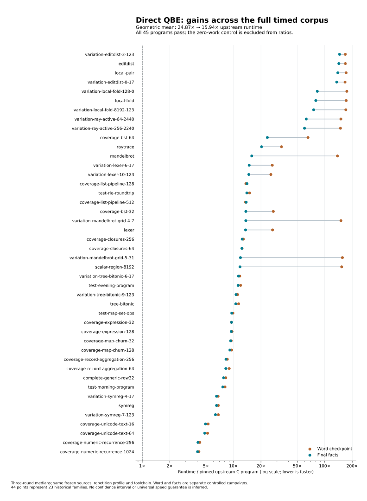

# Phase112: direct QBE compiler performance

Campaign: 2026-10-19 00:41–03:41 UTC, followed by final evidence sealing.
[Design](../../design/phase112/qbe-parity.md) · [Usage](../../docs/self_hosted/direct-qbe.md) · [Experiment history](progress.md).

## Outcome and scope

The largest demonstrated win is removing representation work before native
lowering: retain scalar Word patterns and checked non-owning facts instead of
constructing objects and recovering their meaning through runtime calls. The
compiler and its generated programs improve independently; neither broad program
parity nor complete compiler-request parity has been reached.

All compiler transformations remain written in Bend. The experimental route
uses structured IR→QBE→assembly/link with one cached runtime object; it does not
run C/cproc for each program. The installed production selection is unchanged.
Experimental generations are N1/N2, never relabeled as production B1/B2.

## Controlled measurements

The selected experimental `facts` compiler is **3.32× faster than Phase111 on
the matched compiler-request screen**. Its generated-program aggregate improves
from the word checkpoint’s 24.868× upstream to 15.943× upstream. Requests remain about
2.08× upstream; executable construction is approximately upstream speed in this
three-source screen. These are different clocks, with different remaining gaps.

| Metric | Final facts result | Qualification |
|---|---:|---|
| N1 compiler requests / upstream |2.057×|Three frozen sources, three rotated rounds; transport04|
| N2 compiler requests / upstream |2.071×|Same source and policy as N1; transport04|
| N2/N1 request time |1.0065×|No meaningful generation difference established|
| N2 requests / original Phase111 N2 |0.30153×|3.32× faster; directly matched transport05|
| N2 ready-executable stage sum / upstream |1.014×|Transport04; independent final campaign gives 0.984×|
| Generated-program runtime / upstream |15.943×|44 timed points across 23 historical families|
| Outside the initial six-program screen |16.895×|38 timed points; previously seen in older phases|
| Native self-emission |275.721s|Exact 46,541,018 QBE bytes reproduced; N2 built|
| Assembled source |44,389 lines|+8.00% over Phase111; controls included|

The three compilation inputs are lexer, closures and map churn. Final N2 median
request seconds in transport04 are 1.614/0.815/2.907 versus upstream
0.718/0.554/1.084. Ready-executable stage sums are 1.689/0.855/3.063 versus
1.368/1.089/2.853. Thus the aggregate near 1× result is not per-program parity.
The final matched Phase111 campaign gives 2.086× upstream for facts and
6.918× for Phase111; use its 0.30153 ratio for the phase speedup.

The word checkpoint previously measured 2.448× upstream N2 requests,1.147×ready
executable time and349.70s self-emission. Phase111/word/facts self-build sources
differ, so their self-build times are capability/cost observations, not a
controlled same-source speed ratio. All figures and receipt pins are in
[results.json](results.json); [selection.json](../../selfhost/tools/performance/phase112/selection.json)
identifies the exact experimental source/API/N1/N2/runtime.

Compiler requests are fresh native processes emitting QBE versus pinned
TypeScript under Bun emitting C. Native uses prepared Base; upstream reads its
source Base. Ready-executable times additionally include QBE/as/link with the
cached runtime versus upstream whole-C Clang compilation. Neither metric is
interchangeable with execution of an already-built program. See
[transport methods](../../selfhost/tools/performance/phase112/transport/README.md).

The full runtime follow-up uses the original 45 frozen inputs: 44 timed points
and one checked zero-work control. Three rounds check every full result and
success count. Its equal-point geometric mean is not a mean across 45 independent
source families. Thirty-eight measured points were outside this phase’s six-case
development screen, but had been used in historical phases.

## Broad execution results

All 270 final full-output/count observations pass. Word and facts use the same
frozen 45 sources, arguments, repetition profile, runtime, CPU and tool versions,
but their broad timings are separate controlled campaigns. The normalized
geometric time is 35.89% lower; raw batched time is 35.73% lower. The stronger
matched evidence for individual changes comes from the six-case campaigns.
No confidence interval or universal performance guarantee is inferred from three
rounds. [All 45 rows, including the zero-work control](broad-runtime.csv), are kept.

| Program/input | Word / upstream | Facts / upstream |
|---|---:|---:|
| Mandelbrot |137.72×|15.86×|
| Scalar-region8192 |153.34×|11.78×|
| Mandelbrot grid5 |156.16×|11.92×|
| Local-fold |172.04×|79.74×|
| Local-pair |171.40×|139.14×|
| Edit distance |168.33×|142.78×|

Most points improve. The largest observed normalized slowdown is 3.0% for the
128-element list pipeline, with 1.7% for 512 elements and0.3% for expression 32;
this campaign does not resolve those small differences statistically. The largest
remaining ratios are 135–145× in edit-distance/local-pair cases. Overall gains
therefore coexist with substantial missing backend capabilities.

The [plotting script](../../selfhost/tools/performance/phase112/plot-results.py)
reads the committed CSV and runs no target programs.

## What produced gains

1. **Backward liveness instead of repeated suffix scans.** Six emitted QBE
   products remain byte-exact, 47 independent controls pass, and long let chains
   improve substantially. This also makes the previously blocked Unicode batch
   compile: the old hosted baseline naturally overflows its stack while lowering.
2. **Scalar operations, private workers and continuations optimized together.**
   Exact U32/F32 lowering, bounded direct workers, fail-stop side exits, accessors
   and bounded immutable static images remove generic work. Independent guards
   retain the generic route for unsupported shapes.
3. **Reuse mature scalar-pattern and selector machinery.** The first instrumented compiler
   lexer request constructs 32 Word nodes and 31 wrappers for each scalar conversion.
   Its 1,625,654 such conversions mechanically account for 102,416,202 allocations.
   The composed word/selector candidate reduces allocation calls from 124,677,389
   to 16,515,651, 86.75% fewer. These are event counts, not sampled CPU shares.
4. **Preserve pure work between continuation setup and a call.** The old fusion
   matcher rejects harmless assignments in that gap. Correctly snapshotting
   captures before those assignments allows the ray call chain to compose.
   Matched ray runtime falls 4713→2075ms; its frame calls fall 334,011→66,509.
   The six-case geometric runtime falls 16.69%.
5. **Reuse checked scalar facts before ownership insertion.** Five small
   declaration overrides retain existing parameter/alias kinds, skip ownership
   operations only for known non-owning values, and leave unknowns untouched.
   The six-case facts/gap-if time ratio is 0.9068; lexer 710→460ms. Machine widths
   and runtime ABI remain unchanged. Full integration reproduces all 46,541,018 QBE bytes, builds N2, and passes
   19 focused cases in each generation plus45 successor corpus cases.

The same actual checked scalar-region request provides a structural witness:
its `mit` entry goes from 72 to65 statements, with keeps 2→0 and sinks 5→0. The
frame count before worker planning remains 8, so this witness proves removal of
ownership barriers, not complete loop elimination. Across the whole graph,
keeps 33→13 and sinks 63→39. All six development QBE products from the checked
hosted API also match native N2 output byte-for-byte.

These improvements overlap; their percentages must not be multiplied.
[Profiles](profiles.md), [allocation comparison](profile-comparison.md),
[call boundaries](hot-call-boundaries.md) and [broad generated-code analysis](broad-gap.md)
contain the source and machine evidence. The final profile records fewer frames
and register clears but more allocations than word, reflecting additional
emission work. An [offline reachability audit](private-reachability.md) identifies
3.18 MB of unused private definitions; pruning them remains unimplemented and
no proportional speed gain is claimed.

## Negative results and remaining limits

Increasing private-worker ranks and arity bounds alone did not materially improve
the six-program runtime. The actual obstruction was the shape at call boundaries,
not insufficient iteration limits. Repeated/ranked composition is useful only
once specific lost information is restored.

The late immediate-helper fast path is **rejected**. Its isolated controls pass,
but a real Unicode program prints the initial text correctly then fails later
equality checks. Reversibly collapsing 107 new conditional expansions makes all
637 function bodies match the passing program after numeric-name normalization.
The exact root cause is unresolved. The selected facts composition excludes it.
[Failure and witness](immediate-rejection.md) are preserved.

Runtime register-bank zeroing remains unchanged. Current verifier/runtime
contracts do not prove that inactive words can be left untouched across every
continuation and late getter. Removing that work without strengthening the
contract would be unjustified. See [register transport](register-transport-opportunity.md).

The broad follow-up exposes large gaps that the six-program screen
misses. Upstream often keeps flat scalar/product loops where this route still
allocates carriers and traverses continuations. Local-pair structurally creates
327,680 temporary carriers per grid before additional RC wrappers; this is a
source count, not a measured percentage of runtime. QBE cannot infer the original
ownership and product meaning through these generic runtime boundaries.

## Correctness and simplicity

Qualification separates checked source, exact source/runtime admission, negative
mutation tests, independent native semantic fixtures, whole-program outputs and
bootstrap consistency. The original structural verifier remains mandatory.
These checks are not a whole-compiler proof or whole-language conformance claim.
The word checkpoint self-reproduces exact QBE and passes 19 successor-focused
cases and all 45 frozen batch outputs. Facts additionally passes all 45 one-shot
corpus programs through N2 and 19 focused cases in both N1/N2; native self-emission
takes 275.721s. Loaded ELF code/data and memory layout
match across generations except build-ID metadata; raw executable bytes differ.

The implementation reuses existing Word/selector/type facts and keeps one
runtime ABI, but assembled code has grown. Word is 43,588 lines; facts is 44,389
lines and 5,578 declarations, versus Phase111 41,103 lines and 5,142 declarations.
The latter is 8.0% more lines, not a simplification in line count. Facts QBE
grows from word’s28.46MB to46.54MB and its N1 ELF from 8.08MB to 10.02MB as
more direct code is retained/copied; that code-growth cost is explicit. Compared
with Phase111, final QBE is still smaller (50.66→46.54MB), as is the compiler ELF
(15.73→10.02MB). These are exact
assembled experimental-source counts, not repository or handwritten-core totals.
[Complexity accounting](complexity.md) states what is included.

## Ambition levels and what remains

The 1× plan delivers the usable direct optimization infrastructure, compiler
speed gains and reproducible comparisons. The 10× plan begins by retaining
semantic facts and jointly composing ownership/calls; it does not yet provide
a complete typed functional IR or flat cross-call product ABI. The 100× research
loop, learned policies and coordinated runtime/layout search remain proposals.
No automatic recursive acceleration has been demonstrated. The priority target
of 1× upstream compiler requests and generated-program runtime remains unmet.

The next experiments are [ranked here](next-architecture.md): preserve more
checked facts where measured work disappears; flatten products across calls and
array operations; then admit mutually tail-recursive groups as direct loops.
Each starts with structural evidence, independent controls and a small matched
measurement before another full acquisition. Another machine backend is not
justified by the observed loss of semantic information.

## Time, resources and evidence

Root owns one serial CPU 3 target queue; agents prepare code, independent controls
and source analysis. Full jobs enforce 4GiB process-tree RSS and 16GiB available
memory; small jobs 2GiB. The final full integration peaks at 2.91GB tree RSS
inside its 618.37s guard. No parallel/GPU performance claim is made. Authenticated
hardlink deduplication recovered 1.48GB while retaining historical paths/bytes.

The [time account](time-use.md) reports measured guard-interval unions, not token
billing or inferred agent labor. The [evidence index](evidence/README.md) records
raw receipts, failures and artifact hashes. Large generated sources/images stay
local; bounded receipts are committed. [Progress history](progress.md) preserves
the sequence of decisions and intermediate results.
