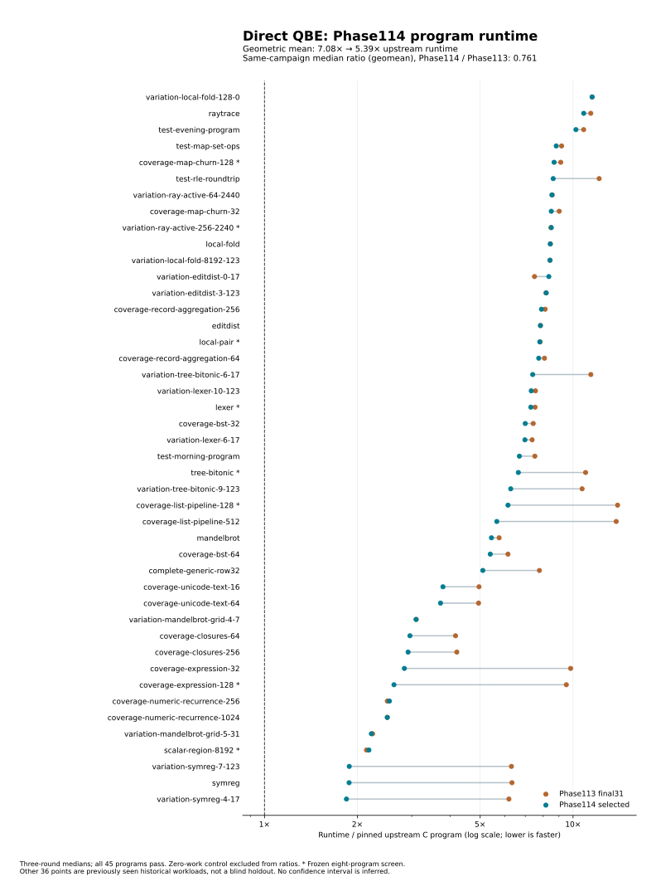

# Phase114 — visible runtime semantics and bounded compilation

Started 2026-10-20 21:31 UTC from `6259718`.
[Design](../../design/phase114/qbe-parity-and-staged-runtime.md) ·
[Architectural comparison](../../design/phase114/architecture-options.md).

The selected QBE compiler reduces broad generated-program runtime from
**7.082× to5.386× pinned upstream**, measured together on the original45 corpus
(44 timed points plus one zero-work control). That is **23.95% less runtime,
or1.315× faster**. All405 complete-output/count observations pass. Parity is not
reached. These products were emitted by the checked hosted Bend API; native
self-reproduction is being qualified separately. Installed selection is unchanged.

The improvement extends beyond the frozen eight-program development screen:
the other36 timed points improve6.925→5.337× upstream (22.93% less time). These
are previously seen historical workloads, not a blind holdout. Across44 medians,
33 decrease,6 tie and5 increase. The only increase above3%,
`variation-editdist-0-17`, does not reproduce: five additional paired rounds give
both old and new a389ms median. The original broad score retains its434ms
candidate median; the repeat does not replace or cherry-pick that observation.

[Exact summary](results.json) · [Per-program samples](broad-runtime.csv).

The main finding is that **retaining recursive computations as local control
regions matters much more than exposing isolated runtime helpers**. Eligible
recursion uses local descent/unwind and a closed continuation table, preserving
the explicit stack, owning captures and generic fallback. This removes global
dispatch and register-bank transfers. Unary representation packing and structured
frame access add smaller gains. The best three-kernel screen is2.449× faster;
its size must not be confused with the1.315× broad result.

The selected assembled source grows48,839→50,565 physical lines (+3.53%), and
2,232,290→2,306,291bytes. This phase adds capability rather than simplifying LOC.
All compiler transformations remain Bend; the host scripts transport files and
measure outcomes. The separately prepared scalar-operand experiment is not in
this selected source or the broad score.

Runtime integration takes214.314s for19 ordinary programs plus the frozen eight,
then634.502s for the remaining37 acquisitions and the complete paired45 campaign.
Neither gate exceeds433MiB process-tree RSS. Source checking and full native
acquisition have separate larger limits and clocks. All target work uses one
serial CPU3 lane; source-only agent work overlaps it.

## Verification reuse: first completed change

The Bend optimizer now has an internal verification session: validate the
unchanged original graph once, retain its IDs, and validate each changed direct
function graph. The independent final verifier remains. Invalid transformations
keep the prior valid graph. No external certificate authorizes emission.

All18 positive controls pass. Ten ordinary source requests in two A/B/A/C/A
sequences preserve exact QBE and constructor catalogues across the baseline and
candidate, including repeated names with different layouts. Local-pair and the
list-pipeline workload also emit byte-identical whole QBE files before/after.
This establishes generated-product nonregression for these requests, not a
whole-compiler theorem.

Single-run stage diagnostics, seconds (not a qualified speed benchmark):

| Source | Prior inline + range stages | New boundary + inline + range stages |
|---|---:|---:|
| local-pair | 4.702 | 3.242 |
| coverage-list-pipeline-128 | 1.622 | 0.636 |

The separate final verifier remains in both cases. Full-image scaling now completes; see the acquisition result below. Exact receipts are under `selfhost/build/phase114/`: baseline/cached
split reports, `scaling-controls01`, `scaling-session01`, and associated guards.
Compiler source: `phase113/p114-scaling-source01/compiler.bend`, SHA256
`57247caf806136c4581ae23191449775348246a496852a9f14c174dde0373685`.

## Runtime experiments and their disposition

The first runtime template exposes two-field constructor consumption to QBE,
with ordinary runtime fallback for shared/static/allocator-boundary cases. It
uses the unchanged authenticated runtime object. Its source API and exact
source/runtime admission pass. Five ordinary generated programs pass complete
outputs: two-owned-fields, nested-owned-fields, string-field-alias,
append-owned-suffix and recursive-fallback-shapes. Three paired kernels improve
only2.83% in geometric mean elapsed time, still11.16× upstream on that selected
set. This establishes limited reach and motivates representation/control work;
it does not justify a broad performance claim.

The ambitious prototype keeps a recursive constructor spine in a local
descent/unwind region while preserving the original explicit frame stack and
allocation order. Candidate04 passes source checking, actual admission and seven
ordinary complete-output gates. List-pipeline improves700→464ms over three
paired rounds (1.509×). Tree and lexer QBE remain byte-identical; their small
timing changes are noise. Initial checker failures are retained. The later general continuation and table extensions below supersede this first slice.

The next representation experiment restores mature unary constructor packing
at the shared constructor lowerer. Source checking, exact runtime admission,
all four ordinary output checks and27 benchmark observations pass. Three paired
rounds give tree554→490ms (11.55% less elapsed time), expression488→459ms (5.94%),
and list700→699ms (effectively unchanged). The three-case geometric mean improves
5.995%, still10.723× upstream. This is separate from the recursive candidate.
See [P114-003](../../experiments/phase114/P114-003-unary-representation.md).

## Full compiler acquisition now completes

Verification reuse plus the mature product signature index emits the complete
compiler's own source in502.479s guard wall, peak3.547GiB. The output contains
60,356,569 QBE bytes,33,800 segments and808 direct functions. Stage seconds:
frontend206.715; product planning96.965; verification boundary33.149;
inlining/direct check30.502; ranges/direct check28.769; final verifier43.014;
QBE emission59.808. The signature index preserves first-definition lookup and
exact QBE on the two small staged kernels.

The QBE/as/link machine build completes in7.969s. Its native image passes all
five fast-suite programs in5.777s. This clears the prior600s lowering timeout;
these changed-source observations are not a controlled speed ratio. This intermediate checkpoint does not establish N2/full self-reproduction. It contains the scaling/index changes only; the runtime candidates were separate at this point.
Receipts: `phase114/catalogue-full01`, `phase111/p114-catalogue-native01`,
`phase111/p114-catalogue-native-fast01`, and corresponding Phase114 guards.

## General continuation result

The next prototype admits a bounded captured environment and a checked local
resume helper, preserving operations after recursion. Both independent ordinary
controls (zero captures and multiple owning captures) pass complete outputs.
The initial second fixture had a frontend-invalid local match; its preserved
v2 gives that match an explicit helper argument, with unchanged expected bytes.

In three paired rounds, list pipeline falls766→360ms (2.128× faster than31),
while lexer393→392ms is unchanged. All18 measured outputs/counts pass. The list
remains6.923× upstream; the two-case geometric mean is7.295×. This is a broader
local-control mechanism, not aggregate45 parity. Source/receipts:
`phase113/p114-general-source01`, `phase114/general-controls-plan02`,
`phase112/p114-general-screen01-measure`.

The final-emission frame/pop/get expansion passes source/runtime admission,
12 structural groups,11 ordinary programs and36 benchmark output/count checks.
Four-case elapsed time falls5.47% geometrically (tree555→523ms, lexer358→345,
list707→674, expression489→451), still9.830× upstream on that subset.
See [P114-005](../../experiments/phase114/P114-005-fixed-transport.md).
The later combined results below supersede these isolated screens; isolated ratios are not multiplied.

The eight-program development screen is frozen before candidate timing, uses
unchanged original45 sources/oracles/repetitions and includes scalar, arrays,
ray, lexer, list, tree, expression and map workloads. It does not replace45.
All target work is serial on CPU3 with memory/time guards. No PR comments.

## First combined checkpoint

The combined source (verification session, indexed catalogue, unary packing,
general02 recursive plans and transport01) passes exact composition admission,
17 ordinary complete-output programs and all72 paired benchmark observations.
On the frozen eight-program screen, elapsed time improves15.19% geometrically:
7.810× upstream for31 versus6.623× for this candidate. List695→305ms, tree561→461,
expression490→395, lexer355→339 and map463→443 improve; scalar108→108, pair390→391
and ray425→427 are effectively unchanged. This remains a development subset.

Source SHA256 `23d4d70598bb958c9b30a145594fd5a02f2e988283fdda93ade7a41d4e3a15be`.
Exact receipts: `phase114/combined-admission01`,
`phase113/p114-combined-qualification01-jobs`,
`phase112/p114-combined-screen01-measure` beneath `selfhost/build`.
The17-program plus eight-kernel acquisition/measurement gate takes202.680s wall,
peak380MiB. The later broad45 checkpoint below supersedes this development screen.

## Closed continuation table

The larger region plan now handles multiple resumptions and two-child recursion,
with constant native stack depth and the original explicit frames. The actual
expression evaluator admits six continuation identities; tree scan admits two.
Independent owned-data/caller controls and all36 measured output/count checks
pass. Compared with the prior combined candidate, expression389→163ms and
tree466→358ms; list remains305ms. The selected3 geometric mean improves31.47%,
remaining5.054× upstream. Source and machine evidence are recorded in
[P114-006](../../experiments/phase114/P114-006-local-continuation-table.md).

The generic-to-complete bridge is semantically qualified on its control and48
runtime observations, but improves its selected4 only1.5% over the earlier
combined candidate. It remains optional: static call counts were not a useful
prediction of aggregate benefit. The table remains the main candidate.

## Selected region composition

Structured table unwinding reuses the admitted frame/pop/get renderer. It removes
opaque stack helper calls without changing stack layout or owner transfer.
Trying the table before older narrow plans is neutral alone, but helps when
combined with structured unwinding. In the joint three-kernel comparison, tree
falls554→334ms, list701→290ms and expression491→134ms versus source31. All45
paired observations and five ordinary programs pass. The geometric mean falls
11.364→4.640× upstream on this selected subset (2.449× faster). This is not a
broad45 result. See [P114-007](../../experiments/phase114/P114-007-structured-region-unwind.md).

The separate packed Take1 template passes six structural groups, six ordinary
programs and36 runtime observations, but gains only1.60% over the original table
and makes the list median3.31% worse. It remains optional alongside the complete
call bridge; neither belongs in the selected composition.

The frozen v3 recipe selects verification reuse, indexed product lookup, guarded
unary packing, local recursive regions/table, transport, structured unwind and
table-first precedence. Its exact checked source has6,377 declarations,
2,306,291bytes and SHA256
`4fb0572f0a011f6c1921594372d816bb49f26289ecc0e079328edd7491598587`.
Source/API/runtime admission,19 ordinary programs and the broad45 integration
pass; native integration is in progress.
Reproduction uses `integration/prepare-v3.py` and
`integration/recipes-v3/table-unwind-first.json`, followed by checked API and
`integration/admit-v3.py`; [instructions](../../selfhost/tools/performance/phase114/integration/README.md).

## Stack-bounded native integration

The first full acquisition of the selected runtime candidate passed frontend
checking (221.705s) and lowering (201.763s), then failed final verification with a
host `RangeError`. The run took472.137s and peaked at3.121GiB. Its output receipt
is retained; it produced no native image. Inspection found that the added
namespace check recursively traversed35,734 segments through a nested Boolean
conjunction. That consumes host stack even for a flat list. The saved exception
has no stack trace, so attribution to this concrete defect is an inference from
the generated code, rather than an observed exception frame.

The v4 composition replaces six pure list walkers with accumulator loops. It
preserves the predicates, original verifier and final admission gate. Independent
review establishes the finite-list identity `go(xs, valid) = valid && old(xs)`;
[actual generated JavaScript](namespace-js-review01.txt) has six loops and no
self calls. Three frozen ordinary requests (tree, list128, ray) produce
[byte-identical complete QBE](namespace-products01.json). This is scoped product
evidence, not an assertion that every future input is byte-identical.

The repaired source02 SHA256 is
`500211d484785778e75d5d4388b0d5ebc7282effd233c6b8f3d0e0269ac777f8`,
2,306,979bytes and6,383 declarations. Its checked API and exact composition
admission pass. The native generation chain is running through unchanged gates.
The broad runtime campaign remains bound to source01; the traversal repair
changes compiler validation, not its target renderer.

## Scalar operands: tested, deferred

The optional whole-function scratch-use audit removes a temporary buffer only
when every use belongs to a recognized scalar operation. Unknown uses, aliases,
loads and mixed operations retain the original renderer. Structural controls
show arithmetic scratch stores8→0 and conversion1→0; a mixed square-root case
retains3→3. The ordinary complete-output control covers floating-point bit
patterns, comparisons, signed zero, conversion and the fallback.

The paired two-program screen passes24 observations: ray425→411ms, local
pair389→391ms. Geometric elapsed time falls only1.41%; the candidate remains
8.018×upstream on this selected pair. This is insufficient evidence to promote
the extra audit/renderer complexity. It is excluded from the selected source.
The compiler remains written in Bend; Python orchestrates file preparation and
measurement, and does not implement this transformation.
