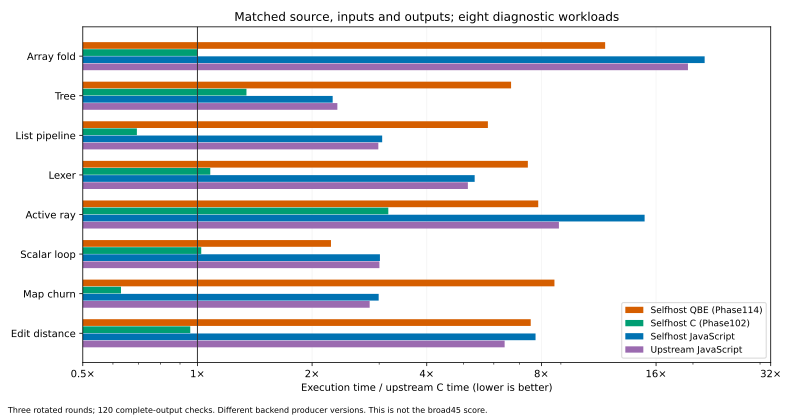
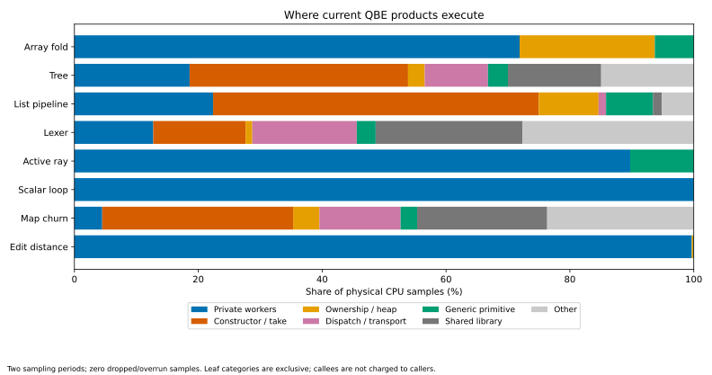

# Phase116: where the QBE runtime gap actually comes from

The most useful result is that **our existing C backend already demonstrates
most of the desired performance on the same programs**. In this eight-program
matched diagnostic set, QBE takes 6.649× upstream C time, selfhost C 1.089×,
upstream JavaScript 4.906× and selfhost JavaScript 5.490×. These are selected
workloads, not a replacement for Phase114's 44-point 5.386× broad score.
No production compiler, optimizer, runtime, installed selection or qualified
image was changed. This phase collects evidence and ranks the next experiments.

[Design](../../design/phase116/profile-and-backend-comparison.md) ·
[Exact results](results.json) · [Source comparison](backend-source-audit.md) ·
[Machine hotspots](machine-hotspots.md) · [Prior evidence audit](profile-evidence-audit.md) ·
[Reproduce](../../selfhost/tools/performance/phase116/README.md) ·
[Evidence capsule](evidence/summary.json).

## Matched execution comparison

All five roles compile the exact Phase93 Bend fixture and execute identical
arguments and complete-result checks. Native C uses its retained Clang-O3
products. QBE uses the selected Phase114 direct emitter and runtime. Selfhost C
uses selected Phase102 products and their authenticated continuity records.
JavaScript is freshly emitted by installed selfhost JS and pinned upstream,
then both run on Node 24.18.0. Different compiler/backend histories prevent
attributing the entire difference to QBE's machine optimizer alone.

Three rotated rounds use four times the existing 50ms profile repetitions,
with 32 explicit warmup iterations for every role. Timings are the program's
measured interval, including complete-result validation; fresh process wall
clocks are also retained. Startup is excluded by the in-program timer, but JIT
work during the interval remains part of JavaScript performance. These are
serial CPU3 observations; no profiling runs contribute timing samples.

| Program | Upstream C ms | Selfhost C / upstream C | QBE / upstream C | Upstream JS / upstream C | Selfhost JS / upstream C |
|---|---:|---:|---:|---:|---:|
| Array fold128 | 201 | 1.00× | 11.76× | 19.40× | 21.46× |
| Tree | 200 | 1.35× | 6.66× | 2.33× | 2.27× |
| List pipeline128 | 199 | 0.69× | 5.79× | 2.98× | 3.06× |
| Lexer | 186 | 1.08× | 7.37× | 5.13× | 5.34× |
| Active ray256 | 217 | 3.17× | 7.85× | 8.89× | 14.93× |
| Scalar loop8192 | 215 | 1.02× | 2.24× | 3.00× | 3.01× |
| Map churn128 | 227 | 0.63× | 8.66× | 2.83× | 2.99× |
| Edit distance | 212 | 0.96× | 7.50× | 6.41× | 7.72× |

This is evidence of recoverable implementation headroom. It does not prove that
porting one C optimization into QBE obtains the C result. Clang also supplies
inlining, scalar simplification, loop optimization and register allocation.
Ray remains a material deficit even in our mature C backend. JavaScript is a
useful structural reference, but is not the fastest baseline on these workloads.

## Dynamic evidence changes the priority order

The existing main-thread sampler profiles **unchanged native ELFs** at 8ms and
13ms periods. All 48 captures have zero drops/overruns and at least 95% process
CPU coverage. Their 21,301 pooled physical instruction samples cover all eight
programs and three native roles. Each case/role has more than 500 pooled samples.
Two periods help expose sampling aliasing; this remains statistical leaf
attribution, not an inclusive call stack or exact operation counter. Unsized
QBE text symbols use the next text-symbol boundary, explicitly recorded in the
method. External libc addresses are normalized against their actual mappings.

1. **Arrays: preserve representation facts across the entire lifetime.**
   About 71% of fold samples execute its array loop, 22% generic destruction,
   and 6% the array-fill primitive. Edit distance spends about 92% in its cell
   worker. Machine code confirms repeated tag/location/class/scalar checks,
   64-bit Term cells and scratch joins. The faster C fold uses packed 32-bit
   elements, an invariant address calculation and a short unrolled loop.
   Importantly, QBE already computes the mature scalar/unshared admission
   certificate. The missing step is a verified per-value layout/access contract
   and coherent creation, access, clone and destruction. This is more than
   deleting a conditional in an array helper.
2. **Map/tree: owning interfaces recreate work that borrowed interfaces avoid.**
   Tree samples put 17.6% in constructor creation and 17.6% in extraction; map
   puts 16.3% and 14.6% there. Hot extraction PCs enter the shared RFC path:
   unique ownership cannot simply be assumed. Map's selfhost C output includes
   borrowed Map.bit.go/String.cmp observers and ordinary-worker forwarding;
   QBE has no corresponding observer workers. Tree's warp family dominates
   named Bend leaves. Its scan worker has only 3 of 930 samples, so the earlier
   four-field Stat proposal should not lead the next tree optimization campaign.
3. **Lists and generated strings: destination passing is an existing capability.**
   List constructor/take helpers alone occupy roughly half of QBE samples.
   The mature C path already uses constructor-loop destination passing and
   consumed-cell reuse for the builder and mapper. QBE descends into an explicit
   continuation region and reconstructs on unwind. Reusing the existing semantic
   plan could eliminate both frame and reconstruction work. It must retain
   sharing rules, private-hole lifetime, initialization and bounded native depth.
4. **Transport: substantial, but insufficient by itself.**
   Tree's 140 libc samples split into 83 fill and 57 copy samples; lexer's 218
   split into 144 fill and 74 copy. Map has 110 fill and 63 copy. These are memory
   operations, not evidence that malloc dominates. The actual p111_set_regs
   implementation calls memmove and memset, but leaf samples do not establish
   that it owns every library sample. Replacing this boundary with smaller,
   typed transfers is plausible; removing all 15–24% library time alone cannot
   close a 6–9× gap.
5. **Numeric work needs a different treatment.**
   The scalar loop accounts for essentially all its QBE samples and has no
   machine calls. The faster C machine loops use three arithmetic right shifts;
   QBE uses shift/sign-fill/Boolean sequences with zero `sar` instructions.
   Ownership work cannot explain that 2.24× gap. In ray, isect5 receives about
   40% of samples, nearest about 23%, with additional nearest.t and primitive
   work. Typed F32 values/calls, scalar identities and specialization of invariant
   arguments are higher-value than another Hit-product optimization: Hit is
   already flat in the hot route.

The [numeric machine captures](numeric-machine/report.json) preserve exact
functions and counts. QBE isect5 has 49 integer/float register moves, one
generic F32.sqrt primitive call (operation 36) and two static failure-call sites. Those
three static calls are not three executed calls per intersection; the integer
ABI and Boolean/tag validation sequences survive. Upstream's much larger spin_22 contains extensively
combined intersection work and uses hardware sqrt instructions. Whole-function
instruction counts are **not** directly comparable because inlining boundaries
differ. Existing local float-lane gains (about 13% on active ray) remain historical
prototype evidence; no new numeric transformation was implemented here. The
current generic sqrt handler passes a float through double `sqrt` and converts
back, whereas the upstream hot machine region contains `sqrtss`. A direct typed
math boundary is another small candidate; exact rounding/NaN/signed-zero behavior
must be checked before substituting it. This does not explain the whole ray gap.

## JavaScript confirms both transfer and backend-specific costs

Sixteen V8 CPU profiles cover both JavaScript producers on all eight sources.
The array fold spends approximately 26–28% in array_new and 24–26% in GC, with
much of the remainder attributed to the inlined batch loop. Native array
optimization should therefore use C as its target, not JavaScript timing.
Tree/list/map execute similar source function families in both JS producers;
selfhost JS is close to upstream JS there. On ray, selfhost JS spends about
23% in fl while upstream attributes most numeric work to isect5 and surrounding
loops. Its 1.68× runtime gap to upstream JS is real in this screen, but needs a
separate inlining/type/constant-flow investigation. It is not evidence of a new
regression caused by this phase. CPU-profile ticks include startup/JIT/GC and
are not mixed with clean timing ratios or native sample frequencies.

## The compiler is affected too

The exact qualified N1 executable performed the original lexer-scan request
six times. All six complete QBE outputs equal its frozen oracle. Two clean
requests take 2.702s and 2.695s. Four sampled requests yield 1,082 zero-loss
samples; no new executable or self-host build was acquired.

- 16.8% destruction, 7.9% reclamation, 11.1% extraction and 8.6% constructors.
- 17.8% libc: 133 fill, 59 copy, one other sample.
- Additional register transport, dispatch and keep/sink work.

The current compiler's String.cmp generated QBE consumes and reconstructs
strings and nested returned roots, whereas the mature C path has borrowed
observer machinery. This supplies a concrete compiler workload for a general
ownership-preserving transformation. Named comparison-family leaves cover only
3.8%; the runtime helper share is not an inclusive String.cmp cost estimate.
The compiler profile is a single ordinary request, not a full-source self-build
profile or a new B1/B2 comparison.

## Ranked experiments and conditional estimates

These are planning estimates, **not measured improvements**. Gains refer to
current QBE on affected workloads, not the whole 45-program geometric mean.
Prototype estimates include a checked ordinary-source witness, visible removal
of the intended work and a matched fast screen. Integration estimates include
ordinary ownership controls and transfer testing; full native-chain qualification
is a separate, amortized gate. Categories overlap and their gains cannot be multiplied.

| Rank | Experiment | Plausible affected-workload gain | Prototype / integrated range | Confidence and decisive test |
|---|---|---|---|---|
| 1 | Verified scalar-array region: retain descriptor/base facts, then specialize storage and lifetime | 1.5–3× for initial guard/address cleanup; 3–8× for coherent typed lifetime on array family | 1–3h / 6–12h | High confidence in the mechanism, medium in magnitude. Fold + edit distance must lose repeated checks; initialization/destruction need their own evidence. Preserve shared/static/unknown fallback. |
| 2 | Project mature borrowed-observer and typed-field plans into QBE | 1.5–4× on map/tree/text; provisional 1.1–1.5× compiler request gain | 2–4h / 8–16h | Medium. Begin with a checked read-only traversal whose returned roots remain exact, then map and compiler String.cmp. Count avoided reconstruction/retains and measure total caller time. Shared RFC path must remain correct. |
| 3 | Reuse destination-passing constructor plans and consumed-cell reuse | 2–5× on suitable list/string builders | 2–4h / 6–12h | Medium. Existing C is 8.35× faster on the list input, but includes other optimizations. Require disappeared frame/rebuild categories and unrelated list/String transfer. |
| 4 | Scalar identities, typed F32 calls and invariant-argument specialization | 1.3–2× scalar loop; 1.5–3× ray for the larger combined change | 1–3h / 6–12h | Medium. Preserve exact widths, NaNs, signed zero, rounding and evaluation order. Inspect machine arithmetic and profile the actual caller; local F32 moves alone have already shown smaller gains. |
| 5 | Narrow typed register/capture transport with live-prefix clearing | 1.1–1.4× on transition-heavy programs | 1–2h / 3–6h | Medium-low until caller attribution. Preserve all pending captures and runtime root visibility. Do not infer a 5× gain from memcpy/memset samples. |

The first experiment should be the scalar-array region, because the mechanism
is strongly localized and two unrelated workloads are hot there. Next prioritize
borrowed observers: they connect map/tree/text performance to compiler execution.
This sequence offers quick falsification plus a larger architectural payoff.

A clean architecture can share **semantic plans**, rather than rediscover them
from generic runtime calls: checked ownership mode (owned/borrowed/scalar),
layout identity, returned-root relation, destination initialization obligations,
and typed call/result representation. Extract one mature C analysis result into
such a small structured interface and project it into existing QBE. Expand only
when it removes measured work. Do not start another backend or rebuild the
entire IR before the first projection proves useful.

## What reaching 1× or 0.5× would mean

For an individual 5.386× workload, parity requires removing about 81.4% of its
current time; 0.5× requires about 90.7%. The broad geometric mean is not one
workload and these percentages are not a broad dynamic cost decomposition.
No single 20–40% helper category can deliver parity. We need transformations
that remove connected categories of work across ownership, layout and control.

Our matched C products make near-parity a concrete engineering target on most
of this screen. List and map already beat upstream C at 0.69× and 0.63×. Getting
QBE to those shapes is credible; obtaining a universal 0.5× score is unproved
and would need further work elimination or specialization beyond the current
reference. Typed-array gains on a few families also cannot imply broad parity:
coverage and the unchanged workloads still matter.

This phase demonstrates no recursive self-improvement. It identifies a useful
route toward it: a transformation that removes ownership reconstruction in both
user programs and the compiler, then an explicit measurement of whether adopting
the improved compiler amortizes acquisition/qualification in later experiments.
Policy search and a larger autonomous framework remain deferred.

## Evidence, limitations and cost

All 120 clean runtime observations, 48 sampled native executions and 16 sampled
JS executions pass the **unchanged Phase112 complete-output/count/interval gate**
replayed independently; six compiler products are byte-exact. All attempts are
retained. No custom fault reproductions, broad conformance campaign, source
optimization, installed promotion or PR comment occurred.

The profile analysis was corrected before native execution to handle QBE's
unsized text symbols; the original clean-timing script is retained. An early
source interpretation that QBE lacked the scalar/unshared certificate was
corrected by inspecting its actual array-plan entry: the certificate exists,
but stronger representation projection is missing. Earlier static Stat/Mode
priorities are now qualified by measured hotness. The old runtime04 counter
harness was not reused against a different runtime ABI.

Root owns all target execution. Two agents performed bounded source/evidence
reviews only. The four main acquisition/timing/profiling guards plus the compiler
profile total 405.229s of target-supervised work; exact clocks and peaks are
in the receipts. Disk headroom was recovered by hash-checked hard-link dedup of
70,325,607 bytes of immutable generated QBE/assembly/objects; every path and byte
is retained. Source and executables remain untouched. Frozen linked artifacts
must never be modified in place. Agent/token spend is unavailable; wall time
outside guards is not a quota measurement.
