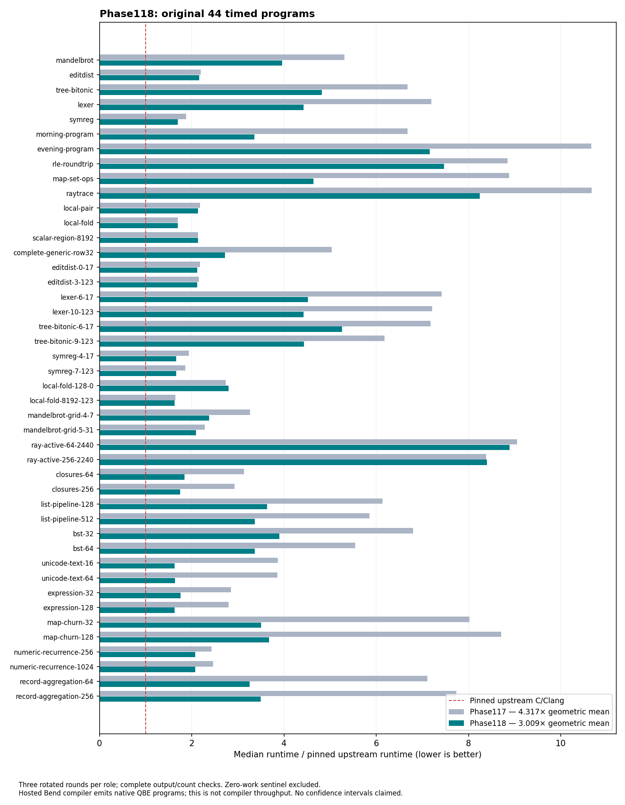

# Phase118: preserve ownership and live transport in direct QBE

**Phase118 has a qualified native N1/N2 compiler and completed runtime/cost evidence.** The completed broad generated-program campaign improves the
44-point geometric runtime ratio from **4.3165× to 3.0089× pinned upstream C**:
1.4346× faster, or 30.29% less execution time. All 405 complete-output/count
observations across the original45 pass. The zero-work sentinel remains a
correctness case and is excluded from ratios. This is a three-round screen,
not a confidence interval or a claim that every program has that slowdown.

[Design](../../design/phase118/ownership-and-construction.md) ·
[Timed source recipe](source-recipe.json) · [Native recipe](source-recipe-safe03.json) ·
[Selection](selection.json) · [Native results](native-results.md) ·
[Reproduction](../../selfhost/tools/performance/phase118/README.md).

## What changed and why

The main finding is that direct QBE had discarded useful ownership and calling
information already available in the compiler. Generic helpers then paid for
sharing, pending recursive construction, and register transport at runtime.
Projecting those facts into generated code gives larger, more transferable gains
than searching among nearly identical optimization policies.

The selected compiler remains written in Bend. It composes these mechanisms:

1. **Destination passing for eligible recursive construction.** Reuse the mature
   structural plan to build through a private pending destination. Preserve
   completion, sharing and publication rules. Select allocation-only helpers;
   consumed-cell reuse did not establish an additional general speedup.
2. **Root-preserving borrowed observers.** Reuse mature observer eligibility,
   keep owning roots alive, and derive readonly workers with a separate structural
   check. The original request still controls effect and provider permission.
3. **Cold constructor facts.** Request-derived sharing information permits
   avoiding unnecessary reference-counted wrappers. Unknown sharing retains
   original metadata. A count-one RFC wrapper is not evidence that its creation
   was necessary; it can be the consequence of eager sealing.
4. **Live-prefix register transport.** An additional checked capability proves
   that a transition needs only its live argument/result prefix. Avoid clearing
   the dead register tail, use the live builtin bank directly, and copy only the
   explicit exit result count. Legacy capabilities retain their behavior.
5. **Known-count and primitive projection.** Specialized constructor/take/extend
   helpers expose constant field counts. Exact guarded U32 division/modulo and
   F32-to-U32 operations avoid generic scratch/helper traffic while preserving
   zero-divisor, overflow-range, NaN and full-word fallback semantics.
6. **A request-bound entry.** Lower and verify the original request once, derive
   its ownership plans internally, and emit. This is reuse inside one request,
   not a persistent checked-IR cache or a caller-supplied semantic certificate.

There is no benchmark-name matching, per-program C translation unit, or cproc
step. QBE supplies machine optimization/register allocation; the separately
cached C runtime supplies the existing runtime plus explicit helper contracts.
The runtime remains GCC-O2 with strict floating-point contraction disabled.

## Broad results

The baseline is the exact selected Phase117 source/runtime, rerun beside the
candidate and pinned upstream executables. Phase117's historical4.240× number
is not substituted for this campaign's4.3165× fresh baseline. Original source,
counts, output oracles and three-role rotated order remain unchanged.

| Workload | Phase117 median ms | Phase118 median ms | Upstream median ms |
|---|---:|---:|---:|
| Lexer | 338 | 208 | 47 |
| Tree bitonic | 334 | 241 | 50 |
| Morning program | 334 | 168 | 50 |
| Evening program | 533 | 358 | 50 |
| Map/set operations | 444 | 232 | 50 |
| RLE roundtrip | 451 | 381 | 51 |
| Mandelbrot | 271 | 202 | 51 |
| Edit distance | 110 | 108 | 50 |
| Raytrace | 608 | 470 | 57 |

No case has a median regression exceeding3% in this screen. Do not interpret
that as a universal no-regression guarantee. Gains are strongest in ownership,
text and constructor workloads; previous array improvements remain. Ray-active
variants still cost roughly8–9× upstream and are the largest measured gap.

The campaign's emission/build/execution guard took358.733s. Broad emission took
255.187s; the experiment is not made cheap merely by shortening its timed runs.
Frozen QBE/object/executable reuse is therefore important for runtime-only and
longer-repeat experiments.

## Ablations and rejected ideas

These are separate short screens, not additive speedups:

| Experiment | Observation | Decision |
|---|---|---|
| Borrowed observers | Map128435→230ms in the initial isolated screen | Keep mature root-preserving form |
| Allocation-only destination passing | Lexer340→254ms initially | Keep |
| Cold facts alone | List288→211ms; lexer334→343ms | Compose and evaluate broadly |
| Live transport | Another roughly9–13% on map/lexer/tree | Keep with capability gate |
| Direct builtin bank | Closure256128→87ms in paired runtime variants | Keep |
| Consumed-cell reuse | List197→210ms; sized version196ms | Reject extra reuse machinery |
| Scalar-only shared observer | Ordinary alias controls pass; map remains183ms | Reject for lack of measured benefit |
| CPU U32 macro alone | Focused screen essentially neutral | Correct CPU lowering; no claimed isolated gain |
| Direct U32 division/modulo | List/lexer improve; first numeric screen noisy | Keep exact guarded projection; inspect machine evidence |
| Sized destination extension | About3% beyond direct division on list/lexer | Keep small general helper |
| Guarded F32-to-U32 | Numeric1024123→104ms, numeric256124→105ms | Keep with boundary controls |
| Destination-slot cursor | Five-round paired list678→660ms; lexer834→841; map717→723 | Reject extra representation complexity |
| Dead scalar cleanup + existing Boolean selection | Paired Mandelbrot845→913ms; lexer833→830ms | Reject; smaller IR produces worse hot machine code |
| Lazy observer eligibility | Exact three-program QBE; paired whole compiler cost1.00045× | Reject for no measured gain |

The cursor comparison uses longer scale4 runs against the selected Phase118
candidate, not Phase117. Thirty complete observations pass. Saving a parent
lookup does not automatically save runtime when the replacement introduces
scratch transport and loses sized-helper specialization.

The first scalar-observer variant failed structural verification because its
branch condition had the wrong width; v2 explicitly normalizes it. The first
numeric-control source had an unfilled reachable declaration; the revised valid
source keeps the original literal expected outputs. Neither failed attempt is
discarded. Two full-source inspection attempts also failed economically: Node's
host stack limit and an overly short120s Bun cap. Prior full frontend time was
222s; another short timeout would not have been a useful experiment.

## Correctness and scope

The selected source passes the checked API gate, the original full45 runtime
oracle,19 ordinary focused controls, and13 selected finite transport/extension
checks. Ordinary controls cover shared and mixed construction, deep recursion,
observer roots, boxed/string/scalar arrays, effects,22 U32 boundary outputs and
13 F32 boundary outputs. Separate reuse prototypes have28 finite checks; those
are not evidence that reuse is selected.

Structural verification, finite controls and output agreement do not constitute
a formal ownership proof. The admitted environment remains Linux x86-64,
one CPU worker, GPU off, and the pinned runtime/provider set. There is no new
CPU-parallel, CUDA, Metal or arbitrary-foreign-provider qualification.

The first full native acquisition passed its source frontend in254.45s, then
failed the integrated compiler stage after332.24s with a Bun call-stack exception.
The guard recorded589.62s total and4.86GiB peak RSS; this was not an OOM or a
deadline. No N1 was produced. The first attempt did not capture its exception stack, so its exact dynamic
culprit remains unknown. A second candidate repairs catalogue traversals and
matches all45 broad and19 focused QBE emissions byte for byte. Its full request
then fails an older eager `nc_pack_foreign` walk after0.966s in lowering. The
captured trace establishes this failure precisely. The old qualified Phase114
source uses the same walk: growth from6,186 to6,384 definitions and available
host stack headroom matter. The earlier staged host did not bypass this scan.

The third candidate adds an explicit DFS worklist with the identical foreign
predicate and children-before-siblings order. Its40 finite/scale checks pass,
including32768-element flat and nested catalogues. Do not infer that all recursive
Bend source consumes host stack: the generated `nt_choose` path uses a trampoline.
The independent [stack diagnosis](../../selfhost/tools/performance/phase118/native-stack-diagnosis.md)
separates that case from eager Boolean recursion. Full native qualification then passes: N1/N2 reproduce85,831,654 QBE bytes, both
pass focused19, and N2 passes45. The safe03 API additionally matches all45 timed
program QBE files and19 control files byte for byte; this does not relabel the
hosted compilation-cost clock. No installed default is changed.

## Compiler cost

Eight sources, one retained warmup and three rotated paired rounds give64
successful prepared requests. Every emitted hash agrees with the independently
frozen output for its own compiler role. Whole prepared-request geometric cost
is **1.12501× Phase117 (+12.50%)**; the admitted optimization/emission entry costs
**1.18662× (+18.66%)**. The326.614s guard peaks at1.155GiB. The compared compiler
is the exact timed float-source01, not the later traversal-repaired source.

This cost regression accompanies the30.29% program-runtime gain. It does not
measure native N1/N2 throughput. Keep acquisition, prepared frontend, optimization,
serialization and machine build clocks distinct; see the [cost method](../../selfhost/tools/performance/phase118/cost.md).
Installed native and JavaScript selections remain unchanged.

## Simplicity and ambition

Selected composed source grows51,056→52,117 physical lines (+1,061,+2.08%). This
phase improves execution speed, not line count. Aggregate broad QBE grows0.94%.
The experiment directory also
retains rejected versions and harnesses; those are not all part of the selected
compiler. The exact19-module timed composition is in `source-recipe.json`. The qualified
22-module native source adds catalogue repairs and analysis controls, reaching
52,411lines (+1,355/+2.65% versus Phase117). Its runtime object grows97,088→113,728B;
the0.94% broad QBE increase is not an ELF-size claim.

The1× goal became a general destination-passing implementation. The10× scope
was useful: borrowing, constructor sharing, transport and primitive projection
compose across unrelated workloads. The100× producer/consumer-fusion idea was
not implemented: current evidence does not yet justify its evaluation-order,
sharing and representation complexity. The cursor prototype tests a smaller
cross-layer representation change and supplies an informative negative result.

No recursive acceleration has been demonstrated. The qualified native compiler
now uses about26% less request time and25% less ready-executable time than a fresh
Phase114 rerun on three sources. N1/N2 request ratios are2.092×/2.110× upstream;
ready stages1.016×/1.024×. Native prepared Base and cached runtime differ from
upstream source Base/full C/Clang. Actual future validated research throughput
must still include acquisition, failed attempts and qualification overhead.

## Remaining opportunities

1. **Typed private scalar/float regions.** Ray computations still cross integer
   Term boundaries; earlier local float-lane experiments gave only small gains.
   Preserve representation across complete internal call regions, then compare
   the actual hot instructions. This needs ABI and semantic controls, not merely
   fewer printed QBE casts.
2. **Representation-aware scalar simplification.** Mandelbrot's selected hot
   region has97 static instructions versus38 upstream, despite no calls or
   spills. The tested cleanup exposes two Boolean diamonds but grows the loop
   to99 instructions and regresses8.05%; it stays excluded. Impossible arms were
   already gone. Future rules must remove normalization at the machine level.
3. **Remaining ownership/continuation cost.** New profiles expose extension,
   field access, allocation and control costs after generic wrapper work falls.
   Prefer removing intermediate construction or a complete runtime transition
   over adding another helper spelling. Require transfer beyond one list case.
4. **Compiler cost and evidence reuse.** Measure the integrated entry and native
   compiler before adding more analyses. Reuse authenticated products for runtime
   ablations. A faster benchmark kernel alone does not accelerate research.

See the evidence-ranked [remaining opportunities](remaining-opportunities.md).

## Evidence and complete-loop cost

The [evidence capsule](evidence/capsule.tar.gz) contains2,386 unique payloads,
32,635,243 uncompressed bytes,5,540,759 compressed bytes, mapped to7,060 original
paths by [its manifest](evidence/capsule-manifest.json). All payload hashes were
read back and verified. It preserves selected/rejected methods, source/API,
reports, small observations and guards. Large machine artifacts remain local
with their pins and explicit omissions; archive membership is not qualification.
[Independent replay](evidence/replay.json) checks all405 output/count observations,
19 ordinary controls and the exact45-source bridge, and recomputes the aggregate.

The [time account](time-accounting.md), through12:48:23UTC, covers180.82 elapsed
minutes and84.41 guarded minutes:102 guards,83 successful,18 failed and1 timeout.
Failed/stopped guards account for17.71min. Native qualification including failed
attempts costs35.58min; broad emission/gates15.48min; focused campaigns13.53min.
Intervals are unioned, not double-counted. The remainder is unclassified, not
measured thinking or waiting time; billing, tokens and quota are unavailable. Three reused
agents performed bounded source/machine/review/accounting work; root alone ran
the guarded targets. Production selection is unchanged, and no PR comment was
posted. Design, implementation, negative results and report are committed together
with their source identities; this phase does not promise runtime parity.
