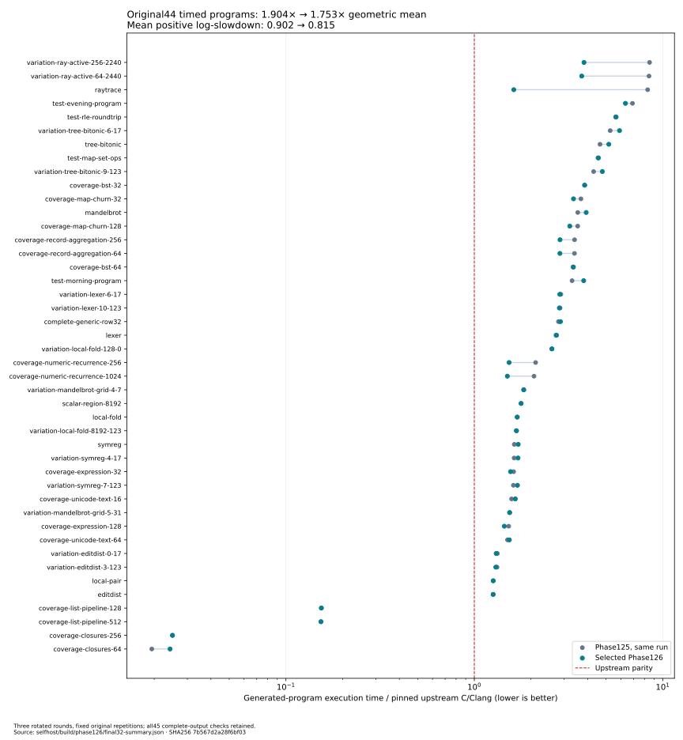

# Phase126: keep representations useful across optimization boundaries

The frozen original44-point runtime ratio improves **1.90357→1.75263× upstream**
in a matched run: **7.93% less geometric-mean runtime** and13.90% less total
fixed-batch time. **Parity is not reached:**40 of44 cases still exceed1.1× upstream.
All405 correctness observations pass, and source32 is native-qualified through
hosted→N1→N2. However, tree/morning programs regress and native compiler requests
cost about22% more. This is a qualified **experimental** program-speed candidate,
not an installed promotion or a research-throughput improvement.
See [candidate identities](candidate.json), [native results](native-results.md)
and the [regression audit](broad-regression-audit.md).

[Design](../../design/phase126/persistent-private-values.md) ·
[Reproduce](../../selfhost/tools/performance/phase126/README.md) ·
[Architecture](../../docs/self_hosted/representation-composition.md) ·
[Semantic review](final-semantic-review.md) ·
[Next opportunities](remaining-opportunities.md).

## Complete matched runtime result

The same original45 sources, complete outputs and repetition counts are retained.
One zero-work sentinel remains excluded only from timing ratios. Three rotated
rounds produce405 checked observations. Timed products come from the checked
hosted API of the selected Bend source; N2 one-shot45 is a separate native gate.

| Metric | Phase125, same run | Phase126 |
| --- | ---: | ---: |
| 44-point geometric ratio to upstream | 1.90357× | 1.75263× |
| Mean positive log-slowdown | 0.902235 | 0.814547 |
| Equal-family geometric ratio | 1.96066× | 1.84688× |
| Cases above1.1× / above2× | 40 / 24 | 40 / 21 |
| Sum of fixed-batch medians | 26.235s | 22.589s |
| Positive excess over upstream | 18.010s | 14.363s |

Positive log deficit falls9.72%; positive excess time falls20.25%. The three
roundwise candidate/parent geometric ratios are0.91508,0.91155,0.92483. These
describe the observed spread, not a confidence interval. The historical Phase125
score1.89221 is retained as history; the gain uses its contemporaneous1.90357 score.

| Program | Phase126 ms | Phase125 ms | Upstream ms | Change vs Phase125 |
| --- | ---: | ---: | ---: | ---: |
| raytrace | 371 | 1905 | 229 | -80.52% |
| variation-ray-active-256-2240 | 829 | 1848 | 217 | -55.14% |
| coverage-numeric-recurrence-1024 | 301 | 417 | 201 | -27.82% |
| coverage-record-aggregation-256 | 570 | 681 | 200 | -16.30% |
| coverage-map-churn-128 | 652 | 718 | 203 | -9.19% |
| test-evening-program | 1268 | 1382 | 200 | -8.25% |
| test-morning-program | 769 | 667 | 202 | +15.29% |
| tree-bitonic | 1040 | 934 | 201 | +11.35% |
| variation-tree-bitonic-6-17 | 1262 | 1126 | 214 | +12.08% |
| variation-tree-bitonic-9-123 | 961 | 864 | 201 | +11.23% |

**Regressions are real observations, not discarded outliers.** Morning is15.29%
slower, and all three tree-bitonic cases are11.23–12.08% slower. Closures64 grows
4→5ms (25% at integer-millisecond resolution) while remaining far faster than
upstream. Eighteen points improve, eight tie and eighteen worsen. The main tree
ownership workers have byte-identical QBE; predecessor lowering and added-worker
layout are candidate causes, not established explanations. Morning changes its
Map/String helper graph and needs a separate ablation. See the regression audit.



[Raw summary](../../selfhost/build/phase126/final32-summary.json) is also preserved
in the final evidence capsule. The strongest remaining fixed-batch deficits are
evening, the tree family, RLE and map/set operations. There is no all-family parity claim.

## What changed

The useful capability is composition: retain information that an existing pass
already established so the next pass can remove a whole boundary. The selected
compiler is still checked Bend emitting QBE directly. There is no generated C or
cproc stage; one small arithmetic helper is added to the cached runtime.

1. **Persistent local floats.** Keep F32 machine temporaries across admitted local
   operations, preserving rounding and explicit observation boundaries. Function
   calls retain the original full-Term ABI. The typed-private-ABI experiment was
   slower and is excluded. This is not fast-math or a promise about arithmetic
   NaN payloads beyond the stated transport/conversion controls.
2. **Finite scalar selectors.** Evaluate small closed selectors into verified
   readonly tables, then project their reads into consumers. Keep the full-width
   default, exact supported operations and a bounded admission policy. Effects,
   nonfinite intermediate values and unknown expressions retain fallback.
3. **Recursive computation composition.** Admit already-safe conditional argument
   preparation into the existing explicit-stack regions, and project the exact
   Nat predecessor operation. A small local admission now unlocks a much larger
   ray computation; stack safety continues to use the existing continuation stack.
4. **Flat observer products.** Give an existing certified borrowed reader a flat
   result interface, then rerun dependency closure with that interface available.
   The production hook matters: merely creating a helper did not activate the
   optimization at the integrated entry point.
5. **Unboxed quotient/remainder.** Authenticate the native Nat.divmod application
   and return its two full-width results in a local 16-byte buffer. This removes
   a temporary heap Tuple, its construction and take. The exact new runtime
   import preserves divisor-zero behavior `(0, dividend)` and performs no
   ownership operation. A final publicly observable Tuple still materializes.
6. **Two-member tail cycles.** Join exact mutual tail calls into one existing-IR
   loop with word arguments and a discriminator. Original wrappers retain their
   interfaces. Exact call/result identity, hygiene, arity and final verifier
   checks remain mandatory; unresolved and non-tail cycles retain fallback.

The selected source SHA256 is
`40c469114c4d1c75dceab456e1979bb5c0278744a02e6dbe4a37e63667740abb`.
[Its compressed source](compiler-source32.bend.gz) is independently recoverable;
the manifests retain the module-by-module derivation and protected declarations.
Source33's extra optimizer composition is excluded.

## Focused findings before the broad gate

These are three-round, fixed-repetition screens, not a pooled corpus score.
Numbers are generated-program runtime in milliseconds, candidate / same-run
Phase125 / pinned upstream C-Clang.

| Selected capability screen | Candidate | Phase125 | Upstream |
| --- | ---: | ---: | ---: |
| Ordinary ray, numeric composition20 | 374 | 1913 | 230 |
| Active ray256, numeric composition20 | 769 | 1696 | 200 |
| Numeric recurrence, composition20 | 303 | 418 | 201 |
| Record aggregation256, final32 | 567 | 684 | 200 |
| Map churn128, final32 | 653 | 712 | 200 |
| Evening program, final32 | 1292 | 1382 | 211 |
| RLE, final32 | 1130 | 1145 | 202 |
| Lexer, final32 | 504 | 521 | 192 |

Composition20's numeric changes are included in final32, but its measurements
remain measurements of composition20 until the final broad run checks them.
The final32 five-case geometric ratio is0.92537×Phase125 and3.83755×upstream;
its difficult subset is not the original44-point metric.

Machine inspection explains specific work removed. The recurrence worker has
60→40 instructions,9→0 stack-memory operands and9→2 integer/XMM transfers.
Neither version called a runtime helper there: operation admission unlocked the
entire local float buffer. The ray column worker loses a Nat helper boundary
and six stack operands. All five inspected final programs contain joined
Nat/U32 read/format tail workers with local backedges and no mutual native
recursion. See [numeric machine evidence](machine-work14-17.md),
[product evidence](product-observer-report.md) and [SCC evidence](tail-scc-machine-review.md).
Static counts establish changed code, not each mechanism's runtime share.

## Correctness and qualification boundaries

The checked API and combined98 finite predicates pass. Nine ordinary native
programs pass152 exact output lines, including float boundaries, table defaults,
full-width Nat arithmetic, zero-divisor divmod, ownership aliases and deep mutual
recursion. The SCC controls exercise200002 internal transfers with full-width
arguments and an aliased String. Their three forward-calling helpers use the
language's explicit `@unsafe` permission for user forward laws; this does not
relax the IR verifier or prove general termination. Earlier invalid fixtures
remain preserved with their original failures and unchanged expected outputs.

The native ABI is source-bound and retains the previous runtime prefix and
verifier fallbacks. Seven data-only mutations are refused. A complete native
checkpoint additionally requires hosted→N1→N2, byte-identical raw QBE, both
focused19 suites and N2's original45 correctness suite. ABI admission or hosted
success alone cannot substitute for these obligations.

The native one-shot45 sources and the timed batch45 sources have different
entry points:0/45 source hashes match. They are deliberately separate gates.
The installed JS/native selection remains unchanged. There is no N2→N3, ELF
fixed-point, GPU/parallel or recursive-research-acceleration claim.

## Costs and rejected alternatives

Two matched hosted compiler requests cost **1.08745×Phase125** overall and
1.13212× for the admitted entry, using the unchanged paired method. RLE grows
4.221→4.639s and lexer8.055→8.668s. These are compilation costs, not user-program
runtime or native B1/B2 throughput. Static inspection identifies repeated late
candidate preparation as a cleanup opportunity; it does not attribute the
measured overhead without a profile or ablation.

The separately measured native compiler regression is larger: N1/N2 fixed requests
cost22.82%/21.99% more than a fresh Phase125 repeat. Their request ratios are
2.578×/2.558× upstream; ready-executable stage sums are1.231×/1.222×. The reference
block drifts only0.28% in upstream request time. These three-source measurements
and their preparation/build policies are detailed in [native results](native-results.md).
Thus this cycle does **not** improve the complete research loop despite its
user-program gains. Recover preparation overhead and ablate the regressions first.

The compiler source grows53,219→55,285 physical lines: **+2066 lines,+3.88%**,
including controls. Bytes grow2,429,750→2,527,616. The runtime gains594 bytes.
This cycle improves capabilities at a real simplicity and compilation-cost price.
It does not establish a simpler compiler or lower research cost overall.

- **Typed private float ABI:** local-only values win the paired ablation
  (active ray1175ms local,1297ms typed,1712ms parent). Keep the simpler choice.
- **Tree-shell reconstruction:**5630/5630 guarded attempts succeed and Node
  allocator calls fall37.92%, but runtime regresses5.47% and3.35% in two variants.
  The old freelist already recycles those cells. Fewer allocator calls do not
  establish less fresh memory traffic; cache-placement effects remain unmeasured.
  Both variants are excluded. [Full negative result](tree-reshape.md).
- **Initial divmod hook:** all five programs were byte-identical to the parent,
  because the hook missed the authenticated App form. Static activation inspection
  avoided wasting a timing campaign; source32 fixes that boundary.
- **Source33:** extra bounded optimizer composition changes few private workers;
  lexer/RLE QBE remains byte-identical to32 and the separate five-case score differs
  only about0.3%. That does not justify its extra machinery;32 remains selected.
- Earlier rejected constant-field/constructor adapters and parser/type/law fixture
  failures remain in the evidence. No correctness gate was weakened to accept them.

## What the ambitious path taught us

The larger experiment was to compose representation, borrowed products and local
control flow using existing verified interfaces. It produced useful general
capabilities without replacing the whole IR. The negative tree experiment also
prevented promoting an attractive but slower cross-layer transformation. Neither
result justifies a universal IR rewrite or a parity forecast.

First ablate the tree predecessor/layout changes and morning call-graph regression,
and recover duplicated preparation with byte-identical-output checks. After that,
the strongest capability experiment is the **outer Map continuation boundary**. Actual
final32 machine code still takes and reconstructs MNode roots, saves frames and
jumps to boxed Map.bit even though a useful flat helper exists. Preserve that flat
result through its immediate return consumer first; test a renamed binary search
with aliases/missing keys and an unrelated consumer before widening its ownership
schema. A second bounded task can skip already-ready flat candidate preparation
and require byte-identical QBE to recover compiler overhead. See
[ranked opportunities and falsifiers](remaining-opportunities.md).

## Research cost and evidence

The planned three-hour window started22:59:07 UTC. Through01:59:15, there are
**180.13 wall minutes**, **77.37 minutes inside115 exclusive guards**, and102.76
minutes outside those guards. Guarded time comprises26.27min native qualification,
14.24min broad emission/build/timing,2.16min matched native compiler requests and
34.71min other bounded experiments and checks. Code, review and documentation also
overlap guarded execution; these categories are not model inference or quota meters.
Final reporting, capsule sealing and pushing follow that accounting endpoint.

Twenty-seven guards fail, mostly early fixture/parser/admission attempts. The
26 failures other than the storage refusal total2.21min. The storage-refused guard
contains14.79min of successful emission/build/check work, which the resume reuses.
No full compiler build was repeated for that interruption. A broad read-only
duplicate audit plus exact snapshot dedup recovered room without discarding evidence.

Agents handled disjoint representation/machine investigations, semantic review,
SCC/observer experiments, validation recipes and native/storage authority. Root
selected and integrated the candidate and owned the single CPU3 execution lane.
Only one final native chain and one final broad campaign ran. The storage detour
and late regressions are reasons to improve the next cycle, not evidence that
more validation or more agents automatically improve research throughput.

[Accounting](time-accounting.json) pins the completed guard data.
The [evidence capsule](evidence/receipts01.tar.gz) retains bounded methods, receipts,
ordinary outputs, exact identities, failed attempts and machine excerpts; large
rebuildable binaries/SSA are omitted with identities. The separately committed
source archive recovers the exact selected compiler. Verify the capsule without
running a compiler or target:

```sh
python3 -B selfhost/tools/performance/phase126/seal.py replay \
  implementation/phase126/evidence/receipts01.tar.gz
```

The cycle demonstrates useful generated-code gains and a native checkpoint,
but not parity, a cheaper iteration loop, or recursive acceleration. The next
acceptance criterion should include recovering compiler cost and the recorded
regressions as well as improving the remaining user-program deficit.
