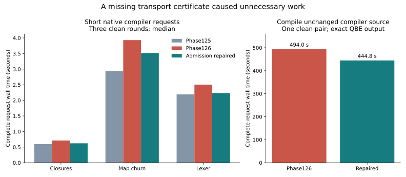
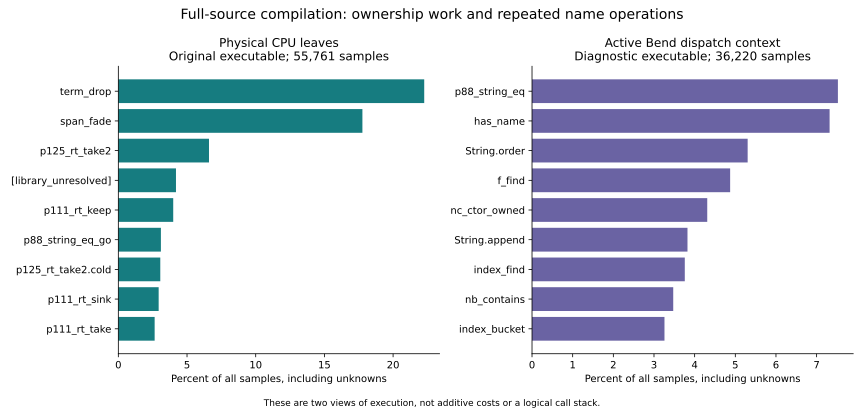

# Phase127: a reusable profiler explains native compiler cost

The profiler now measures ordinary sequential native Bend programs and the
compiler itself. It combines clean timing, physical CPU samples, authenticated
selected callers, active Bend dispatch contexts, lowered-definition attribution
and sixteen runtime event counters. The [usage guide](../../docs/self_hosted/PROFILING.md)
contains the reusable workflow; [the design](../../design/phase127/general-native-profiler.md)
records the investigation's scope.

Its first causal result is a missing transport admission: restoring an audited
helper certificate makes the same-source native compiler **11.37% faster across
three short requests** and reduces one full-source request from **494.0 to
444.8 seconds**. No compiler instructions change. The latest profiles then
identify ownership-heavy name operations and duplicated lowering as useful
next targets. This is evidence for specific experiments, not an upstream-parity
claim or a production promotion.

Parent: Phase126 `6fe4f29`, branch `selfhost/bootstrap`. Work started2026-10-23
09:44 UTC with a three-hour window. The installed compiler selections and
Phase126's native qualification remain intact.

## Precisely what was measured

The main clock is a complete fresh N1 process compiling fixed Bend source to
QBE text: startup, input, prepared-Base decode, compiler work, output and exit.
The full request compiles unchanged Phase126 compiler source32. It does not
include assembling/linking that output, acquiring the compiler executable, or
running the emitted user program. Those costs are recorded separately.

All compiler captures require exact complete QBE stdout, empty stderr and the
expected status. Native prepared Base is explicit. This phase does not rerun
upstream or replace the historical44-point generated-program score.

## Measured recovery: a cold helper disabled a global capability

Phase126's verified `p126_rt_nat_divmod` import was missing from the independent
`p118z_runtime` live-register-bank admission list. Consequently the generated
compiler's capability word fell from5 to1. The same loss appears in44 of45
ordinary products, including tree/morning. RLE already has a different missing
admission and stays unchanged in this bounded repair.

The [source/runtime audit](live-bank-audit.md) establishes that the helper
ignores runtime state and writes two words into an independently verified local
buffer. A checked Bend overlay extends only that admission list. It does not
force flags, remove semantic checks or alter runtime code. Its49 finite
predicates pass, including malformed/unknown-import refusals.

The repaired producer emits unchanged source32. Across99,526,466 QBE bytes,
only the capability field differs. The two clean executable images have
byte-identical10,103,457-byte `.text`; the only allocated-data difference is
one capability byte, apart from linker build ID. This isolates the transport
policy from instruction selection, optimization algorithms and machine layout.

| Complete request | Phase125 | Phase126 | Admission repaired | Reduction from Phase126 |
|---|---:|---:|---:|---:|
| closures256 | 0.596s | 0.713s | 0.622s | 12.78% |
| lexer | 2.192s | 2.504s | 2.234s | 10.77% |
| Map churn128 | 2.942s | 3.931s | 3.517s | 10.53% |
| Compiler source32 | — | 493.996s | 444.823s | 9.95% |

Short requests are three-round contemporaneous clean medians. Their geometric
repaired/Phase126 ratio is0.88631; repaired/Phase125 is1.08335. Map remains
19.56% slower than Phase125. The full-source result is one clean pair, a scale
check rather than a confidence interval. All outputs match their independent
oracles exactly.

Runtime counters show requested clearing falling to zero from614,487,605 words
for lexer,236,753,496 for closures, and954,732,702 for Map: about4.916GB,
1.894GB and7.638GB of requested writes, respectively. Every other measured
channel matches exactly per FID across all three requests. These are requested
bytes, not physical memory-bus traffic. The capability also affects bank
transport paths not individually counted; the entire speedup is not attributed
solely to `memset`.

Before repair, all612 eligible libc samples recover an authenticated physical
caller, locating fill in jump/return handling. The refreshed5,502 short-request
samples contain no fill. The [caller audit](physical-caller-audit.md),
[P127-002](../../experiments/phase127/P127-002-live-bank-admission.md), and retained
machine/counter comparisons provide the chain from source omission to runtime
work to clean timing.

**Qualification boundary:** this experimental executable still contains original
Phase126 compiler source, so it emits original Phase126 QBE. The repaired
producer has not itself been taken through a new repaired-source N1/N2 campaign.
The result justifies that integration step; it does not silently replace the
qualified or installed compiler.

## Remaining work differs by request size

The full-source original executable yields55,761 samples at8ms; its sampled
request takes446.541s, about0.39% above the444.823s clean observation. A diagnostic
context link yields36,220 samples at13ms, with97.46% known active dispatch and
zero recorded loss. Its471.331s time is5.96% higher than clean. These are single
full-scale observations at different periods, not a precise isolated overhead
estimate.

In the original executable, `term_drop` and `span_fade` account for **40.03%** of
physical samples. The diagnostic counterpart reports38.54%, confirming the broad
finding while showing instrumentation changes the distribution. Constructor
takes, keeps and sinks account for additional work. Allocator call volume alone
would not explain this profile.

The [full-scale source/QBE/machine audit](full-scale-opportunities.md) explains
what those samples mean:

- String equality still traverses retained roots with owning `take` operations.
  Mature C already has a borrowed implementation; selected QBE excludes the
  scalar-result observer needed here. An archived checked prototype exists,
  but its actual compiler admission and isolated speedup were never established.
- `has_name` and `f_find` already have local tail-cycle loops. Their remaining
  costs include repeated linear lookup and ownership traffic, not generic
  scheduler transitions on every element.
- `String.order` already borrows its traversal but still transports and consumes
  a result product. Returning a proven nonowning scalar is a distinct opportunity.
- `nc_ctor_owned` rescans constructor/ADT provenance that could be preserved in
  existing prepared metadata. Parent-ADT provenance and duplicate precedence
  must remain correct.

Active owner shares are observations of the current dispatch, not inclusive
logical call trees. The seven audited contexts sum to36.56% of samples; this is
not a predicted gain or seven independent savings to add together.

The new [ordered CPU timeline](full-timeline.md) provides a useful additional
distinction without executing another target. In the first50 sampled CPU
seconds, `f_find` owns37–55% of samples. At125–150seconds, `has_name` owns71%.
Later windows emphasize occurrence/provenance scans and verifier/index work;
the final windows emphasize `String.append`. These are changing computation
mixes, not automatically inferred compiler phases or wall timestamps. They
suggest small isolated lookup and text-construction experiments with very
different profitability from a fixed preparation optimization.

Short requests expose a different fixed cost. After repair, decoded-Base owners
account for roughly49% of the small closures profile,15% of lexer and10% of Map.
The [cache/live comparison](cache-preparation.md) uses the same binary and exact
QBE oracle: prepared Base already saves1.65–1.70seconds per request compared
with live preparation, with higher RSS. This delta measures net workflow
savings, not absolute decoder cost. Optimize canonical decoding for latency,
but do not expect it alone to fix full-source compilation.

Map has an independently confirmed repeated-lowering problem. Entry dispatches
for `p112s_prepare` grow1→2, `p113pl_candidates`73→146, and
`p118t_original_done`3696→7394. Lexer and closures do not repeat preparation.
The late `p126bp_close` invokes `p113pl_inspect_request` again. This native
lowering is distinct from Base decoding. The [repeated-work experiment](../../experiments/phase127/P127-003-repeated-lowering.md)
and [preparation analysis](preparation-findings.md) distinguish counts from
inclusive time; eliminating the duplicate still needs an exact-output ablation.

## The profiler is useful beyond the compiler

Two unrelated Phase126 ordinary programs pass50 output-checked observations.
Mandelbrot spends65.85% of weighted samples in generated code and records72,442
allocations with no frame pushes. Tree-bitonic spends25.16% in ownership/product
helpers and records25.2million allocations plus5.04million frame pushes.
Per-FID event files repeat byte-for-byte across three runs per program.
The [refresh survey](refresh-survey.md) retains full interpretation and caveats.

| Diagnostic mode, process CPU versus clean | Mandelbrot | Tree-bitonic |
|---|---:|---:|
| Physical sampling | +0.80% | +0.93% |
| Active context, unsampled | +5.16% | +12.18% |
| Runtime counters | +25.04% | +90.34% |

Counters are deliberately collected separately from speed measurements. A
reproducible count does not make instrumentation free. Samples retain unknown
locations; insufficient samples, loss, poor thread coverage and incompatible
capture identities prevent quantitative claims. Context-only and counter-on
timing distributions remain separate.

The generic tools have no workload-name or compiler-phase recognizers. Source
semantics and code generation remain in Bend. Python handles ELF/evidence;
small C hooks handle signals/runtime events. Reversible diagnostic runtime
links reuse the exact generated program object. Supported scope is sequential
Linux x86-64 native ELF, including other native binaries for physical sampling.
This version does not provide all-thread/GPU profiling, logical recursive
stacks, source-line debug information or allocation-origin tracking.

## Independent checks and retained failures

The offline suite passes80 tests, including seven ordered-timeline controls. The frozen
three-segment ABI control passes all16 counter-channel expectations, including
disabled-counter behavior. A nested-Tuple control initially exposed an incorrect
hand expectation: sealing adds one RC wrapper. Its original failure remains;
source-audited corrected expectations pass. That corrected control is not
presented as an independent blind first-run prediction.

Two checked-API attempts exceeded their2GiB guard; the4GiB attempt succeeded.
A stale tool pin rejected an ordinary-program plan after the runner changed.
A wrong fixture name was rejected before execution. A full request was refused
for insufficient disk before launching. None of these gates was weakened.
An initial ELF comparison treated NOBITS as file data; the corrected durable
comparison handles its zero-initialized extent properly. Rejected observations
and obsolete diagnostics are preserved rather than substituted silently.

## Research cost and next steps

At the report-data checkpoint,31 recorded guarded jobs total56.72minutes:
31.07minutes for full-source measurements,13.86minutes for the single full-image
emission,10.84minutes for short experiments/checks, and0.95minutes for acquisition,
linking and profiling controls. Four recorded failed target jobs total26.47s.
Offline development, source/machine audits, report work and agent time are
additional and overlap the target lane; guarded time is not total research cost.
No model quota counter was available, so token/quota consumption is not inferred.

One root-owned CPU3 target lane prevented competing measurements. Bounded agents
worked on offline comparison, source/runtime reasoning and independent tooling
review. Peak measured process-tree RSS was5.55GiB under a6GiB bound with a16GiB
available-memory floor. A recoverable extracted Lean download archive and
exact-output hardlinks provided disk headroom while retaining evidence paths.
See [storage receipt](storage.json), capture dedup receipts, and
[measurement data](figures/data.json).

Recommended next sequence:

1. Integrate the audited live-bank admission and qualify the repaired source.
   The gain is already measured; also audit the separate concat-helper admission.
2. Skip guaranteed-unused late candidate preparation before its repeated
   lowering. Require byte-identical QBE and measure the complete Map request.
3. Test scalar-result borrowed equality on an extracted real name-search workload,
   independently varying comparison ownership and list/index lookup. Require
   nonowning-result proof, aliases, early exits and unrelated transfer before a
   new compiler image.
4. Preserve constructor provenance and remove observed result-product transport
   where existing semantic evidence makes that legal. Use measured break-even
   costs before adding a global cache or wider analysis.
5. Optimize Base decode if short cold-request latency is the target. Keep its
   canonical-input and graph-verification checks; do not reclassify a warm
   prepared-state benchmark as the existing cold request.

The phase establishes better diagnosis and one causal compiler-runtime result.
It does not demonstrate recursive research acceleration, broad QBE/upstream
parity, improved N2 compilation throughput or a new45-program runtime score.
