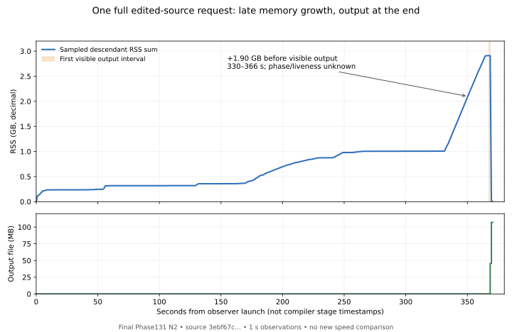

# Memory and output growth during the real source-edit witness

The already-required full compile of the edited source succeeded. This adds
one-second observations to that run; it does not run another compiler campaign.
[Exact results](summary.json), [small immutable receipts and raw observations](evidence.tar.gz),
and the [standalone SVG](memory-output.svg) are retained here.



The compiler is qualified Phase131 N2 (`2fae360…fd5dc`), reading edited source
`3ebf67c…f3e7fa`. The edit renames one emitted local QBE variable in
`p111q_main`. The resulting full-reference QBE is107,059,557bytes,
`c48ad08…d8a784`. This is a successful independently source-checked experimental
request, not a newly qualified self-hosting successor.

## What was measured

| Quantity | Observation |
|---|---:|
| Native child wall / CPU | 368.976 /368.759 seconds |
| Native child maximum RSS (`wait4`) | 2.900 GB |
| One-second sampled descendant RSS maximum | 2.910 GB |
| Outer guard process-tree maximum RSS | 2.930 GB |
| Outer guard wall time | 370.667 seconds |
| Minimum available system memory | 24.244 GB |
| Samples / largest interval | 371 /1.028 seconds |
| Last observed zero-length output | 367.527 seconds |
| First nonempty output observation | 368.528 seconds:45,563,904bytes |
| First complete output-size observation | 369.529 seconds:107,059,557bytes |

The timeline origin precedes the native child launch. RSS includes the native
request harness but excludes the observer itself; the outer guard includes both.
These are deliberately distinct scopes. The guard retained its4GiB RSS limit
and16GiB available-memory floor. Observation overhead was not separately
measured, so this run is not compared with Phase131's379-second observation as a
speedup.

Memory plateaus near1.005GB around270–330seconds. From330.477 to364.523seconds,
it rises from1.007GB to2.904GB: **1.897GB in34.046seconds**, while the output
file remains empty. It reaches2.910GB before any nonempty-output observation.
The request then produces its entire107MB visible file between the last
zero-size observation and the first complete-size observation, a2.002-second
window. That is file/page-cache visibility, not physical disk completion;
stdio buffering and the one-second observation interval limit precision.

## What this establishes, and what it does not

The compiler accumulates substantial resident state before exposing its output.
Improving final file-writing speed alone cannot explain away most of this
roughly369-second request. The source audit independently shows that emission
constructs a `List<String>` before the IO traversal, and that an ordinary String
character uses a two-word heap cell. The late1.9GB rise is consistent with the
roughly1.71GB expanded-character payload estimate for107MB of ASCII output.
This is now a much stronger reason to test packed or streamed emission.

It remains a **hypothesis about what occupies the memory**. The observations
have no phase marker, allocation-origin counter or live-object census. We cannot
assign the entire34-second rise to rendering, infer that all earlier time is
checking, or claim that eliminating the rise saves34seconds. Shared data, retained
arena pages, IR and temporary traversals may contribute. A drop at process exit
also cannot distinguish explicit reclamation from address-space teardown.

## Independent checking is smaller with a narrow export root

The edited full book was independently checked by the pinned upstream checker,
then only `p111q_main` and its required dependencies were exported into a3892-byte
JS API. That operation took **5.477seconds** inside the check wrapper,
**6.154seconds** including its outer guard, with **681.247MB** peak process-tree
RSS. It still includes parsing/checking/ownership and minimal API generation;
pure source checking was not timed separately.

Phase131's14.178-second/2.293GB API gate exported many compiler entry points and
controls into a2.49MB API. The new result uses almost the same source but a
materially narrower output scope. It demonstrates a cheaper existing independent
check workflow for this witness, **not a checker optimization or a matched
speed comparison**. A minimal export gate cannot replace the full API when an
experiment actually needs those exported entry points.

## Most useful next experiment

First preserve exact emitted QBE while avoiding retention of expanded String
cells for the entire file: either packed output chunks or verified incremental
emission into a temporary sink, finalized only after all required verification
succeeds. Measure resident peak, output-start time, byte identity and request
wall time separately. Verify large private chunks too: an outer chunk list does
not guarantee bounded producer memory.

A promising result would reduce the late resident buildup substantially without
moving an equal expansion into another process. It could improve memory safety
and shorten reclamation work. It would not by itself provide the~98% semantic
reuse needed for a ten-second warm edit loop; that remains the incremental-unit
experiment. Do not weaken the final verifier or pretend that shortening names
has removed parsing/checking/lowering work.

Reproduction is offline:

```sh
MPLCONFIGDIR=/tmp/bend-phase132-mpl taskset -c 1 python3 -B \
  selfhost/tools/performance/phase132/edit/analyze-observation.py \
  --out implementation/phase132/edited-memory-fresh
```

The analysis authenticates the original observation method/log/request pins,
edited source and image, final output hash and size, independent-check source
identity, monotonic sample order and file growth. The archive contains the raw
371-observation JSONL, request/check/guard receipts and exact observer/analysis
methods. Large source/ELF/QBE products are pinned but not duplicated here.
