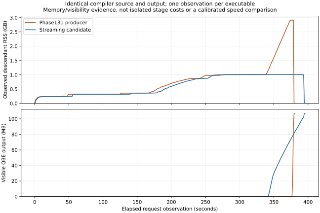

# Phase134 — Bounded emission and incremental reuse experiments

Work in progress from `ed0a842`, 2026-10-24. [Design](../../design/phase134/README.md).
The installed compiler remains unchanged. The first streaming candidate is
native-qualified; a batched writer is being evaluated to recover its time cost.

## First qualified checkpoint

The native entry now consumes a verified rendering cursor. It renders/writes/
releases individual functions and bounded data fragments instead of retaining
the complete textual product. Original source/IR admission and verification
remain; the pure testing API collects the same legacy chunks. The unchanged
runtime's File effects supply raw writes, with explicit original newline boundaries.

| Metric | Qualified Phase131 producer | First streaming compiler |
|---|---:|---:|
| Same-source observed peak descendant RSS | 2.909 GB | 1.006 GB (**65.4% lower**) |
| Same-source observed native request | 378.76 s | 392.99 s (**3.76% longer**) |
| Fresh three-request compiler ratio, same block | 1.4312× upstream | 1.4668× upstream |
| Three-request candidate/parent | — | 1.02488× (**2.49% longer**) |
| Generated QBE for the same complete compiler source | 106,991,972 bytes | Exactly identical |
| Selected compiler source lines | 57,842 | 58,206 (+364, including controls) |

The full-source pair is one observation per executable, with CPU6 correctness
work during acquisition. It is not a calibrated full-build speed estimate.
The three-request block uses the existing rotated 27-observation method with a
fresh Phase131 N2 parent and pinned upstream. Its result triggers the plan's
regression investigation; the checkpoint is not promoted as a faster compiler.

Both native generations pass focused19; N2 passes ordinary45. Native Q1=Q2
self-reproduction passes for source
`a7c3522a563bb4eb58d215b0f614ba4df06ef57bcd98a096c5d56e9e8cafd9d4`.
Fifteen finite controls preserve the old chunk order, data boundaries, flags and
refusals. Three real requests preserve complete bytes through both pure collection
and cursor traversal. All45 hosted wrapper products match the qualified native
reference; a native wrapper bridge is a separate validation step, not inferred.

The [stream checkpoint archive](stream/receipt.json) contains the source capsule,
qualification, measurements and exact evidence identities. Whole structured IR,
global indices and checked data still remain live; this is output streaming,
not bounded total IR or incremental compilation. Largest measured cursor piece
across the initial three requests is127,386 bytes, with a per-function/name-size
exception rather than an unconditional fixed byte ceiling.

The plot is a presentation of the retained one-second observations, not a new
benchmark or an exclusive compiler-stage attribution.

## What the first cache experiment taught us

The [owner reuse probe](reuse/README.md) makes a real decision before generic
owner lowering. It preserves fresh output under controlled edits and challenges
key omissions. However, its conservative closed grammar mostly admits cheap
native primitives: on Lexer all14 hits are primitives, while31 ordinary owners
are refused. Complete hosted requests were slower in ordered exploratory runs.
It remains isolated and is not added to the native compiler.

Static-body preparation is also a poor next cache target on this small corpus:
its measured ceiling is small. The [stage breakdown](reuse/stage-ceilings.md)
finds generic owner lowering is only4.5–10.7% of warmed hosted backend time.
Lexer spends more on actual inline/range transformations and their repeated
commit verification; Map has a larger private-candidate preparation share.
These are hosted diagnostics, not inferred native percentages.

## Current follow-up

Bound raw writes into packets while retaining the cursor's bounded lifetime.
The first packet checks caught a JS-hosted stack overflow in long recursive
test/length helpers before native acquisition; that failed attempt is preserved.
The batched native N1 passes three exact requests and focused19. Its27-observation
screen is1.01291× the same-block Phase131 N2 request time, still1.29% longer.
We did not spend another full self-build on that version.

The [isolated writer experiment](../../selfhost/tools/performance/phase134/emission/writer/README.md)
found a simpler choice: write the original text and its LF separately. This
avoids copying every emitted linked String. Although File.write adds worker
round trips, the no-copy form was faster in both tested4MiB regimes. All six
outputs matched independent bytes. Exact candidate helpers also preserve append
output and fail correctly when the second, newline-only write reaches/dev/full.
Its native N1 screen still measures1.02031× same-block parent request time
(2.03% longer), despite the isolated writer gain. The batch and no-copy screens
used different measurement windows; these small differences do not establish a
robust ordering between writers. We retain the simpler no-copy form for the next
combined experiment, but do not claim that its fixture win transfers to the
complete compiler. Full standalone qualification is deferred to avoid repeating
the same expensive campaign before integrating the measured verification work.

In parallel, a small verified-boundary experiment reuses successful verification
for exactly unchanged functions under the same ordered signature context. Changed
functions still run the original verifier; final verification is unchanged.
An independent audit and26 controls pass. Repeated edited-source hosted results
are positive but noisy, so native integration remains conditional. The audit also
found the inner inliner already invokes range optimization, motivating exact
input/result reuse before the later range pass rather than assuming idempotence.

The larger owner-identity, dependency-aware invalidation and persistent-process
parts of the plan are not yet implemented. No10-second edit, subsecond validated
build, reduced full QBE file size or recursive acceleration is claimed.
