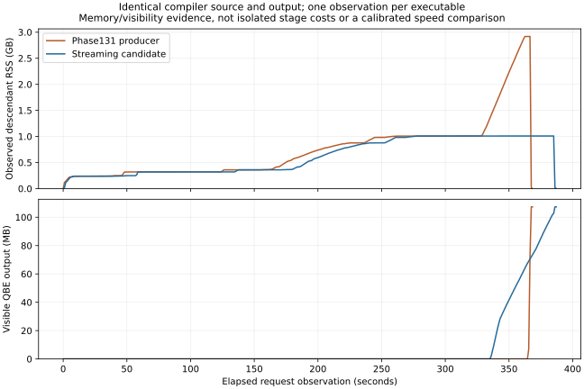

# Phase134 — Bounded emission and measured incremental reuse

[Design](../../design/phase134/README.md) ·
[Qualified source and evidence](final/README.md) ·
[Development guide](../../docs/self_hosted/incremental-native-development.md).

Implemented and native-qualified a compiler that stops retaining the complete
rendered QBE output. Observed full-source peak memory falls **65.43%**. Small
native N2 requests remain approximately unchanged in time, and all 45 benchmark
products remain byte-identical. A separate Bend implementation reuses actual
optimization results across edits; its performance is measured separately below.

This campaign began at `ed0a842` on 2026-10-24 at 03:00 UTC. The qualified core,
incremental prototype and byte-transport tooling are distinct artifacts. No
installed production or research selection was changed; Phase131 remains the
recovery compiler. This is substantial progress on the plan, **not completion of
its full incremental frontend, stable binding and machine-unit architecture**.

## Qualified compiler and the metrics

The final source is `a00019246b5181b288ab4d3e09e616bd41415fe6381e89a96185c05efa19fb57`.
The [capsule](final/candidate.json) authenticates the source, N1/N2, runtime,
controls, qualification, timing and exact benchmark-product bridge.

| Metric | Result and scope |
|---|---|
| N1 compilation speed | 0.98166× same-block Phase131 N2 time; 1.41736× upstream. Three requests, three rotated rounds. |
| N2 compilation speed | 1.00255× same-block Phase131 N2 time; 1.41377× upstream. Effectively unchanged, not a demonstrated speed gain. |
| Full-source compilation | 366.84 → 384.28 s, **4.76% longer** in single observations overlapping other correctness work. Not a controlled speed estimate. |
| Generated-program speed | All 45 native-emitted benchmark QBE products match the previous measured products exactly, with the same runtime. Historical runtime evidence remains applicable; no new runtime score is claimed. |
| Conformance/self-hosting | Both generations pass focused19; N2 passes ordinary45. Q1=Q2 reproduces all 107,316,480 bytes. Independently checked source and 59 finite controls pass. |
| Simplicity | Selected source 57,842 → 58,392 lines: **+550, +0.95%**, including controls. Reuse core adds 124 lines and no new types. |
| Peak full-source memory | Sampled descendant RSS 2,918,051,840 → 1,008,922,624 bytes: **65.43% lower**. |
| Compiler binary | 17,132,048 → 17,152,432 bytes: +20,384 bytes, **+0.119%**. |

N1 and N2 have separate fresh parent/upstream measurements; do not combine them
into a universal 1.8% speedup. N2 individual median ratios are Lexer 0.94375,
Closures 1.01952 and Map 1.04729. Map observations overlap substantially and only
three rounds were taken. Its apparent 4.73% regression is retained, rather than
hidden by the aggregate. There are no confidence intervals establishing
neutrality or improvement. The full-source observation also prevents claiming
an overall compiler speed win or promoting this as universally faster.

Memory samples can double-count shared descendant pages. They still show the
large reduction consistently with the earlier streaming checkpoint. Whole
structured IR, indices and verified plans remain live; **1 GB RSS is not a
1 MB compiler**. The qualified compiler emits the same expanded text if asked
to retain it. Self-compilation of this larger compiler naturally produces more
text than Phase131 self-compilation; compare producers on identical source.

## Work removed from the qualified path

1. **Whole-output text retention.** Successful native paths produce sealed
   emission plans, then render/write/release pieces through a cursor. Private
   workers and data declarations use this boundary too. The pure collection API
   remains an exact compatibility oracle. Whole-program verification precedes
   output; a piece can exceed the usual bound for a large function/name.
2. **Copying every piece to add its newline.** The writer sends the original
   text followed by the optional LF. It preserves the previous chunk protocol.
   Either failed write aborts; an actual second-write failure is checked with
   `/dev/full`. The inherited runtime ignores delayed `File.close` errors; this
   change does not establish universal IO correctness.
3. **Repeated verification of unchanged function bodies.** Under identical
   ordered complete headers and the same immutable ID context, a successful
   prior judgment can serve the identical body. Changed bodies run the original
   verifier; changed headers fall back to the original complete commit. The
   independent final verifier and connected proof bodies remain unchanged.

These are compiler implementations in Bend. Python supervises processes,
authenticates artifacts and transports bytes; it does not implement the
optimization, legality check or cache decision. Controls and source audits
are finite evidence, not new BendTT proofs or whole-compiler equivalence laws.

## Avoiding a complete textual IR file

The [pipe builder](../../selfhost/tools/performance/phase134/pipe/README.md)
connects the native compiler to QBE stdin through a hashed relay of at most
65,536 bytes. It preserves the established QBE/assembly/link policy, records
producer/tool/runtime identities, and handles backpressure and child failure.
Assembly and the object still exist; only the complete textual QBE file is
avoided. QBE input bytes are not removed from compilation work.

Three strict small builds preserve exact QBE, assembly, complete objects and
loaded ELF contents except build-ID metadata. All ordinary outputs pass. A
wrong reference digest is rejected before assembly. Whole ELF files differ in
linker path metadata, caught and retained as the first failed harness attempt.
A new source can build without a preexisting reference; its receipt does not
claim differential equality.

The full session image passed **108,111,638 bytes** directly through the pipe in
399.72 s for concurrent emission/QBE, with a 65,536-byte maximum relay read and
no textual IR file. Guarded peak descendant RSS was 1.039 GB. The assembly is
78,489,700 bytes, so retained build storage is reduced, not eliminated. This is
one acquisition of a different source, not a controlled pipe speed comparison.

The original wrapper stopped after successful assembly because it treated all
stderr as failure. Four immediate-truncation warnings are the existing QBE
low/high 32-bit store convention, independently reviewed against the qualified
compiler. A narrowly authenticated continuation reproduced the complete object
and diagnostics exactly and linked in 6.28 s, without re-emitting. The original
405.82-second failed guard receipt remains. `build-v02.py` now follows the
established assembler/linker zero-exit policy and retains diagnostics; compiler,
QBE and execution errors still fail. No new full emission was spent merely to
rerun this supervisor change. The session image is experimental, not a newly
self-reproduced successor of the core capsule.

## Incremental optimization units: actual reuse with limited scope

The [cross-edit experiment](reuse/cross-edit-units.md) caches expensive private
inline/range transformations **before** rerunning them. Inline keys contain the
exact incoming function and complete results of original-body callee lookups,
including absence and nested branches. Hits still republish the current ordered
table. Range keys contain exact pass inputs. No idempotence is assumed. The
cache is typed state returned by the same fixed producer; no external,
serialized or cross-version cache is accepted.

Independent fresh outputs agree after actual behavior-changing Lexer and Map
edits. All 99 controls pass, including 20 dependency/body/absence/order
mutations. The separate session source adds ten controls and uses sealed output
plans. Source checking, common preparation, generic lowering, private-candidate
preparation, final verification, rendering and machine building still run.

Hosted Lexer reuses 26/31 inline and range units and takes about **26.7% less
backend time** in both measurement orders. One two-revision component total,
including measured frontend costs and cache acquisition, falls 10.619 → 9.615 s
(9.45%). These are hosted diagnostics, not native CLI or full-compiler results.
Map gets 34/34 hits, but reversed ratios are 0.784 and 1.275: balanced ratio
approximately **1.000**. High hit counts do not establish useful reuse.

The experimental [native two-revision session](../../selfhost/tools/performance/phase134/session/README.md)
prepares Base once, reads both immutable sources before opening outputs, then
checks/compiles/writes each separately. Warm mode retains the cache; cold mode
resets it. The supervisor checks actual path identities, fresh outputs,
independent ordinary-reference bytes and complete process cost. Neither mode
is a daemon, persistent disk cache, incremental frontend or full compiler edit
qualification. Native results are recorded in the separate session report.
This source has 59,127 lines, 735 more than the qualified core; its additional
cache/session complexity is not hidden inside the core's +550-line metric.

## Native incremental result

[Session evidence and reproduction](session/README.md). The independent native
run finishes in 35.90 s: five refusal controls pass and all 16 complete A/B QBE
files match ordinary no-unit-cache compilation by the independently qualified
core. Two warm/cold pairs reverse order for each workload, on the same CPU with
no competing target jobs.

| Native edit | Edited B request time, warm/reset | Complete A+B process, warm/reset | Actual prior inline hits |
|---|---:|---:|---:|
| Lexer | **0.78679×: 21.32% less time** | **0.90925×: 9.08% less time** | 26/31 |
| Map | **0.93883×: 6.12% less time** | **0.97381×: 2.62% less time** | 34/34 |

Lexer B takes 962/968 ms with reuse versus 1,222/1,231 ms after reset. The
complete two-revision session includes Base preparation, cold A/cache acquisition,
B, writing both files and process teardown. Map's two B gains vary from 2.5%
to 9.6%; two pairs are too few to establish a robust broad improvement. Native
Lexer transfer is much clearer than the hosted Map result, and both are retained.

These comparisons isolate **retaining versus resetting the cache in the same
experimental compiler**. Both modes pay for cache construction; they do not
establish adoption cost versus an otherwise identical compiler with caching
removed. Source checking and final verification remain included. QBE machine
building and full compiler-image qualification are outside these session clocks.
Acquiring the experimental compiler costs roughly 413 guarded seconds including
the reviewed finish; that cost is separately visible and not amortized away by
two edits. An initial 8.90-second supervisor attempt failed because its tiny
fixture lacked the required `import Base`, before any session ran; the corrected
fixture reuses previously checked source. Both attempts are preserved.

This establishes a useful native incremental optimization boundary, not general
incremental compilation of our 59,000-line compiler. No full compiler-source
edit was measured through the cache. The next transfer test should be an actual
compiler-derived hot computation, followed by the expensive preparation boundary.

## Rejected attempts and lessons

- The [first streaming checkpoint](stream/receipt.json) established the memory
  reduction but cost 2.49% in the small native request screen. It remains a
  separately qualified ablation, rather than being relabeled as the final result.
- Packet batching added length scans and String joins. Its screen was still
  1.29% slower than its same-block parent; no additional full self-build was run.
- Isolated no-copy writes were substantially faster, but that candidate alone
  remained 2.03% slower in its native request screen. Combining it with verified
  boundary reuse recovered aggregate small-request time without a cold speedup.
- The [generic-owner cache](reuse/README.md) admitted only cheap primitives in
  Lexer: 14 hits, 31 ordinary owners refused. It did not pay and was excluded.
- [Within-request range reuse](reuse/verification-reuse.md) had mixed timings
  despite exact-input legality. It is excluded from the qualified core and kept
  only in the separately measured unit/session prototype.
- Simple token compression offered only a 10.83% optimistic text reduction and
  extra String processing. Owner-local identities and packed IR remain work to
  investigate, rather than unmeasured additions to this checkpoint.
- A validation scheduler reused guard-directory names for different requests.
  Completed jobs were retained; a data-only resume relocates only guard paths.
  Original failure and resumed commands are archived; no oracle was weakened.

Stage diagnostics explain the cache choice: generic lowering was only 4.5–10.7%
of warmed hosted backend time. Actual inline/range transforms matter for Lexer;
Map spends about 26% in earlier candidate preparation and only about 2.9% in
those transforms. These hosted percentages are not inferred native profiles.

## Plan completion and remaining work

| Planned boundary | Implemented status |
|---|---|
| A: freeze/accounting | Source, image, runtime, carrier, oracles, clocks and resource receipts frozen. |
| B: bounded output | Core implemented and native-qualified; memory win demonstrated, full-source time gate remains unresolved. |
| C: owner-local identities/compact IR | Not implemented; whole structured IR and global binding remain. |
| D: reuse lowering | Private transformation units reuse across edits; generic/frontend/candidate lowering does not. |
| E: binding/machine reuse | Streaming QBE transport implemented. Stable binding and integrated object reuse remain unimplemented; Phase132 is separate. |
| F: persistent preparation | Bounded two-revision native experiment; Base reuse only, no general persistent checking/service. |
| G: qualify/consolidate | Core N1/N2 qualified and packaged. Session has narrower evidence; installed selection unchanged. |

Next investigate earlier **private-candidate preparation reuse** with explicit
semantic dependencies, followed by stable generated identities if real compiler
edits show churn. Require a native win on an extracted compiler computation as
well as Lexer/Map before expanding the interface. Connect semantic units to the
existing object reuse only after their dependency boundary pays for itself.

The 10-second full edit, subsecond persistent compilation, 1-MB total IR and
recursive research acceleration goals remain unproved. A clean repeat of the
full-source timing pair is needed before making a compiler-speed claim; another
full campaign solely to improve a headline is not justified by this pass.

## Execution cost and reproduction

One heavy resource-guarded native lane handled acquisitions and clean timings;
bounded agents developed/audited independent emission, reuse, session and
evidence work. Correctness work overlapped selected full acquisitions, and those
timings are labeled accordingly. The last full pipe acquisition and native
session check extend beyond the approximate two-hour target. Agent quota is
not observable here, so no exact cost or token-efficiency claim is made.

Several variants were rejected before full reproduction. The final core's exact
45-wrapper identity avoids rebuilding and rerunning unchanged benchmark programs.
The session image is acquired once through the pipe to answer both full-size
transport and native reuse questions. Failed attempts, raw observations, method
identities and sources remain in linked archives. See the
[validation adapters](../../selfhost/tools/performance/phase134/validation/README.md)
for qualification/timing commands, the [capsule](final/README.md) for explicit
native use, and the [pipe guide](../../selfhost/tools/performance/phase134/pipe/README.md)
for builds that do not retain full QBE text.
