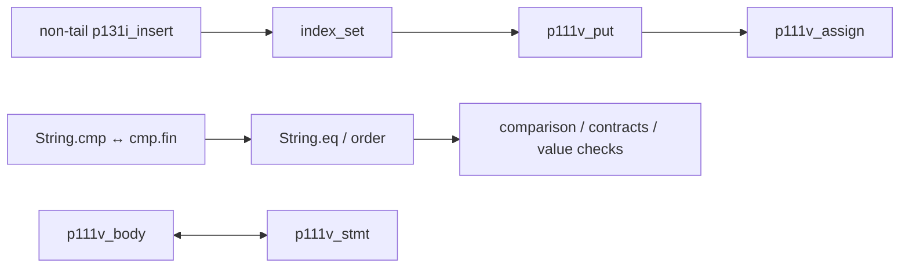

# Phase167 — architectural work elimination and the admission cliff

**We built three working experimental compiler paths and found a concrete
architectural obstruction. We did not obtain a qualified 2×, 5× or 10× full-build
improvement.** The qualified Phase152 compiler and production selection remain
unchanged. No full native compiler image was acquired for a candidate that failed
the small generated-program quality gate.

The strongest new result is predictive: moving one general, source-authorized
observer implementation before dependency admission admitted **exactly the 16
previously blocked workers predicted by the dependency graph**, plus its borrowed
reader. It avoided 12 genuine fallback families and 240 scheduled segments.
This reduced complete compilation of the real verifier slice by **25.50%** versus
the unchanged baseline. Its generated verifier remains **48.54% slower**, so this
is a useful experimental capability, not a replacement compiler.

[Design](../../design/phase167/README.md) · [Metrics](metrics.json) ·
[Admission evidence](../../experiments/phase167/admission-obstructions.md) ·
[Independent audit](../../experiments/phase167/prototype-independent-audit.md) ·
[Reproduction](reproduce.md).

## What was actually measured

The input is a 39,333-byte closure of the maintained `p111_verify_program`, with
111 source declarations. It verifies nonempty 32-segment arithmetic/branch
programs, accepts valid inputs, and rejects undefined-local and duplicate-header
inputs. It repeats all three obligations 256 times; the independently determined
result is `768`. It is not the old empty-program verifier control.

Each build starts a fresh process and performs prepared-Base decoding, source
preparation/checking, the selected Bend backend, independent final verification,
complete QBE emission, QBE machine generation, assembly and linking. Baseline and
candidate use the same checked API, exact source, Base policy, CPU3, QBE/runtime
and toolchain. There is no input-specific cache or object reuse.

**Compiler execution in this economical pilot is upstream-checked Bend hosted by
pinned Bun (B1). Generated programs are native QBE executables.** These clocks are
neither native N1/N2 request times nor the approximately 250-second full self-build.
The fixed prepared Base is the existing authenticated operational asset; its
load/decoding is charged. The initial live-Base screen is preserved separately.
API acquisition is acquisition of the experiment tool, not part of each request.
Emission and machine construction are serial here, unlike the pipelined full
native acquisition. Do not compare their sums as interchangeable pipelines.

One clean complete build observation per treatment; four alternating execution
pairs per reported runtime comparison. These are decisive exploratory contrasts,
not statistical confidence bounds or a broad benchmark score.

| Compiler path | Complete build | Build speedup | Generated verifier | Runtime / baseline |
|---|---:|---:|---:|---:|
| Unchanged baseline |31.276s|1.00×|0.4385s|1.00×|
| Demand-first, plain emitter, checked live transport |22.685s|1.38×|1.1311s|2.58×|
| One demanded generic representation, no direct candidates |16.770s|1.87×|1.5767s|3.60×|
| One generic representation plus region optimization |19.509s|1.60×|0.9918s|2.26×|
| Observer-first demand path, separately matched pair |23.351s|1.34×|0.6554s|1.49×|

The observer pair's own baseline is **31.343s / 0.4412s**. Its runtime now uses
that exact newly built baseline ELF (`observer-runtime02`); the earlier runtime
screen used a retained baseline with byte-identical QBE and is preserved as such.
Both build comparisons use unchanged baseline QBE SHA256 `9cda5e8a…`.

The minimum-complexity path produces **more** QBE than demand-first (2.113MB versus
1.988MB), yet builds much faster. This is direct evidence that minimizing text or
function counts is not the same as minimizing compiler work.

## Cost model and the 10× ceiling

The complete same-source qualified native reference is **249.222s**. Its
**242.103s emitter/QBE interval overlaps**; the 7.119s remainder is not the entire
cost of machine generation. The Phase161 diagnostic partitions 239.794 CPU seconds:

| Disjoint or explicitly scoped diagnostic work | CPU seconds |
|---|---:|
| Parse/load, checking/publication and report |66.520|
| All work before the backend entry, including other preparation |83.223|
| Generic body production |11.588|
| Direct candidate production |26.782|
| Initial optimizer |23.673|
| First independent verifier |7.857|
| Observer composition and selected final admission |19.625|
| Registry |16.190|
| Rendering, output and teardown |40.208|

The first row is contained in the second; do not add both. The final-admission
interval includes the nested 9.26s verifier. This is an instrumented CPU model,
not a new clean full-build timer. Other preparation/interstage work fills the
remaining partition. Physical ownership/dispatch costs overlap these stages;
the >2-billion allocation residual remains unattributed by owner. We did not
relabel it as dead IR or claim to have explained every allocation.

Deleting generic-body production alone has only a **4.83%** diagnostic envelope.
With unchanged execution of the frontend, even a free backend cannot support a
10× forecast: the 83.223s prefix already exceeds the 24.922s target. Faster
execution by a newly generated compiler could change this bound, but our current
simplified generated verifier is slower. These measurements do not establish
that beneficial generational feedback.

The new clean slice makes the tradeoff explicit:

| Complete-request component | Baseline | Single generic | Observer-first / its matched baseline |
|---|---:|---:|---:|
| Base decoding |0.838s|0.837s|0.849 / 0.889s|
| Source preparation/checking |8.188s|8.126s|8.087 / 8.166s|
| Backend + verification + rendering/writing |21.336s|6.985s|13.627 / 21.311s|
| QBE + assembly + link |0.399s|0.317s|individual job receipts retained|
| Complete fresh source-to-executable |31.276s|16.770s|23.351 / 31.343s|

Loader/process/file handling makes up the small remaining difference. Candidate
rendering occurs inside its main backend call; baseline rendering uses a cursor.
Only the **combined backend/render** time is comparable. All materialized chunks,
writing and process teardown are charged in complete time; this prototype makes
no full-scale streaming-memory claim.

Full retained evidence and the scope of the bendc comparisons are in the
[cost model](../../experiments/phase167/cost-and-falsification.md). Same-source
execution through bendc/C previously improved our full emission by about
1.33–1.61× under the reported runtime choices. bendc's few-second self-emission
uses different source, products and checking boundaries; it is not our baseline.

## What the architecture experiments established

**Demand-first.** We establish source/worker/factory identities first, retain
existing compact typed direct bodies, and build genuine scheduler families only
when executable references demand them. Exact source-bound adapters connect the
two ABIs. No fabricated reference body is provided to a verifier. The initial
implementation unexpectedly called the region optimizer through
`p111q_segment_chunks`; independent source and emitted-code audits caught this.
Those results remain as a separate partial simplification. The final plain
renderer calls `p111q_segment` directly and has no registry path.

This goes beyond Phase164, which still built every admitted factory and retained
most later machinery. Nevertheless, 49 real fallback families and 1,223 segments
remained. Zero admitted factories were demanded in the verifier slice. Further
factory omission had no useful remaining target there.

**Single generic representation.** This removes all speculative direct candidate
production/admission and its discarded products. It lowers only demanded genuine
families, verifies them, and emits either plain segments or regional workers.
Backend cost fell **3.05×**, but execution became much slower. Restoring region
optimization improved execution while increasing construction cost. The removed
machinery was doing useful execution work as well as avoidable construction.

**Observer-first.** The dependency census found 127 raw candidates: 116 had no
local lowering error; 55 raw owners were admitted, plus one synthesized SCC worker.
Of 72 rejected raw candidates, 61 had no local error but unavailable callees.
There were eleven explicit errors and four separate error-free blocked cycles.
Increasing the admission iteration limit cannot fix these cycles.

For example:

The graph predicted that resolving the comparison cycle could make 16 existing
candidates dependency-ready. The general source-authorized observer selector
chose one source owner, produced two independently checked seed functions, and
seeded admission **before** ordinary candidates and fallback bodies were built.
There is no benchmark-name recognizer. Actual additions were exactly the
predicted 16 original workers plus the borrowed reader, with no removals:

| Actual demanded program | Plain demand | Observer-first |
|---|---:|---:|
| Direct functions |56|73|
| Generic fallback families |49|37|
| Scheduled segments |1,223|983|
| Final QBE functions |1,280|1,057|
| QBE bytes |1,988,024|1,886,005|

This removes a category of downstream construction for the newly admitted
owners, while restoring valuable code quality. It is stronger evidence than a
local helper speedup: a predicted dependency effect appeared in actual complete
program compilation and execution. It still fails the runtime preservation gate.

## Verification, alternatives and remaining barrier

Executed semantic compiler logic is upstream-checked Bend under
[`selfhost/tests/phase167`](../../selfhost/tests/phase167/). Host scripts transport
files, orchestrate jobs, inspect immutable data and measure; they do not lower Bend.
The existing final generic and borrowed-body verifiers remain unchanged. Actual
headers, static data, constructors, direct-call ordering and adapter bodies are
checked. Source permission and root-preservation analysis precede borrowed seeds;
a producer Boolean is not a certificate. No native recursion whitelist is added.

Evidence includes 35 malformed-final-IR/projection controls, independent
upstream-JS verifier outcomes on 18 boundary cases and the complete `768` result,
alternating native output checks, shared Data captures through linear partial
applications with 20,000-deep non-tail recursion (`20040`), and unrelated frozen
Map/IO output/count oracles for both demand and observer variants. Function values
are affine Type values: an initially invalid duplicated-closure fixture was
rejected and corrected to lawful shared captures; the rejection is retained.
These are finite checks and structural verifiers, not a new BendTT theorem or
an end-to-end compiler-correctness proof.

We also compared a fundamentally different lifetime architecture: durable checked
roots with bounded per-computation temporary regions and root-tied borrowing.
It could remove ownership transport across many stages, but its current profile
envelope overlaps the work above and lacks allocation-owner/lifetime attribution.
No arena or GC rewrite was justified. See the
[architecture comparison](../../experiments/phase167/architecture-alternatives.md).

The bendc lesson is about its coherent expression/direct-function route, not a
faster spelling of our helpers: it does not first materialize this entire
scheduler program and separately recover private versions. It still has passes,
wrappers, ownership work and allocation. Copying its runtime or changing backend
would not automatically remove our duplicated semantic work.

**Next highest-value experiment:** preserve reusable observer/scalar-consumer
summaries across calls before producing alternate bodies, then test a canonical
control representation for one complete recursive ownership computation. Start
with persistent verifier/index update and a consumer retaining the old root,
plus an unrelated recursive-tree transfer. Represent ordinary calls and explicit
resumable continuation frames in the same body; keep constructor/ownership facts
through the return consumer. Select direct calls or bounded explicit frames from
that representation, instead of rejecting the surrounding call graph and later
recovering separate workers. Existing late scalar observers and local-resume
optimizations provide a code-quality oracle.

Require both lower complete compilation cost and runtime near the unchanged
baseline before another full native acquisition. Do not widen the direct
whitelist, add admission fuel, remove the final verifier, or resume unmeasured
helper/caching work. The current prototypes show where work can disappear and
why the simple version cannot yet retain efficient execution. They do not supply
a credible measured 10× whole-build plan.

## Research cost and retention

All target execution used one guarded CPU3 lane with explicit disk/RSS/time
budgets and the unchanged 5GiB disk reserve. Three bounded agents implemented and
criticized source independently; only root executed targets. Failed source checks,
timer-method revisions and the hidden-registry correction are preserved. The final
clean method removes eager diagnostic JSON serialization; output QBE stayed
byte-identical to the corresponding preliminary treatments.

The final [metrics](metrics.json) account for each guard separately; 41 guarded
jobs consumed about **667 seconds** total, including checks, failed attempts,
compilation and execution. This is execution-lane time, not agent reasoning,
editing, retention time or quota usage; quota telemetry was unavailable. There was
no full self-host campaign. Every guard is closed with verified archive receipts;
no qualified compiler was deleted. The reviewed retention plan reclaimed only
162MiB of individually authenticated older artifacts before this campaign.
