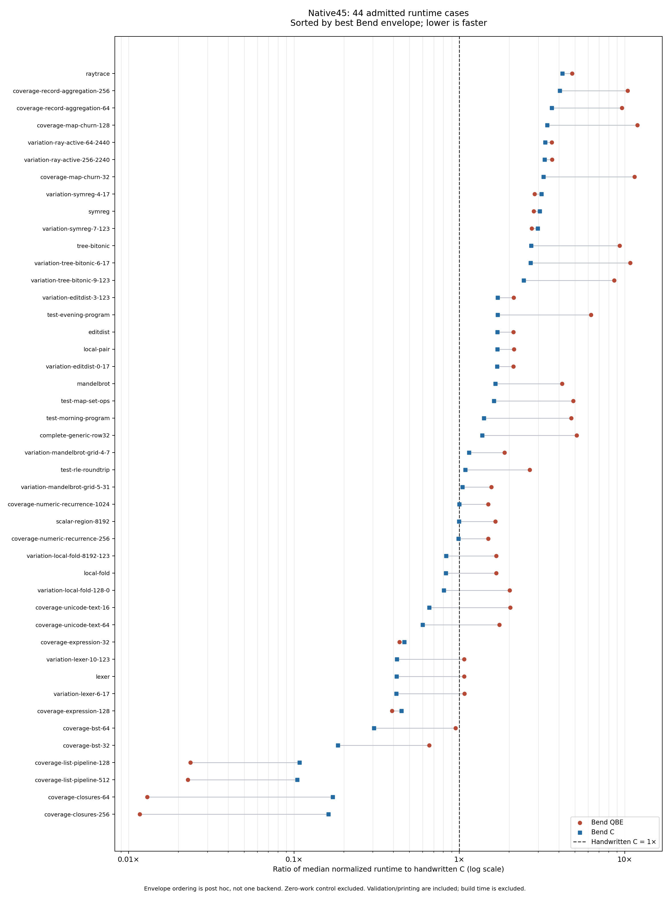

# Phase184 — handwritten C versus Bend program runtime

The full retained native45 comparison completed: **45/45 correct cases, 44 timed
cases, three rounds per role**. Compilation time is excluded, as requested.
Handwritten C was implemented for every case, using 24 shared kernels and the
original algorithms, inputs and complete output oracles.

Our installed **C target is faster than QBE on 35 of 44 timed cases**. QBE wins
the other nine, including the closure and list transformations. QBE is therefore
not uniformly our fastest generated-program backend.

| Runtime relative to handwritten C | QBE target | C target |
|---|---:|---:|
| Equal-case geometric mean | **1.671×** | **1.071×** |
| Equal-source geometric mean, 23 groups | 1.813× | 1.111× |
| Equal-family geometric mean, 22 families | 1.746× | 1.052× |
| Median case ratio | 2.122× | 1.260× |
| Cases more than 10% slower | 33/44 | 23/44 |
| Cases more than 2× slower | 25/44 | 13/44 |
| Cases more than 10× slower | 4/44 | 0/44 |
| Mean positive log-slowdown | 0.9353 | 0.4475 |

Lower is better; handwritten C is 1×. Large wins on a few cases pull down the
geometric mean, so **1.071× does not mean broad C parity**. Handwritten C has the
lowest median on 26 cases, Bend QBE on six, and Bend C on twelve. Near-ties are
point estimates, not statistically established wins.

Choosing the faster Bend target separately for each case gives a **0.878×**
geometric envelope (0.921× with equal-source weighting). This is a post hoc
selection, not one compiler configuration or an automatic backend selector.
It still leaves 23 cases more than 10% slower and 13 more than 2× slower.

[Full table](summary.md) · [CSV, including dispersion and counts](cases.csv) ·
[SVG](comparison.svg) · [Evidence index](evidence/index.json) ·
[Runnable benchmark guide](../../selfhost/tools/bench/handwritten-c/README.md) ·
[Design](../../design/phase184/README.md).

## Concrete examples

Median microseconds per complete kernel invocation, including result checking
and disposal. The values are normalized from independently calibrated batches.

| Original case | Handwritten C | Bend QBE | Bend C |
|---|---:|---:|---:|
| raytrace | 6,736.84 | 32,416.67 | 28,333.33 |
| coverage-map-churn-128 | 67.89 | 810.66 | 230.70 |
| tree-bitonic | 62.21 | 579.42 | 169.32 |
| lexer | 921.57 | 986.55 | 384.01 |
| coverage-numeric-recurrence-1024 | 3.245 | 4.860 | 3.248 |
| coverage-closures-256 | 18.163 | 0.212 | 2.935 |
| coverage-list-pipeline-512 | 53.856 | 1.228 | 5.638 |

## What this comparison establishes

These are straightforward C algorithm counterparts, **not a hand-tuned C
performance ceiling**. The C sources retain separate list stages, closure
composition, tree operations, map algorithms and other intermediate work.
They use native C representations and explicit ownership. The family notes
document stack arrays, arenas, unique mutation, borrowing and byte rendering.
For example, the map remains a codepoint-based crit-bit tree, not a replacement
hash table; record aggregation still constructs and parses its records.

The large closure/list wins are consistent with Bend eliminating intermediate
work that these C counterparts retain. Their times scale with input size rather
than collapsing to a fixed timing-loop cost. Driver machine inspection confirms
external kernel calls remain inside both repetition loops. This run did not add
dynamic allocation attribution, so it does not by itself quantify the exact
contribution of fusion, allocator choice or representation to those wins.

Conversely, map churn, record aggregation, tree sorting and rendering expose
substantial remaining gaps. QBE's family ratios are 11.70× for map churn,
10.02× for record aggregation and 9.54× for tree sorting. Bend C reduces them
to 3.31×, 3.83× and 2.62× respectively. That gives two distinct follow-ups:

1. Compare QBE and our C output on these exact same Bend computations to find
   missed compiler/runtime optimizations without changing source algorithms.
2. Compare the faster Bend C version with its handwritten counterpart to isolate
   layout, ownership, temporary construction and algorithm-expression costs.

Rendering remains around 3–4× slower even with the faster Bend backend and is
another useful shared target. Scalar/F32 recurrence is already approximately
equal to handwritten C through our C target. No compiler optimization was made
in this benchmark phase, and these ratios must not replace earlier ratios
against upstream-generated programs: that is a different reference.

## Controlled method and limits

- Native45 retains all 45 IDs, argument pairs, source groups and output oracles.
  Only the existing `scalar-region-0` control is excluded from ratios. These are
  our existing workloads, not an exhaustive sample of Bend programs.
- Both Bend sets were freshly acquired from the installed Phase183 selection:
  native QBE N2 and native C N1, upstream `9a4223d` / Bend 2.0.40. The C role is
  **our compiler emitting C**, not the upstream TypeScript implementation.
  Installed images and production source are unchanged. Assembly and JS are
  outside this comparison.
- Handwritten C uses the pinned Clang, `-std=c11 -O3 -ffp-contract=off -fno-lto`,
  separate driver and kernel objects, and `-lm`. There is no cross-call cache or
  copied expected-result return. Expected values enter through driver files.
  Unsigned wrapping, guarded shifts/conversions and F32 grouping are preserved.
- Every C catalog output and every Bend product matches the full oracle.
  **83 additional input pairs** across the 24 kernels agree among all three
  roles. GCC10 ASan/UBSan checks pass all 45 original cases with repeated calls.
  Leak detection is unavailable under the sandbox's ptrace environment; it is
  explicitly disabled in the successful memory/UB gate. No leak-proof or
  arbitrary-input equivalence claim is made.
- One serial CPU3 lane on an Intel Xeon E3-1245 V2 at nominal 3.40 GHz; GPU off,
  one Bend mutator. No frequency-governor change. Each role calibrates toward
  250 ms, then uses fixed repetitions for three rotated rounds. All 396
  timing-eligible observations exceed 100 ms (minimum 219 ms) and pass exact
  result/warmup/success-count checks.
- **396 timing-eligible observations, nine zero-work correctness observations
  and 277 calibration observations** were preserved.
  The campaign took 297.798 s of harness wall time. Reported speed uses the
  in-program interval, excluding process startup, initial result, warmups and
  all build work. It includes comparison/disposal and timed success printing.
  C string comparison/formatting and Bend's equivalents need not cost the same.
- Different per-role counts make timings resolvable without forcing the slower
  role to run an enormous batch. This measures warm repeated throughput and
  can expose different cache/allocator states. It is **not the historical
  equal-repetition score**. Median within-role sample ranges are about
  0.59–0.80%; the largest are 8.42–17.44%. Three samples and a millisecond clock
  do not justify precise near-parity conclusions. Full min/max/MAD are in CSV.

## Implementation, failures and research cost

The C kernels, four shared headers and driver total 2,190 lines / 74,484 bytes.
The maintained benchmark acquisition now supports the authenticated public
native C image and byte-exact C replay. The runtime adapter and metadata tests
preserve incomplete/refused campaigns instead of silently shrinking the set.
Ten runtime metadata controls and nine acquisition controls pass. The generic
unittest discovery invocation initially collided with the repository's
`inspect.py`; preloading Python's standard `inspect` module resolved that test
invocation without changing benchmark code.

Two failed attempts are retained:

1. The first sanitizer pilot produced the correct result, then LeakSanitizer
   refused the ptrace environment. ASan memory/UB checking was rerun with leak
   detection explicitly disabled; all 45 cases passed.
2. The first extra-input plan used `(3, UINT32_MAX)` for every kernel. In the
   Mandelbrot grid, the second argument is an iteration limit, not a seed.
   The coordinator interrupted that unnecessary billion-iteration control.
   All 45 fixed C cases had passed; the extra-input campaign was incomplete.
   The revised method uses bounded defaults, reviewed edge inputs and a 30 s
   child cap. It completed all 83 pairs in the final acquisition.

The interrupted guard did not finalize its lifecycle receipt. The failed
`close.py` attempt is explained in the evidence index; original active-state
receipts, old adapter source, interruption note and streams remain intact.
The lane lock was verified idle before the next job. Nothing from this attempt
contributes to timing or correctness-completion claims, and nothing was pruned.

Successful acquisition took 259.53 s for the two Bend sets and 48.72 s for C
plus extra comparisons; the memory/UB gate took 20.94 s. These are research
costs, not compiler speed comparisons. Finalized guarded jobs total
628.32 s including runtime and the failed leak pilot; the interrupted attempt has an observed upper bound
of 158.23 s before the coordinator's interruption receipt. Agent effort and
billing are separate and unmeasured.

Before acquisition, exact-byte hardlinking of 307 reviewed immutable historical
pairs recovered 319,553,536 bytes (about 305 MiB), preserving every path and
protecting installed inodes. The 5 GiB disk reserve stayed intact. Raw binaries
remain in their fresh build directories; the committed evidence stores reports,
all 4,100 observation/command files in a verified compressed archive, pins,
retention receipts and plots without duplicating machine artifacts.

The user-facing result is a reproducible runtime comparison. The strongest next
measurement opportunity is the same-source QBE/C gap in maps, aggregation and
trees, while retaining the successful QBE closure/list transformations.
