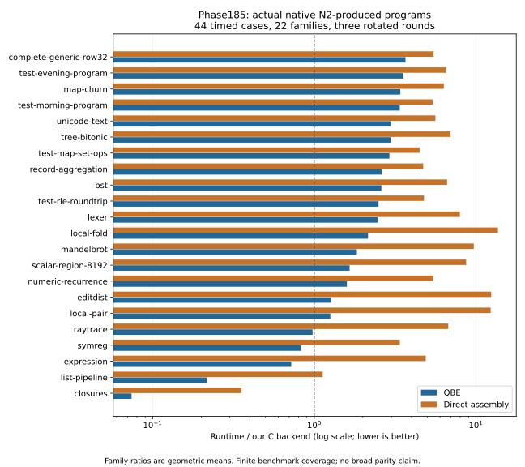

# Phase185 — QBE and assembly generated-program performance

[Design](../../design/phase185/README.md) · [Profiles](profile-findings.md) ·
[Remaining work](remaining-runtime-opportunities.md) · [Experiment progress](progress.md) ·
[Native qualification and use](native-qualification.md)

Work began at06:07:54UTC on2026-11-09 from1d8b56e. The primary reference is our
C backend executing identical Bend programs. Handwritten C and upstream C are
separate comparisons; ratios below must not be relabelled as those references.

## Final native result

The final actual N2 compilers build all45 programs. Three rotated rounds across
C/QBE/assembly complete in254.43s, with405 timed/control observations and433
calibration observations. Every complete-output/count oracle passes. The
zero-work case is excluded from ratios;44 cases remain.

| Runtime metric | QBE | Assembly |
|---|---:|---:|
| Geometric mean / our C backend | **1.47759×** | **5.55592×** |
| Equal-family geometric mean / C | 1.58595× | 5.36396× |
| Mean positive log slowdown | 0.60801 | 1.76198 |
| Cases above1.1× C | 32/44 | 42/44 |
| Cases above2× C | 23/44 | 40/44 |
| Projected fixed-catalog-batch sum | 18.5997s | 70.5653s |
| Positive fixed-batch excess over C | 9.0640s | 60.3506s |

C's projected equal-work total is10.2902s. These totals multiply measured
per-invocation medians by frozen catalog counts; they are not sums of adaptive
batch durations. [Derived metadata](release-full45-runtime02-analysis.json)
contains every case, formulas, exact report identity and independent output audit.

Broad C parity is **not achieved**. QBE's normalized geometric ratio improves
about5.02% relative to the earlier retained-QBE/C1.55570 baseline. This final
comparison crosses campaigns, with the same45 C executable identities and
about0.95% geometric C timing drift; it is not a paired confidence claim. The
first integration had already demonstrated3.84% in a same-campaign comparison.
Final normalized comparisons improve33 cases and regress11; the largest observed
regressions are closures256(+9.05%) and numeric recurrences(+5.45–5.68%). They
remain unresolved observations, not silently discounted as noise. The number
above2×C grows from22 to23 even while the geometric mean improves.

Inspection finds the timed numeric/closure worker instructions identical after
consistent local-label renaming; ten shared support functions change in each
binary. The binaries themselves differ, so layout and support work remain
possible causes alongside measurement variation. This is useful evidence for
the next regression experiment, not a reason to dismiss the observed slowdown.

Assembly's diagnostic four-case speedups are1.34–6.35×, but there is no old
full45 assembly baseline, so no broad assembly before/after factor is claimed.
Its final5.56×C score establishes the next full-corpus reference. Final QBE is
approximately at C speed on the ray family(0.977×), and faster on closures,
list pipelines, expression evaluation and symbolic regression; map, tree,
text and ordinary application workloads still show substantial deficits.

## What changed and why

The maintained compiler now contains shared Boolean result facts, canonical
Boolean operations, packed single-field projection, cold-constructor allocation
and verified continuation-frame expansion. A checked descriptor fact can remove
the repeated cold-allocation descriptor guard; raw/unpaired IDs retain it.

Assembly now reuses admitted array and late native expansions, preserves
entry-only setup across loop backedges, removes stable copies and dead pure
assignments, forwards known local stack cells, places confined temporary values
in caller-saved registers, emits direct register destinations/immediates, and
uses native scalar F32 instructions for admitted binary arithmetic/comparisons.
Calls, aliasing and unknown boundaries retain conservative behavior. No backend
switch, runtime replacement, benchmark-name recognizer or final-verifier change
was introduced. All new compiler algorithms are written in Bend; the existing
host harness transports inputs and checks independently specified outputs.

The baseline Bend-aware sampler accepted paired QBE/C map, tree and ray captures
at two sampling intervals, with roughly 800 samples per pooled capture and no
lost samples. Ownership helpers and transitions are material in map/tree;
the ray spends most samples in numeric workers. A separate assembly capture
places 99.844% of samples in the admitted fast fold body, so missed fast-path
admission does not explain its huge scalar gap. Machine inspection does:
the old assembly loop has 156 instructions/82 explicit frame references,
versus QBE's 17/0. Final assembly reaches 123/29; five dead tuple stores and
four-value loop snapshots still remain. Static instruction counts are diagnostic,
not a predicted speed factor.

## Intermediate experiments

The first integrated full45 campaign completes all45 correctness points and44
timed points with four rotated rounds. QBE/C geometric runtime decreases from
1.55570 to1.49599 (3.84% less runtime); assembly/C is5.98203. These are the
first integrated candidate, before the final descriptor and assembly refinements.
The ray family is0.98989×C; tree3.05786×C and BST2.89845×C still have large gaps.

The final bounded assembly screen compares actual retained products in four
rotated rounds: local-pair13225→2598.96µs (5.09×), local-fold249.75→39.34µs
(6.35×), scalar-region1533.54→345µs (4.45×), generic-row586.90→437.06µs
(1.34×). These four timed cases are diagnostic, not a full45 speedup claim.

The final QBE four-case screen observes tree559.28→483.56µs, map892.86→804.95µs,
ray36000→32250µs and BST25.30→19.95µs. Three rotated rounds and exact complete
output/count checks pass. The differing absolute clocks across campaigns are
why within-campaign paired ratios, rather than cross-campaign absolute values,
are the performance evidence.

## Correctness and selection

Independent upstream source checks accept both current maintained QBE and x86
profiles. The checked hosted API passes finite machine oracles for full-word
Boolean semantics, scalar facts, immediate selection, copies, setup/backedges,
public returns, packed payloads, cold constructors, transient register lifetimes,
dead assignments, continuation frames, F32 edge cases, stack-cell aliases,
register arithmetic and descriptor facts. The new register oracle alone covers
3267 invocations/26136 exact result words. These are finite observations and
structural admission checks, not BendTT proofs.

Eight ordinary source/runtime checks and the first integrated90 benchmark
products pass. Final refinements pass all12 pilot product outputs. Both native
N1/N2/third-emission chains now reproduce exact emitted code and objects, and
both actual N2 compilers pass64/64 current finite qualification cases with zero
unsupported cases. They also build all45 benchmark programs with independent
output/count oracles. All12 final pilot products match the checked hosted B1
byte for byte. These checks strengthen finite evidence; reproduction alone is
not semantic correctness. The final assembly N2 also passes all10 current
runtime controls, including arrays, output, arguments, files and valid exits.

No installed image or release selector changed. Named qualified N2 candidates
are usable through explicit maintained image/receipt arguments. The existing
all-target publication contract still requires a coherent JS/C/QBE selection
and an assembly seed from the selected QBE image; it was not weakened merely
to install two performance candidates. See [qualification](native-qualification.md).

Final candidate source identities: QBE076aa368ae888d02abb1e83f7e89a6c39a11c9baf2f00a970f19f5c336a77214
(3202029bytes); x86374255ac57f28dd93e4714e75093956aa8c938c905e3e771d9c85aae455bae5d
(1525646bytes). Complete sources are retained under
`selfhost/build/phase185/release-source03/`.

## Evidence and reproducibility

Root-owned serial CPU3 lane; sequential runtime, GPUoff; pinned current runtime,
assembler, linker and QBE; 5GiB disk reserve. Adaptive batches target250ms and
require100ms minimum, with full output and success-count verification. Profiling
samples are diagnostics, separate from clean timing; no unsupported hardware
counter or quota measurement is claimed.

Primary roots: `baseline-profile01`, `array-profile02`, `full45-runtime01`,
`register-controls01`, `register-x86-runtime01`, `register-qbe-runtime01`,
`source-qbe-check01`, `source-x86-check01`. All are under
`selfhost/build/phase185/`. Portable evidence and the final qualification
receipts accompany the closing report. The
[final evidence index](evidence/index.json) and
[reproduction instructions](evidence/reproduction.md) cover14,421 authenticated
metadata members, including failures, profiles, complete outputs and native
qualification. Bulk generated code is identified by hashes and retained locally;
the16.6MB portable capsule does not duplicate binaries or full compiler sources.
Early negative screens also remain in
[evidence/early-screens.json.gz](evidence/early-screens.json.gz).

Preserved negatives include slower array-only assembly, mixed cold-constructor
profitability, rejected unconditional scalar-fact reuse across public Returns,
fixture grammar/oracle mistakes, and a180s full45 emission deadline. The latter
completed44 verified products; an authenticated supplemental final case and
metadata-only merge recovered those products without redoing successful work.

## Costs, limitations and next experiments

The campaign used approximately three hours of elapsed research time. Its73
finished guards total4,184.995 seconds (69.75 minutes),57 successful and16
unsuccessful; the union is4,184.974 seconds. These are whole guarded job times,
including tool startup/build/validation, not pure CPU time or agent billing.
Bounded agents investigated Boolean semantics, machine lowering, profiling,
ownership facts and evidence independently; only the root executed measured
target jobs. No quota/token estimate is invented. The detailed guard inventory
and overlaps are in the evidence index.

The implementation adds a net1,552 Bend lines across20 files. The selected QBE
source grows about0.72% versus the prior canonical source, while the assembly
entry closure grows about7.7%. This is a real complexity cost, largely bounded
machine-lowering capability, not a simplification claim. No new runtime ABI or
compiler-wide IR was introduced. The descriptor certificate shares established
facts instead of rechecking each constructor against every table, but is an
executable verifier result rather than a mathematical theorem.

Complete native QBE builds take195.1s and193.8s for the two generations;
assembly takes165.6s from its QBE-built producer and257.8s from its assembly-built
producer. These single observations establish no compilation-throughput gain.
The latter same-source difference is an important remaining assembly compiler
performance workload. Full chain acquisition/qualification was reserved for
the integrated candidate after bounded output and runtime experiments.

For assembly, next test dead private-stack stores and correct parallel moves on
loop backedges. Also preserve the exact effect summary of an inline F32 operation
through scratch forwarding and register allocation: today those analyses see
a call barrier even when the renderer emits no call. For QBE, investigate
ownership-preserving construction/consumption boundaries on map/tree before
another small primitive specialization. C's tree loop also allocates and takes
nodes, so allocation count alone cannot explain its speed advantage. These are
ranked hypotheses with concrete machine evidence, not measured future gains.
