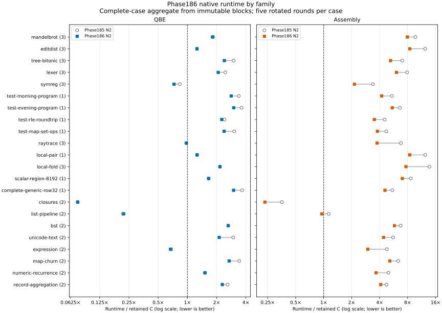

# Phase186 — remove transport, temporary memory and primitive dispatch

[Design](../../design/phase186/README.md) · [Experiment progress](progress.md) ·
[F32 ablation](xmm-ablation-summary.md) ·
[Remaining assembly work](remaining-assembly-work.md)

This campaign began at 09:10:53 UTC on 2026-11-09 from `1b46218`.
The comparison is **runtime of identical Bend programs against our mature C
backend**. It is not a comparison with handwritten C or the upstream compiler.
The 45-program catalog, inputs and independent output oracles are unchanged;
one zero-work case is excluded from runtime ratios.

## Integration status

The final source checkpoint is `86915d9`. Both maintained source profiles pass
the unmodified upstream checker with zero unresolved holes. Both actual native
chains reproduce their emitted text, assembly and objects. Both N2 images pass
64 current finite cases; assembly passes ten additional runtime controls.
All 45 programs emitted by each N2 pass their independent outputs, and eight
retained hosted/native emissions match exactly. The complete runtime comparison
is recorded below. See
[native qualification and use](native-qualification.md).
The installed Phase183 selection and qualified Phase185 candidates are preserved.

## Final runtime result

| Target | Phase185 / C | Phase186 / C | Less runtime |
|---|---:|---:|---:|
| QBE | **1.47131×** | **1.34731×** | **8.43%** |
| Direct assembly | **5.53262×** | **4.00353×** | **27.64%** |

These are direct before/after comparisons of actual native N2 products, with
unchanged C products and all five roles timed together for each case. Every
case has five position-balanced rounds. All 1,125 timed observations and 731
pilots pass independent output/count verification. The original 640-second run
reached its budget after 40 complete cases; the other five were rerun in full.
The explicitly derived two-block result retains every complete case, discards
whole partial cases, and preserves the original deadline failure. No benchmark
inputs, repetition policy, correctness gates or performance observations changed.

**C parity is not reached.** QBE still has 32/44 cases above 1.1× C and 23 above
2×; assembly has 40/44 above both thresholds. Equal-family geometric ratios
improve 1.57962→1.43539 for QBE and 5.34264→3.96097 for assembly. Mean positive
log deficits improve 0.60603→0.52689 and 1.75759→1.45552 respectively. These
show useful broad improvement without hiding the remaining deficit.

Assembly's observed median improves on all 44 timed cases. QBE's largest
observed regressions are list-pipeline128 (+3.64%) and active-ray256 (+1.55%).
Four cases have at least one role with >10% sample spread; all remain included
and explicitly flagged. Five medians do not establish statistical significance.
The [full summary](runtime-summary.md) and [derived data](runtime-analysis.json)
include every workload, family, dispersion flag, fixed-work total and artifact pin.

## What work disappears

Both backends consume the same checked fixed-count state-transfer expansion.
Eligible jump/return calls snapshot their arguments, update the runtime register
bank directly, and retain the original fallback when the runtime capability is
absent. Exact Char construction/projection becomes full-word identity operations.
This eliminates runtime calls and intermediate transfers without changing the
scheduler or treating arbitrary Unicode words as range-checked characters.

QBE local recursive regions now admit several pending continuation frames
before a descent or verified helper call. Each frame still lives on the explicit
continuation stack; this does not introduce unbounded native recursion. The
same case/capture restrictions and independent final verifier remain.

Assembly now removes private stores whose values cannot be observed, schedules
acyclic simultaneous moves directly, and retains the complete snapshot fallback
for cycles. It reuses bounded pure expressions, writes directly to assigned
register/stack homes, loads ABI arguments directly when safe, and saves only
callee-saved registers that the frame actually uses. Unknown effects and aliases
retain conservative behavior.

A distinct private F32 operand plan preserves operands after eliminating their
scratch buffers. Its placement projection is metadata, never a replacement
integer instruction program. Closed canonical floating-point regions can keep
values in XMM registers. Values crossing calls or ordinary control-flow boundaries
keep their original homes. Finally, exact U32-to-F32 primitive calls become the
same short conversion sequence used by the pinned runtime.

All compiler algorithms and selectors are written in Bend. Existing host tools
transport source, invoke toolchains, authenticate artifacts and check independent
observations. No production runtime replacement, ABI change, verifier weakening,
new backend, benchmark-name recognizer or new mathematical-proof claim is made.

## Decisive small experiments

The first ten-case screen reduces QBE geometric runtime by 6.93% and assembly
by 19.63%. The later continuation-only QBE experiment reduces Unicode text
another 21.06% and generic rows 13.78%, with Map/tree/record within 0.63%.
These are bounded screens, not substitutes for the final catalog comparison.

The refreshed Bend-aware assembly ray profile contains 1,401 accepted samples;
21.69% fall in generic primitive dispatch. Actual emitted code exposes 244
U32-to-F32 helper sites. All 244 disappear in the final candidate, while other
primitive call counts remain unchanged. The four-role ablation shows 28.39%
less ray runtime with direct conversion enabled, conditional on XMM retention;
XMM retention contributes a separate 4.34% conditional reduction. These effects
are not additive. No role in that repeat has more than 10% sample spread.
A final profile of the native N2-produced ray executable accepts 899 samples,
with zero loss/unknowns and >99.93% CPU coverage. Clean CPU falls from 7.1144 to
4.4789 seconds in separate single runs; primitive-helper share falls from 21.69%
to 6.35%. Estimated helper time falls from 1.5430 to 0.2846 seconds. Nearest
workers and field accessors now account for 56.15% and 24.06% of samples. This
concentrates the next investigation; a larger share alone is not a regression.
[Profile evidence and limits](final-profile.md) remain separate from clean timing.

Local-fold is an explicit negative control for the F32 ablation: the three
variants have identical assembly and `.text`, despite small timing differences.
The broad assembly changes earlier reduced its actual hot loop from 123 to
66 instructions. QBE still needs only 17 for the equivalent loop. Remaining
scalar spills, copies and Boolean materialization are concrete further headroom.

## Rejected hypotheses and measurement failures

- Both unique-owned constructor-take templates pass focused semantic controls
  but regress tree, Map and record workloads. Even the single-fallback revision
  regresses them by 8.90–15.27%. Neither is selected. Inlining ownership helpers
  added instructions and pressure instead of eliminating the owned computation.
- Wider admission-size limits produce exactly the same 172 record and 13 text
  probe rows. The remaining boundary is closure/readiness, not the size limit.
- Loop-alignment probes improve less than 0.40%; no alignment policy changes.
- One generic-row screen makes an unchanged baseline binary 1.81 times slower.
  Its apparent 46% candidate gain is rejected. A separate six-round repeat
  measures 2.78%, and both original and repeat evidence are preserved.
- The first hosted acquisition exceeded its 2 GiB RSS budget; a fresh explicitly
  bounded 3 GiB acquisition succeeds. A missing Bun path and a prematurely
  submitted job are retained setup failures; the execution lock prevented the
  latter from running concurrently. No performance result uses either failure.

## Costs and limits

The assembly implementation grows by 1,309 maintained lines across 17 changed
modules, including ten new modules. Shared Char/transport adds 168 lines; QBE
stacked-frame admission adds a further small bounded extension. Two rejected
ownership prototypes remain evidence and are excluded from selected profiles.
This is a real complexity cost, not a simplification claim. CSE is bounded to
16 facts/aliases, XMM placement to 14 homes, and the new private-plan path retains
its strict 4,096-statement admission limit.

The generated QBE compiler expands to 128,840,843 bytes in its first native
build, versus 102,207,685 bytes for Phase185. Program speed, compiler execution,
code construction and retained storage must therefore be reported separately.
The complete native build observations are below. They use prepared Base and
one CPU, not a newly established cold-build benchmark. Phase185 comparisons
cross source versions, so they are workflow observations rather than isolated
pass-cost measurements.

| Native build | Phase185 | Phase186 | Change |
|---|---:|---:|---:|
| QBE N1 | 195.108 s | 205.950 s | +5.56% |
| QBE N2 | 193.764 s | 191.221 s | −1.31% |
| Assembly N1 (QBE-built producer) | 165.561 s | 206.457 s | +24.70% |
| Assembly N2 (assembly-built producer) | 257.758 s | 290.135 s | +12.56% |

Within Phase186's QBE chain, N1 and N2 builds use the same compiler source and
produce identical text/assembly/objects. The latter is 7.15% faster end to end;
this is one observation, not a repeated timing result. Assembly's larger analysis
pipeline has a real cost that should be recovered before adding many more passes.
The older qualified images remain available. Independent finite tests and
self-reproduction are not a whole-compiler theorem.

## Next experiment

For assembly, test comparison-to-branch selection and loop-weighted selection
of existing fixed register homes before inventing another IR. The measured
fold loop has 21 frame references and 47 moves but no calls or per-iteration
heap operations; smaller prologues would miss the main issue.

For QBE, keep the new transport/continuation composition and pursue elimination
of whole temporary products across actual hot caller/consumer boundaries.
The failed take templates argue against more helper inlining without evidence
that a complete construction/use/destruction sequence will disappear. Require
a source-level ceiling and transfer to an unrelated workload before broadening.

## Research and resource cost

The campaign ran slightly over three hours including final consolidation.
[Guard receipts](cost-accounting.json) cover 84 finished jobs and 66.53 minutes
of serial execution: 28.10 minutes acquiring/reproducing native images,
18.74 minutes on final gates/products/timing/profile, 5.58 minutes on candidate
profiles/timing, and 14.11 minutes on candidate source/API/emission/build/controls.
These categories include 15 nonzero jobs; they are not all semantic failures.
The large final timing deadline and source/acquisition failures are retained.
Agent work, metadata, storage audits and documentation are not separately timed
and may overlap execution; the difference from wall time is not an agent-cost
measurement. No token/quota expenditure estimate is available from these receipts.

Peak observed guarded process-tree RSS was 2.11 GiB. The smallest recorded free
space was 5.64 GiB, above the required 5 GiB reserve. Exact immutable hardlink
reclamation preserves all paths/bytes; generated compiler text shares storage
only after reproduction identities pass. No qualified reference was deleted.

Completed code checkpoints were pushed as `ec56a51` and `86915d9`. The final
report, source/figure evidence, executable qualification and remaining-work notes
are consolidated with this phase's closing commit.
