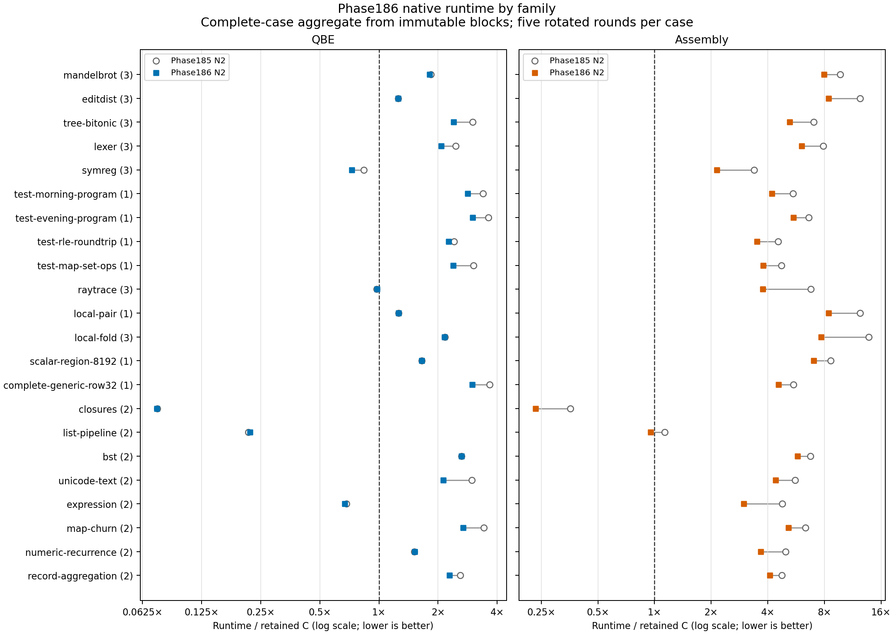

# Phase186 final native runtime

**Derived multi-block result:** the original run stopped at its deadline. This analytical view includes every complete case from that immutable report and whole-case reruns of its unfinished cases. No partial case observations are reused and no source report is relabeled complete. Each case retains five balanced rounds with all five roles measured together; blocks ran at separately recorded times.

The complete five-role campaign compares actual Phase185 and Phase186 N2 products with the same retained C products. All45 frozen catalog points execute;44 contribute timing ratios and one is a correctness-only control. Five serial rotated rounds balance execution positions. Ratios use per-role medians; no paired statistical significance is claimed.

| Target | Old / C GM | New / C GM | New / old GM | Runtime reduction |
|---|---:|---:|---:|---:|
| QBE | 1.471310 | 1.347307 | 0.915720 | +8.43% |
| Assembly | 5.532622 | 4.003531 | 0.723623 | +27.64% |

Positive reductions mean less runtime. These are same-campaign target comparisons, not normalization against historical clocks.

| Target | Equal-family GM old → new / C | Mean positive log deficit old → new | Cases >1.1× C old → new | Cases >2× C old → new |
|---|---:|---:|---:|---:|
| QBE | 1.579618 → 1.435393 | 0.606028 → 0.526886 | 32 → 32 | 23 → 23 |
| Assembly | 5.342642 → 3.960966 | 1.757587 → 1.455517 | 42 → 40 | 40 → 40 |

Each family is the geometric mean of its timing-eligible points; counts appear in parentheses. The dashed line marks C parity. [SVG](runtime-family-comparison.svg) and [PDF](runtime-family-comparison.pdf) are retained for export.

| Role | Projected fixed-catalog total (s) | Positive excess above C (s) |
|---|---:|---:|
| c | 10.095378 | 0.000000 |
| oldqbe | 18.144079 | 8.819920 |
| newqbe | 16.357191 | 7.134113 |
| oldx86 | 69.095935 | 59.075342 |
| newx86 | 48.168369 | 38.175331 |

Fixed-catalog totals multiply per-invocation medians by original frozen repetition counts for the44 timing-eligible cases. They are projected work totals, not summed adaptive measurement time. Positive excess sums only cases slower than C.

## Largest observed regressions

| Target | Case | New / old | Runtime change | Target-role spread flag |
|---|---|---:|---:|---|
| QBE | coverage-list-pipeline-128 | 1.036404 | +3.64% | none |
| QBE | variation-ray-active-256-2240 | 1.015538 | +1.55% | none |
| QBE | coverage-numeric-recurrence-256 | 1.008079 | +0.81% | none |
| QBE | coverage-list-pipeline-512 | 1.008065 | +0.81% | none |
| QBE | variation-ray-active-64-2440 | 1.004402 | +0.44% | none |

Small differences are observations, not established regressions. Each target retains its own role-specific dispersion caveat.

## Verification and dispersion

Revalidated 1125 timed samples and 731 pilots, including exact output/count suffixes, executable identities, the frozen catalog, and 1269 input pins. Per-case and aggregate summaries were independently recomputed. No observations were replaced or excluded.

Max/min sample spread above10% triggers review; it does not automatically reject a case or establish its cause.

| Case | Flagged roles and max/min spread |
|---|---|
| variation-lexer-6-17 | newx86 1.480× |
| variation-lexer-10-123 | oldqbe 1.198×, newqbe 1.173×, oldx86 1.177× |
| variation-symreg-7-123 | newqbe 1.232× |
| coverage-expression-32 | newx86 1.130× |

A C-only flag cautions new/C ratios; examine old/new target roles separately for same-campaign target effects. Any targeted repeats belong in separate reports and do not rewrite this full45 campaign.

Derived analytical view: `/home/ai/bend2/build/publish/bend/selfhost/build/phase186/release-full45-five-composite01/report.json` (SHA256 `2b672c66c58f19d072341ba556d67986a1bdee053a509fd4800874d7087233ec`). Exact per-workload ratios, pins, samples, family metrics and comparisons are in [runtime-analysis.json](runtime-analysis.json). The main phase README and original measurement report remain unchanged.

Source blocks:

- `/home/ai/bend2/build/publish/bend/selfhost/build/phase186/release-full45-five-runtime01/report.json`: original complete=False; 40 complete cases included; 5 whole incomplete cases discarded.
- `/home/ai/bend2/build/publish/bend/selfhost/build/phase186/release-full45-five-resume01/report.json`: original complete=True; 5 complete cases included; 0 whole incomplete cases discarded.
