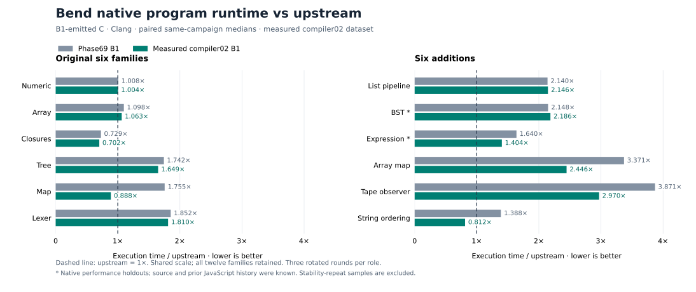

# Native runtime results: compiler02 measured checkpoint

Compiler02 reduces geometric execution time by **12.95% on the original six
families** and **18.90% on six broader additions**, compared with Phase69 B1
measured in the same campaigns. Its respective execution-time ratios to
upstream are **1.12124×** and **1.84036×**. There are useful general gains, but
the broader set still shows substantial gaps; this is not universal C parity.

These are **runtimes of C programs emitted by the checked B1 Bend compiler and
compiled with Clang**. They are not B1/B2 compilation latency, C toolchain time,
or the execution time of the compiler itself. The measured image is compiler02
API SHA-256 `f326862f5163fce83e47642c9b8dcfdb6596683bafe36054b7fb6d5430376f2f`.
It is a measured candidate checkpoint, not a release-promotion claim. A later
compiler-only change must establish its emitted-code relationship or receive
separate qualification before inheriting these runtime claims.

**Final compiler03 transfer:** compiler03 is now installed from source commit
`d6d6049`, with B1 SHA-256
`386ae358ee8fe33c5af3f7fec16f956b59451ee6004da99a94146140d3e8a162`.
Its checked B1 and genuine B2 each emitted all twelve benchmark programs:
**24/24 complete C outputs are byte-identical to measured compiler02**, with
56 supporting identity equalities. Self-check, B3 and the maintained final gates
also passed. This transfers the saved-C runtime evidence under the same native
toolchain; it is not a new timing campaign. Tables, chart and timestamps below
remain attributed to compiler02. The completed transfer receipt is
`selfhost/build/phase70/compiler03-C-identity12-v2-summary.json`, SHA-256
`fef66ef4b9ff565ac1b2b4faab749f5b4953af0b2896ae63275013aabb69802a`.

The [portable evidence summary](evidence/native-runtime-results.json) contains
all **144 qualified intervals**: 54 original-family observations, 54 additional
family observations and 36 separate sensitivity observations. It pins the raw
reports, plans, APIs, holdout freeze, corpus and oracles. No intervals are removed
and the sensitivity observations are not substituted into the primary scores.



The [standalone SVG](native-runtime-comparison.svg) preserves both six-family
panels on one common scale, with upstream at 1×. It plots this measured
compiler02 dataset; any later compiler03 identity mapping is separate evidence.
The small [Matplotlib generator](evidence/plot-native-runtime.py) reads only the
portable summary and uses no compiler or generated program:

```sh
taskset -c 0 python3 -B implementation/phase70/evidence/plot-native-runtime.py \
  --out implementation/phase70/native-runtime-comparison.svg
```

## Original six families: contemporaneous comparison

Every number below is a three-round median from the same comparison. Smaller
time ratios are better. “Time reduction” is `1 − current/Phase69`, so negative
values would mean more time. Absolute times are not comparable across families
because work counts differ; they are identical between roles within a family.

| Family | Phase69 B1, ms | compiler02 B1, ms | Upstream, ms | Phase69/upstream | Current/upstream | Time reduction |
| --- | ---: | ---: | ---: | ---: | ---: | ---: |
| numeric | 252 | 251 | 250 | 1.0080× | 1.0040× | 0.40% |
| array | 191 | 185 | 174 | 1.0977× | 1.0632× | 3.14% |
| closures | 164 | 158 | 225 | 0.7289× | 0.7022× | 3.66% |
| tree | 338 | 320 | 194 | 1.7423× | 1.6495× | 5.33% |
| map | 737 | 373 | 420 | 1.7548× | 0.8881× | 49.39% |
| lexer | 389 | 380 | 210 | 1.8524× | 1.8095× | 2.31% |
| **Equal-family geomean** | — | — | — | **1.28809×** | **1.12124×** | **12.95%** |

The equivalent geometric speedup over contemporaneous Phase69 is **1.14880×**;
current time is **0.87047×** old time. Map contributes the largest improvement
and now runs faster than upstream on this workload. Closure execution is also
faster than upstream. The small changes on numeric/array/closures/lexer should
not be interpreted as strong standalone improvements from three rounds.

This campaign ran on 2026-10-12, 01:57:49–01:58:13 UTC. All **54/54** intervals
passed independent output checks, clean exits, clock consistency and the 100ms
minimum. Raw report: `compiler02-native06-comparison/report.json` under the
Phase70 build directory.

## Six additions: broader transfer and remaining gaps

Membership was selected before this result: repository list/AST/tree workloads,
the repository's U32→Bool→U32 Array.map pipeline, and independently written
immutable-root/ordering workloads. Sizes, seeds, wrappers and input cycles are
fixed by [cases-v2.json](../../selfhost/tools/performance/phase70/coverage/cases-v2.json).
The independent Python oracle supplies base and aggregate digests; candidate
output was not used to invent expected values.

| Family | Phase69 B1, ms | compiler02 B1, ms | Upstream, ms | Phase69/upstream | Current/upstream | Time reduction |
| --- | ---: | ---: | ---: | ---: | ---: | ---: |
| list-pipeline | 644 | 646 | 301 | 2.1395× | 2.1462× | −0.31% |
| BST, native holdout | 681 | 693 | 317 | 2.1483× | 2.1861× | −1.76% |
| expression, native holdout | 564 | 483 | 344 | 1.6395× | 1.4041× | 14.36% |
| Array-map | 1126 | 817 | 334 | 3.3713× | 2.4461× | 27.44% |
| Tape observer | 1169 | 897 | 302 | 3.8709× | 2.9702× | 23.27% |
| String ordering | 472 | 276 | 340 | 1.3882× | 0.8118× | 41.53% |
| **Equal-family geomean** | — | — | — | **2.26916×** | **1.84036×** | **18.90%** |

The equivalent geometric speedup over Phase69 is **1.23300×**; current time is
**0.81103×** old time. The nonobserver expression workload improves, while
list-pipeline and BST are slightly slower in this run. Those unfavorable
observations remain in the denominator. String ordering runs faster than
upstream; Tape remains almost 3× upstream despite a substantial improvement.

This campaign ran on 2026-10-12, 02:04:32–02:05:14 UTC. All **54/54** intervals
qualified under the same correctness and clock requirements. The raw report is
`compiler02-coverage-final-comparison01/report.json`. Acquisition of the five
missing candidate cases and the two baseline/upstream holdouts also passed all
smoke digests; existing Array-map and four-family baseline artifacts were reused.

### Holdout exposure and limits

BST and expression were frozen against the exact compiler02 API at
**01:50:56 UTC**, before the missing-five candidate acquisition began at
02:01:49 UTC. Their source, wrappers, seeds, sizes and independent oracle are
pinned by `compiler02-coverage-final-plan01/holdouts.json`. This guards against
selecting a new favorable compiler after seeing their native timing.

They are **native performance holdouts**, not previously unseen programs. Their
source was read, they existed in earlier JavaScript benchmark work, and their
source-check results were known before this campaign. The other four additions
were actively used during development. Six additions increase coverage; they
do not cover every Bend feature, allocation pattern, input size or parallel
workload. These measurements use one runtime worker with GPU disabled.

## Keep the denominators separate

The two primary scores remain **1.12124× for the original six** and **1.84036×
for the six additions**. They answer different questions: continuity with the
old native loop and transfer to a broader set.

For an explicitly equal-weighted view of all twelve distinct families, the
geomean is **1.43649× upstream**: `sqrt(1.1212448869 × 1.8403622782)`. This is an
optional combined summary of two contemporaneous campaigns, not a replacement
for the original denominator, a population estimate, or a claim about the full
45-program JavaScript suite. It excludes the targeted repeat below.

Geometric time reduction is computed as
`1 − exp(mean(log(current median / old median)))`, rather than averaging the
percentage improvements or adding milliseconds from differently sized batches.
No confidence interval or universal speed bound is inferred from three rounds.

## Noise audit and targeted sensitivity result

Historical Phase69's **1.0332×** upstream score is not the current baseline.
The same saved Phase69/upstream binaries measure **1.28809×** in this campaign.
The [timing-drift audit](native-runtime-noise-audit.md) verifies matching saved
binaries, work counts and relevant inputs. In particular, the unchanged
upstream closure executable moved from a historical median 566ms to 225ms now.
The audit establishes changing execution conditions, without identifying a
physical cause or justifying a uniform correction factor.

A predefined six-round repeat of only array and closures then produced **36/36
qualified intervals**, with the same saved binaries and work:

| Family | Phase69 median, ms | compiler02 median, ms | Upstream median, ms | Current/upstream |
| --- | ---: | ---: | ---: | ---: |
| array | 169.0 | 169.5 | 168.0 | 1.0089× |
| closures | 161.5 | 156.5 | 223.0 | 0.7018× |

Array is effectively at parity in this sensitivity check; the primary 1.0632×
point estimate is sensitive to its short-run spread. The closure ratio closely
reproduces. Initial and unfavorable observations remain retained. Neither repeat
value is spliced into the original six-family geomean, and this repeat does not
explain the historical drift.

## What the results support

The general immutable-root observer path has useful transfer beyond its first
Map example: Map and String ordering improve substantially, and the independent
Tape traversal improves while still exposing a large residual gap. The
[observer checkpoint](observer-emission.md) documents the narrower earlier
experiments and the ownership/error/effect contracts. These whole-version final
comparisons do not independently attribute every percentage to one pass.

Checked Bool admission restores an existing representation permission on
Array-map: packed arrays, direct unshared locations and typed private scalar
parameters become available. The [C shape inspection](native-array-map-opportunity.md)
shows both specialized map bodies remain byte-identical at source level while
their runtime-helper permissions change. Both still contain the recurring
array/value Tuple allocation and destruction sites missing from upstream's
corresponding loops. That is a concrete general product-transport opportunity,
not proof of its dynamic cost or that it alone would reach parity.

List-pipeline and BST receive no demonstrated gain; neither is an observer-only
workload. Together with residual tree/lexer gaps and Tape's remaining ratio,
they argue for general allocation, ownership and loop-state improvements rather
than assuming the observer technique solves all programs. Further cost
attribution should start with saved C and a small bounded profile before another
broad rerun. No additional optimization is performed by this report.

Runtime checksum success is separate from language conformance. The
[compiler02 correctness report](compiler02-correctness.md) records the focused
and broad gates, including known upstream disagreements. These 144 samples
cannot establish full conformance, genuine B2 qualification or release readiness.

## Method and reproduction

All roles use the same wrapper and Clang recipe within each family, CPU3,
`--threads 1 --gpu off`, fixed shared warmup and measured counts, and a repeated
16-input cycle. The wrapper reports its independent base result, warm digest,
measured digest and integer elapsed milliseconds. Timed execution includes the
wrapper's measured loop and the measured digest's formatting/print, excluding
warmup, source loading, compiler execution and C compilation. Calibration chooses work; its short observations
are not mixed into final timing results.

The three primary rounds rotate Phase69, compiler02 and upstream order. Each
child is guarded by a deadline, 2GiB process-tree RSS and a 4GiB available-memory
floor. The comparator checks source/toolchain equality and saved C, executable,
emission and recipe hashes. Final observations require clean output, exact
digests, at least 100ms and a plausible relation to whole-process time.

Use the [frozen coverage instructions](../../selfhost/tools/performance/phase70/coverage/final-compiler02.md)
for acquisition, calibration and saved-binary comparison. Fresh output paths
are required; old plans and failures remain unchanged. The data-only
[summary script](evidence/summarize-native-runtime.py) reproduces this report's
medians and ratios from retained receipts without executing any target.

## Portable evidence pins

The portable [summary JSON](evidence/native-runtime-results.json) uses paths
relative to the repository and retains all observations and raw identities.
Its SHA-256 is
`ee4a76e041ba96c32dc72b81afd258da388158525fd186a42c26c749edb1cab6`.
Raw report paths below are relative to `selfhost/build/phase70`:

| Evidence | SHA-256 |
| --- | --- |
| `compiler02-native06-comparison/report.json` | `0e719e8e35c9979aaad94902027e656e6ab353ed54bb316b163a504ef6e4a291` |
| `compiler02-coverage-final-comparison01/report.json` | `a1b962fc66c266dc304faacb711eb13e1fea44f01a8fdac342ccfe0b39dcd461` |
| `compiler02-native-stability02/report.json` | `eaa4c42fc89d4a743fbf50c4c84d40ba9d05d33b04cc1c49fe0413dd73da5714` |
| `compiler02-coverage-final-plan01/holdouts.json` | `d06e7b9ed8b43f316cb5e62630d3efbfa8bac8895c7b551a00a9b1d7d53edca5` |

The summary additionally pins each final plan, both B1 APIs, acquisition recipes,
holdout acquisition receipts, the six-addition catalog/oracle and saved-C
inspection. Source/data preparation of this report ran on CPU0 and executed no
compiler, Clang, generated program or profiler; root produced the target receipts.
