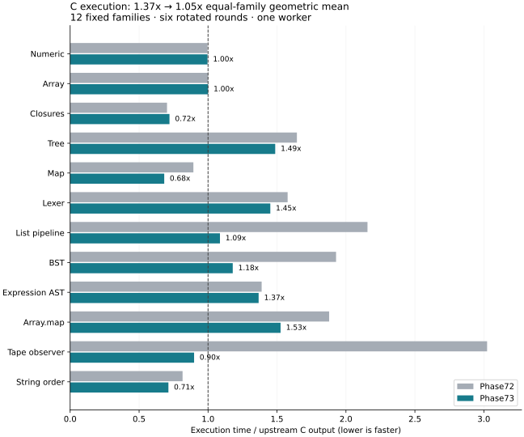

# Phase73: native execution close to aggregate parity

[Design](../../design/phase73/native-parity.md) · [Measurements](measurements.json) ·
[Ownership invariants](../../docs/self_hosted/NATIVE_OWNERSHIP_FACTS.md) ·
[Methods](../../selfhost/tools/performance/phase73/README.md).

Selected compiler14 reduces the fixed twelve-family C execution score from
**1.36903× to 1.05060× upstream**, or **23.26% less execution time**. The original
six reach **1.00924×**, and the six additional families reach **1.09365×**.
This is close to aggregate parity, not parity on every program: four families
remain 1.37–1.53× slower, while several others beat upstream. About 4.82% further
reduction in the equal-family score would reach 1.0×.

The largest changes are Tape **3.36× faster**, list pipeline **1.98× faster**,
and BST **1.64× faster** than Phase72. These come from general ownership and
representation facts implemented in Bend, without benchmark-name selectors.
C compilation requests cost **7.33% more in B1 and 6.28% more in B2**. This is an
explicit execution/compilation tradeoff, not an improvement in every metric.

**Compiler14 is installed and verified.** Checked B1 is `c2705793…`, genuine
B2/B3 is `25d4ca2e…`, upstream remains `0592662`. The
[qualification receipt](qualification.json) joins the executed gates and verifies
all seven old release files were preserved. No PR comment was posted.

## Generated-program execution

All rows are medians in milliseconds from six rotated rounds per role, with
Phase72, selected Phase73 and pinned upstream measured together. All **216/216**
intervals match independent sixteen-input checksums and exceed 100ms. Emission,
Clang, warmup and profiling are outside the execution clock. One worker, CPU3,
GPU off; the sources, iteration counts, seed handling and oracles are unchanged.

| Family | Phase72 ms | Phase73 ms | Upstream ms | Phase73 / upstream | Time saved vs Phase72 |
|---|---:|---:|---:|---:|---:|
| Numeric | 251 | 251 | 252 | 0.996× | 0.0% |
| Array | 169 | 169 | 169 | 1.000× | 0.0% |
| Closures | 157 | 161 | 223.5 | 0.720× | -2.5% |
| Tree | 319 | 288.5 | 194 | 1.487× | 9.6% |
| Map | 353 | 269.5 | 395 | 0.682× | 23.7% |
| Lexer | 358 | 329.5 | 227 | 1.452× | 8.0% |
| List pipeline | 649 | 327 | 301 | 1.086× | 49.6% |
| BST | 646 | 395 | 335 | 1.179× | 38.9% |
| Expression AST | 443 | 436 | 319 | 1.367× | 1.6% |
| Array.map | 562.5 | 457 | 299.5 | 1.526× | 18.8% |
| Tape observer | 896.5 | 266.5 | 296.5 | 0.899× | 70.3% |
| String order | 278 | 243 | 341 | 0.713× | 12.6% |

The equal-family twelve score weights each family equally; it does not estimate
all possible Bend programs. The six additional families were selected before
this phase to cover persistent lists/BSTs, expression trees, array pipelines,
shared recursive data and string ordering. They are distinct from the historical
45-point JavaScript corpus. Faster cases do offset slower cases in a geometric
mean, so the per-family gaps above remain the primary guide for further work.
Closures takes 4ms more (2.55%); Numeric and Array are unchanged. Other rows improve.

Timing drift is visible in retained samples, including upstream BST and earlier
AST screens. Earlier candidate08's 1.036× was partly aided by a slow upstream AST
sample. We increased the final campaign to six rounds before executing it and
kept every qualified sample. We report the final 1.051×, not the best intermediate
score. Samples and inputs are retained in `measurements.json`; these are descriptive
medians, not confidence intervals.

Genuine B2 emits all twelve complete C files byte-identically to the timed B1
outputs. Thus these finite generated-program results apply to both stages.
This does not measure a compiler executable built natively in C: B1 and B2 are
JavaScript compiler images producing C programs.

## What changed and why it worked

**Unnecessary sharing machinery was a large hidden cost.** Before this phase,
a sixteen-input cycle created 5,609 RFC wrappers in the list pipeline versus 3
upstream, 4,255 versus 1 in BST, and 16,371 versus 3 in Array.map. A saved-C
falsifier removed only proven-unnecessary field sealing and immediately cut list
execution approximately in half. The compiler implementation uses a bounded
analysis of the checked book: duplicated variables heat their complete annotated
types and transitive live fields. Constructors that cannot be shared can transfer
fields without sealing them. Unknown, dependent, unbounded or effectful cases
retain conservative behavior. Complete type instantiations and Base/user
constructor provenance are part of the certificate.

Final selected-image counters confirm the mechanism, independently of timing:

| Family | Heap allocations, old → new → TS | RFC wrappers, old → new → TS |
|---|---:|---:|
| List pipeline | 11,266 → 5,660 → 5,660 | 5,609 → 3 → 3 |
| BST | 11,913 → 7,659 → 7,659 | 4,255 → 1 → 1 |
| Tape | 2,082 → 1,066 → 2,066 | 1,033 → 17 → 1 |

Counts are deltas across the same sixteen-input cycle, taken from instrumented
programs; their runtime is not used in the performance table. The compiler now
matches upstream allocation counts on list and BST; residual gaps need a different
explanation. Tape allocates fewer objects than upstream, despite retaining a few
more wrappers at owning boundaries.

**Borrowing and storage facts must compose.** A scalar-result observer can borrow
a shared recursive root and release its ownership once at completion. Every root
is checked and the guard repeats at loop backedges, including a unique prefix
leading to a shared tail. Borrowing alone cut Tape roughly in half. Proving that
all reachable consumers borrow while shared allowed its recursive children to
remain unsealed too, bringing the final Tape time from 896.5ms to 266.5ms. Partial
applications, escaping consumers, reconstruction, effects and worker bypasses
refuse this stronger certificate. Ordinary unique consumers retain their loop.

**Facts need to survive suspension.** Existing U32/F32/Char/Bool word kinds now
travel with ownership bindings, aliases, matched fields and continuation
parameters. The checked constructor telescope provides one bounded field mask,
shared by monomorphic field macros and captured match-field kinds. Unknown values
stay opaque; a general Nat is not assumed to fit 32 bits. Checked CPU permission
gates narrowing, while raw/device loads retain full Terms. This removes a later
pass that reconstructed widths after lowering.

The analyses reuse the prepared native bodies rather than erasing each function
again. The runtime representation, scheduler, TypeScript reference and JS frontend
were not rewritten. See the ownership document for the exact admission rules and
maintenance obligations when adding new destructive consumers.

## What did not work

| Experiment | Observation | Decision |
|---|---|---|
| Unrestricted non-tail C recursion | List 644→970ms, AST 450→548ms, Tape 899→1298ms; also unsafe on deep inputs | Rejected diagnostic; never installed |
| Nat range masking | Helped tree, hurt AST approximately 13% | Removed; no new Nat word kind remains |
| Match field mask alone | Negligible gains across four families | Removed as a standalone change; later composed with capture kinds |
| Force all private workers inline | Helped lexer, hurt AST approximately 14% | Rejected |
| Remove forced inlining everywhere | Helped tree, hurt lexer approximately 6% | Rejected; existing policy retained |
| Reuse prepared bodies | Candidate11 emitted all twelve C files/binaries exactly like candidate08 | Retained to avoid duplicate compiler work |

The per-hypothesis records in [experiments/phase73](../../experiments/phase73)
retain the candidate sequence. No addition of overlapping gain estimates is used.
Storage reuse and collection fusion were not implemented in this phase. Failed
compiler06 affine binding, invalid first-version affine fixtures, early preparation
races and a rejected attempt to prepare an already populated profiling cache are
preserved. They are not silently removed or counted as successful validation.

## Compilation speed is a separate tradeoff

The fixed request campaign has **45/45 exact C checks**: three sources, old/new
B1/B2 plus upstream, three rotated/reversed rounds, fresh requests. Imports,
explicit prepared Bend Base, Clang and generated-program execution are outside
the request clock; TypeScript checks Base inside its request. These numbers are
not a broad frontend/JS score or end-to-end CLI time.

| Source | Old B1 ms | New B1 ms | Old B2 ms | New B2 ms | TS ms |
|---|---:|---:|---:|---:|---:|
| Numeric | 2391.6 | 2512.2 | 1566.3 | 1652.8 | 747.8 |
| Array | 2437.2 | 2733.4 | 1560.9 | 1687.1 | 712.3 |
| Lexer | 3089.9 | 3243.0 | 1976.9 | 2080.8 | 899.2 |

B1's geometric mean moves **3.35025×→3.59582× upstream**; B2's moves
**2.16089×→2.29667×**. The changes are +7.33% and +6.28% request time. We accept
this bounded cost for the substantially larger native execution gains and keep
it visible as a next optimization target. Six additional old/new B2 profiles locate the added work in native emission:
its instrumented stage increases about 71–85ms, with the new sharing/field
functions present in 44–53ms of inclusive CPU samples per request. Binding-kind
helpers account for another 2–6ms. GC and existing erasure also vary. These are
single diagnostic profiles, not causal ablations or clean speed samples;
[profile summaries](compiler-profiles.json) retain the scope and raw identities.
The direct next compiler experiment is one indexed occurrence summary per body,
rather than repeated `nq_uses` scans, plus reuse of specialized field facts.

Historical Phase66 broad JS scores remain 1.049× execution and 1.402×/1.321×
B1/B2 compilation. This phase did not remeasure those clocks: it verified exact
identity of all 2,992 functions in the exported non-native dependency closure,
the runtime and public wrappers. Native changes use fresh native evidence.

## Correctness, self-hosting and limits

- Checked B1 frontend: 36 paired observations pass.
- Native selection: candidate 100/100 pass; reference 93/100, with precisely the
  same seven unused-error-demand failures as Phase72. The paired controller
  correctly returns failure for those disagreements; it is not labeled passing.
- Twelve new controls pass on both compilers. All twelve also run correctly at
  one and four threads (24 executions), with six positive/negative generated-code
  assertions ensuring cold-root admission and refusal really execute.
- Controls cover shared tails, mixed roots, escaped consumers, reconstruction,
  nested/captured data, 100k-deep inputs, erased fields, Nat range and parallel
  users. The inherited raw gate passes 31 observations over 19 custom cases.
- Genuine B2 passes eight driver comparisons, freshly accepts its own complete
  source and reproduces B3 exactly. Unsafe proof-trust refusal is expected and
  explicit; this is not an independently kernel-checked compiler proof.
- All twelve B2 C-output identities pass. Redundant B1 jobs prepared in that
  identity plan were not executed or claimed; B1's actual acquisitions and timed
  binaries supply their own evidence.

Installed release integrity passes before and after legacy42/default24/helper5
CLI checks. All six release jobs return success. The old checked B1 `0ab62a7a…`
and its seven-file lineage are retained byte-for-byte under `selfhost/dist/release-history/`.

Thirteen native API gaps and the existing finite frontend/JS exceptions remain.
No full-language, physical GPU, allocation-heavy parallel-scaling or formal
correctness claim is added. The focused four-thread controls check semantics,
not throughput scaling; Phase71's compute-heavy scaling result remains historical.

## Simplicity and identities

Manifest-counted Bend production source grows from **31,457 to 31,730 physical
lines**, and from **25,728 to 25,939 code lines** (blank/comment lines excluded).
That is +273 physical/+211 code lines, **128→129 modules**. The new module owns the
sharing certificate; scalar propagation extends the existing word-kind type and
ownership environment. A duplicate erasure and later scalar-reconstruction pass
were removed. This is a modest source increase for an execution improvement,
not a line-count reduction. Runtime, methods and generated artifacts are separate.

| Artifact | SHA-256 / commit |
|---|---|
| Selected production source | `a6ca26d` |
| Upstream | `059266225b77c8ca256ac6b25ee5c21449bab151` |
| Checked B1 | `c27057932d254ebbec8f3d29932d74284ba682c73f1e91ef93c87625cda052fa` |
| Genuine B2/B3 | `25d4ca2e6677f86c5421a157cdf78b180819fde51b6daa263412f862bd9afcae` |
| Flattened Bend source | `cf12e529f362d1cae089f5632891cab40da66e9af536964ad4f1f446cffb1a89` |

## Remaining opportunities

The next loop should target the remaining slow families and compiler analysis
cost, rather than collecting more wins on already fast Tape/Map. Intermediate candidate08 counters
show tree allocating about 434k objects per sixteen-input cycle versus 231k
upstream. Generic unique-node reuse or producer/consumer fusion deserves a bounded
saved-C falsifier, followed by a general Bend rule if it succeeds. In contrast,
Array.map's intermediate selected image already reduced allocation counts to
49,206 versus 49,174 upstream while execution remained slow: another allocation
counter reduction alone cannot explain or guarantee parity there. AST likewise
has matching allocation counts but excess scheduler and generated-code work.

Use the retained C/binaries for short independent-input interventions; require a
benefit in multiple families before production changes. First recover the new
compiler-analysis overhead through indexed/reused facts. Keep full native and
self-hosting gates for a selected candidate and preserve the known failures.
Neither 0.5× upstream nor universal 1.0× has been demonstrated.

## Cost, evidence and replay

One agent, **no subagents**, one guarded target process tree at a time. Through
release qualification the recorded interval is **118.4 minutes**, of which
**44.9 minutes** are guarded target-tree wall time across 1,362 unique receipts.
The balance includes reasoning, code/data preparation, orchestration and writing;
it was not separately instrumented, so this is not a precise activity breakdown.
Peak recorded tree RSS is **1.588GiB**, below the 2GiB guard; no OOM occurred.
The available-memory floor was 4GiB and Node used a 1GiB heap/4MiB stack.
Final documentation, archival and pushing are outside that accounting cutoff.

Account quota observations moved **54%→57% used**, three percentage points over
the same weekly window. This is account telemetry, not an exact bill or proof all
usage came from this turn. [Accounting](accounting.json) preserves aggregate
observations and receipt paths; private usage snapshots are excluded from the
public evidence. The first checked candidate built in tens of seconds; broad
native qualification was deferred until a selected candidate had shown gains.

The [evidence capsule](../../selfhost/tools/performance/phase73/evidence01/manifest.json)
retains source snapshots, all candidate/failed attempts, generated C and binaries,
independent oracles, selected B2/B3, clean timings, counters and profiles. Its
verification reopens every archived file and checks hashes and executable modes.
The 128,696,585-byte archive contains17,277 files and is published in four verified
pieces; [restoration instructions](../../selfhost/tools/performance/phase73/evidence01/README.md)
include the exact joined SHA-256. The small publication tool is tracked separately
because splitting occurs after the target evidence has been sealed.
Earlier frozen baselines, upstream and toolchains are pinned external dependencies;
absolute recorded paths require restoration/adaptation. This is reproducible
experimental evidence, not a hermetic toolchain package.

Phase73 target writers are closed after sealing. Use a fresh phase/output path
for the next experiment, preserve unrelated inherited changes, and never reuse
an already populated preparation cache under another plan identity. Commits during
this phase record the design (`4fb4bbb`), first implementation (`25f5909`), ownership
consolidation (`36c3461`) and final production changes (`a6ca26d`), followed by this
qualified release/report commit.
