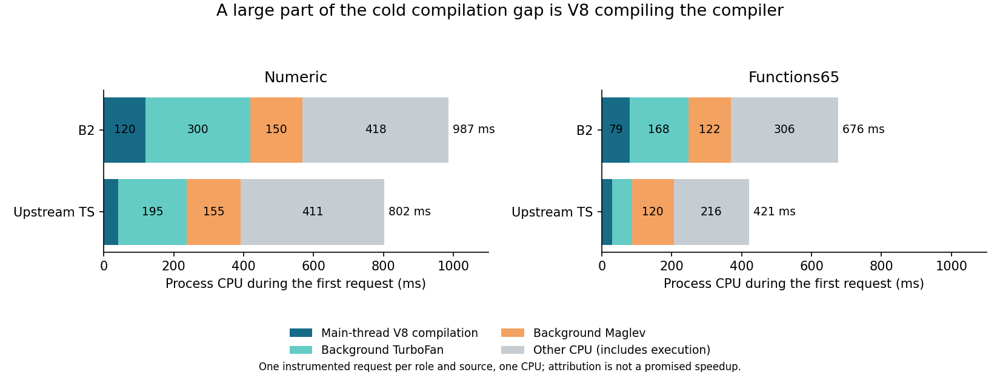

# Phase85: V8 spends substantial time compiling our compiler

**The main new finding is first-use V8 compilation cost, not a new expensive
native optimization pass.** On two directly instrumented first requests, extra
V8 compilation CPU accounts for96% and65% of B2's CPU gap against upstream.
This gives a stronger direction for the next compiler experiment: reduce the
JavaScript work V8 must compile and optimize, while retaining useful optimized
execution. It does not prove that all that compilation can be removed for free.

[Design](../../design/phase85/v8-compiler-execution.md) ·
[Methods](../../selfhost/tools/performance/phase85/README.md) ·
[Full timing tables](summary.json) · [Comparisons](comparisons.json) ·
[Thread CPU evidence](timeline.md) · [Machine-code evidence](scc-findings.md) ·
[Archive receipt](evidence.json).

## What was measured

This is the **JavaScript-hosted genuine B2 compiler compiling Bend programs to
C**. It is neither Clang time nor the execution time of the resulting native
programs. Production remains Phase82: B2/installed API `098320e8…`, checked B1
`8a400725…`, upstream `059266225b77c8ca256ac6b25ee5c21449bab151`.
Node24.18.0/V8 `13.6.233.17-node.50` is pinned by executable hash.

Numeric, Map, Lexer and Functions65 provide scalar/IO, higher-order data,
parsing and small generated-definition cases. They are a diagnostic subset,
not the full45-point execution benchmark or a fresh broad qualification.
Every request uses ordinary load/check/report/native emission, verifies complete
C against its own role's prior oracle, and checks unchanged inputs/Base cache.
Each fresh process in the repeated-process lanes imports once and makes five
ordinary requests, without a
persistent inspector or result memo. Prepared Bend Base and imports are separate
from the request clock. Upstream loads/checks Base but omits its CLI proof-report
helper, preserving the explicitly documented existing comparator contract.

Clean timings, CPU profiles, optimization traces, thread traces, bytecode and
machine-code dumps are separate jobs. CPU3 is the default affinity; the hardware
experiment explicitly compares CPU3 with CPU2,3. These are different physical
cores on this machine (sibling lists2,6 and3,7). No target jobs overlap.

## 1. Direct thread CPU explains much of the first-request gap

Inspector samples alone miss background compiler CPU. V8's trace writer records
per-thread CPU durations as well as elapsed durations. We join exact job/PID
records and `process.hrtime()` boundaries to those events, union overlapping
scopes within each thread, and keep task envelopes/nested compilation from being
counted twice. Main compilation includes parsing, bytecode, tier decisions and
finalization; observed nested GC is excluded. Sparkplug's background work is not
fully covered. The residual includes execution, GC and other unclassified work.

| First request, diagnostic CPU ms | Numeric B2 | Numeric TS | Functions65 B2 | Functions65 TS |
|---|---:|---:|---:|---:|
| Main-thread compilation |119.6|42.0|79.5|28.7|
| Background TurboFan |299.6|194.9|168.1|57.4|
| Background Maglev |149.7|154.9|122.5|119.5|
| Total attributed compilation |568.9|391.8|370.0|205.6|
| Other CPU |417.7|410.6|306.0|215.8|
| Total process CPU |986.6|802.4|676.1|421.4|

Numeric's observed184.2ms B2-minus-TS CPU gap contains177.1ms of extra compilation
CPU (96.1%). Functions65's254.7ms gap contains164.4ms (64.6%). Maglev CPU is
similar; the excess chiefly comes from **first-use parsing/bytecode and TurboFan**.
Numeric has1,675 `V8.CompileCode` slices in B2 versus556 upstream; Functions65
has1,060 versus411. These are event counts, not a count of distinct definitions.

This is one instrumented request per role/case. Trace clocks are slower than clean
clocks and cannot replace them. There are no selected compilation slices crossing
the request boundaries in these four traces. The measured residual is not a
hypothetical fully precompiled compiler's speed. Removing an optimizer changes
the code that executes, as the counterfactuals below demonstrate.

## 2. Repeated process execution changes the comparison substantially

Three rotated clean rounds retain120 complete C outputs. Each entry below is the
median at that call position, not an average over a hidden warmup.

| Source | First B2 / TS ms | Fifth B2 / TS ms | First ratio | Fifth ratio |
|---|---:|---:|---:|---:|
|Numeric|941 /757|285 /346|1.244×|0.821×|
|Map|1,795 /1,214|675 /636|1.479×|1.062×|
|Functions65|601 /402|227 /166|1.496×|1.369×|
|Lexer|1,295 /945|391 /488|1.370×|0.800×|
|Equal-source geometric mean|||**1.394×**|**0.989×**|

Ratios by call position are1.394,1.208,0.932,0.839,0.989. The fourth call being
faster than the fifth is one reason not to call this steady state. Imports plus
first request have an equal-source geometric ratio of1.147× upstream, a separate
metric. B2's fifth-request time
is about66% below its first across this subset. This is process-reuse benefit,
not pure JIT savings or parity for every source. Cross-input warmup transfer
still needs its own experiment before a mixed-workload claim.

## 3. Counterfactuals establish useful and harmful optimization work

These flag lanes retain exact output. They run in separate campaigns from the
original clean control, so small differences remain exploratory.

| V8 intervention | B2 first time vs default | B2 fifth vs default | TS first vs default | Interpretation |
|---|---:|---:|---:|---|
|Sparkplug ceiling (`--max-opt=1`)|1.756×|4.663×|1.046×|B2 needs optimizing tiers; blanket disabling is harmful|
|Maglev ceiling (`--max-opt=2`)|0.785×|1.175×|0.740×|21.5% less B2 cold time, but worse later throughput and an even larger TS cold benefit|
|Exclude only lexer from TurboFan|0.967×|1.041×|0.997×|Only3.3% less first time; one large reported job duration is not a large removable wall-time gain|

Maglev-only B2/TS is1.478× on the first call, worse than default1.394×. It is not
a fair parity solution. `--no-opt` would not disable every optimizing tier in
this V8: it aliases the TurboFan control and leaves Maglev available.

The lexer has a129–181ms reported TurboFan OSR job in default traces. Those are
elapsed compilation-job durations, including scheduling effects, not directly
removable request time. The exact-function exclusion is a useful falsifier of
the tempting larger gain prediction. Production flags remain unchanged.

## 4. More CPUs speed the iteration loop, but also speed upstream

Two rotated rounds interleave one-CPU and two-CPU requests for both roles, with
32 exact C outputs. Only the first request is measured in this hardware screen.

| Source | B2 one / two CPUs, ms | TS one / two CPUs, ms |
|---|---:|---:|
|Numeric|984 /580|765 /497|
|Map|1,869 /1,180|1,227 /801|
|Functions65|601 /381|404 /257|
|Lexer|1,361 /811|966 /652|

Equal-source request time falls**38.8% for B2** and**34.7% for TS**. B2/TS moves
from about1.424× to1.334×. This is consistent with background compilation
competing with the JavaScript thread on one CPU. It is a useful fast-loop
configuration, not a compiler-source improvement or a replacement for the pinned
one-CPU metric. Total developer-loop savings depend on imports, preparation and
other stages; the38.8% does not apply to all of them.

## 5. The size ceiling is false; one real allocation fix is still not a win

The largest exercised generated SCC has20,700 bytes of bytecode, below V8's61,440
limit. Lexer has4,888 bytes and the normalizer3,872. The normalizer's observed
early deopts often concern previously unvisited call sites, not wrong-map proof
for shared argument slots. Tiny accessors do inline in some jobs. See the
[source and machine-code audit](scc-findings.md) for exact locations and limits.

There is a real generated-code issue: expression choices encoded as immediate
arrow calls make the lexer capture locals. Optimized TurboFan code still allocates
an80-byte context on the common scanning path before the EOF branch. A disposable
image converts four strictly recognized choices to lazy ternaries, leaving a
declaration-bearing expression alone. It owns a fresh API-keyed Base preparation.

The allocation disappears in the candidate's optimized code. Context sites fall
5→2 and closure sites5→1, but bytecode grows4,888→4,948 and interpreter registers
184→196. Optimized code shrinks41,416→39,880 bytes. This is a successful mechanism
change with an unsuccessful overall performance result: the paired three-round,
four-source comparison is**0.995× first /1.048× fifth**. All120 C comparisons pass.
Reject promotion. Do not extrapolate Lexer-only fifth-call improvement to the
whole compiler, or assume fewer allocations automatically mean lower JIT cost.

## What to do next

Keep first-use JIT CPU, bytecode/register shape and clean end-to-end clocks as
explicit optimization objectives. The evidence does not justify another native
IR rewrite unless it demonstrably reduces generated-JS compilation work. The
priority is general generated-JS
shape, with saved-image falsifiers before a full selfhost build.

| Priority | Next experiment | Gain evidence or conditional target | First useful decision |
|---|---|---|---|
|1|Use the two-CPU configuration for development diagnostics; retain declared one-CPU qualification|Measured39% less B2 request time in this subset; both roles must get matching hardware|15–30min integration/documentation, no compiler rewrite|
|2|Budget generated JS for first use: fewer newly compiled helper bodies, smaller hot optimization units, shorter temporary lifetimes; compare statement lowering/limited helper fusion separately|Aim for10–20% less cold request time. Unproved: a25–35% cut in measured V8 CPU corresponds to roughly14–20% of total CPU here, before execution tradeoffs|2–4h for one sharply bounded general code-shape experiment; broader implementation/qualification likely another day|
|3|Test a long-lived ordinary compiler process on different inputs, including errors and source changes|Same-source fifth requests already66% faster; cross-input benefit not established by this phase|30–60min transfer experiment; integrate only with request-isolation controls|
|4|Test persistent bytecode caching under an explicit preparation contract, for both roles|Main first-use compilation is about12% of B2 CPU here; only a subset may be cacheable, so5–10% is a test target, not a measured forecast|1–2h to establish actual cached functions and combined startup/request benefit|
|5|Test a latency-specific tier/inlining budget, keeping later throughput visible|Maglev ceiling gives21.5% less cold B2 time but17.5% worse fifth time; selective lexer exclusion only3.3%|30–60min counterfactual screen; no default flag change without a broad tradeoff decision|

The next backend experiment should first reduce the directly counted compilation
work and clear a10% complete-request discriminator on this fast loop. Use Map
and Functions65 to reject misleading Numeric-only wins. Confirm emitted-program
speed and genuine B2 correctness before promoting a general JS emitter change.
If it only removes a local allocation and returns another1% result, stop it early.
The observed compilation CPU budget makes a larger gain plausible; it is not
evidence that parity or0.5× has already been achieved.

## Correctness, resources and unchanged release

All**623 full C comparisons pass** across160 successful guarded jobs, including
one independent Base preparation. All source/API/cache identities remain bound.
Peak aggregate target RSS is**480.3MiB**; target occupancy totals**761.8s** (12.7min).
No target timeout, OOM, file-limit failure or failed C comparison occurs. Three
bounded agents perform source/research/offline analysis; root alone runs targets.
Time outside recorded target intervals includes design, analysis, tool creation,
agent work, reporting and archiving; it is not claimed as measured active CPU or
quota usage. No quota telemetry was available and no PR comment was posted.

Two diagnostic limitations are preserved: the initial timeline lacks requested
usertiming marks, corrected by a PID/hrtime bridge; the intended suffix bytecode
filter matches all functions because V8 accepts leading`*` as match-all. The
larger dump remains below the64MiB file limit. Two TS CPU profiles contain negative
time deltas; summaries flag them and retain signed data. Inspector protocol time
is separate from compiler work. All original raw attempts remain archived.

No production Bend, runtime, driver or installed image changed. Qualified metrics
remain**1.673× B1 /1.328× B2** native compilation and prior**1.067×** native program
execution. Known seven reference failures/thirteen broader native API gaps remain;
maintained Bend stays32,540 physical lines/132 modules. No new conformance,
generated-program speed or simplification claim is made. The unchecked lexer
image is retained only as a rejected experiment. Parity remains open.
