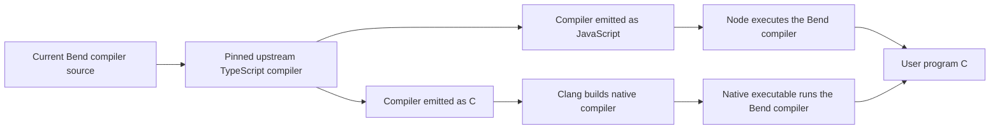

# Phase86: execute the Bend compiler natively

**Native hosting works on several inputs, but should not replace the installed
JS host yet.** Map hits a native sharing fail-stop; Lexer is much slower and
gets slower across repeated requests. Small-input gains gave the wrong
impression of the overall opportunity.

The current Bend compiler can be compiled by the pinned upstream C backend into
a standalone native executable. Its successful pilot requests produce exactly
the same C as the installed, JavaScript-hosted B2. There is no Node or TypeScript
process in the native request path. This establishes feasibility; it does not
qualify a replacement CLI or native B2.

[Design](../../design/phase86/native-compiler-host.md) ·
[Methods and commands](../../selfhost/tools/performance/phase86/README.md) ·
[Host boundary audit](host-boundaries.md) ·
[Bootstrap feasibility audit](bootstrap-feasibility.md) ·
[Raw measurement summary](summary.json) · [Evidence receipt](evidence.json).

## Hosting and output target are independent

Both versions use the existing compiler algorithms written in Bend. JavaScript
or C is the implementation language of the *compiled compiler executable*;
the user program's output target is a separate choice.



Upstream TypeScript is a bootstrap dependency in this experiment, not a semantic
bridge called for each native request. The installed compiler is already a genuine
JS-hosted B2. The new native image is an upstream-built B1: a native B2 would need
our own compiler to emit and successfully reproduce the compiler image. The pilot
entry emits C only, although its assembled current core includes both backends.

## Method and interpretation

The prototype assembles all132 current manifest modules with one experimental
Bend IO entry. Upstream `059266225b77c8ca256ac6b25ee5c21449bab151` fully checks
the assembly before emitting either target. Production modules and installed
artifacts are untouched. Each native process uses one runtime thread, GPU off,
CPU3 affinity, the same immutable source/Base/effect bytes and the same prepared
runtime chunks as its JS sibling. Clang22.1.4 uses `-O2`; Node is24.18.0.

The sibling JS image needs the existing primitive-string equality guard used by
our B1 development workflow. It is a separately hashed derivative of raw upstream
output; the raw image and its stack overflow remain evidence. The Node file-read
adapter supplies the upstream runtime's syscall hook. Neither adapter introduces
compiler algorithms. Comparisons must say *guarded JS sibling*, not raw JS.

Both prototypes parse/check/prepare Base once inside Bend. That already warms JS
frontend functions. Request clocks include loading/checking the new source,
report work, annotation/layout validation, foreign conversion, native emission
and complete result traversal. Input reading, Base preparation, runtime chunk
reading, and writing C files are separately visible outside that request clock.
Five-call processes repeat real compilation, without result memoization or hidden
warmup. First and fifth calls are reported separately; neither is a proof of
steady state. Native `IO.now` has millisecond resolution.

Ordinary B2 and upstream TypeScript are contemporaneous context controls, not
identical hosts. B2 loads its normal prepared cache and reports trust; TypeScript
checks Base inside its request and does not run the separate CLI proof helper.
Those controls do not add the prototype's explicit result-length traversal.
Complete native/sibling C is checked against an independent ordinary B2 result.
Upstream emits a different C family and is not the byte oracle for our backend.

## Measured requests: small gains do not generalize

The planned three-round five-source campaign stopped after pilot failures.
After fixing the effect-path wrapper, native Map still fails and Lexer regresses.
`followup01` is one fresh process per role/source with five real requests for
the four successful performance sources. It confirms direction and exposes
request-number behavior; it is not a qualified median campaign. No aggregate
silently excludes Map. Numeric/Map append small IO entries to unchanged existing
workload bodies; Lexer is the original module. These are not Phase85's imported
batch wrappers or the full45-point program benchmark.

| Request ms: first → fifth | Native B1 | Guarded JS sibling B1 | Ordinary B2 context | Upstream TS context |
|---|---:|---:|---:|---:|
|Small|85 →90|223 →84|257 →95|336 →166|
|Functions65|376 →406|593 →239|607 →318|406 →158|
|Numeric closed|240 →310|395 →144|396 →117|373 →166|
|Lexer original|5,314 →10,791|1,057 →476|923 →263|472 →242|

Native's first request uses62%,37% and39% less time than sibling JS on the first
three inputs. Lexer takes5.03× as long, and22.67× by the fifth call. An earlier
independent native Lexer screen agrees at5,329ms. Native Numeric/Lexer requests
get slower with repetition while JS generally improves. The native Lexer process
peaks at40.5MiB: this growth is not an RSS-limit event or demonstrated OOM.
It needs attribution before recommending a native resident process.

Corrected Map produces exact C from JS and ordinary B2, but native exits1 before
output. A diagnostic rerun reproduces that failure. Unicode succeeds on all three
hosts, with native84ms and JS234ms in one screen; its generated C also runs.

Native Base preparation costs about3.06s, sibling JS about3.81s. Normal B2 loads
its prepared cache. In a one-call Small screen, complete processes take3.20s
native,4.17s sibling JS and0.496s ordinary B2. Five-call native process times are
3.54/5.06/4.53/43.55s across Small/Functions65/Numeric/Lexer; ordinary B2 takes
1.02/2.01/1.39/2.76s. Faster prepared requests do not establish a faster command,
and a Base loader alone cannot fix the Lexer request cost.

## Map failure localized without rebuilding the compiler

A tiny diagnostic-only preload library intercepts `_exit`, prints a stack and
preserves exit status. The original compiler binary stays byte-identical.
Offline symbols and disassembly identify:

```text
WL_FID_NOA_EVAL_K8169 → rfc_wrap → err_fail → _exit(1)
```

`rfc_wrap` rejects a closure or task entering ordinary reference counting
(`ERR_RFCS`). The generated observer continuation contains generic `term_keep`
calls, including `_k_2`. Source `noa_eval` forwarding is untyped and unsafe, while
downstream consumers describe a higher-order continuation. This is a concrete
representation/type-information boundary to minimize next. It does not yet
distinguish unsafe source assumptions from upstream lowering behavior. Disabling
the runtime guard would be unjustified.

Trace source/library, binary bindings, raw stack, generated C and assembly are
retained. Non-returning calls can end at the next symbol boundary, so lookup uses
return-PC minus one; the initial naive lookup is preserved too. Tail calls remove
earlier semantic frames. A separate `perf` attempt could not run: its wrapper
forwards to missing `perf_5.10`. No native CPU profile was collected, and the
Lexer/request-number growth mechanism remains unproved.

## Runtime-template discovery

The original native pilot needed16,646ms to split the runtime template, compared
with43ms in its JS sibling. `ne_template_step` repeatedly appends one character
to the accumulated prefix. C-hosted cons-list strings make that quadratic;
the same expression has much cheaper string operations in V8. This is a host
representation mismatch, not a cost inherent to emitting user-program C.

Production Phase82 already avoids the scan using five canonical chunks produced
by Bend. The revised entry reads those exact authenticated pieces and constructs
`NE_Parts`. The transport script copies generated data; it does not parse markers
or implement a scanner. The original image, timing and failed acquisitions remain
preserved. The hypothesis was recorded before building the revised native image
in [P86-002](../../experiments/phase86/P86-002-runtime-chunk-transport.md).
Native template preparation falls to1–2ms with exact complete C. This solves that
startup cost only; it does not fix the separate Map/Lexer issues.

## Failures retained and build cost

The raw attempts are part of the result. Initial acquisition hit sandboxed Node
subprocess restrictions, then an incomplete upstream-effect pin list; the harness
now freezes upstream identities through Python and binds every used effect.
Early Bend entry checks rejected a match shape and affine reuse. A raw JS run
then exposed a deep diagnostic-width recursion on the full Base source; the
experimental entry now computes the identical UTF-16 width with a tail loop.
Another raw JS stack overflow required the separately recorded existing B1
String-equality guard, rather than being silently timed as unmodified upstream JS.

Clang exceeded2GiB and3GiB process-tree ceilings. An O1 attempt also exceeded3GiB;
syntax checking alone passed. The revised build policy allows6GiB only while at
least16GiB remains available. Both completed O2 images before the effect-path fix
took about194s and peaked4.14GiB, with more than22GiB available at their low point.
No system OOM was observed. These are compiler-image bootstrap costs, distinct
from emitting and executing user programs.

Final acquisition takes65.30s wall: loading0.84s, checking0.92s, JS emission4.05s
and C emission52.84s, plus assembly/IO. Clang takes194.15s, peaks4.14GiB, leaves
at least22.22GiB available, and turns19.54MB C into an11.00MB executable. Combined
acquisition/build is259.45s in this dual-output harness, including4.05s for the
JS control. Validate the shared entry in JS first and cache native images by
exact inputs; rebuilding the native image for every wrapper edit is expensive.

The first expanded lane exposed the prototype whitelist omitting Base's literal
`./effs/` spelling. Both prototype hosts refused IO cases while ordinary B2
succeeded. The lane was stopped; an interrupted guard lacks final timing and is
excluded from the measured occupancy sum. The corrected wrapper accepts the two
exact Base-relative spellings for the same three authenticated effects. It does
not broaden admission to arbitrary paths. Subsequent lanes stop at the first
unexpected failed worker; expected refusal tests opt into continuing explicitly.

The original extra-import negative used invalid syntax and only tested parser
refusal. A fresh valid two-module control corrects this: B2 accepts it while
both prototype hosts explicitly reject the additional import. The original
control remains preserved rather than rewritten.

## Qualification boundary

The entry deliberately accepts one module importing Base and only three exact
audited Base effects: args, print and now. It does not implement general import
discovery, arbitrary foreign files, full located diagnostic replay, public trust
reporting, source-edit sessions or persistent prepared-state loading. Its private
checked permission is valid only behind the experiment's exact-hash checks.

Output identity preserves the existing backend's generated program behavior for
these inputs. This phase neither improves generated-program execution nor reruns
the full conformance or45-point runtime benchmark. Production Phase82 remains
installed; known native gaps and all qualified metrics remain unchanged.

All87 successful prototype C outputs (40 native,47 sibling JS) match independent
B2 outputs. The comparison lanes record198 C files, including B2 and upstream's
separate C family, with no within-family mismatch. Native has five successful
source families; Map has only a JS success and native failure. Three original
negative inputs yield nine refusals with no C; the valid additional import adds
two explicit pilot refusals and one B2 success. Generated Small/Unicode C builds
and runs, printing `42` and `😀🦋猫` respectively.

Installed release verification passes with unchanged B2 `098320e8…`.
Production stays32,540 physical Bend lines/132 modules. No core algorithm,
upstream source, default host or installed image changes. Experimental wrappers
and methods are outside the manifest. This is not native B2, self-reproduction,
full conformance, a production speed gain or a compiler correctness proof.

## Recommendation and next experiments

Keep the installed JS host and its existing session interface. Do not start a
complete native CLI migration from these samples. The next bounded experiments:

1. Minimize Map's higher-order sharing failure, comparing typed and erased
   forwarding. Require checked source and exact Map C before claiming a repair;
   never bypass the reference-counting guard.
2. Attribute Lexer cost and growth with a working native profiler, separating
   preparation from requests. Reproduce the expensive mechanism cheaply before
   another full compiler-image build. The template append result makes string
   representation a candidate, not an explanation proven for all remaining time.
3. Only after those pass, qualify prepared Base loading and the full host
   contract, mixed-input sessions and the stopped broad campaign.

Phase85's V8 first-use/code-shape work remains relevant to production latency.
AOT execution removes JIT work but can expose larger representation/ownership
costs. This prototype makes that tradeoff concrete.

Keep one compiler core and independent choices of host and output target. A
native host is a legitimate way to remove V8 first-use work without rewriting
the compiler in C. It still needs prepared Base loading or a long-lived process;
rechecking Base at every command cannot be hidden behind a request-only number.
Host adapters should transport bytes/effects and generated immutable products,
with compiler decisions remaining in Bend.

Before a default change, qualify the complete host contract: imports and paths,
foreign effects, error ordering/locations, trust reporting, edited inputs, cache
identity, bounds and relocation. Then test mixed-input sessions, a broader C/JS
emission corpus and native self-reproduction separately. Keep the inexpensive
JS-hosted checked build available for the development loop while native compiler
image builds remain expensive.

## Resource and evidence account

109 guarded job records:78 successes,11 expected refusals,19 other completed
failures/stops and one interrupted receipt without final timing. Completed
occupancy is1,359.23s (22.65min), with49.46min between first/last recorded jobs.
This excludes later reporting/archiving and does not measure quota or tokens.
Three Clang attempts were stopped at RSS ceilings; no recorded deadline or system
OOM. Runtime targets were serial, CPU3,2GiB RSS/4GiB available floor. Only large
Clang builds used the separately justified6GiB/16GiB policy. Two bounded agents
audited source/methods; root alone ran targets. No PR comment was posted.

The archive retains every acquisition, raw/guarded/diagnostic JS, checked C,
native binary and binding, fixture, runtime chunk, comparison output and guard
log, including failed methods and the cancelled lane. [The receipt](evidence.json)
binds every archive member to its source bytes. Existing Phase82/83 capsules and
the pinned upstream remain dependencies; no historical seal is rewritten.
