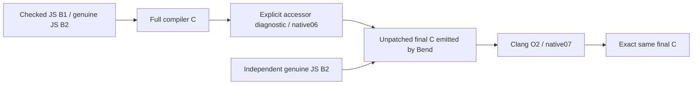

# Phase90: a self-reproducing native compiler and a coherent release

[Design](../../design/phase90/native-self-hosting.md) ·
[Verified summary](summary.json) · [Native usage](../../docs/self_hosted/NATIVE_HOST.md).

The compiler written in Bend now compiles its complete frozen native source to
C, builds as an optimized native executable, and reproduces that C exactly.
**Native07 emits all 38,614,882 bytes of its own C in 164.322 seconds.** It was
built from unpatched C emitted by the native Bend compiler, independently equal
to genuine JS-hosted B2 output. Phase89's native self request had timed out after
600.022 seconds without C. This phase closes that self-hosting blocker.

The installed JS package is also refreshed: genuine B2 `284f6e9b…`, checked B1
`6bf8e093…`, source `4ffae2a3…`. Fresh own-source acceptance, exact B3 reproduction,
release verification and all 42 legacy / 24 default installed and relocated
checks pass. The old Phase82 manifest/source mismatch is resolved through a real
checked build and qualification, not a manifest-only edit.

## Results and boundaries

| Metric | Completed observation | Meaning |
|---|---:|---|
| Native full compiler C request | 164.322 s; 1.536 GiB peak RSS | Complete native self-emission, exact C fixed point |
| Independent JS B2 full compiler C request | 51.672 s | Same frozen source/runtime and complete C; separate observation |
| Final native executable build | 308.201 s; 3.886 GiB peak RSS | Clang O2, after the large-table repair |
| Six-source native compilation screen | 0.678× TS-Bun process time | Five of six wins; Map is 1.706×; two rounds |
| Same screen, JS B2 | 1.367× TS-Bun process time | Request-only ratio 0.891×; different boundary |
| Generated-program continuity | 45/45 complete CPU preprocessing comparisons | No new generated-program timing campaign |
| Production Bend size | 32,692 physical lines / 132 modules | +101 lines; native runtime adds 7 net lines |

The native request-only geometric ratio is 0.380× TS-Bun, but native Base decode
is outside that request clock. Native/B2 use prepared Base while TS loads/checks
Base ordinarily. Process time includes preparation and measurement-worker/output
checks; it is not public CLI startup time. These six selected cases do not prove
broad compilation parity. See the complete [timing table and scope](final-screen.md).
The 36 timed requests take 39.290 seconds; setup plus final verification brings
the screen to 46.958 seconds. All outputs pass their complete-C oracle checks.

Full native self-compilation remains 3.180× the separate JS B2 observation, and
prepared Base decode is about 135 ms. This is a correctness and scaling milestone,
not the end of native performance work. The old native B1 was produced by
upstream's C backend, whereas native07 uses ours; old and new scores cannot be
substituted for a controlled same-source backend comparison.

## What removed the blockers

1. [Stack-safe static images](static-image.md) and [segment traversals](segment-traversals.md)
   replace linear-depth recursion with tail loops and reversal. Controls include
   65,536 distinct words and 65,536 segments.
2. [Linear table construction](tables.md) replaces five growing-prefix String
   builders with chunk collection and one flatten. All 108 complete String
   observations match independent expectations in JS and native execution.
3. [Indexed fork propagation](fork-closure.md) replaces repeated list searches
   with exact-name indexed lookup. All 46 complete-product controls preserve
   first-match behavior, cycles and fuel handling in JS/native execution.
4. [C formatting](formatting.md) removes a character-by-character indentation
   pass. Its sampled late window was 85.82% GC. One emitter-line change lets full
   C emission finish; all 45 complete preprocessing comparisons preserve the
   earlier qualified program tokens. This is not a general license to strip
   whitespace from arbitrary foreign C.
5. [LLVM dispatch-table scaling](clang-memory-localization.md) fixes the build
   blocker after C emission. A 39,642-entry function table is referenced through
   return macros at 15,296 sites. Pass/RSS attribution localizes explosive memory
   growth to callgraph construction. A small noinline table accessor makes the
   optimized compiler build fit below 4 GiB, after even a 10 GiB attempt failed.

The runtime selects the accessor only for host tables with at least 4,096 entries;
small optimized programs retain direct dispatch, and GPU dispatch is unchanged.
It also restores upstream's optimization guard for special calling conventions,
fixing the O0 build path. Runtime C, Bend-generated template and host template
identity were updated together. Four actual O0/O2 threshold controls pass. All
45 retained small programs have equal complete O2 preprocessing before/after the
two exact runtime edits. Their FID_ENTER range is 22–606; the threshold is a
conservative policy, not a measured universal crossover.

## Native lineage and qualification

The temporary native06 C patch remains explicit in its historical receipt.
Native07 is built from the accepted backend's unpatched output. Its source
`d04ad79c…`, runtime `9e1c5907…` and C `dae071f0…` form the qualified fixed tuple.
The native profile retains earlier owned-composition/observer changes separately
from the canonical JS profile. Exact C reproduction does not establish identical
ELF bytes, unrestricted semantics or a mathematical correctness proof.

Actual final gates:

- Native full self-emission and independent genuine-JS-B2 C equality.
- Eight exact-C compiler requests: Small, Map, Unicode and file I/O, each live
  and cached. Two syntax/type refusals require exit 1, a diagnostic and no C.
- Four Clang-built generated programs execute with complete expected results,
  including Unicode and exact file-copy bytes/stderr.
- Six public CLI controls cover cached Small, live file I/O, five repeated Map
  requests, existing-output refusal, changed-admission refusal and invalid syntax.
- Fresh JS frontend36, eight B2 driver comparisons, own-source acceptance,
  exact B3, installed integrity and installed/relocated 42/24 checks.
- All 45 formatting preprocessing comparisons, all 45 runtime preprocessing
  comparisons, four runtime threshold controls and 36 final timed output checks.

The four final fixture oracles are exact reversible runtime derivatives of
previous independent C, not newly emitted JS oracles. The full compiler C is
independently emitted by JS B2; the final six-case speed screen also prepares
fresh B2 C oracles. This distinction is retained in each method and receipt.

The public native entry supports one source importing canonical Base and nine
C effects, with one CPU worker and GPU off. Its admission binds the actual image
and request assets. The [26-file restoration capsule](../../selfhost/tools/performance/phase90/runtime-migration01/public-assets01/receipt.json)
preserves bytes and modes and has passed full verification; it is tied to the
canonical checkout path. [CLI request evidence](public-cli-evidence.json) archives
all six public requests, including failures. Follow the usage guide to restore
and compile; no JavaScript execution is needed for an ordinary native request.

## Failed approaches and costs retained

The full optimized Clang build exceeded 6 GiB both at O1 and with heuristic
inlining disabled; the one 10 GiB trial also failed. A bounded pass trace exposed
the graph-scaling mechanism, so the fix changed the generated reference shape
instead of increasing memory again. O0 with default calling conventions built
and passed small requests, but its self request timed out at 240 seconds. Final
O2 takes 308 seconds to build and does not improve the full self-request clock
versus the O1 diagnostic's 163 seconds. No O2 speed gain is claimed.

Several method/schema mistakes and a Node pipe-capture failure are preserved.
The initial legacy release smoke failed six CPU builds because sandboxed Node
reported `EPERM`. A tiny controlled diagnostic produced identical binaries with
pipe and regular-file capture, while only pipe capture reported that error.
An approved outside-sandbox replay passed both forms. The unchanged legacy42,
default24 and verification then passed under the original resource guards.
No production host workaround or relaxed error predicate was introduced.

[Runtime migration](runtime-migration.md), [native builds](native-build.md),
[bootstrap](bootstrap.md), [profiling](profiling.md) and
[execution ledger](execution-ledger.md) retain the exact methods and boundaries.
Root ran targets serially under the execution lock. Three agents prepared or
audited offline work; no competing benchmark or compiler builds ran. Resource
stops were contained, and no further memory-cap increase followed the failed
10 GiB experiment. Exact Codex quota consumption is not available from these
process receipts and is not estimated from runtime.

## Remaining priorities

1. Profile native07's Map and prepared-Base decoder, using the roughly 47-second
   screen and tiny complete-product controls. Both expose real remaining costs.
2. Compare upstream-C and own-C native executables from the same frozen Bend
   source, with the same providers, Clang flags and request boundary. This is the
   clean way to isolate code-generation cost from frontend/source changes.
3. Use those findings to reduce full self-compilation's 3.180× JS B2 gap. Avoid
   another broad rewrite without a measured region and a small falsifying test.
4. Extend public imports/effects and portability separately from this single-Base
   native contract. Historical native API/full-language gaps are not closed by
   the self-hosting proof or this finite suite.

[Evidence01](evidence01.json), [02](evidence02.json), [03](evidence03.json),
[04](evidence04.json) and [05](evidence05.json) preserve successive completed
results and failures. Historical runtime assets were frozen before migration;
old receipts were not rebound. [Reclamation notes](reclamation.md), including
[prune08](prune08.json) and [prune09](prune09.json), record only exact archived
payload removal. Unrelated Phase6/68 work is preserved. No PR comment was posted.
