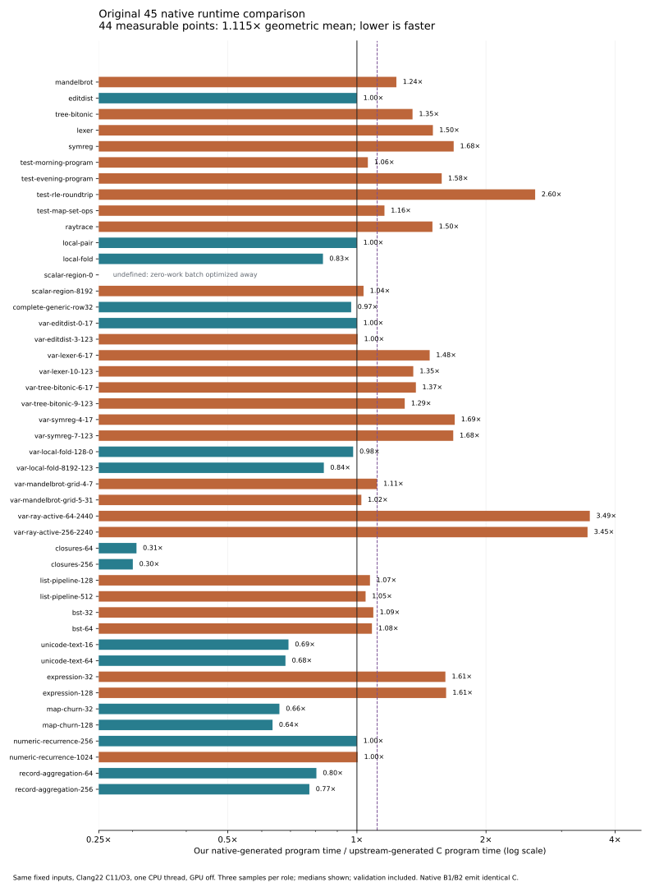

# Phase93: native execution of the original 45 benchmark points

**Our native-generated programs take 1.115× upstream's execution time with
equal-point weighting, or 1.139× with equal weight for each original program.**
These fresh measurements cover 44 measurable points from the original 45-point,
23-program JavaScript catalog. The remaining zero-work scalar control is optimized
away by both backends; its runtime ratio is undefined, and it is explicitly
excluded from both aggregates.

This measures **programs produced by the native Bend compiler**, compared with
programs produced by upstream TypeScript's **C backend**. Both run as native
executables. It does not compare native execution with JavaScript execution or
measure compiler latency. The compiler itself remains implemented in Bend.
No production compiler source, runtime, image or installed selection changed.

[Design](../../design/phase93/native-program-runtime.md) ·
[Reproduction tools](../../selfhost/tools/performance/phase93/README.md) ·
[Machine-readable results](summary.json) · [All timings CSV](timings.csv) ·
[Method review](method-review.md) · [Evidence capsule](../../selfhost/tools/performance/phase93/evidence01/README.md).

## Results

| Measure | Result |
|---|---:|
| Complete native B1/B2 C product pairs agreeing | 45 / 45 |
| Original programs represented | 23 |
| Timed points / explicit zero-work controls | 44 / 1 |
| Qualified final timing samples | 264 / 264 |
| Equal-point geometric mean, own / upstream | **1.114840×** |
| Equal-original-source geometric mean | **1.139377×** |
| Median of point ratios | 1.066532× |
| Faster / slower / equal measured medians | 12 / 28 / 4 |
| Shortest final measured batch | 199 ms |

Below one is faster. Equal-source weighting first takes the geometric mean of
the measurable points for each original source, then the geometric mean across
23 sources. No missing point is assigned a ratio of one. Small differences near
parity are not strong evidence: three-sample ranges reach 12% in a few cases.

| Illustrative point | Our time per call | Upstream per call | Own / upstream |
|---|---:|---:|---:|
| Active rays, 64 / seed2440 | 110.478 µs | 31.638 µs | **3.492×** |
| Active rays, 256 / seed2240 | 456.187 µs | 132.236 µs | **3.450×** |
| RLE roundtrip | 0.536 µs | 0.206 µs | **2.604×** |
| Symbolic regression, original | 2344.444 µs | 1394.444 µs | 1.681× |
| Expression evaluation, 128 | 8.558 µs | 5.301 µs | 1.614× |
| Numeric recurrence, 1024 | 3.242 µs | 3.229 µs | 1.004× |
| Closures, 256 | 3.064 µs | 10.205 µs | **0.300×** |
| Map churn, 128 | 234.286 µs | 368.571 µs | **0.636×** |
| Unicode text, 64 | 67.410 µs | 98.940 µs | **0.681×** |
| Record aggregation, 256 | 395.683 µs | 510.791 µs | **0.775×** |

The full table below retains every point. These results identify useful next
profiling targets: active-ray paths, RLE, symbolic regression and expression
evaluation. They do not establish their root causes. Preserve the closure,
Unicode and Map wins when investigating the slower families. No optimization
was attempted during this measurement phase.



[Download PNG](runtime-ratios.png) · [Download SVG](runtime-ratios.svg).

## What was actually compared

The same frozen native compiler source and images qualified in
[Phase92](../phase92/README.md) produce the new batch programs:

- Native B1 `6bb07e94…`: our Bend compiler built through upstream's C backend.
- Native B2 `d7c7a479…`: native07, built from our compiler's emitted C.
- Reference: upstream TypeScript at `059266225b77c8ca256ac6b25ee5c21449bab151`,
  run with pinned Bun1.4.3 to produce its C. Bun is outside runtime timing.

All 45 batch sources were freshly compiled by all three roles. Every native
B1/B2 pair emitted identical complete C, so one own-backend executable per point
represents both stages. Both executable roles were freshly built with the same
Clang22.1.4, `-std=c11 -O3`, headers and pthread/math flags. Execution uses CPU3,
one runtime thread, GPU off, on an Intel Xeon E3-1245 V2. This is sequential CPU
coverage, not GPU or parallel scaling qualification.

The Phase88 wrappers retain the original 23 bodies and exact catalog parameters,
with an explicit full-state serializer for the generic-row program. Phase93
replaces only their single-call IO entry with a documented Bend batch wrapper.
The wrapper reads repetition count and workload arguments at runtime, repeats
the fixed catalog input and compares every complete result against its retained
oracle. Numeric and string successes must sum to the exact repetition count;
the first complete result is also checked. Counts are below 2^32.

The in-program monotonic clock encloses evaluation, result validation, the
repetition loop and printing the final success count. It excludes startup,
argument parsing, the initial output, up to32 warmup calls, compiler requests
and Clang. The two roles use a common calibrated repetition count. Three fresh
processes per role alternate order within each point; an odd number of rounds
is not perfectly position-balanced. All final intervals exceed the100 ms gate.
Raw process time is separate from the supervisor's20 ms polling clock.

This closely follows the old JS benchmark's fixed-input/result-checking
principle, but the C wrapper, validation representation and warmup differ.
The historical JS1.049× and original-C12 1.067× figures are separate experiments;
this result is neither a regression calculation against them nor a JS/C speedup.

## Optimized-away work and retained failures

The zero-work `scalar-region-0` batch reported0 ms for both roles through
200,000,000 repetitions. Disassembly confirms a direct success-count result
instead of a repetition loop for that runtime input. The initial calibration
stopped as designed; its74 observations and failure remain intact. An explicit
continuation reused its ten already completed calibration plans and ran the
other29 points, without silently promoting the failed parent report.

Representative optimized numeric, pair and evening paths retain workload
execution inside their loops. Numeric code hoists some invariant setup, while
the recurrence remains repeated. The five pilot pairs also scale by1.972–2.056×
when repetitions double. Those ten diagnostics are separate from the264 final
samples and do not prove all45 workloads resist every optimization.
See the [offline review](method-review.md) for exact instructions and limits.

An earlier offline inventory assertion expected60 upstream files instead of the
actual32-file C dependency closure. It launched no target; the original method
and failed receipt are preserved. The corrected inventory checks all three core
files and all29 C providers. There were no target failures, timeouts or OOMs.

## Reuse this as a fast runtime loop

Once executables exist, the full44-point timing campaign occupied **99.9 seconds**
of guarded execution. Acquisition of all three compiler outputs and two Clang
builds per point occupied **316.6 seconds**, separately. No compiler-image
rebuild or full self-compilation was performed.

A useful six-point screen includes numeric recurrence, active rays, RLE,
closures, Unicode and expressions. Those samples occupied **16.7 seconds** in
this campaign; that is an observed subset cost, not a promised deadline:

```sh
python3 -B selfhost/tools/performance/phase93/run.py measure \
  --acquired selfhost/build/phase93/pilot02/report.json \
             selfhost/build/phase93/broad01/report.json \
  --plans selfhost/build/phase93/calibrate-pilot01/report.json \
          selfhost/build/phase93/calibration-continuation01/retained-plan.json \
          selfhost/build/phase93/calibrate-broad02/report.json \
  --cases coverage-numeric-recurrence-256,variation-ray-active-64-2440,test-rle-roundtrip,coverage-closures-64,coverage-unicode-text-64,coverage-expression-128 \
  --out selfhost/build/phase93/fast-FRESH
```

Changing `--cases`, `--rounds` and calibration `--target-ms` controls depth.
Keep complete-output correctness checks and the100 ms timing floor. Changed
compiler products require a new acquisition; saved binaries alone cannot test a
new compiler. Restoration instructions accompany the evidence capsule.

## Resource accounting and preservation

The [execution ledger](execution-ledger.json) contains791 serial guarded jobs,
**450.9 seconds (7m31s)** of occupied time and a13m37s first-to-last target span.
Peak sampled process-tree RSS was223,059,968 bytes (about213 MiB). There were no
overlaps, target timeouts or resource kills. Two agents prepared/reviewed offline;
root alone executed targets. Planning, documentation and archival time are outside
those target clocks; quota consumption is unavailable.

All4,798 raw files (45,074,590 bytes) are preserved in the verified11,033,700-byte
[capsule](../../selfhost/tools/performance/phase93/evidence01/README.md), including
failed calibration, exact C/executables, commands, full outputs and every sample.
Byte-identical new B1 C copies have explicit restoration mappings to retained
B2 products. The [reclamation receipt](reclamation.json) records77,229,764 bytes
of older self-output duplicates removed only after committed-archive verification;
their identical active build C remains locally. No compiler source or current
image was deleted. No PR comments were posted.

## Every benchmark point

Times below are measured batch time divided by repetitions, including the
documented validation/loop cost. `undefined` is not parity. Raw three-sample
ranges are in [summary.json](summary.json) and [timings.csv](timings.csv).

| Point | Own µs | Upstream µs | Own / upstream |
|---|---:|---:|---:|
| mandelbrot | 27.357 | 22.134 | 1.236× |
| editdist | 842.282 | 842.282 | 1.000× |
| tree-bitonic | 164.953 | 122.369 | 1.348× |
| lexer | 588.321 | 391.241 | 1.504× |
| symreg | 2344.444 | 1394.444 | 1.681× |
| test-morning-program | 3.810 | 3.592 | 1.060× |
| test-evening-program | 1.215 | 0.771 | 1.577× |
| test-rle-roundtrip | 0.536 | 0.206 | 2.604× |
| test-map-set-ops | 10.515 | 9.069 | 1.159× |
| raytrace | 28615.385 | 19076.923 | 1.500× |
| local-pair | 209.949 | 209.949 | 1.000× |
| local-fold | 2.747 | 3.296 | 0.833× |
| scalar-region-0 | <clock resolution | <clock resolution | undefined |
| scalar-region-8192 | 37.176 | 35.879 | 1.036× |
| complete-generic-row32 | 132.938 | 137.092 | 0.970× |
| variation-editdist-0-17 | 209.622 | 209.622 | 1.000× |
| variation-editdist-3-123 | 1684.564 | 1677.852 | 1.004× |
| variation-lexer-6-17 | 133.672 | 90.447 | 1.478× |
| variation-lexer-10-123 | 2155.689 | 1592.814 | 1.353× |
| variation-tree-bitonic-6-17 | 24.717 | 18.009 | 1.372× |
| variation-tree-bitonic-9-123 | 406.650 | 314.578 | 1.293× |
| variation-symreg-4-17 | 1176.796 | 696.133 | 1.690× |
| variation-symreg-7-123 | 3934.579 | 2345.794 | 1.677× |
| variation-local-fold-128-0 | 0.103 | 0.106 | 0.980× |
| variation-local-fold-8192-123 | 5.488 | 6.554 | 0.837× |
| variation-mandelbrot-grid-4-7 | 9.098 | 8.168 | 1.114× |
| variation-mandelbrot-grid-5-31 | 144.722 | 141.317 | 1.024× |
| variation-ray-active-64-2440 | 110.478 | 31.638 | 3.492× |
| variation-ray-active-256-2240 | 456.187 | 132.236 | 3.450× |
| coverage-closures-64 | 0.801 | 2.616 | 0.306× |
| coverage-closures-256 | 3.064 | 10.205 | 0.300× |
| coverage-list-pipeline-128 | 2.156 | 2.010 | 1.073× |
| coverage-list-pipeline-512 | 8.379 | 7.998 | 1.048× |
| coverage-bst-32 | 6.132 | 5.615 | 1.092× |
| coverage-bst-64 | 7.976 | 7.358 | 1.084× |
| coverage-unicode-text-16 | 16.750 | 24.188 | 0.693× |
| coverage-unicode-text-64 | 67.410 | 98.940 | 0.681× |
| coverage-expression-32 | 2.165 | 1.346 | 1.608× |
| coverage-expression-128 | 8.558 | 5.301 | 1.614× |
| coverage-map-churn-32 | 46.787 | 70.936 | 0.660× |
| coverage-map-churn-128 | 234.286 | 368.571 | 0.636× |
| coverage-numeric-recurrence-256 | 0.807 | 0.807 | 1.000× |
| coverage-numeric-recurrence-1024 | 3.242 | 3.229 | 1.004× |
| coverage-record-aggregation-64 | 104.583 | 130.000 | 0.804× |
| coverage-record-aggregation-256 | 395.683 | 510.791 | 0.775× |
