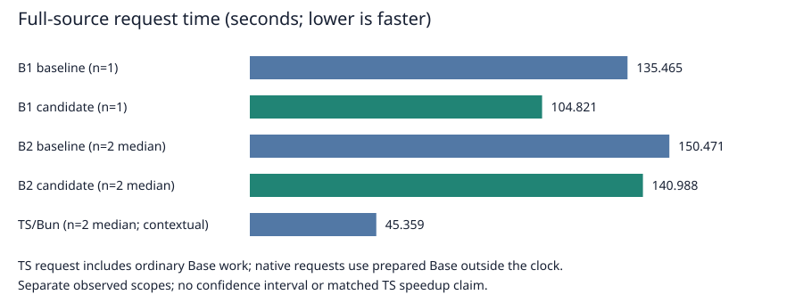

# Phase98: laws that support real native compiler optimization

Status: implemented and qualified. Native B1/B2, public CLI, default selection,
actual capsule restoration and both complete physical profiles passed.
This campaign began at
2026-10-15 20:07:27 UTC and follows the [three-hour design](../../design/phase98/laws-and-native-optimization.md).

## Results measured so far

The selected source improves upstream-built native B1 substantially and
self-hosted native B2 more modestly. Both are Bend compilers executing as native
programs. Neither timing is JavaScript-hosted compilation or the execution time
of a generated user program.

| Measurement | Candidate / previous native stage | Evidence |
| --- | ---: | --- |
| B1 compilation request, six fixed programs | **0.81067×** | Four balanced rounds; 48 exact complete C/diagnostic matches. |
| B1 complete process, same screen | **0.86564×** | Includes startup, prepared Base, output writing and teardown. |
| B2 compilation request, same six programs | **0.93924×** | Four balanced rounds; 48 exact per-producer C/diagnostic matches. |
| B2 complete process, same screen | **0.97834×** | Small-request preparation remains significant. |
| B1 full self compilation | **0.77379× request**: 135.465 → 104.821 s | One complete run per producer on the exact final source; process 136.173 → 105.531 s. |
| B2 full self compilation | **0.93697× request**: 150.471 → 140.988 s | Two balanced rounds, four complete requests; median process 151.301 → 141.862 s. |



The [machine-readable scoreboard](results.json) is derived from the completed
source-bound receipts by the [data-only exporter](../../selfhost/tools/performance/phase98/scoreboard.py).

The B1 full-input result is about **22.6% less time**, supported by the repeated
six-source screen. The repeated B2 full-input result is **6.3% less time**. Every
timed request checks complete per-producer C and diagnostics. Final B1 and B2 emit
identical self-C; previous and new backend self-C deliberately differ. Timed C
identity is consistency evidence; independent behavior and conformance checks
remain required for changed backend output.

For upstream context, two fresh Bun 1.4.3 processes running pinned TypeScript on
this same 1.75 MB source took 45.357 and 45.361 s request time, median **45.359 s**;
both produced the complete expected upstream C. The single qualification runs
put native B1 at **2.31×** and native B2 at **3.12×** this request time. This is
neither parity nor a representative-program geometric mean. TypeScript checks
ordinary Base inside its request; native request time excludes prepared-Base
decoding. Complete process ratios are similar, 2.315× and 3.124×. These contextual
runs were not interleaved with the native pairs and are not a statistical claim
about small differences. Raw inputs, clocks and products are retained in
`selfhost/build/phase98/origin-ts-self-plan01/`.

The final source is SHA256
`2a72bbdc3d757982d7dd4804d8a1312f9427e3b2822ed9d187424c2d9f4de051`.
B1 was built from unchanged pinned-upstream C in 190.613 s with 4.007 GiB peak
RSS. B2 was built from actual B1-emitted C in 260.847 s with 3.855 GiB peak RSS.
B1 self compilation used 1.527 GiB peak RSS and stayed under the original 2 GiB
request cap. Compiler-image build costs are separate from compilation requests.

## What changed and why

**Keep the owning strings alive while comparing them.** A three-line finishing
helper retains both complete inputs until the unchanged recursive comparison
returns. The upstream backend then recognizes borrowed reads instead of doing
ownership work at every character. This source-only form beat a larger retained
product representation with less code. Fusing 1,366 term-tag comparisons adds a
further B1 improvement.

**Make that opportunity available to native B2.** The own C backend previously
tied observer permission to the whole-program packed-array certificate. An
otherwise admitted IO program, including the compiler, therefore missed pure
borrowed traversals. The new permission is narrower: it authenticates the nine
existing providers, preserves the old scalar/array/cold/product restrictions,
and still requires every individual observer to pass the existing structural
analysis. This is not a global unchecked borrowing switch.

The exact own-backend self-C contains seven new observer workers and adapters.
Shared String equality traverses with `term_peek`; the adapter keeps both roots
until the observation returns, then releases them normally. The consuming
fallback is preserved exactly. **The KTerm tag projection itself remains
consuming in B2.** It benefits indirectly through String comparison, while B1
gets a better projection lowering. The completed matched physical profiles
quantify the remaining ownership/construction work and distinguish physical
cost from causal attribution.
See [actual B2 C spans and mappings](own-backend-mechanism.md).

**Correct an exposed termination defect.** Enabling more observer analysis
exposed an eager `&&` around ancestry recursion. A nonmatching non-field origin
still recursively accessed `kid(Absent, 0)` forever. Full-self runs hit both 2 GiB
and 4 GiB guards. Two intentionally stopped physical profiles and exact generated
C inspection located the defect. Replacing the conjunction with a lazy branch
adds one line and 38 bytes. The old helper fails with a stack overflow; the new
helper passes 11 origin decisions, three unchanged full C products and a valid
root-swapping program which must decline borrowing. This is extended termination
for previously divergent inputs, not an unconditional equivalence claim.

## Laws: useful evidence and explicit limits

The exact selected source has **13 independently accepted named statements:
eight public contracts and five support lemmas**. Two closures contain 15
instances because they share statements; those are not 15 distinct laws. They
connect actual extracted comparison, tag and provider-membership helpers to
frozen reference contracts. Source checking, safe BendTT elaboration, the
independent Lean kernel and a false-statement kernel control all ran. No opaque
helper assumptions substitute for those source bodies.

Independent challenge choices were frozen before inspecting the new suites and
proofs. Incorrect equality carry, character-width and complete retained-product
helpers were first admitted as safe code, then rejected by unchanged laws. A
full-value retained-product fault escaped the public-Bool finite corpus; the law
caught the internal contract violation. A semantically valid codepoint refactor
needed a two-line support-proof repair while its public statement remained fixed.
Targeted follow-up witnesses cover all eight selected bad changes and accept both
equivalent controls, separately from the original finite-suite outcomes.

The wider experiment catalog has 56 distinct Phase98 names, including rejected
and historical variants. That number is **not final-image coverage**. The actual
ancestry nontermination was found by native execution and profiling: safe value
equations did not prove native evaluation order or resource behavior. Runtime
reference counting, observer analysis, unsafe adapters, FFI and the whole
compiler are not mathematically proved.

Across the wider experiment catalog, Phase98 adds **16 public contracts and 40
support statements**, including historical and rejected variants. Together with
the Phase96/97 foundations, the catalog has 51 public and 50 support names.
Only the 13 statements bound to the exact selected helper closures above are
reported as final-profile coverage; the ancestry correction itself is covered
by native controls rather than a termination theorem.

The practical loop is to extract the actual new helper, run its one relevant
law closure, check complete values and aliases, inspect emitted C, and only then
build a full native image. The final tag and membership checks took about 4.7 s
and 5.3 s end-to-end, respectively. [Reproduction commands](../../selfhost/proofs/phase98/RUNNING.md)
make that loop available for later edits.

## Rejected and retained experiments

| Experiment | B1 request ratio | Source cost | Decision |
| --- | ---: | ---: | --- |
| Cache two tag observations | 1.00749× | +2 lines | Neutral; reject. |
| Retained three-word equality product | 0.85866× | +10 lines | Superseded by smaller finishing helper. |
| Finishing helper alone | 0.85619× | +3 lines | Keep. |
| Finishing helper plus fused tags | 0.81383× | +23 lines | Keep. |
| Wide dispatch extraction across 19 functions | 0.98766× | +525 lines | Reject; no material gain. |
| Held scalar field readers | 0.83766× | +14 lines | Exclude; weak incremental benefit and worse process result. |
| Cached schema planning and lazy redirect construction | Not measured as a native image | +59 lines combined | Keep as separate source/proof/control experiments; not in selected source. |

The held-string IO microbenchmark is 0.14587× previous time, about 6.86× faster,
with complete surviving inputs checked. It demonstrates a mechanism, not a
representative compiler or generated-program speedup. The 105 complete worker
and 60 schema controls for the separate planning candidates do not qualify or
measure them as compiler images.

## Qualification, release and five-metric scope

The exact final native images passed these separate gates:

- 22 live/cache control compilations: 16 positive requests and six exact
  rejections, including eight B1/B2 complete-C agreements.
- 90 emissions for the 45 original programs, 45 B1/B2 C agreements and 45
  independently checked generated-program executions.
- 69 native conformance cases per stage and three exact diagnostic rejections
  per stage; the existing 31 exclusions remain explicit.
- Five final observer programs, with 15 emissions, five cross-stage C agreements,
  five native builds and complete output comparisons. The retained comparison
  corpus covers 1,444 pairs and all 14 observation fields.
- All 45 original Phase93 runtime-benchmark batches emit byte-identical C to the
  previous release. No changed subset needs a fresh runtime campaign.

The actual admission is `selfhost/build/phase98/origin-admission01/report.json`.
Public controls then passed nine launcher scenarios, including both stages,
cached/live/repeated requests, invalid source and refusal to overwrite output or
use a changed admission. The stable native entry now defaults to B2:

```sh
python3 -B selfhost/native.py input.bend -o output.c
python3 -B selfhost/native.py input.bend -o output-b1.c --stage b1
```

Both request capsules were sealed and verified. Actual missing-file restorations
recovered the Python entry and the B2 executable with exact bytes and modes;
the restored B2 then emitted the expected complete Small C. The public default
also compiled its full 1.75 MB source and matched private B1/B2 self-C exactly.
See `origin-release-plan01/report.json` and `public-b2-restoration01/report.json`
under `selfhost/build/phase98/` for the complete operations and failures policy.

| Metric | Final scope |
| --- | --- |
| Compiled-program speed | All 45 Phase93 batch C products are unchanged. Reuse the prior 44 measurable points: **1.115× upstream C time** equal-point, **1.139×** equal-original-source; zero-work point has no ratio. This is artifact continuity, not fresh timing or a universal no-regression proof. |
| Native B1 compilation | Six-source request ratio **0.81067×** previous B1; full same-input request **135.465 → 104.821 s**. |
| Native B2 compilation | Six-source request ratio **0.93924×** previous B2; paired full same-input median **150.471 → 140.988 s**. |
| Conformance | Fresh native **69/69 per stage**, all six exact rejections, broad45 and five final controls pass; **31 exclusions** remain. Installed JS and its historical 3,173/3,174 result are unchanged and not freshly tested here. |
| Simplicity | Selected native source **38,790 lines**, +79 lines / −5,257 bytes versus D04. Canonical **134 modules / 34,231 physical lines** remain unchanged. Large neutral dispatch and speculative planning changes are excluded. |

The selected native profile is separate from the installed JS release and the
canonical modules. It does not claim a JS compiler-speed change, general module
support, GPU/parallel scaling or full language conformance.

The final native profile has 38,790 physical lines: **79 more** than D04, with
5,257 fewer bytes. The selected optimization does not halve compiler complexity.
It rejects the large neutral rewrite and preserves separate narrow permissions.
The compact exact forward/inverse source recipe is 14,812 compressed bytes plus
its manifest. Historical native07 remains available independently.

The public Python entry and launcher total 122 physical lines. Asset packaging
and source replay add 127 and 99 tooling lines respectively. They authenticate
and transport the native compiler; none implements a compiler pass. Proof,
experiment and qualification tooling is tracked separately from compiler source
and is not hidden in the native +79-line figure.

[Native usage and source replay](../../docs/self_hosted/NATIVE_PHASE98.md) describe
B1/B2 identities, entry limits and restoration. The existing native07 entry and
its original release remain available independently.

## A faster validation loop

The first final conformance suite exceeded its 300-second deadline before
finishing. Each case was repeatedly hashing 411.5 MiB of mostly historical
provenance, including Node, Bun and old full compiler C. Snapshot17 retains that
complete closure before and after each suite and at collection/admission, and
checks the selected execution inputs around every case. Compiler execution,
fixtures, golden expectations, guards and rejection diagnostics are unchanged.

The fresh B1 suite finishes in **68.633 s**, B2 in **79.686 s**, with all cases
passing. Including integrity wrappers and diagnostic collection, the final
conformance sequence takes about **163 s** for both stages. This is a harness
improvement rather than a compiler speedup. The failed 300-second attempt is
retained. [P98-008](../../experiments/phase98/P98-008-conformance-provenance-cost.md)
records the exact derivation and partition controls.

## What the next cycle should target

The [complete B2 machine-code profile](origin-b2-profile.md) confirms active
borrowed comparison. Ownership helpers still account for 50.58% of request
samples. Even deleting all of that sampled helper work, with other work fixed,
would leave about **1.54× TypeScript** in this full-source context. Parity needs
broader reductions in traversal, construction and representation costs.

Promising measured sites are known Boolean branch closures, field projections
with escaping children, late String append reconstruction, and comparison
ownership boundaries. These are follow-up hypotheses, not promised additive
speedups. The rejected +525-line dispatch experiment makes it especially
important to test direct backend lowering rather than assume another source
rewrite will help.

A subsequent [matched full B1/B2 profile](origin-stage-profile-comparison.md)
sharpens this ranking. B1 spends an estimated 62.05 seconds in ownership helpers,
B2 71.41 seconds, even though the percentage falls from 59.21% to 50.58%.
The explicitly mapped append/reconstruction bucket grows from **4.86 to 13.44
seconds**; `kc` cleanup stays roughly unchanged. Exact C and assembly show broader
borrowed projection, raw scalar fields and simpler continuation dispatch in B1.
Prioritize these concrete stage differences, then investigate branch construction
as a cost shared by both stages. These are sampled, partly overlapping physical
buckets, not additive causal speedup forecasts.

The [next-cycle playbook](next-cycle.md) pairs these experiments with useful law
boundaries: origin progress, operational lazy-branch behavior and retained-root
adapter ownership. Preserve the fast independently checked value laws and the
finite native controls; neither replaces the other. Whole-compiler correctness
requires connected semantics across much larger boundaries and is not a result
of this campaign.

## Evidence and further reading

- [Comparison experiments](comparison.md), [dispatch](dispatch.md), [proof accounting](proofs.md), and [independent challenges](review.md).
- [Observer permission](observer-permission.md), [caller/lifetime review](observer-safety-review.md), and [profile diagnosis](profile-findings.md).
- [Design](../../design/phase98/laws-and-native-optimization.md), [experiment ledger](../../experiments/phase98/), and [current-source law commands](../../selfhost/proofs/phase98/RUNNING.md).

The native release is published in commit `62d6fed` on `selfhost/bootstrap`.
The final evidence package is
[`selfhost/tools/performance/phase98/artifacts/evidence01/`](../../selfhost/tools/performance/phase98/artifacts/evidence01/).
Its receipt records actual seal/verification success and its manifest preserves
original file paths, bytes and modes. Identical content is stored once, retaining
both successful and failed experiments. The two separate request capsules carry
the installed B1/B2 images and ordinary request assets; large experiment C,
profiles, proof receipts and historical attempts live in the evidence package.
Restore requires the recorded checkout root because source identities include
absolute paths. Earlier-phase toolchains and historical dependencies remain
separately preserved; this is not a portable arbitrary-root toolchain bundle.

Failures are retained, including both resource stops, the interrupted C build,
initial harness/preparation mistakes and the exact rejected candidates. A server
restart interrupted one C build; it is not evidence of a machine-wide OOM.
Execution accounting distinguishes recorded guard occupancy from elapsed work,
and does not invent token or quota percentages.

At the final target-accounting checkpoint, 970 completed guard intervals,
including public native requests, occupy **5,457.26 seconds (90.95 minutes)**.
The maximum recorded process-tree RSS is **4.007 GiB**. The interrupted build
has no end record and receives no invented duration. Guards remain serial;
their tiny recorded boundary overlaps are merged rather than double-counted.
The rest of the campaign includes source/proof preparation, offline analysis,
independent review, the server interruption, documentation and packaging, not
measured target CPU time. All actual compiler/program targets were root-owned;
delegated lanes prepared and reviewed source/data. The raw accounting method
and `time-accounting03.json` are retained, with explicit roots and scope.

The expensive checkpoints were deliberate: repeated B2 full-self pairs occupied
586.33 s; the two final native image builds occupied 451.46 s; four physical
captures occupied 412.82 s, including the two incomplete diagnostic prefixes.
The failed first conformance suite cost 300.03 s and led to the faster harness.
These categories are examples within the guard total, not extra elapsed time.
The next cycle should retain the seconds-long helper/law checks, the roughly
163-second two-stage conformance loop, and exact-C reuse of runtime benchmarks;
reserve full image builds and self profiles for demonstrated mechanisms.
