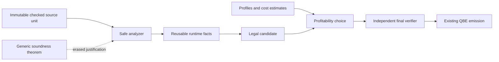

# Phase129: use Bend's semantics to remove compiler work

Research at fork `a4ecad0e2e33944814fbad0b53705c2460e60f8a`, October 23, 2026.
Selected compiler: qualified Phase128 source02, SHA256
`6bd9de05e251180280a6761fa46be30dc2a22164cdb35c9ca48fd710911d0f4d`.
The active upstream pin remains `059266225b77c8ca256ac6b25ee5c21449bab151`;
latest upstream was independently read at `5150fe296f70a918026de20b808d24d2a521a7d7`.
No compiler implementation, language pin or installed selection changed.

**Recommendation: continue QBE throughput work, change how we retain semantic
facts, and introduce one small proved analysis boundary.** A wholesale typed-IR
rewrite or GPU compiler is not justified yet. We are mostly implementing a
conventional compiler in Bend, but Phase128 borrowing genuinely uses the
language/runtime ownership model. The largest underused capability is proving
and reusing a *general analysis algorithm*, rather than independently rebuilding
its answers in several optimization passes.

[Language and proofs](language-and-proofs.md) ·
[Selected-code audit](selected-compiler-audit.md) ·
[Runtime and parallelism](runtime-parallelism.md) ·
[Profiler audit](profiler-audit.md) ·
[Optimization ranking and ambition ladder](qbe-opportunities.md) ·
[Measurements and reproduction](../../implementation/phase129/README.md).

## The five deepest ideas and their practical meaning

1. **Restrict live duplication instead of imposing the usual universe and
   positivity restrictions.** Bend combines `Type : Type`, negative datatypes
   and dependent types with a live/dead distinction and restrictions on copying
   live functions. That is the most unusual theoretical choice. It does not
   make arbitrary type computations terminate, make unsafe code safe, or make
   our generated machine code correct. The checked live fragment has the
   termination/consistency argument; the compiler must preserve its premises.
2. **Duplicability is part of the type/kind system.** Reusable Data and affine
   functions/resources have different contracts. A strict data value can be
   certified once and then shared; this is not a promise that it is physically
   unique. Lowering must preserve evaluation-once and ownership boundaries.
   Phase128 won by avoiding ownership work while an existing owner kept data
   alive, not by assuming reference counts were unnecessary.
3. **Executable specifications and proofs can constrain implementation changes.**
   The useful unit is an exact theorem about a helper or transformation and a
   checked bridge to the code actually used. The upstream kernel itself proves
   optimized substitution equal to a simpler specification, and indexed lookup
   equal to first-match list lookup. This is a better model for our next change
   than merely increasing the number of finite law tests.
4. **Erased dependent evidence can separate justification from execution.**
   A verified analyzer can produce runtime facts, while its correctness theorem
   is erased. This can make an optimization contract stronger without executing
   a proof for every node. It cannot erase the cost of discovering facts about
   an unknown input, or safely retain a fact after the input changed.
5. **Affine evaluation and structured fork/join are co-designed with a common
   CPU/GPU runtime.** This supports parallel algorithms without a second shader
   implementation. It still requires explicit independent, balanced work and
   compatible backend/runtime support. Our selected QBE path is sequential.

These explanations and limitations are grounded in exact checker, kernel,
guide, Base, runtime and paper-source locations in the linked audits. The
author-maintained [BendTT](../../bend2/docs/BendTT/main.typ) and
[BendRT](../../bend2/docs/BendRT/main.typ) sources were preferred over extracting
PDF text. Neither metatheory nor a published GPU result is a Bend compiler
throughput measurement.

## Two rankings, and actual use

Ranks are judgments for this project, not claims of invention. Lower is higher.
“Importance” means potential leverage for a reliable, fast self-hosted compiler.

| Property | Novelty rank | Compiler importance rank | Selected Phase128 use |
| --- | ---: | ---: | --- |
| Live/dead discipline with single universe and negative datatypes | 1 | 7 | Language supported; selected compiler largely opts out of live descent via `@unsafe` |
| Data/Type quantities and certify-once strict evaluation | 2 | 2 | Used extensively; borrowed querying and information preservation remain underexploited |
| One-source affine CPU/GPU fork/join runtime | 3 | 6 | Not exploited by qualified QBE; mature C has earlier bounded multicore evidence |
| Explicit small proof-checking workflow with independent BendTT check | 4 | 3 | Real historical local proofs; recent optimizer's legality mostly executable checks/tests |
| Quantity-polymorphic containers and restricted higher-order values | 5 | 8 | Generic Base and quantities used; closure/static-call distinction worth preserving |
| Erased dependent invariants and proof-carrying interfaces | 6 | 1 | Barely used for the compiler's own representations; plans are ordinary records |
| Type/ownership-directed reclamation and borrowed observations | 7 | 4 | Effectively exploited in several generated-code paths; many compiler traversals still consume data |
| Closed template specialization | 8 | 5 | Used and supported; cached instance/fact reuse needs measurement before more specialization |
| Stack-safe continuation runtime with optimized local regions | 9 | 9 | Essential and effective, but generic transitions still cost work; not unique to Bend |

The practical top three are therefore **reusable semantic facts, ownership-aware
queries, and narrow proof bridges**. The most unusual theory is useful context,
but it is not automatically the fastest way to remove today's bottleneck.

## What we actually use, and what we do not

The selected assembled compiler contains 6,159 definitions, 6,020 `@unsafe`
annotations and 680 `law` declarations. Those 680 signatures contain no equality
propositions; they are not 680 proved optimization laws. There are 267 own
datatype declarations, none parameterized. `KDef` stores an unrelated type term
and value term; `NO_Plan`, `P128BRHelper` and `P113ACertificate` store ordinary
lists, names, errors and Bools. This is useful executable verification, but it
does not make inconsistent combinations unrepresentable.

This does not erase past proof work. Phase94–98 contain actual independent
kernel checks of safe helpers and models. Current comparator/tag/permission
declarations still match relevant previously proved extractions after the
documented normalization. There is no new Phase128 whole-compiler proof receipt.
The [audit](selected-compiler-audit.md) distinguishes these exact scopes.

The vocabulary should stay precise:

| Evidence | Meaning |
| --- | --- |
| `law f: ... Result` | A type/interface declaration; it need not state a theorem |
| Checked implementation | Passes the selected checker's rules and explicit unsafe allowances |
| Mathematical proof | A live term of the stated proposition in the admitted safe fragment |
| Independent BendTT acceptance | The translated intended body and dependencies pass, with no excluded roots; translation remains a trust boundary |
| `@unsafe` or modeled native/foreign implementation | An explicit boundary not covered by the source theorem's ordinary live-body claim |
| Finite predicate, structural admission, ABI oracle | Valuable executable evidence, not universal semantic preservation |
| Exact self-reproduction | A reproducibility/correctness gate; not proof of all compiled programs or recursive improvement |

“Certified field template” in the current experimental terminology means
checked structural admission plus independent ABI tests and audit. It does not
mean that the template has a BendTT machine-semantics theorem.

Latest upstream adds a useful [equality adequacy theorem](https://github.com/bendlang/bend/commit/b8664b0a7ff36858b353fdbee77e41a3dd3548db):
under its checked-book/closed/live premises, an equality proof implies
convertible endpoints. Our active kernel predates it. This is worth considering
when extending the proof workflow, but updating the language/kernel and
requalifying the compiler is a separate task. Opaque model equality still does
not prove that a foreign implementation or QBE lowering implements the model.

## What the fresh profiles change

We reused the qualified N1 object and existing profiler, rather than building
another compiler. Three frozen requests passed 55 exact-output observations
across clean, physical-sample, context and event modes. Target execution and a
small diagnostic runtime relink cost about two guarded minutes in total.

- All three requests execute **1,087,899 decimal-parser entry segments** and
  **324,069 number-reader entry segments**. This is identical fixed preparation
  work despite different user sources. Decimal-related active contexts take
  38.84% of the closures diagnostic, 10.47% of lexer and 8.74% of Map.
- `nq_uses` plus its list helper occupy **10.97% of Map active contexts**, with
  565,251 and 750,375 observed entry-segment dispatches respectively. Lexer has
  little of this work. A whole-program gain cannot be inferred from Map alone.
- `String.order` occupies **7.25% lexer / 9.29% Map** active contexts. Existing
  borrowed comparison still crosses a product/projection boundary.
- Authenticating the physical libc samples identifies register-copy work:
  copy plus exclusive `p111_set_regs` leaves account for **9.25–12.78%** of
  original-image CPU exposure. Clearing is already zero; Phase127's repair
  is not another available optimization.
- Physical reclamation remains **11.73–24.28%**; allocator leaves are only
  **1.40–1.94%**. Removing allocations is useful when it also removes traversal,
  ownership and transport, not because allocation count alone predicts time.

These views overlap. Active dispatch is not inclusive call ancestry. Context
instrumentation adds roughly 10–17% wall time in single overhead observations;
counters add 62–77%. Diagnostic percentages are hypothesis exposures, not clean
speedups. The fresh run did not remeasure upstream or the full compiler input.
The report preserves physical and diagnostic evidence separately.

## The three strongest directions

### A. Prove an analysis once, compute it once, reuse its results

Introduce a narrow immutable `RequestFacts` or private-region plan **only at a
boundary with two real consumers**. Bind facts to exact checked input, revision,
callee/layout environment and relevant policy. Store executable answers; erase
the generic soundness proof. Reuse them for legality and emission, while keeping
profitability separate. Do not build a new global cache or revalidate an entire
graph for every lookup.

The best first performance candidate is a 0/1/many usage summary for repeated
queries. The smallest proof candidate is the actual borrowed-field admission
checker accepting only the intended width/layout/import pattern. These test
different claims: analysis reuse can speed compilation, while the latter closes
a small legality gap. Neither entails concrete heap correctness by itself.

This is a proposed narrow interface. Profiling does not authorize a rewrite;
the theorem does not replace the final machine/runtime correctness boundary.

### B. Remove complete transport/ownership computations

Keep a known read-only computation in a private, stack-safe region from input
through scalar result: held roots, borrowed fields, typed locals, helper calls,
local continuations and final ownership transfer. Avoid returning a boxed
product just to project it or copying live scalar state through the generic
register bank at every step. Use the measured decoder, String ordering or a
compiler AST query as the first discriminator; require unrelated transfer.

The missing abstraction is not “an IR” in general—we already have several.
It is a sufficiently persistent contract connecting values, ownership, effects
and control flow across the boundaries where current passes lose it.

### C. Stage fixed compiler state and deterministic work units

Prepared Base is already cached, but each process decodes a text carrier and
reconstructs state. A new bounded carrier or compiler-produced static seed can
remove that entire category of work. For longer-term scalability, resolved
identities and immutable function units can support exact query reuse,
deterministic independent lowering and later parallel execution.

Start sequentially. The current QBE runtime rejects multiple workers, and the
Phase128 ordinary RFC-load template relies on that premise. Parallelizing it is
an ABI/memory-order project, not a command-line toggle. Test a balanced analysis
through the existing C backend first. GPU execution of pointer-heavy irregular
compiler work has no demonstrated advantage here.

## Comparison with conventional implementation languages

| Language | What Bend changes—and what it does not solve |
| --- | --- |
| C/C++ | Bend provides quantities and proof terms in the implementation language; C/C++ need separate ownership/formal tools. Both still need correct machine lowering, representations and fast algorithms. |
| Rust | Rust has more developed lexical borrowing/lifetime tooling and can make many ownership mistakes unrepresentable. Bend's dependent laws can express semantic equivalence, but affine syntax is not a replacement for Rust-style lifetime proofs or runtime alias analysis. |
| OCaml | GC and algebraic types make compiler construction straightforward. Bend exposes reclamation/duplication and can target its common GPU runtime, at the cost of more ownership-sensitive code. Ordinary boxed-tree algorithms do not become faster merely by translation. |
| Haskell | Laziness, rewrite rules and fusion provide established ways to eliminate intermediate structures. Bend is strict and restricts copying live closures; preserving evaluation-once and closed specialization is therefore essential. |
| Lean | Already combines implementation, proofs, erasure and sophisticated ownership optimization. Bend's distinguishing combination is its affine live/dead theory and common CPU/GPU runtime—not the invention of verified programming. |
| Idris2 | Quantitative/dependent programming is established prior art. Bend's at-most-once rule, restricted Data duplication and operational implementation differ; do not treat all quantity systems as interchangeable. |

Primary comparisons: [Rust borrowing](https://doc.rust-lang.org/book/ch04-02-references-and-borrowing.html),
[OCaml GC](https://ocaml.org/docs/garbage-collection),
[GHC rewrite rules and list fusion](https://ghc.gitlab.haskell.org/ghc/doc/users_guide/exts/rewrite_rules.html).
Lean/Idris references and exact quantity distinctions are in the language audit.

No source-grounded evidence establishes that a compiler in Bend must beat these
languages. The plausible advantage is an inexpensive, source-connected
specification/optimization loop with useful ownership facts—not a speed theorem.

## Attractive ideas to defer

- Full compiler correctness first: too broad; start with one actual fast helper
  or plan validator, including its bridge to selected code.
- A dependent type on every existing AST node: risks larger terms, slower
  checking, awkward unsafe adapters and more duplicated work before any win.
- Free optimization from proof erasure: it removes proof execution, not runtime
  analysis, alias checks or the cost of constructing facts.
- Unconditional RC removal from affine types: shared Data disproves it.
- Automatic HVM superposition, optimal reduction or deforestation: those are
  not provided by the current Bend2/QBE architecture.
- QBE multicore/GPU now: requires real runtime work and requalification of
  sequential assumptions; no GPU-specific compiler workload evidence.
- A new general profiler/search framework: existing tools already identify
  useful work. Add bounded provenance/width data only when a specific decision
  needs it, then perform a causal experiment.

Taelin's author-maintained [launch material](https://github.com/VictorTaelin/bend2-landing/blob/main/index.html)
illustrates the laws/proof workflow; it is historical and includes obsolete
installation/kernel paths. Direct recent X posts were not reliably retrievable
in this research. Search mirrors were treated as leads, not technical evidence.
The source, maintained guide and checked proof boundaries take precedence over
promotional speed or “no mistakes” language.

The practical change is to make the next optimization **an executable semantic
contract with one precise theorem and a measured cost**, then reuse it. That is
a more ambitious and testable Bend-native direction than another independent
recognizer, while preserving the working QBE compiler and fast experiment loop.
