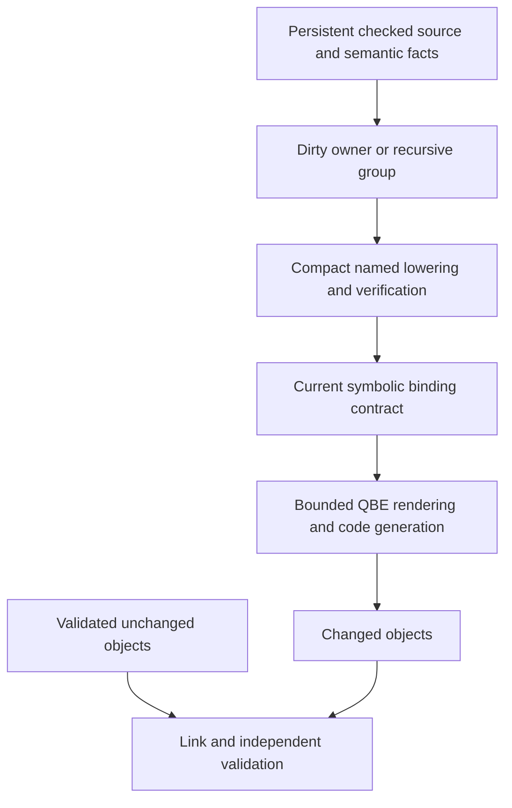

# Phase133 — A Zig-informed architecture for fast Bend compilation

Research at `d636752`, 2026-10-24. [Zig incrementality](zig-incremental.md) ·
[Zig IR/layout](zig-ir.md) · [Bend source audit](bend-opportunities.md) ·
[Derived size bounds](unit-bounds.json).

**Zig supports a substantially more ambitious target than Phase132's object
cache. The useful architecture is a persistent database of checked semantic
facts, with compact, disposable function IR and work proportional to the edit.**
The first implementation should retain QBE and the existing optimization semantics.
We do not need a new machine backend to test that architecture.

This investigation reads checksum-verified official Zig 0.17.0 source, revisits
our qualified Bend source, and derives additional bounds from the frozen census.
No Zig binary was installed or benchmarked. No Bend compiler, runtime, production
selection or qualification changed. Published Zig timings are demonstrations on
other hardware; proposed Bend gains remain hypotheses.

## Are the seconds and milliseconds real?

Yes, with meaningful scope distinctions:

| Primary observation | What was timed | What it does not establish |
|---|---|---|
| June 2025: compiler 13.8 → 10.0 s after parallel native codegen | A Zig compiler build, excluding LLVM library linking; peakRSS1.08 → 1.35 GB | Universal optimized build time, our hardware, or tiny total IR. |
| May 2026:36 s initially, then228–288 ms | Native Debug compiler updates in a persistent `--watch -fincremental` process | Each exact edit is absent from the textual log; LLVM capability in the resulting compiler does not mean LLVM generated it. |
| July 2026: Fizzy about5 s initially, then50–70 ms | Actual local application edits in a persistent compiler | Cold starts, arbitrary interface-wide edits, release optimization, or complete disk-state restoration. |

Sources: [official 2025 devlog](https://ziglang.org/devlog/2025/#parallel-self-hosted-code-generation),
[official 2026 devlog](https://ziglang.org/devlog/2026/), and
[the implementation author's internals article](https://mlugg.co.uk/posts/incremental-compilation-internals/).
The companion audit separates those dates from the pinned0.17 source. Its
limitations include incomplete external C-input update handling; LLVM object
emission remains a separate expensive step. These do not negate the architecture,
but they rule out treating every build as the demonstrated fast path.

Our measured369 s native request is a complete fresh request with optimization,
verification and materialized output. A fair comparison needs the same edit
class, cache/process state, optimization quality, hardware budget and validation
scope. Nonetheless, the Zig evidence shows that millisecond semantic rebuilds
are an engineering result, not an inherently impossible ambition.

## The strongest new conclusion: do not retain a whole-program output graph

Phase132 asked how much of a 107 MB textual product could be removed. Zig suggests
a more powerful question: **why should every expanded representation be alive
at once, or be rebuilt at all for a local edit?**

Zig keeps immutable syntax-level ZIR per source file, shared canonical facts in
InternPool, and separate typed AIR for each function. Codegen consumes function
AIR and releases it. Native machine representation is transient too. Its own
source describes MIR commonly 20× AIR and an observed worst case 50×, so a bounded
codegen queue throttles the producer. This is a scheduling heuristic, not a hard
RSS cap; even its instruction accounting differs from physical AIR storage.
[Exact definitions, lifetimes and caveats](zig-ir.md).

For our **unchanged qualified Bend compiler**:

- Whole textual QBE: **107,059,385 bytes**.
- Largest individual QBE function: **171,719 bytes**, about172 KB.
- Largest attributed source-owner group: **2,130,828 bytes** (`ni_template`).
- Data declarations: **4,626,796 text bytes**, which need their own streaming or
  chunking contract. The unknown-origin bucket is not a single owner.

These are actual static census results, not a new performance experiment.
[Reproducible derivation](../../selfhost/tools/performance/phase133/unit-bounds.py).
The whole file is 623× larger than its largest function. Thus **less than 1 MB of
live rendered function text is a plausible first target without reducing the
compiler's functionality or deleting instructions**. That counts text bytes;
linked-character storage could still use roughly 2.75 MB of fields for that
171,719-byte function, before temporary copies. A packed implementation must
establish the actual memory bound.
It does not mean total
compiler RSS, all checked facts or total logical IR fits in 1 MB. Owner-level
optimization may require several functions together; the largest current group
exceeds1 MB and is a useful explicit exception.

There is an additional practical finding: **QBE already supports this lifetime
pattern.** Its pinned1.3 `main.c` calls a function callback that runs optimization,
emits machine assembly and calls `freeall()`. Its parser accepts stdin, and data
output is also callback-driven. Source lines42–49,54–121 and204 are pinned in
[unit-bounds.json](unit-bounds.json). We can initially stream verified function
text to QBE or to bounded object units. Replacing QBE merely to stop constructing
one enormous Bend String graph would attack the wrong boundary.

Keep the existing preflight/final verification obligations. If later errors can
occur during unit emission, write only temporary artifacts and publish a complete
executable after all gates pass. Streaming does not permit observable partial
success or bypassing whole-program checks.

## Compact IR means compact physical storage and canonical identities

Zig's no-safety ZIR/AIR tag and payload columns have a9-byte logical base per
instruction, with variable operands in extra-word arrays and strings stored once.
It does not repeatedly use long human-readable names as instruction identities.
Runtime-safe compiler builds, payloads, spare capacity, indexes and allocators
add memory. [Source layout audit](zig-ir.md).

Applying9 bytes to our 2.294M QBE instruction count would already give 20.65 MB,
**before** payloads. These are different IRs, so this is only an inventory
illustration. It demonstrates why a 1 MB complete equivalent IR is unsupported,
while compact live units can be far smaller than a 107 MB dump.

Our existing native IR is already structured; a new universal SSA is unnecessary.
`N111Value`, `N111Stmt` and `P113DStmt` repeatedly carry String identities and
nested lists. The verifier stores some identifier facts in general KDef records.
A scoped refactor can replace one such domain with:

```text
SymbolId / ValueId / BlockId / LayoutId
instruction tags + fixed scalar operands
variable-operand side storage
one symbol/debug string table
explicit owned unit lifetime, frozen before verification/publication
```

This must change actual representation and operations. An `Array<large ADT>`
whose fields remain separately boxed can preserve most current cost. Bend's
affine ownership supports an exclusively built buffer followed by immutable
reads, but the runtime/layout contract must establish packed storage and efficient
updates. Keep namespace/pool identity and bounds explicit; equal integers from
different pools are not equal semantic objects.

The earlier [Phase101 packed-String experiment](../../implementation/phase101/README.md)
is a caution: storage alone did not help consistently; construction and consumers
had to change together, and unrelated workloads regressed. Prefer compiler-local
IR/output buffers to another global String representation change. Maintain all
Char semantics outside the controlled ASCII QBE-rendering boundary.

Cold-build gains would come from eliminating name traversal, allocation,
reclamation and repeated fact reconstruction across complete passes. Shorter
QBE spelling alone yielded only 0.65 s in one backend pair. We should measure
allocation and algorithmic work, not infer speed from file size.

## A concrete abstraction mistake found in our selected QBE compiler

This research also exposed a small, specific example of semantic facts being
represented at the wrong layer. The actual qualified QBE image calls
`ni_template` from `nc_native_primitive` and `nd_scalar_known` merely to ask
whether a **C expression template** is empty. Source arity logic also searches
that C template for `$1`. QBE lowering already has its own operation catalogue.
[Exact source and generated-code evidence](primitive-catalogue.md).

A shared primitive descriptor—recognized identity, arity, scalar/result/effect
facts—would let these consumers ask the real question directly. C formatting
would consume the descriptor independently. This is a concrete first semantic
query to consolidate, requiring neither a new IR nor a backend replacement.

The `ni_template` owner contributes2.13 MB of QBE, but that is not a removable-size
or speed claim: other consumers/fallbacks may retain it, and many results are
already static constants. Fresh String allocation on every call is not established.
An exact catalogue prototype with full known/unknown/arity controls is a useful
1–2h falsifier before investing in a wider semantic-query representation.

## Incrementality needs finer dependencies than our object prototype

Go's package/action/content model remains useful. Zig goes further: its analysis
units distinguish types, values, layouts, defaults and function bodies, and its
dependencies include namespace membership and source/comptime facts. Potentially
outdated consumers need not be reanalyzed when the specific result they consumed
is unchanged. It also remaps identities when source instructions move.
[Implementation audit](zig-incremental.md).

For Bend, split these facts instead of hashing the whole book for every unit:

```text
query: definition type | reducible body/value | constructor layout
       ownership/use summary | effects | helper admission/refusal
       literal identity | symbol presence/absence
result: immutable fact + content identity + exact dependencies
unit: owner/SCC + generated continuations/private workers + consumed query IDs
```

A body edit can affect dependent typing even with an unchanged type signature.
Conversely, an unchanged layout fact need not invalidate all layout consumers.
Record negative results too. The current fixed producer, target/runtime ABI,
optimization policy, independent verifier and kernel/checker identity remain
part of the environment.

Phase132's real edit changed 476 functions. Of those, 377 differed only in
recognized numeric copy operands, all observed shifts +12. This implicates static
pool placement. A reusable unit must preserve **literal identity separately from
literal placement**, alongside owner-local continuation identities. Simply
replacing long symbols with global sequential integers can make invalidation
worse. Static-pool capacity/admission also matters: a literal becoming static or
dynamic is a code-generation decision, not merely a relocation. Stable handles also need a defined epoch and remapping/binding policy;
Zig's process-local indices are not magically portable disk-cache keys.

The authoring source already has module manifests, but qualification feeds one
2.67 MB assembled source file to the compiler. Cache the existing parser's results
for authenticated modules/fragments and preserve the assembled order and source
maps initially. A new parser is not required, and replacing concatenation with
imports is not automatically semantics-preserving. The current checked-prefix
reuse is a useful precedent, not permission to reuse arbitrary middle definitions.
[Actual manifest and prefix contracts](bend-opportunities.md).

A **persistent native compiler process** can then keep checked syntax, canonical
IDs, dependency records and summaries across requests. It must handle updates
transactionally and bound retained state; surviving one failed request must not
leave stale facts. Long-lived state alone is insufficient if each update still
reruns the whole pipeline.

## What should remain, what should change

Keep QBE, the trusted semantic gates, current optimization rules and generated
program quality. Cache their results with complete dependencies rather than
silently disabling expensive transformations. A global optimization-rule edit
may legitimately invalidate much of the compiler; warm local-edit speed cannot
be promised for that edit class.

Change the unit of work and ownership of intermediate state:



Independent final verification remains initially. Later, a separately justified
composition check can validate unchanged unit certificates plus current
cross-unit contracts. A narrow BendTT law about resolution or unaffected query
updates can support that boundary, but neither an artifact hash nor a local
lemma proves the whole compiler correct.

This is a targeted architectural refactor across existing boundaries. It is
larger than a name-shortening patch, and stronger than another generic object
cache. It does not require redesigning every optimization pass at once.

## Opportunities, experiment order and estimates

The largest long-term speed opportunity is semantic reuse; bounded unit
lifetimes are the cheaper first experiment that establishes its physical boundary.
The ranges below are **engineering targets or conditional estimates**, not
predicted measured gains. Prototype time excludes broad generalization and
release qualification. Benefits overlap and cannot be multiplied blindly.

| Priority | Change | Potential scale / measurable target | First decisive experiment |
|---|---|---|---|
|1| Sealed emission plan, bounded render/consume lifetime | Live encoded function-text payload107 MB → under 1 MB is structurally plausible; peak request RSS 2.9 GB → roughly 1–1.5 GB is a hypothesis. Cold speed is unknown. |2–4 h: stream existing verified functions with exact QBE comparison; count retained bytes and total request cost. |
|2| Interned IDs and physically compact existing native IR | Target2–5× less memory for the selected IR/query domain. Broadly addressing repeated traversals could support1.5–3× cold-request improvement, but that range is speculative. |4–8 h: one real name/verification/lowering domain; charge indexing, construction and destruction as well as queries; inspect layout. |
|3| Persistent fact-sensitive semantic reuse and owner-local binding | First target 10–30 s warm local edits; then1–5 s.10–100× local-edit speedups are plausible only when dirty work and fixed gates permit them. |4–8 h first cached lowering-unit hit with a full-reference comparison; more staged campaigns for a reliable persistent compiler. |
|4| Earlier demand-driven selection of private implementations | Audited9.07 MB unrooted private text; avoid its preparation as well as rendering if selection can move earlier. Whole-time benefit unmeasured. |2–4 h closed-image discriminator with explicit indirect roots and unchanged fallback semantics. |
|5| Bounded parallel unit compilation, later incremental linking | Useful after units are independent. Eliminating today's entire machine stage alone saves only~3.5% of the loop. |1–2 h frozen-unit scheduling experiment; defer a custom linker until it dominates warm-edit latency. |

The 1.5–3× cold target is deliberately ambitious and low-confidence. Current
profiles do not isolate enough disjoint removable work to forecast it. For
example, treating reclamation 29.4% plus borrowed equality 10.0% as completely
removable would give only about1.65× overall speedup. Those leaves do not identify
all their causes, and a representation change may remove less. Gains beyond that
need eliminating additional traversals or unnecessary preparation, not counting
the same samples twice.

An initial streaming result may improve memory substantially with little time
improvement; that would still establish the lifetime boundary but would not
justify a cold-speed claim. Likewise, demand-driven selection must preserve
whole-source checking and all reachable effects/closures/fallbacks; Zig's lazy
language semantics cannot simply replace Bend's existing acceptance rules.

## Ambition ladder and falsification

**1×: remove the first whole-program materialization barrier.** Produce existing
verified output with bounded buffers, then integrate compact local identities
without per-token String lookup. Preserve byte-identical QBE where possible and
machine equivalence where spelling changes. Measure the complete native request,
not only backend time. This is the cheapest foundation for the larger change.

**10×: make edit cost follow changed semantics.** Keep a qualified producer alive;
reuse checked syntax and fact-specific queries; re-lower dirty owner groups;
render only dirty artifacts. Aim for 10–30 s first, then low single-digit seconds.
Use a suite containing no-op, constant change, private body, reducible body,
layout change, added/missing symbol, optimizer policy and runtime/producer change.
Compare against fresh reference builds and include invalidation explanations.

**100×: near-interactive compiler research.** Target 50–500 ms for genuinely local
edits only after global parse/check/verification and relink floors are bounded.
This likely needs reusable independently checked unit certificates and ultimately
incremental linking. It is a longer-term architecture target demonstrated in
another compiler, not a promised Bend delivery time. Global optimizer changes,
full independent checks and new compiler adoption still have separate costs.

The implementer's traced37 ms Zig update spends roughly 31 ms resolving global
references, despite about 1.2 ms semantic analysis and tiny codegen/link work.
That is the relevant warning: once dirty work becomes small, global housekeeping
becomes the floor. Removing our 369 s full request but retaining a 5.48 s independent
whole-book check cannot produce a 50 ms validated edit. Preserve that check in the
first prototype; later justify reuse rather than quietly omitting it.

A practical break-even measure is:

```text
experiment cost = initial acquisition / useful edits per epoch
                + per-edit checking, invalidation, compilation, link and validation
                + qualification / useful edits per qualified integration
```

Adopting a modified compiler changes the producer epoch and can invalidate cached
products. Repeated self-compilation alone does not demonstrate recursive research
acceleration. Measure useful validated changes per total research budget.

## Recommended next work

Pursue one coherent experiment: **a reusable verified owner unit with bounded
physical representation and rendering**, starting with the output-lifetime
boundary so the first change has independent memory value. Add interned identity
for the same unit, then reuse it across controlled edits under one fixed producer.

Do not spend the next cycle chasing a 1 MB whole compiler file, writing a new
backend, or speeding up a Python postprocessor. The stronger objective is a
small live unit, little dirty work, and no repeated whole-program reconstruction.
The Zig evidence makes that a credible direction; the Bend experiments must
establish its actual speed and correctness incrementally.
